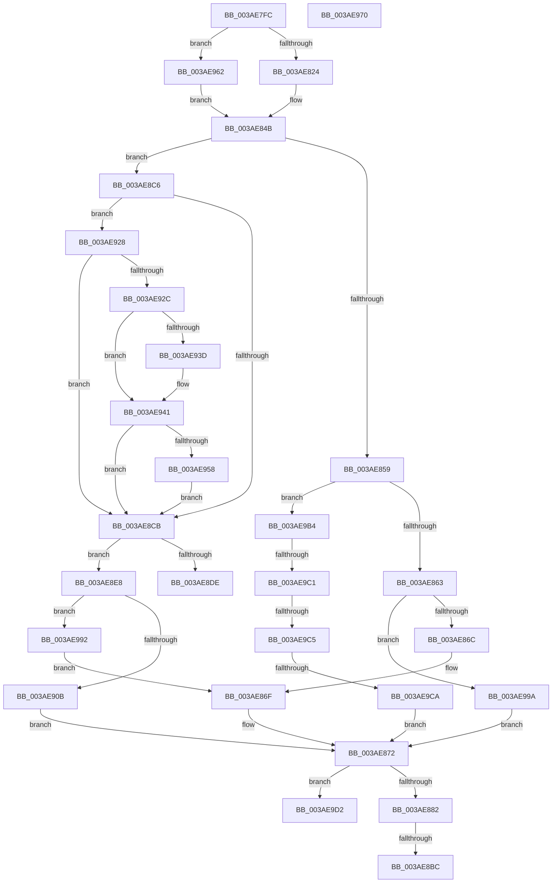

# sub_003AE7FC

- RVA: `0x003AE7FC`–`0x003AE9E5` (길이 `489` bytes)
- VA: `0x00000001403AE7FC`
- 실행 섹션: `.text`
- PDB 이름 있음: `아니요`; PDB Function 태그: `아니요`
- unwind 정보 RVA: `0x0008C050`
- 디코드: `137`개 명령, `489/489` bytes 표시
- 미해석 바이트: `0` (있으면 어셈블리에 `.byte`로 보존)

> 이 문서는 커널 이미지의 기계어와 PDB 기호를 분석해 생성했습니다. 4번과 5번은 함수 원형과 자료형을 바이너리 사용 방식에서 추정한 C 해석이며 원본 소스 복구 결과는 아닙니다.

## 1. Dependencies

- 직접 호출 지점: **5**; 고유 호출 대상: **4**
- 직접 호출자로 확인된 함수: **0**
- RIP 상대 이미지 참조: **0**

### Outgoing calls
- `0x003AE82A` → [B_TREE<unsigned long,ST_STORE<SM_TRAITS>::_ST_HASH_ENTRY,4096,NP_CONTEXT,ST_STORE<SM_TRAITS>::ST_HASH_ENTRY_COMPARATOR>::BTreeRedistribute](B_TREE_unsigned_long_ST_STORE_SM_TRAITS__ST_HASH_ENTRY_4096_NP_CONTEXT_ST_STORE_SM_TRAITS_ST_HASH_EN_function_003AECFC.md) (function, `0x003AECFC`)
- `0x003AE8BC` → [NP_CONTEXT::NpLeafDerefInternal](NP_CONTEXT_NpLeafDerefInternal_function_003A9A70.md) (function, `0x003A9A70`)
- `0x003AE8D1` → [B_TREE<unsigned long,ST_STORE<SM_TRAITS>::_ST_HASH_ENTRY,4096,NP_CONTEXT,ST_STORE<SM_TRAITS>::ST_HASH_ENTRY_COMPARATOR>::BTreeSplitChild](B_TREE_unsigned_long_ST_STORE_SM_TRAITS__ST_HASH_ENTRY_4096_NP_CONTEXT_ST_STORE_SM_TRAITS_ST_HASH_EN_function_003AF610.md) (function, `0x003AF610`)
- `0x003AE958` → [NP_CONTEXT::NpLeafDerefInternal](NP_CONTEXT_NpLeafDerefInternal_function_003A9A70.md) (function, `0x003A9A70`)
- `0x003AE981` → [memcpy](../6C/memcpy_function_006C6840.md) (function, `0x006C6840`)

### Direct callers
- 이 함수 시작 RVA로 연결되는 직접 call은 확인되지 않았습니다. 간접 호출은 완전히 역산할 수 없습니다.

### Static image references
- 디코드된 RIP-relative 메모리 참조가 없습니다.

## 2. Other-region calls and transfers

- 다른 실행 섹션으로 향하는 call: **0**
- call이 아닌 외부 분기/꼬리 이동: **8**
  - `0x003AE8B6` → [sub_003AE727 + 0x23](Unknown_function_003AE727.md) (`tail-transfer`)
  - `0x003AE8C1` → [sub_003AE727 + 0x23](Unknown_function_003AE727.md) (`tail-transfer`)
  - `0x003AE8E3` → [sub_003AE727 + 0x60](Unknown_function_003AE727.md) (`tail-transfer`)
  - `0x003AE98D` → [sub_003AE727 + 0x5A](Unknown_function_003AE727.md) (`tail-transfer`)
  - `0x003AE9BF` → [sub_003AE9EF + 0xD](Unknown_function_003AE9EF.md) (`tail-transfer`)
  - `0x003AE9C3` → [sub_003AE9EF](Unknown_function_003AE9EF.md) (`tail-transfer`)
  - `0x003AE9C8` → [sub_003AE9EF + 0x1E](Unknown_function_003AE9EF.md) (`tail-transfer`)
  - `0x003AE9E0` → [sub_003AE727 + 0x23](Unknown_function_003AE727.md) (`tail-transfer`)

## 3. Assembly (complete function range)

```asm
003AE7FC  4C 8B 67 08                     mov r12, qword ptr [rdi + 8]
003AE800  4C 2B E3                        sub r12, rbx
003AE803  C1 E9 18                        shr ecx, 0x18
003AE806  49 83 EC 10                     sub r12, 0x10
003AE80A  49 8B C4                        mov rax, r12
003AE80D  49 C1 FC 02                     sar r12, 2
003AE811  48 C1 F8 04                     sar rax, 4
003AE815  84 C9                           test cl, cl
003AE817  44 0F 44 E0                     cmove r12d, eax
003AE81B  49 3B 1E                        cmp rbx, qword ptr [r14]
003AE81E  0F 84 3E 01 00 00               je 0x1403ae962
003AE824  48 8B D6                        mov rdx, rsi
003AE827  49 8B CE                        mov rcx, r14
003AE82A  E8 CD 04 00 00                  call 0x1403aecfc
003AE82F  4C 8B 4F F8                     mov r9, qword ptr [rdi - 8]
003AE833  4C 8B D0                        mov r10, rax
003AE836  49 F7 D2                        not r10
003AE839  4C 8B C0                        mov r8, rax
003AE83C  41 83 E2 01                     and r10d, 1
003AE840  49 C1 E2 05                     shl r10, 5
003AE844  49 83 C2 F0                     add r10, -0x10
003AE848  4D 03 D1                        add r10, r9
003AE84B  8B 03                           mov eax, dword ptr [rbx]
003AE84D  8B C8                           mov ecx, eax
003AE84F  C1 E9 18                        shr ecx, 0x18
003AE852  0F B7 D0                        movzx edx, ax
003AE855  3B D5                           cmp edx, ebp
003AE857  73 6D                           jae 0x1403ae8c6
003AE859  41 F6 C0 01                     test r8b, 1
003AE85D  0F 85 51 01 00 00               jne 0x1403ae9b4
003AE863  44 3B E2                        cmp r12d, edx
003AE866  0F 8F 2E 01 00 00               jg 0x1403ae99a
003AE86C  4D 8B CA                        mov r9, r10
003AE86F  41 8B D4                        mov edx, r12d
003AE872  48 89 1F                        mov qword ptr [rdi], rbx
003AE875  48 63 C2                        movsxd rax, edx
003AE878  44 38 6B 03                     cmp byte ptr [rbx + 3], r13b
003AE87C  0F 84 50 01 00 00               je 0x1403ae9d2
003AE882  48 83 C0 04                     add rax, 4
003AE886  49 8D 51 F8                     lea rdx, [r9 - 8]
003AE88A  48 8D 04 83                     lea rax, [rbx + rax*4]
003AE88E  48 89 47 08                     mov qword ptr [rdi + 8], rax
003AE892  48 8B 47 F0                     mov rax, qword ptr [rdi - 0x10]
003AE896  48 8D 48 10                     lea rcx, [rax + 0x10]
003AE89A  48 83 C0 08                     add rax, 8
003AE89E  4C 3B C9                        cmp r9, rcx
003AE8A1  49 8D 4E 10                     lea rcx, [r14 + 0x10]
003AE8A5  48 0F 46 D0                     cmovbe rdx, rax
003AE8A9  4D 85 F6                        test r14, r14
003AE8AC  49 0F 44 CD                     cmove rcx, r13
003AE8B0  48 8B 01                        mov rax, qword ptr [rcx]
003AE8B3  83 38 FF                        cmp dword ptr [rax], -1
003AE8B6  0F 84 8E FE FF FF               je 0x1403ae74a
003AE8BC  E8 AF B1 FF FF                  call 0x1403a9a70
003AE8C1  E9 84 FE FF FF                  jmp 0x1403ae74a
003AE8C6  4D 85 C0                        test r8, r8
003AE8C9  75 5D                           jne 0x1403ae928
003AE8CB  48 8B D6                        mov rdx, rsi
003AE8CE  49 8B CE                        mov rcx, r14
003AE8D1  E8 3A 0D 00 00                  call 0x1403af610
003AE8D6  48 8B C8                        mov rcx, rax
003AE8D9  48 85 C0                        test rax, rax
003AE8DC  75 0A                           jne 0x1403ae8e8
003AE8DE  B8 9A 00 00 C0                  mov eax, 0xc000009a
003AE8E3  E9 9F FE FF FF                  jmp 0x1403ae787
003AE8E8  8B 7E 18                        mov edi, dword ptr [rsi + 0x18]
003AE8EB  8B 03                           mov eax, dword ptr [rbx]
003AE8ED  FF CF                           dec edi
003AE8EF  48 C1 E7 04                     shl rdi, 4
003AE8F3  48 03 3E                        add rdi, qword ptr [rsi]
003AE8F6  44 0F B7 C0                     movzx r8d, ax
003AE8FA  4C 8B 4F F8                     mov r9, qword ptr [rdi - 8]
003AE8FE  49 8D 51 10                     lea rdx, [r9 + 0x10]
003AE902  45 3B E0                        cmp r12d, r8d
003AE905  0F 8E 87 00 00 00               jle 0x1403ae992
003AE90B  45 2B E0                        sub r12d, r8d
003AE90E  48 89 57 F8                     mov qword ptr [rdi - 8], rdx
003AE912  C1 E8 18                        shr eax, 0x18
003AE915  48 8B D9                        mov rbx, rcx
003AE918  84 C0                           test al, al
003AE91A  41 8D 54 24 FF                  lea edx, [r12 - 1]
003AE91F  41 0F 45 D4                     cmovne edx, r12d
003AE923  E9 4A FF FF FF                  jmp 0x1403ae872
003AE928  84 C9                           test cl, cl
003AE92A  74 9F                           je 0x1403ae8cb
003AE92C  48 8B 4F F0                     mov rcx, qword ptr [rdi - 0x10]
003AE930  49 8D 52 F8                     lea rdx, [r10 - 8]
003AE934  48 8D 41 10                     lea rax, [rcx + 0x10]
003AE938  4C 3B D0                        cmp r10, rax
003AE93B  77 04                           ja 0x1403ae941
003AE93D  48 8D 51 08                     lea rdx, [rcx + 8]
003AE941  4D 85 F6                        test r14, r14
003AE944  49 8D 4E 10                     lea rcx, [r14 + 0x10]
003AE948  49 0F 44 CD                     cmove rcx, r13
003AE94C  48 8B 01                        mov rax, qword ptr [rcx]
003AE94F  83 38 FF                        cmp dword ptr [rax], -1
003AE952  0F 84 73 FF FF FF               je 0x1403ae8cb
003AE958  E8 13 B1 FF FF                  call 0x1403a9a70
003AE95D  E9 69 FF FF FF                  jmp 0x1403ae8cb
003AE962  4D 8B D5                        mov r10, r13
003AE965  4D 8B C5                        mov r8, r13
003AE968  4D 8B CD                        mov r9, r13
003AE96B  E9 DB FE FF FF                  jmp 0x1403ae84b
003AE970  49 FF C0                        inc r8
003AE973  48 8D 4F 10                     lea rcx, [rdi + 0x10]
003AE977  49 C1 E0 04                     shl r8, 4
003AE97B  4C 2B C7                        sub r8, rdi
003AE97E  4C 03 C3                        add r8, rbx
003AE981  E8 BA 7E 31 00                  call 0x1406c6840
003AE986  41 0F 10 07                     movups xmm0, xmmword ptr [r15]
003AE98A  0F 11 07                        movups xmmword ptr [rdi], xmm0
003AE98D  E9 EF FD FF FF                  jmp 0x1403ae781
003AE992  4C 8B CA                        mov r9, rdx
003AE995  E9 D5 FE FF FF                  jmp 0x1403ae86f
003AE99A  44 2B E2                        sub r12d, edx
003AE99D  4C 89 57 F8                     mov qword ptr [rdi - 8], r10
003AE9A1  84 C9                           test cl, cl
003AE9A3  49 8B D8                        mov rbx, r8
003AE9A6  41 8D 54 24 FF                  lea edx, [r12 - 1]
003AE9AB  41 0F 45 D4                     cmovne edx, r12d
003AE9AF  E9 BE FE FF FF                  jmp 0x1403ae872
003AE9B4  2B D5                           sub edx, ebp
003AE9B6  49 83 E0 FE                     and r8, 0xfffffffffffffffe
003AE9BA  41 03 D4                        add edx, r12d
003AE9BD  84 C9                           test cl, cl
003AE9BF  74 3B                           je 0x1403ae9fc
003AE9C1  85 D2                           test edx, edx
003AE9C3  7E 2A                           jle 0x1403ae9ef
003AE9C5  49 3B D8                        cmp rbx, r8
003AE9C8  74 43                           je 0x1403aea0d
003AE9CA  4D 8B CA                        mov r9, r10
003AE9CD  E9 A0 FE FF FF                  jmp 0x1403ae872
003AE9D2  48 FF C0                        inc rax
003AE9D5  48 C1 E0 04                     shl rax, 4
003AE9D9  48 03 C3                        add rax, rbx
003AE9DC  48 89 47 08                     mov qword ptr [rdi + 8], rax
003AE9E0  E9 65 FD FF FF                  jmp 0x1403ae74a
```

## 4. C-style interpretation (structured pseudocode)

```c
__int64 __fastcall sub_003AE7FC(int a1)
{
    __int64 result;
    __int64 v_r10;
    __int64 v_r12;
    __int64 v_rdi;

    v_r12 = (*(unsigned __int64 *)(v_rdi + 8)) - (v_rbx);
    a1 = (unsigned int)((a1) >> (24));
    v_r12 = (v_r12) - (16);
    v_r12 = (v_r12) >> (2);
    result = (v_r12) >> (4);
    if ((unsigned __int8)(a1) == 0) { v_r12 = (unsigned int)(result); }
    if (v_rbx == (*(unsigned __int64 *)(v_r14))) goto loc_003AE962;
    result = B_TREE_unsigned_long_ST_STORE_SM_TRAITS____ST_HASH_ENTRY_4096_NP_CONTEXT_ST_STORE_SM_TRAITS___ST_HAS(v_r14, v_rsi, a3, a4);
    v_r10 = ~(result);
    v_r10 = (unsigned int)((v_r10) & (1));
    v_r10 = (v_r10) << (5);
    v_r10 = (v_r10) + (-16);
    v_r10 = (v_r10) + (*(unsigned __int64 *)(v_rdi - 8));
loc_003AE84B:
    a1 = (unsigned int)(((unsigned int)((unsigned int)((unsigned int)(*(unsigned int *)(v_rbx))))) >> (24));
    if (((unsigned int)((unsigned __int16)((unsigned int)(*(unsigned int *)(v_rbx))))) >= ((unsigned int)(v_rbp))) goto loc_003AE8C6;
    if ((((unsigned __int8)(result)) & (1)) != 0) goto loc_003AE9B4;
    if (((unsigned int)(v_r12)) > ((unsigned int)((unsigned __int16)((unsigned int)(*(unsigned int *)(v_rbx)))))) goto loc_003AE99A;
loc_003AE86F:
loc_003AE872:
    *(unsigned __int64 *)(v_rdi) = v_rbx;
    if ((*(unsigned __int8 *)(v_rbx + 3)) == ((unsigned __int8)(v_r13))) goto loc_003AE9D2;
    result = ((int)((unsigned int)((unsigned int)((unsigned int)(v_r12))))) + (4);
    *(unsigned __int64 *)(v_rdi + 8) = v_rbx + result * 4;
    result = (*(unsigned __int64 *)(v_rdi - 16)) + (8);
    a2 = v_r10 - 8;
    if (v_r10 <= (*(unsigned __int64 *)(v_rdi - 16) + 16)) { a2 = result; }
    a1 = v_r14 + 16;
    if (v_r14 == 0) { a1 = v_r13; }
    result = NP_CONTEXT__NpLeafDerefInternal(a1, a2, result, v_r10);
loc_003AE8C6:
    if (result != 0) goto loc_003AE928;
loc_003AE8CB:
    result = B_TREE_unsigned_long_ST_STORE_SM_TRAITS____ST_HASH_ENTRY_4096_NP_CONTEXT_ST_STORE_SM_TRAITS___ST_HAS(v_r14, v_rsi, result, v_r10);
    if (result != 0) goto loc_003AE8E8;
loc_003AE8E8:
    v_rdi = (unsigned int)(((unsigned int)(*(unsigned int *)(v_rsi + 24))) - 1);
    v_rdi = (v_rdi) << (4);
    v_rdi = (v_rdi) + (*(unsigned __int64 *)(v_rsi));
    if (((unsigned int)(v_r12)) <= ((unsigned int)((unsigned __int16)((unsigned int)(*(unsigned int *)(v_rbx)))))) goto loc_003AE992;
    v_r12 = (unsigned int)((v_r12) - ((unsigned int)((unsigned __int16)((unsigned int)(*(unsigned int *)(v_rbx))))));
    *(unsigned __int64 *)(v_rdi - 8) = *(unsigned __int64 *)(v_rdi - 8) + 16;
    result = (unsigned int)(((unsigned int)(*(unsigned int *)(v_rbx))) >> (24));
    a2 = v_r12 - 1;
    if ((unsigned __int8)(result) != 0) { a2 = (unsigned int)(v_r12); }
    goto loc_003AE872;
loc_003AE928:
    if ((unsigned __int8)(result) == 0) goto loc_003AE8CB;
    if (v_r10 <= (*(unsigned __int64 *)(v_rdi - 16) + 16)) {
        a2 = *(unsigned __int64 *)(v_rdi - 16) + 8;
    }
    a1 = v_r14 + 16;
    if (v_r14 == 0) { a1 = v_r13; }
    if ((*(unsigned int *)(*(unsigned __int64 *)(a1))) == -1) goto loc_003AE8CB;
    result = NP_CONTEXT__NpLeafDerefInternal(a1, a2, (unsigned __int16)((unsigned int)(*(unsigned int *)(v_rbx))), *(unsigned __int64 *)(v_rdi - 8));
    goto loc_003AE8CB;
loc_003AE962:
    goto loc_003AE84B;
loc_003AE992:
    goto loc_003AE86F;
loc_003AE99A:
    v_r12 = (unsigned int)((v_r12) - ((unsigned int)(a2)));
    *(unsigned __int64 *)(v_rdi - 8) = v_r13;
    a2 = v_r12 - 1;
    if ((unsigned __int8)(a1) != 0) { a2 = (unsigned int)(v_r12); }
    goto loc_003AE872;
loc_003AE9B4:
    a2 = (unsigned int)((a2) - ((unsigned int)(v_rbp)));
    a3 = (v_r13) & (-2);
    a2 = (unsigned int)((a2) + ((unsigned int)(v_r12)));
    goto loc_003AE872;
loc_003AE9D2:
    result = (result) + 1;
    result = (result) << (4);
    result = (result) + (v_r13);
    *(unsigned __int64 *)(v_rdi + 8) = result;
}
```

## 5. (Beta) C Style

```c
int64_t sub_003AE7FC(int32_t Arg1)
{
    int64_t result;
    int64_t local_r10;
    int64_t local_r12;
    int64_t local_rdi;

    local_r12 = (*(uint64_t *)(local_rdi + 0x8)) - (local_rbx);
    Arg1 = (uint32_t)((Arg1) >> (24));
    local_r12 = (local_r12) - (16);
    local_r12 = (local_r12) >> (2);
    result = (local_r12) >> (4);
    if ((uint8_t)(Arg1) == 0) { local_r12 = (uint32_t)(result); }
    if (local_rbx == (*(uint64_t *)(local_r14))) goto loc_003AE962;
    result = B_TREE_unsigned_long_ST_STORE_SM_TRAITS____ST_HASH_ENTRY_4096_NP_CONTEXT_ST_STORE_SM_TRAITS___ST_HAS(local_r14, local_rsi, a3, a4);
    local_r10 = ~(result);
    local_r10 = (uint32_t)((local_r10) & (1));
    local_r10 = (local_r10) << (5);
    local_r10 = (local_r10) + (-16);
    local_r10 = (local_r10) + (*(uint64_t *)(local_rdi - 0x8));
loc_003AE84B:
    Arg1 = (uint32_t)(((uint32_t)((uint32_t)((uint32_t)(*(uint32_t *)(local_rbx))))) >> (24));
    if (((uint32_t)((uint16_t)((uint32_t)(*(uint32_t *)(local_rbx))))) >= ((uint32_t)(local_rbp))) goto loc_003AE8C6;
    if ((((uint8_t)(result)) & (1)) != 0) goto loc_003AE9B4;
    if (((uint32_t)(local_r12)) > ((uint32_t)((uint16_t)((uint32_t)(*(uint32_t *)(local_rbx)))))) goto loc_003AE99A;
loc_003AE86F:
loc_003AE872:
    *(uint64_t *)(local_rdi) = local_rbx;
    if ((*(uint8_t *)(local_rbx + 0x3)) == ((uint8_t)(local_r13))) goto loc_003AE9D2;
    result = ((int32_t)((uint32_t)((uint32_t)((uint32_t)(local_r12))))) + (4);
    *(uint64_t *)(local_rdi + 0x8) = local_rbx + result * 4;
    result = (*(uint64_t *)(local_rdi - 0x10)) + (8);
    a2 = local_r10 - 8;
    if (local_r10 <= (*(uint64_t *)(local_rdi - 0x10) + 16)) { a2 = result; }
    Arg1 = local_r14 + 16;
    if (local_r14 == 0) { Arg1 = local_r13; }
    result = NP_CONTEXT__NpLeafDerefInternal(Arg1, a2, result, local_r10);
loc_003AE8C6:
    if (result != 0) goto loc_003AE928;
loc_003AE8CB:
    result = B_TREE_unsigned_long_ST_STORE_SM_TRAITS____ST_HASH_ENTRY_4096_NP_CONTEXT_ST_STORE_SM_TRAITS___ST_HAS(local_r14, local_rsi, result, local_r10);
    if (result != 0) goto loc_003AE8E8;
loc_003AE8E8:
    local_rdi = (uint32_t)(((uint32_t)(*(uint32_t *)(local_rsi + 0x18))) - 1);
    local_rdi = (local_rdi) << (4);
    local_rdi = (local_rdi) + (*(uint64_t *)(local_rsi));
    if (((uint32_t)(local_r12)) <= ((uint32_t)((uint16_t)((uint32_t)(*(uint32_t *)(local_rbx)))))) goto loc_003AE992;
    local_r12 = (uint32_t)((local_r12) - ((uint32_t)((uint16_t)((uint32_t)(*(uint32_t *)(local_rbx))))));
    *(uint64_t *)(local_rdi - 0x8) = *(uint64_t *)(local_rdi - 0x8) + 16;
    result = (uint32_t)(((uint32_t)(*(uint32_t *)(local_rbx))) >> (24));
    a2 = local_r12 - 1;
    if ((uint8_t)(result) != 0) { a2 = (uint32_t)(local_r12); }
    goto loc_003AE872;
loc_003AE928:
    if ((uint8_t)(result) == 0) goto loc_003AE8CB;
    if (local_r10 <= (*(uint64_t *)(local_rdi - 0x10) + 16)) {
        a2 = *(uint64_t *)(local_rdi - 0x10) + 8;
    }
    Arg1 = local_r14 + 16;
    if (local_r14 == 0) { Arg1 = local_r13; }
    if ((*(uint32_t *)(*(uint64_t *)(Arg1))) == -1) goto loc_003AE8CB;
    result = NP_CONTEXT__NpLeafDerefInternal(Arg1, a2, (uint16_t)((uint32_t)(*(uint32_t *)(local_rbx))), *(uint64_t *)(local_rdi - 0x8));
    goto loc_003AE8CB;
loc_003AE962:
    goto loc_003AE84B;
loc_003AE992:
    goto loc_003AE86F;
loc_003AE99A:
    local_r12 = (uint32_t)((local_r12) - ((uint32_t)(a2)));
    *(uint64_t *)(local_rdi - 0x8) = local_r13;
    a2 = local_r12 - 1;
    if ((uint8_t)(Arg1) != 0) { a2 = (uint32_t)(local_r12); }
    goto loc_003AE872;
loc_003AE9B4:
    a2 = (uint32_t)((a2) - ((uint32_t)(local_rbp)));
    a3 = (local_r13) & (-2);
    a2 = (uint32_t)((a2) + ((uint32_t)(local_r12)));
    goto loc_003AE872;
loc_003AE9D2:
    result = (result) + 1;
    result = (result) << (4);
    result = (result) + (local_r13);
    *(uint64_t *)(local_rdi + 0x8) = result;
}
```

## 6. Execution-region graph

[열기: 2D/3D 그래프와 함수 탐색 컨트롤 패널](../../../control-panel.html?section=text&rva=0x003AE7FC&view=graph)

- 2D 그래프는 위에서 아래로 흐르고, 3D 그래프는 빈 공간을 드래그해 회전합니다. Shift+드래그는 이동, 휠은 확대·축소, 함수 노드 선택은 대상 보고서 이동입니다.

### Static fallback


