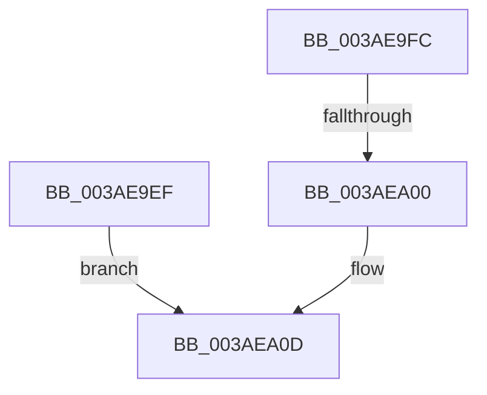

# sub_003AE9EF

- RVA: `0x003AE9EF`–`0x003AEA16` (길이 `39` bytes)
- VA: `0x00000001403AE9EF`
- 실행 섹션: `.text`
- PDB 이름 있음: `아니요`; PDB Function 태그: `아니요`
- unwind 정보 RVA: `0x0008C080`
- 디코드: `14`개 명령, `39/39` bytes 표시
- 미해석 바이트: `0` (있으면 어셈블리에 `.byte`로 보존)

> 이 문서는 커널 이미지의 기계어와 PDB 기호를 분석해 생성했습니다. 4번과 5번은 함수 원형과 자료형을 바이너리 사용 방식에서 추정한 C 해석이며 원본 소스 복구 결과는 아닙니다.

## 1. Dependencies

- 직접 호출 지점: **0**; 고유 호출 대상: **0**
- 직접 호출자로 확인된 함수: **0**
- RIP 상대 이미지 참조: **0**

### Outgoing calls
- 직접 디코드된 call 명령이 없습니다.

### Direct callers
- 이 함수 시작 RVA로 연결되는 직접 call은 확인되지 않았습니다. 간접 호출은 완전히 역산할 수 없습니다.

### Static image references
- 디코드된 RIP-relative 메모리 참조가 없습니다.

## 2. Other-region calls and transfers

- 다른 실행 섹션으로 향하는 call: **0**
- call이 아닌 외부 분기/꼬리 이동: **2**
  - `0x003AE9FE` → [sub_003AE7FC + 0x1C9](Unknown_function_003AE7FC.md) (`tail-transfer`)
  - `0x003AEA11` → [sub_003AE7FC + 0x76](Unknown_function_003AE7FC.md) (`tail-transfer`)

## 3. Assembly (complete function range)

```asm
003AE9EF  41 8B 00                        mov eax, dword ptr [r8]
003AE9F2  49 8B D8                        mov rbx, r8
003AE9F5  0F B7 C8                        movzx ecx, ax
003AE9F8  03 D1                           add edx, ecx
003AE9FA  EB 11                           jmp 0x1403aea0d
003AE9FC  85 D2                           test edx, edx
003AE9FE  79 C5                           jns 0x1403ae9c5
003AEA00  41 8B 00                        mov eax, dword ptr [r8]
003AEA03  FF C2                           inc edx
003AEA05  0F B7 C8                        movzx ecx, ax
003AEA08  49 8B D8                        mov rbx, r8
003AEA0B  03 D1                           add edx, ecx
003AEA0D  4C 89 57 F8                     mov qword ptr [rdi - 8], r10
003AEA11  E9 5C FE FF FF                  jmp 0x1403ae872
```

## 4. C-style interpretation (structured pseudocode)

```c
__int64 __fastcall sub_003AE9EF(__int64 a1, int a2, __int64 a3)
{
    a2 = (unsigned int)((a2) + ((unsigned int)((unsigned __int16)((unsigned int)(*(unsigned int *)(a3))))));
    goto loc_003AEA0D;
loc_003AEA0D:
    *(unsigned __int64 *)(v_rdi - 8) = v_r10;
}
```

## 5. (Beta) C Style

```c
int64_t sub_003AE9EF(int64_t Arg1, int32_t Arg2, void *Arg3)
{
    uint8_t *arg3 = (uint8_t *)Arg3;

    Arg2 = (uint32_t)((Arg2) + ((uint32_t)((uint16_t)((uint32_t)(*(uint32_t *)(arg3))))));
    goto loc_003AEA0D;
loc_003AEA0D:
    *(uint64_t *)(local_rdi - 0x8) = local_r10;
}
```

### 관측된 메모리 오프셋

구조체 형식이 확인되지 않은 접근은 인자 기준의 오프셋으로만 기록했습니다.

| 기준 인자 | 오프셋 표현 | 폭 (bit) | 접근 |
|---|---:|---:|---|
| `Arg3` | `+ 0x0` | `32` | `R` |

## 6. Execution-region graph

[열기: 2D/3D 그래프와 함수 탐색 컨트롤 패널](../../../control-panel.html?section=text&rva=0x003AE9EF&view=graph)

- 2D 그래프는 위에서 아래로 흐르고, 3D 그래프는 빈 공간을 드래그해 회전합니다. Shift+드래그는 이동, 휠은 확대·축소, 함수 노드 선택은 대상 보고서 이동입니다.

### Static fallback


