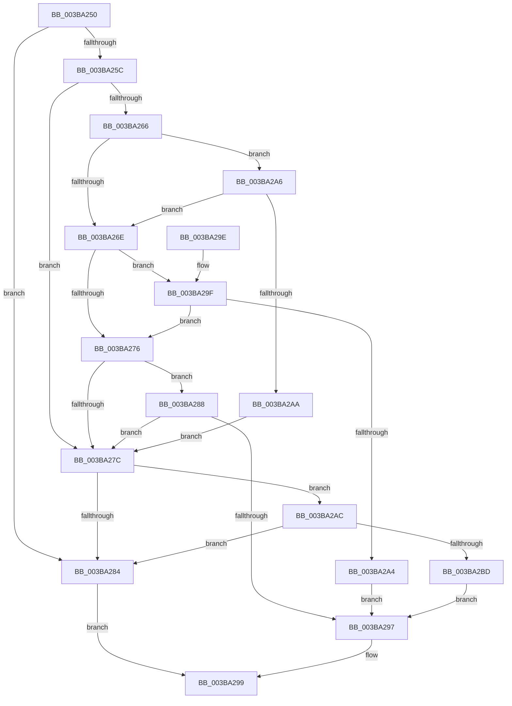

# EtwProviderEnabled

- RVA: `0x003BA250`–`0x003BA2BF` (길이 `111` bytes)
- VA: `0x00000001403BA250`
- 실행 섹션: `.text`
- PDB 이름 있음: `예`; PDB Function 태그: `아니요`
- unwind 정보 RVA: `0x000848A4`
- 디코드: `40`개 명령, `111/111` bytes 표시
- 미해석 바이트: `0` (있으면 어셈블리에 `.byte`로 보존)

> 이 문서는 커널 이미지의 기계어와 PDB 기호를 분석해 생성했습니다. 4번과 5번은 함수 원형과 자료형을 바이너리 사용 방식에서 추정한 C 해석이며 원본 소스 복구 결과는 아닙니다.

## 1. Dependencies

- 직접 호출 지점: **1**; 고유 호출 대상: **1**
- 직접 호출자로 확인된 함수: **21**
- RIP 상대 이미지 참조: **0**

### Outgoing calls
- `0x003BA2B4` → [EtwpLevelKeywordEnabled](../2F/EtwpLevelKeywordEnabled_function_002FD110.md) (function, `0x002FD110`)

### Direct callers
- [EtwTiLogInsertQueueUserApc](EtwTiLogInsertQueueUserApc_function_003B8FC4.md) at `0x003B900E`
- [EtwTiLogInsertQueueUserApc](EtwTiLogInsertQueueUserApc_function_003B8FC4.md) at `0x003B90A1`
- [EtwTiLogInsertQueueUserApc](EtwTiLogInsertQueueUserApc_function_003B8FC4.md) at `0x003B9248`
- [EtwpLogMemNodeInfo](EtwpLogMemNodeInfo_function_003B991C.md) at `0x003B9989`
- [EtwTiLogProtectExecVm](../../page/88/EtwTiLogProtectExecVm_function_00881A48.md) at `0x00881AAB`
- [EtwTiLogProtectExecVm](../../page/88/EtwTiLogProtectExecVm_function_00881A48.md) at `0x00881B2F`
- [EtwTiLogAllocExecVm](../../page/88/EtwTiLogAllocExecVm_function_00882944.md) at `0x0088298B`
- [NtMapViewOfSection](../../page/89/NtMapViewOfSection_function_008986E0.md) at `0x00898A1F`
- [EtwTiLogImpersonateClient](../../page/8C/EtwTiLogImpersonateClient_function_008CC9D0.md) at `0x008CCA72`
- [EtwTiLogImpersonateClient](../../page/8C/EtwTiLogImpersonateClient_function_008CC9D0.md) at `0x008CCB05`
- [EtwTiLogImpersonateClient](../../page/8C/EtwTiLogImpersonateClient_function_008CC9D0.md) at `0x008CCC51`
- [EtwTiLogSyscallUsage](../../page/90/EtwTiLogSyscallUsage_function_00903890.md) at `0x00903934`
- [EtwTiLogDeviceObjectLoadUnload](../../page/9A/EtwTiLogDeviceObjectLoadUnload_function_009A5234.md) at `0x009A52A4`
- [EtwTiLogReadWriteVm](../../page/9B/EtwTiLogReadWriteVm_function_009BB7C8.md) at `0x009BB848`
- [EtwTiLogReadWriteVm](../../page/9B/EtwTiLogReadWriteVm_function_009BB7C8.md) at `0x009BB87A`
- [EtwpTiVadQueryEventWriteCallback](../../page/A0/EtwpTiVadQueryEventWriteCallback_function_00A03970.md) at `0x00A039B7`
- [EtwTraceWorkingSetSwap](../../page/A1/EtwTraceWorkingSetSwap_function_00A17D80.md) at `0x00A17DC0`
- [EtwTiLogSetContextThread](../../page/A2/EtwTiLogSetContextThread_function_00A2FC70.md) at `0x00A2FCBD`
- [EtwTiLogSetContextThread](../../page/A2/EtwTiLogSetContextThread_function_00A2FC70.md) at `0x00A2FDBC`
- [EtwTiLogSetContextThread](../../page/A2/EtwTiLogSetContextThread_function_00A2FC70.md) at `0x00A2FE19`
- [EtwTiLogSuspendResumeThread](../../page/A3/EtwTiLogSuspendResumeThread_function_00A34DE0.md) at `0x00A34E40`
- [EtwTiLogMapExecView](../../page/A5/EtwTiLogMapExecView_function_00A573E0.md) at `0x00A5741E`
- [EtwTraceWorkingSetInSwapStoreFail](../../page/A6/EtwTraceWorkingSetInSwapStoreFail_function_00A61DBC.md) at `0x00A61DE6`
- [EtwTiLogSuspendResumeProcess](../../page/A7/EtwTiLogSuspendResumeProcess_function_00A7956C.md) at `0x00A795E3`
- [EtwpCrimsonProvEnableCallback](../../page/A8/EtwpCrimsonProvEnableCallback_function_00A80540.md) at `0x00A80732`
- [EtwpCrimsonProvEnableCallback](../../page/A8/EtwpCrimsonProvEnableCallback_function_00A80540.md) at `0x00A80757`
- [EtwTiLogDriverObjectLoad](../../page/A9/EtwTiLogDriverObjectLoad_function_00A985E0.md) at `0x00A98632`
- [EtwTiLogDriverObjectUnLoad](../../page/AA/EtwTiLogDriverObjectUnLoad_function_00AA7C60.md) at `0x00AA7CBD`
- [sub_00B1B7C0](../../page/B1/Unknown_function_00B1B7C0.md) at `0x00B1B7D3`
- [sub_00B42FF2](../../page/B4/Unknown_function_00B42FF2.md) at `0x00B42FFF`
- [sub_00B42FF2](../../page/B4/Unknown_function_00B42FF2.md) at `0x00B4301B`
- [sub_00B42FF2](../../page/B4/Unknown_function_00B42FF2.md) at `0x00B43040`
- [sub_00B42FF2](../../page/B4/Unknown_function_00B42FF2.md) at `0x00B43061`
- [sub_00B42FF2](../../page/B4/Unknown_function_00B42FF2.md) at `0x00B43084`

### Static image references
- 디코드된 RIP-relative 메모리 참조가 없습니다.

## 2. Other-region calls and transfers

- 다른 실행 섹션으로 향하는 call: **0**
- 별도 외부 분기/꼬리 이동을 확인하지 못했습니다.

## 3. Assembly (complete function range)

```asm
003BA250  48 83 EC 28                     sub rsp, 0x28
003BA254  4C 8B C9                        mov r9, rcx
003BA257  48 85 C9                        test rcx, rcx
003BA25A  74 28                           je 0x1403ba284
003BA25C  48 8B 41 20                     mov rax, qword ptr [rcx + 0x20]
003BA260  83 78 60 00                     cmp dword ptr [rax + 0x60], 0
003BA264  74 16                           je 0x1403ba27c
003BA266  0F B6 48 64                     movzx ecx, byte ptr [rax + 0x64]
003BA26A  3A D1                           cmp dl, cl
003BA26C  77 38                           ja 0x1403ba2a6
003BA26E  8B 48 68                        mov ecx, dword ptr [rax + 0x68]
003BA271  F6 C1 40                        test cl, 0x40
003BA274  75 29                           jne 0x1403ba29f
003BA276  4C 85 40 70                     test qword ptr [rax + 0x70], r8
003BA27A  75 0C                           jne 0x1403ba288
003BA27C  66 41 83 79 66 00               cmp word ptr [r9 + 0x66], 0
003BA282  75 28                           jne 0x1403ba2ac
003BA284  32 C0                           xor al, al
003BA286  EB 11                           jmp 0x1403ba299
003BA288  48 8B 48 78                     mov rcx, qword ptr [rax + 0x78]
003BA28C  48 8B C1                        mov rax, rcx
003BA28F  49 23 C0                        and rax, r8
003BA292  48 3B C1                        cmp rax, rcx
003BA295  75 E5                           jne 0x1403ba27c
003BA297  B0 01                           mov al, 1
003BA299  48 83 C4 28                     add rsp, 0x28
003BA29D  C3                              ret
003BA29E  CC                              int3
003BA29F  4D 85 C0                        test r8, r8
003BA2A2  75 D2                           jne 0x1403ba276
003BA2A4  EB F1                           jmp 0x1403ba297
003BA2A6  84 C9                           test cl, cl
003BA2A8  74 C4                           je 0x1403ba26e
003BA2AA  EB D0                           jmp 0x1403ba27c
003BA2AC  49 8B 49 28                     mov rcx, qword ptr [r9 + 0x28]
003BA2B0  48 83 C1 60                     add rcx, 0x60
003BA2B4  E8 57 2E F4 FF                  call 0x1402fd110
003BA2B9  84 C0                           test al, al
003BA2BB  74 C7                           je 0x1403ba284
003BA2BD  EB D8                           jmp 0x1403ba297
```

## 4. C-style interpretation (structured pseudocode)

```c
__int64 __fastcall EtwProviderEnabled(__int64 a1, unsigned __int8 a2, __int64 a3)
{
    __int64 result;
    __int64 v_rsp;

    v_rsp = (v_rsp) - (40);
    if (a1 == 0) goto loc_003BA284;
    if ((*(unsigned int *)(*(unsigned __int64 *)(a1 + 32) + 96)) == 0) goto loc_003BA27C;
    if (a2 > ((unsigned __int8)(*(unsigned __int8 *)(*(unsigned __int64 *)(a1 + 32) + 100)))) goto loc_003BA2A6;
loc_003BA26E:
    if ((((unsigned __int8)((unsigned int)(*(unsigned int *)(*(unsigned __int64 *)(a1 + 32) + 104)))) & (64)) != 0) goto loc_003BA29F;
loc_003BA276:
    if (((*(unsigned __int64 *)(*(unsigned __int64 *)(a1 + 32) + 112)) & (a3)) != 0) goto loc_003BA288;
loc_003BA27C:
    if ((*(unsigned __int16 *)(a1 + 102)) != 0) goto loc_003BA2AC;
loc_003BA284:
    result = 0;
    goto loc_003BA299;
loc_003BA288:
    result = (*(unsigned __int64 *)(result + 120)) & (a3);
    if (result != (*(unsigned __int64 *)(result + 120))) goto loc_003BA27C;
loc_003BA297:
loc_003BA299:
    v_rsp = (v_rsp) + (40);
    return 1;
loc_003BA29F:
    if (a3 != 0) goto loc_003BA276;
    goto loc_003BA297;
loc_003BA2A6:
    if ((unsigned __int8)(*(unsigned __int64 *)(result + 120)) == 0) goto loc_003BA26E;
    goto loc_003BA27C;
loc_003BA2AC:
    a1 = (*(unsigned __int64 *)(a1 + 40)) + (96);
    result = EtwpLevelKeywordEnabled(a1, a2, a3, a1);
    if ((unsigned __int8)(result) == 0) goto loc_003BA284;
    goto loc_003BA297;
}
```

## 5. (Beta) C Style

```c
int64_t EtwProviderEnabled(void *Arg1, uint8_t Arg2, int64_t Arg3)
{
    uint8_t *arg1 = (uint8_t *)Arg1;

    int64_t result;
    int64_t local_rsp;

    local_rsp = (local_rsp) - (40);
    if (Arg1 == NULL) goto loc_003BA284;
    if ((*(uint32_t *)(*(uint64_t *)(arg1 + 0x20) + 0x60)) == 0) goto loc_003BA27C;
    if (Arg2 > ((uint8_t)(*(uint8_t *)(*(uint64_t *)(arg1 + 0x20) + 0x64)))) goto loc_003BA2A6;
loc_003BA26E:
    if ((((uint8_t)((uint32_t)(*(uint32_t *)(*(uint64_t *)(arg1 + 0x20) + 0x68)))) & (64)) != 0) goto loc_003BA29F;
loc_003BA276:
    if (((*(uint64_t *)(*(uint64_t *)(arg1 + 0x20) + 0x70)) & (Arg3)) != 0) goto loc_003BA288;
loc_003BA27C:
    if ((*(uint16_t *)(arg1 + 0x66)) != 0) goto loc_003BA2AC;
loc_003BA284:
    result = 0;
    goto loc_003BA299;
loc_003BA288:
    result = (*(uint64_t *)(result + 0x78)) & (Arg3);
    if (result != (*(uint64_t *)(result + 0x78))) goto loc_003BA27C;
loc_003BA297:
loc_003BA299:
    local_rsp = (local_rsp) + (40);
    return 1;
loc_003BA29F:
    if (Arg3 != 0) goto loc_003BA276;
    goto loc_003BA297;
loc_003BA2A6:
    if ((uint8_t)(*(uint64_t *)(result + 0x78)) == 0) goto loc_003BA26E;
    goto loc_003BA27C;
loc_003BA2AC:
    Arg1 = (*(uint64_t *)(arg1 + 0x28)) + (96);
    result = EtwpLevelKeywordEnabled(Arg1, Arg2, Arg3, Arg1);
    if ((uint8_t)(result) == 0) goto loc_003BA284;
    goto loc_003BA297;
}
```

### 관측된 메모리 오프셋

구조체 형식이 확인되지 않은 접근은 인자 기준의 오프셋으로만 기록했습니다.

| 기준 인자 | 오프셋 표현 | 폭 (bit) | 접근 |
|---|---:|---:|---|
| `Arg1` | `+ 0x28` | `64` | `R` |
| `Arg1` | `+ 0x66` | `16` | `R` |

## 6. Execution-region graph

[열기: 2D/3D 그래프와 함수 탐색 컨트롤 패널](../../../control-panel.html?section=text&rva=0x003BA250&view=graph)

- 2D 그래프는 위에서 아래로 흐르고, 3D 그래프는 빈 공간을 드래그해 회전합니다. Shift+드래그는 이동, 휠은 확대·축소, 함수 노드 선택은 대상 보고서 이동입니다.

### Static fallback


