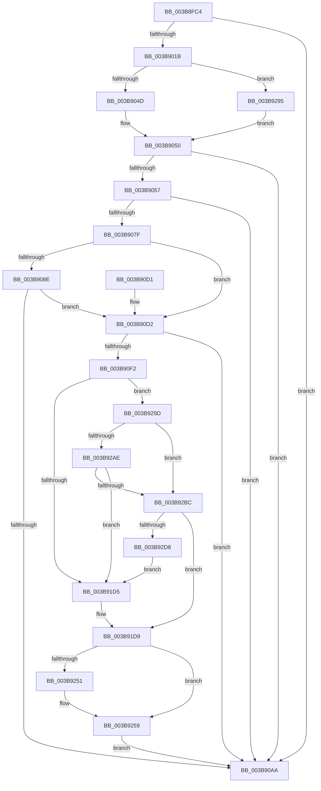

# EtwTiLogInsertQueueUserApc

- RVA: `0x003B8FC4`–`0x003B92DD` (길이 `793` bytes)
- VA: `0x00000001403B8FC4`
- 실행 섹션: `.text`
- PDB 이름 있음: `예`; PDB Function 태그: `아니요`
- unwind 정보 RVA: `0x0008CA10`
- 디코드: `194`개 명령, `793/793` bytes 표시
- 미해석 바이트: `0` (있으면 어셈블리에 `.byte`로 보존)

> 이 문서는 커널 이미지의 기계어와 PDB 기호를 분석해 생성했습니다. 4번과 5번은 함수 원형과 자료형을 바이너리 사용 방식에서 추정한 C 해석이며 원본 소스 복구 결과는 아닙니다.

## 1. Dependencies

- 직접 호출 지점: **11**; 고유 호출 대상: **7**
- 직접 호출자로 확인된 함수: **1**
- RIP 상대 이미지 참조: **4**

### Outgoing calls
- `0x003B900E` → [EtwProviderEnabled](EtwProviderEnabled_function_003BA250.md) (function, `0x003BA250`)
- `0x003B9076` → [EtwEventEnabled](../39/EtwEventEnabled_function_00392450.md) (function, `0x00392450`)
- `0x003B90A1` → [EtwProviderEnabled](EtwProviderEnabled_function_003BA250.md) (function, `0x003BA250`)
- `0x003B90B1` → [_security_check_cookie](../6A/_security_check_cookie_function_006AC640.md) (function, `0x006AC640`)
- `0x003B90E2` → [ExAllocatePool2](../../poolcode/B8/ExAllocatePool2_function_00B820F0.md) (function, `0x00B820F0`)
- `0x003B90FC` → [EtwpTiFillProcessIdentity](EtwpTiFillProcessIdentity_function_003B8F30.md) (function, `0x003B8F30`)
- `0x003B914E` → [EtwpTiFillProcessIdentity](EtwpTiFillProcessIdentity_function_003B8F30.md) (function, `0x003B8F30`)
- `0x003B9196` → [EtwpTiFillProcessIdentity](EtwpTiFillProcessIdentity_function_003B8F30.md) (function, `0x003B8F30`)
- `0x003B9248` → [EtwProviderEnabled](EtwProviderEnabled_function_003BA250.md) (function, `0x003BA250`)
- `0x003B9281` → [EtwpTiVadQueryEventWrite](EtwpTiVadQueryEventWrite_function_003B9360.md) (function, `0x003B9360`)
- `0x003B928B` → [ExFreePoolWithTag](../../poolcode/B8/ExFreePoolWithTag_function_00B82870.md) (function, `0x00B82870`)

### Direct callers
- [KeInsertQueueApc](../20/KeInsertQueueApc_function_00203F10.md) at `0x002041CE`

### Static image references
- `0x003B8FE3` → RVA `0x00E0A740` (`.data`; read)
- `0x003B8FFF` → RVA `0x00EFFA30` (`.data`; read)
- `0x003B905E` → RVA `0x00011C20` (`.rdata`; read)
- `0x003B9068` → RVA `0x00011C30` (`.rdata`; read)

## 2. Other-region calls and transfers

- 다른 실행 섹션으로 향하는 call: **2**
  - `0x003B90E2` → [ExAllocatePool2](../../poolcode/B8/ExAllocatePool2_function_00B820F0.md) (`.text` → `POOLCODE`)
  - `0x003B928B` → [ExFreePoolWithTag](../../poolcode/B8/ExFreePoolWithTag_function_00B82870.md) (`.text` → `POOLCODE`)
- 별도 외부 분기/꼬리 이동을 확인하지 못했습니다.

## 3. Assembly (complete function range)

```asm
003B8FC4  48 89 5C 24 08                  mov qword ptr [rsp + 8], rbx
003B8FC9  4C 89 4C 24 20                  mov qword ptr [rsp + 0x20], r9
003B8FCE  55                              push rbp
003B8FCF  56                              push rsi
003B8FD0  57                              push rdi
003B8FD1  41 54                           push r12
003B8FD3  41 55                           push r13
003B8FD5  41 56                           push r14
003B8FD7  41 57                           push r15
003B8FD9  48 8B EC                        mov rbp, rsp
003B8FDC  48 81 EC 80 00 00 00            sub rsp, 0x80
003B8FE3  48 8B 05 56 17 A5 00            mov rax, qword ptr [rip + 0xa51756]
003B8FEA  48 33 C4                        xor rax, rsp
003B8FED  48 89 45 F0                     mov qword ptr [rbp - 0x10], rax
003B8FF1  48 83 65 D0 00                  and qword ptr [rbp - 0x30], 0
003B8FF6  4D 8B F8                        mov r15, r8
003B8FF9  4C 8B EA                        mov r13, rdx
003B8FFC  40 8A F9                        mov dil, cl
003B8FFF  48 8B 0D 2A 6A B4 00            mov rcx, qword ptr [rip + 0xb46a2a]
003B9006  33 D2                           xor edx, edx
003B9008  41 B8 00 30 00 00               mov r8d, 0x3000
003B900E  E8 3D 12 00 00                  call 0x1403ba250
003B9013  84 C0                           test al, al
003B9015  0F 84 8F 00 00 00               je 0x1403b90aa
003B901B  65 48 8B 04 25 88 01 00 00      mov rax, qword ptr gs:[0x188]
003B9024  4D 8B B5 20 02 00 00            mov r14, qword ptr [r13 + 0x220]
003B902B  48 8B 98 B8 00 00 00            mov rbx, qword ptr [rax + 0xb8]
003B9032  65 48 8B 04 25 88 01 00 00      mov rax, qword ptr gs:[0x188]
003B903B  4C 8B A0 20 02 00 00            mov r12, qword ptr [rax + 0x220]
003B9042  33 C0                           xor eax, eax
003B9044  38 45 70                        cmp byte ptr [rbp + 0x70], al
003B9047  0F 84 48 02 00 00               je 0x1403b9295
003B904D  4D 3B E6                        cmp r12, r14
003B9050  0F 95 C0                        setne al
003B9053  85 C0                           test eax, eax
003B9055  74 53                           je 0x1403b90aa
003B9057  48 8B 0D D2 69 B4 00            mov rcx, qword ptr [rip + 0xb469d2]
003B905E  48 8D 05 BB 8B C5 FF            lea rax, [rip - 0x3a7445]
003B9065  40 84 FF                        test dil, dil
003B9068  48 8D 35 C1 8B C5 FF            lea rsi, [rip - 0x3a743f]
003B906F  48 0F 45 F0                     cmovne rsi, rax
003B9073  48 8B D6                        mov rdx, rsi
003B9076  E8 D5 93 FD FF                  call 0x140392450
003B907B  84 C0                           test al, al
003B907D  74 2B                           je 0x1403b90aa
003B907F  65 8B 04 25 3C 3A 00 00         mov eax, dword ptr gs:[0x3a3c]
003B9087  A9 01 00 01 00                  test eax, 0x10001
003B908C  74 44                           je 0x1403b90d2
003B908E  48 8B 0D 9B 69 B4 00            mov rcx, qword ptr [rip + 0xb4699b]
003B9095  33 D2                           xor edx, edx
003B9097  49 B8 00 00 00 00 00 02 00 00   movabs r8, 0x20000000000
003B90A1  E8 AA 11 00 00                  call 0x1403ba250
003B90A6  84 C0                           test al, al
003B90A8  75 28                           jne 0x1403b90d2
003B90AA  48 8B 4D F0                     mov rcx, qword ptr [rbp - 0x10]
003B90AE  48 33 CC                        xor rcx, rsp
003B90B1  E8 8A 35 2F 00                  call 0x1406ac640
003B90B6  48 8B 9C 24 C0 00 00 00         mov rbx, qword ptr [rsp + 0xc0]
003B90BE  48 81 C4 80 00 00 00            add rsp, 0x80
003B90C5  41 5F                           pop r15
003B90C7  41 5E                           pop r14
003B90C9  41 5D                           pop r13
003B90CB  41 5C                           pop r12
003B90CD  5F                              pop rdi
003B90CE  5E                              pop rsi
003B90CF  5D                              pop rbp
003B90D0  C3                              ret
003B90D1  CC                              int3
003B90D2  BA A0 02 00 00                  mov edx, 0x2a0
003B90D7  B9 40 00 00 00                  mov ecx, 0x40
003B90DC  41 B8 54 49 73 6E               mov r8d, 0x6e734954
003B90E2  E8 09 90 7C 00                  call 0x140b820f0
003B90E7  45 33 D2                        xor r10d, r10d
003B90EA  48 8B F8                        mov rdi, rax
003B90ED  48 85 C0                        test rax, rax
003B90F0  74 B8                           je 0x1403b90aa
003B90F2  4C 8D 45 D8                     lea r8, [rbp - 0x28]
003B90F6  48 8B D3                        mov rdx, rbx
003B90F9  48 8B C8                        mov rcx, rax
003B90FC  E8 2F FE FF FF                  call 0x1403b8f30
003B9101  65 48 8B 14 25 88 01 00 00      mov rdx, qword ptr gs:[0x188]
003B910A  44 8B C0                        mov r8d, eax
003B910D  49 C1 E0 04                     shl r8, 4
003B9111  4C 03 C1                        add r8, rcx
003B9114  8B D8                           mov ebx, eax
003B9116  48 8D 8A 10 05 00 00            lea rcx, [rdx + 0x510]
003B911D  83 C3 02                        add ebx, 2
003B9120  49 89 08                        mov qword ptr [r8], rcx
003B9123  48 8D 8A C0 04 00 00            lea rcx, [rdx + 0x4c0]
003B912A  49 C7 40 08 04 00 00 00         mov qword ptr [r8 + 8], 4
003B9132  49 8B D6                        mov rdx, r14
003B9135  49 89 48 10                     mov qword ptr [r8 + 0x10], rcx
003B9139  49 C7 40 18 08 00 00 00         mov qword ptr [r8 + 0x18], 8
003B9141  4C 8D 45 E0                     lea r8, [rbp - 0x20]
003B9145  8B CB                           mov ecx, ebx
003B9147  48 C1 E1 04                     shl rcx, 4
003B914B  48 03 CF                        add rcx, rdi
003B914E  E8 DD FD FF FF                  call 0x1403b8f30
003B9153  03 D8                           add ebx, eax
003B9155  4C 8D 45 E8                     lea r8, [rbp - 0x18]
003B9159  8B CB                           mov ecx, ebx
003B915B  49 8D 85 10 05 00 00            lea rax, [r13 + 0x510]
003B9162  48 C1 E1 04                     shl rcx, 4
003B9166  83 C3 02                        add ebx, 2
003B9169  48 03 CF                        add rcx, rdi
003B916C  49 8B D4                        mov rdx, r12
003B916F  48 89 01                        mov qword ptr [rcx], rax
003B9172  49 8D 85 C0 04 00 00            lea rax, [r13 + 0x4c0]
003B9179  48 C7 41 08 04 00 00 00         mov qword ptr [rcx + 8], 4
003B9181  48 89 41 10                     mov qword ptr [rcx + 0x10], rax
003B9185  48 C7 41 18 08 00 00 00         mov qword ptr [rcx + 0x18], 8
003B918D  8B CB                           mov ecx, ebx
003B918F  48 C1 E1 04                     shl rcx, 4
003B9193  48 03 CF                        add rcx, rdi
003B9196  E8 95 FD FF FF                  call 0x1403b8f30
003B919B  03 D8                           add ebx, eax
003B919D  41 8D 52 01                     lea edx, [r10 + 1]
003B91A1  41 8B 45 74                     mov eax, dword ptr [r13 + 0x74]
003B91A5  48 8D 4D C0                     lea rcx, [rbp - 0x40]
003B91A9  C1 E8 04                        shr eax, 4
003B91AC  22 C2                           and al, dl
003B91AE  88 45 C0                        mov byte ptr [rbp - 0x40], al
003B91B1  8B C3                           mov eax, ebx
003B91B3  03 DA                           add ebx, edx
003B91B5  48 03 C0                        add rax, rax
003B91B8  48 89 0C C7                     mov qword ptr [rdi + rax*8], rcx
003B91BC  48 89 54 C7 08                  mov qword ptr [rdi + rax*8 + 8], rdx
003B91C1  49 8B 85 20 02 00 00            mov rax, qword ptr [r13 + 0x220]
003B91C8  4C 39 90 10 03 00 00            cmp qword ptr [rax + 0x310], r10
003B91CF  0F 85 C8 00 00 00               jne 0x1403b929d
003B91D5  4C 89 7D C8                     mov qword ptr [rbp - 0x38], r15
003B91D9  8B C3                           mov eax, ebx
003B91DB  48 8D 4D C8                     lea rcx, [rbp - 0x38]
003B91DF  48 03 C0                        add rax, rax
003B91E2  03 DA                           add ebx, edx
003B91E4  41 B8 00 00 00 08               mov r8d, 0x8000000
003B91EA  48 89 0C C7                     mov qword ptr [rdi + rax*8], rcx
003B91EE  48 8D 4D 58                     lea rcx, [rbp + 0x58]
003B91F2  48 C7 44 C7 08 08 00 00 00      mov qword ptr [rdi + rax*8 + 8], 8
003B91FB  8B C3                           mov eax, ebx
003B91FD  03 DA                           add ebx, edx
003B91FF  48 03 C0                        add rax, rax
003B9202  48 89 0C C7                     mov qword ptr [rdi + rax*8], rcx
003B9206  48 8D 4D 60                     lea rcx, [rbp + 0x60]
003B920A  48 C7 44 C7 08 08 00 00 00      mov qword ptr [rdi + rax*8 + 8], 8
003B9213  8B C3                           mov eax, ebx
003B9215  03 DA                           add ebx, edx
003B9217  48 03 C0                        add rax, rax
003B921A  48 89 0C C7                     mov qword ptr [rdi + rax*8], rcx
003B921E  48 8D 4D 68                     lea rcx, [rbp + 0x68]
003B9222  48 C7 44 C7 08 08 00 00 00      mov qword ptr [rdi + rax*8 + 8], 8
003B922B  8B C3                           mov eax, ebx
003B922D  03 DA                           add ebx, edx
003B922F  48 03 C0                        add rax, rax
003B9232  33 D2                           xor edx, edx
003B9234  48 89 0C C7                     mov qword ptr [rdi + rax*8], rcx
003B9238  48 C7 44 C7 08 08 00 00 00      mov qword ptr [rdi + rax*8 + 8], 8
003B9241  48 8B 0D E8 67 B4 00            mov rcx, qword ptr [rip + 0xb467e8]
003B9248  E8 03 10 00 00                  call 0x1403ba250
003B924D  84 C0                           test al, al
003B924F  74 08                           je 0x1403b9259
003B9251  48 8B 55 58                     mov rdx, qword ptr [rbp + 0x58]
003B9255  48 89 55 D0                     mov qword ptr [rbp - 0x30], rdx
003B9259  88 44 24 38                     mov byte ptr [rsp + 0x38], al
003B925D  4D 8B CE                        mov r9, r14
003B9260  48 89 74 24 30                  mov qword ptr [rsp + 0x30], rsi
003B9265  48 8D 45 C8                     lea rax, [rbp - 0x38]
003B9269  C7 44 24 28 02 00 00 00         mov dword ptr [rsp + 0x28], 2
003B9271  44 8B C3                        mov r8d, ebx
003B9274  BA 2A 00 00 00                  mov edx, 0x2a
003B9279  48 89 44 24 20                  mov qword ptr [rsp + 0x20], rax
003B927E  48 8B CF                        mov rcx, rdi
003B9281  E8 DA 00 00 00                  call 0x1403b9360
003B9286  33 D2                           xor edx, edx
003B9288  48 8B CF                        mov rcx, rdi
003B928B  E8 E0 95 7C 00                  call 0x140b82870
003B9290  E9 15 FE FF FF                  jmp 0x1403b90aa
003B9295  49 3B DE                        cmp rbx, r14
003B9298  E9 B3 FD FF FF                  jmp 0x1403b9050
003B929D  0F B7 80 EC 06 00 00            movzx eax, word ptr [rax + 0x6ec]
003B92A4  B9 4C 01 00 00                  mov ecx, 0x14c
003B92A9  66 3B C1                        cmp ax, cx
003B92AC  74 0E                           je 0x1403b92bc
003B92AE  B9 C4 01 00 00                  mov ecx, 0x1c4
003B92B3  66 3B C1                        cmp ax, cx
003B92B6  0F 85 19 FF FF FF               jne 0x1403b91d5
003B92BC  49 8B C7                        mov rax, r15
003B92BF  B9 FF FF FF FF                  mov ecx, 0xffffffff
003B92C4  48 C1 F8 02                     sar rax, 2
003B92C8  48 F7 D8                        neg rax
003B92CB  48 89 45 C8                     mov qword ptr [rbp - 0x38], rax
003B92CF  48 3B C1                        cmp rax, rcx
003B92D2  0F 86 01 FF FF FF               jbe 0x1403b91d9
003B92D8  E9 F8 FE FF FF                  jmp 0x1403b91d5
```

## 4. C-style interpretation (structured pseudocode)

```c
__int64 __fastcall EtwTiLogInsertQueueUserApc(unsigned __int8 a1, __int64 a2, __int64 a3, __int64 a4, __int64 a5, __int64 a6, unsigned __int8 a7)
{
    __int64 result;
    __int64 v_r10;
    __int64 v_rbx;
    __int64 v_rsi;
    __int64 v_rsp;
    unsigned __int64 v_stack_m48;
    unsigned __int64 v_stack_m50;
    unsigned __int64 v_stack_m58;
    unsigned __int64 v_stack_m60;
    unsigned __int64 v_stack_m68;
    unsigned __int64 v_stack_m70;
    unsigned __int64 v_stack_m78;
    unsigned __int64 v_stack_p20;
    unsigned int v_stack_p28;
    unsigned __int64 v_stack_p30;
    unsigned __int8 v_stack_p38;
    unsigned __int64 v_stack_p8;

    v_stack_p8 = v_rbx;
    v_stack_p20 = a4;
    v_rsp = (v_rsp) - (128);
    result = (*(unsigned __int64 *)(v_rip + 10819414)) ^ (v_rsp);
    v_stack_m48 = result;
    a2 = 0;
    result = EtwProviderEnabled(*(unsigned __int64 *)(v_rip + 11823658), a2, (unsigned int)(0x3000ULL), a4);
    if ((unsigned __int8)(result) == 0) goto loc_003B90AA;
    result = 0;
    if (a7 == 0) goto loc_003B9295;
loc_003B9050:
    result = ((*(unsigned __int64 *)(*(unsigned __int64 *)(gs_base + (0 + 392)) + 544)) != (*(unsigned __int64 *)(a2 + 544))) ? 1 : 0;
    if ((unsigned int)(result) == 0) goto loc_003B90AA;
    v_rsi = v_rip - 3830847;
    if (a1 != 0) { v_rsi = v_rip - 3830853; }
    result = EtwEventEnabled(*(unsigned __int64 *)(v_rip + 11823570), v_rsi, (unsigned int)(0x3000ULL), a4);
    if ((unsigned __int8)(result) == 0) goto loc_003B90AA;
    if ((((unsigned int)((unsigned int)(*(unsigned int *)(gs_base + (0 + 14908))))) & (0x10001ULL)) == 0) goto loc_003B90D2;
    a2 = 0;
    result = EtwProviderEnabled(*(unsigned __int64 *)(v_rip + 11823515), a2, (unsigned int)(0x3000ULL), a4);
    if ((unsigned __int8)(result) != 0) goto loc_003B90D2;
loc_003B90AA:
    a1 = (v_stack_m48) ^ (v_rsp);
    result = _security_check_cookie(a1, a2, (unsigned int)(0x3000ULL), a4);
    v_rsp = (v_rsp) + (128);
    return result;
loc_003B90D2:
    result = ExAllocatePool2(64, 672, (unsigned int)(0x6E734954ULL), a4);
    v_r10 = 0;
    if (result == 0) goto loc_003B90AA;
    result = EtwpTiFillProcessIdentity(result, v_stack_p8, v_stack_m60, a4);
    a3 = ((unsigned int)((unsigned int)(result))) << (4);
    a3 = (a3) + (result);
    v_rbx = (unsigned int)(((unsigned int)((unsigned int)(result))) + (2));
    *(unsigned __int64 *)(a3) = *(unsigned __int64 *)(gs_base + (0 + 392)) + 1296;
    *(unsigned __int64 *)(a3 + 8) = 4;
    *(unsigned __int64 *)(a3 + 16) = *(unsigned __int64 *)(gs_base + (0 + 392)) + 1216;
    *(unsigned __int64 *)(a3 + 24) = 8;
    a1 = ((unsigned int)((unsigned int)(v_rbx))) << (4);
    a1 = (a1) + (result);
    result = EtwpTiFillProcessIdentity(a1, *(unsigned __int64 *)(a2 + 544), v_stack_m58, a4);
    v_rbx = (unsigned int)((v_rbx) + ((unsigned int)(result)));
    a1 = ((unsigned int)((unsigned int)(v_rbx))) << (4);
    v_rbx = (unsigned int)((v_rbx) + (2));
    a1 = (a1) + (result);
    *(unsigned __int64 *)(a1) = a2 + 1296;
    *(unsigned __int64 *)(a1 + 8) = 4;
    *(unsigned __int64 *)(a1 + 16) = a2 + 1216;
    *(unsigned __int64 *)(a1 + 24) = 8;
    a1 = ((unsigned int)((unsigned int)(v_rbx))) << (4);
    a1 = (a1) + (result);
    result = EtwpTiFillProcessIdentity(a1, *(unsigned __int64 *)(*(unsigned __int64 *)(gs_base + (0 + 392)) + 544), v_stack_m50, a4);
    v_rbx = (unsigned int)((v_rbx) + ((unsigned int)(result)));
    result = (unsigned int)(((unsigned int)(*(unsigned int *)(a2 + 116))) >> (4));
    result = (unsigned __int8)((result) & ((unsigned __int8)(v_r10 + 1)));
    v_stack_m78 = (unsigned __int8)(result);
    v_rbx = (unsigned int)((v_rbx) + ((unsigned int)(v_r10 + 1)));
    result = ((unsigned int)((unsigned int)(v_rbx))) + ((unsigned int)((unsigned int)(v_rbx)));
    *(unsigned __int64 *)(result + result * 8) = v_stack_m78;
    *(unsigned __int64 *)(result + result * 8 + 8) = v_r10 + 1;
    if ((*(unsigned __int64 *)(*(unsigned __int64 *)(a2 + 544) + 784)) != 0) goto loc_003B929D;
loc_003B91D5:
    v_stack_m70 = a3;
loc_003B91D9:
    result = ((unsigned int)((unsigned int)(v_rbx))) + ((unsigned int)((unsigned int)(v_rbx)));
    v_rbx = (unsigned int)((v_rbx) + ((unsigned int)(v_r10 + 1)));
    *(unsigned __int64 *)(result + result * 8) = v_stack_m70;
    *(unsigned __int64 *)(result + result * 8 + 8) = 8;
    v_rbx = (unsigned int)((v_rbx) + ((unsigned int)(v_r10 + 1)));
    result = ((unsigned int)((unsigned int)(v_rbx))) + ((unsigned int)((unsigned int)(v_rbx)));
    *(unsigned __int64 *)(result + result * 8) = v_stack_p20;
    *(unsigned __int64 *)(result + result * 8 + 8) = 8;
    v_rbx = (unsigned int)((v_rbx) + ((unsigned int)(v_r10 + 1)));
    result = ((unsigned int)((unsigned int)(v_rbx))) + ((unsigned int)((unsigned int)(v_rbx)));
    *(unsigned __int64 *)(result + result * 8) = a5;
    *(unsigned __int64 *)(result + result * 8 + 8) = 8;
    v_rbx = (unsigned int)((v_rbx) + ((unsigned int)(v_r10 + 1)));
    result = ((unsigned int)((unsigned int)(v_rbx))) + ((unsigned int)((unsigned int)(v_rbx)));
    a2 = 0;
    *(unsigned __int64 *)(result + result * 8) = a6;
    *(unsigned __int64 *)(result + result * 8 + 8) = 8;
    result = EtwProviderEnabled(*(unsigned __int64 *)(v_rip + 11823080), a2, (unsigned int)(0x8000000ULL), a4);
    if ((unsigned __int8)(result) != 0) {
        a2 = v_stack_p20;
        v_stack_m68 = a2;
    }
    v_stack_p38 = (unsigned __int8)(result);
    v_stack_p30 = v_rsi;
    v_stack_p28 = 2;
    v_stack_p20 = v_stack_m70;
    result = EtwpTiVadQueryEventWrite(result, 42, (unsigned int)((unsigned int)(v_rbx)), *(unsigned __int64 *)(a2 + 544));
    a2 = 0;
    result = ExFreePoolWithTag(result, a2, (unsigned int)((unsigned int)(v_rbx)), *(unsigned __int64 *)(a2 + 544));
    goto loc_003B90AA;
loc_003B9295:
    goto loc_003B9050;
loc_003B929D:
    if (((unsigned __int16)(*(unsigned __int16 *)(result + 1772))) == 332) goto loc_003B92BC;
    if (((unsigned __int16)(*(unsigned __int16 *)(result + 1772))) != 452) goto loc_003B91D5;
loc_003B92BC:
    result = (a3) >> (2);
    result = -(result);
    v_stack_m70 = result;
    if (result <= ((unsigned int)(0xFFFFFFFFULL))) goto loc_003B91D9;
    goto loc_003B91D5;
}
```

## 5. (Beta) C Style

```c
int64_t EtwTiLogInsertQueueUserApc(uint8_t Arg1, void *Arg2, int64_t Arg3, int64_t Arg4, int64_t Arg5, int64_t Arg6, uint8_t Arg7)
{
    uint8_t *arg2 = (uint8_t *)Arg2;

    int64_t result;
    int64_t local_r10;
    int64_t local_rbx;
    int64_t local_rsi;
    int64_t local_rsp;
    uint64_t v_stack_m48;
    uint64_t v_stack_m50;
    uint64_t v_stack_m58;
    uint64_t v_stack_m60;
    uint64_t v_stack_m68;
    uint64_t v_stack_m70;
    uint64_t v_stack_m78;
    uint64_t v_stack_p20;
    uint32_t v_stack_p28;
    uint64_t v_stack_p30;
    uint8_t v_stack_p38;
    uint64_t v_stack_p8;

    v_stack_p8 = local_rbx;
    v_stack_p20 = Arg4;
    local_rsp = (local_rsp) - (128);
    result = (*(uint64_t *)(v_rip + 0xA51756)) ^ (local_rsp);
    v_stack_m48 = result;
    Arg2 = 0;
    result = EtwProviderEnabled(*(uint64_t *)(v_rip + 0xB46A2A), Arg2, (uint32_t)(0x3000ULL), Arg4);
    if ((uint8_t)(result) == 0) goto loc_003B90AA;
    result = 0;
    if (Arg7 == 0) goto loc_003B9295;
loc_003B9050:
    result = ((*(uint64_t *)(*(uint64_t *)(gs_base + (0 + 0x188)) + 0x220)) != (*(uint64_t *)(arg2 + 0x220))) ? 1 : 0;
    if ((uint32_t)(result) == 0) goto loc_003B90AA;
    local_rsi = v_rip - 3830847;
    if (Arg1 != 0) { local_rsi = v_rip - 3830853; }
    result = EtwEventEnabled(*(uint64_t *)(v_rip + 0xB469D2), local_rsi, (uint32_t)(0x3000ULL), Arg4);
    if ((uint8_t)(result) == 0) goto loc_003B90AA;
    if ((((uint32_t)((uint32_t)(*(uint32_t *)(gs_base + (0 + 0x3A3C))))) & (0x10001ULL)) == 0) goto loc_003B90D2;
    Arg2 = 0;
    result = EtwProviderEnabled(*(uint64_t *)(v_rip + 0xB4699B), Arg2, (uint32_t)(0x3000ULL), Arg4);
    if ((uint8_t)(result) != 0) goto loc_003B90D2;
loc_003B90AA:
    Arg1 = (v_stack_m48) ^ (local_rsp);
    result = _security_check_cookie(Arg1, Arg2, (uint32_t)(0x3000ULL), Arg4);
    local_rsp = (local_rsp) + (128);
    return result;
loc_003B90D2:
    result = ExAllocatePool2(64, 672, (uint32_t)(0x6E734954ULL), Arg4);
    local_r10 = 0;
    if (result == 0) goto loc_003B90AA;
    result = EtwpTiFillProcessIdentity(result, v_stack_p8, v_stack_m60, Arg4);
    Arg3 = ((uint32_t)((uint32_t)(result))) << (4);
    Arg3 = (Arg3) + (result);
    local_rbx = (uint32_t)(((uint32_t)((uint32_t)(result))) + (2));
    *(uint64_t *)(Arg3) = *(uint64_t *)(gs_base + (0 + 0x188)) + 1296;
    *(uint64_t *)(Arg3 + 0x8) = 4;
    *(uint64_t *)(Arg3 + 0x10) = *(uint64_t *)(gs_base + (0 + 0x188)) + 1216;
    *(uint64_t *)(Arg3 + 0x18) = 8;
    Arg1 = ((uint32_t)((uint32_t)(local_rbx))) << (4);
    Arg1 = (Arg1) + (result);
    result = EtwpTiFillProcessIdentity(Arg1, *(uint64_t *)(arg2 + 0x220), v_stack_m58, Arg4);
    local_rbx = (uint32_t)((local_rbx) + ((uint32_t)(result)));
    Arg1 = ((uint32_t)((uint32_t)(local_rbx))) << (4);
    local_rbx = (uint32_t)((local_rbx) + (2));
    Arg1 = (Arg1) + (result);
    *(void **)(Arg1) = Arg2 + 1296;
    *(uint64_t *)(Arg1 + 0x8) = 4;
    *(void **)(Arg1 + 0x10) = Arg2 + 1216;
    *(uint64_t *)(Arg1 + 0x18) = 8;
    Arg1 = ((uint32_t)((uint32_t)(local_rbx))) << (4);
    Arg1 = (Arg1) + (result);
    result = EtwpTiFillProcessIdentity(Arg1, *(uint64_t *)(*(uint64_t *)(gs_base + (0 + 0x188)) + 0x220), v_stack_m50, Arg4);
    local_rbx = (uint32_t)((local_rbx) + ((uint32_t)(result)));
    result = (uint32_t)(((uint32_t)(*(uint32_t *)(arg2 + 0x74))) >> (4));
    result = (uint8_t)((result) & ((uint8_t)(local_r10 + 1)));
    v_stack_m78 = (uint8_t)(result);
    local_rbx = (uint32_t)((local_rbx) + ((uint32_t)(local_r10 + 1)));
    result = ((uint32_t)((uint32_t)(local_rbx))) + ((uint32_t)((uint32_t)(local_rbx)));
    *(uint64_t *)(result + result * 8) = v_stack_m78;
    *(uint64_t *)(result + result * 8 + 0x8) = local_r10 + 1;
    if ((*(uint64_t *)(*(uint64_t *)(arg2 + 0x220) + 0x310)) != 0) goto loc_003B929D;
loc_003B91D5:
    v_stack_m70 = Arg3;
loc_003B91D9:
    result = ((uint32_t)((uint32_t)(local_rbx))) + ((uint32_t)((uint32_t)(local_rbx)));
    local_rbx = (uint32_t)((local_rbx) + ((uint32_t)(local_r10 + 1)));
    *(uint64_t *)(result + result * 8) = v_stack_m70;
    *(uint64_t *)(result + result * 8 + 0x8) = 8;
    local_rbx = (uint32_t)((local_rbx) + ((uint32_t)(local_r10 + 1)));
    result = ((uint32_t)((uint32_t)(local_rbx))) + ((uint32_t)((uint32_t)(local_rbx)));
    *(uint64_t *)(result + result * 8) = v_stack_p20;
    *(uint64_t *)(result + result * 8 + 0x8) = 8;
    local_rbx = (uint32_t)((local_rbx) + ((uint32_t)(local_r10 + 1)));
    result = ((uint32_t)((uint32_t)(local_rbx))) + ((uint32_t)((uint32_t)(local_rbx)));
    *(uint64_t *)(result + result * 8) = Arg5;
    *(uint64_t *)(result + result * 8 + 0x8) = 8;
    local_rbx = (uint32_t)((local_rbx) + ((uint32_t)(local_r10 + 1)));
    result = ((uint32_t)((uint32_t)(local_rbx))) + ((uint32_t)((uint32_t)(local_rbx)));
    Arg2 = 0;
    *(uint64_t *)(result + result * 8) = Arg6;
    *(uint64_t *)(result + result * 8 + 0x8) = 8;
    result = EtwProviderEnabled(*(uint64_t *)(v_rip + 0xB467E8), Arg2, (uint32_t)(0x8000000ULL), Arg4);
    if ((uint8_t)(result) != 0) {
        Arg2 = v_stack_p20;
        v_stack_m68 = Arg2;
    }
    v_stack_p38 = (uint8_t)(result);
    v_stack_p30 = local_rsi;
    v_stack_p28 = 2;
    v_stack_p20 = v_stack_m70;
    result = EtwpTiVadQueryEventWrite(result, 42, (uint32_t)((uint32_t)(local_rbx)), *(uint64_t *)(arg2 + 0x220));
    Arg2 = 0;
    result = ExFreePoolWithTag(result, Arg2, (uint32_t)((uint32_t)(local_rbx)), *(uint64_t *)(arg2 + 0x220));
    goto loc_003B90AA;
loc_003B9295:
    goto loc_003B9050;
loc_003B929D:
    if (((uint16_t)(*(uint16_t *)(result + 0x6EC))) == 332) goto loc_003B92BC;
    if (((uint16_t)(*(uint16_t *)(result + 0x6EC))) != 452) goto loc_003B91D5;
loc_003B92BC:
    result = (Arg3) >> (2);
    result = -(result);
    v_stack_m70 = result;
    if (result <= ((uint32_t)(0xFFFFFFFFULL))) goto loc_003B91D9;
    goto loc_003B91D5;
}
```

### 관측된 메모리 오프셋

구조체 형식이 확인되지 않은 접근은 인자 기준의 오프셋으로만 기록했습니다.

| 기준 인자 | 오프셋 표현 | 폭 (bit) | 접근 |
|---|---:|---:|---|
| `Arg2` | `+ 0x74` | `32` | `R` |
| `Arg2` | `+ 0x220` | `64` | `R` |
| `Arg2` | `+ 0x4C0` | `64` | `R` |
| `Arg2` | `+ 0x510` | `64` | `R` |

## 6. Execution-region graph

[열기: 2D/3D 그래프와 함수 탐색 컨트롤 패널](../../../control-panel.html?section=text&rva=0x003B8FC4&view=graph)

- 2D 그래프는 위에서 아래로 흐르고, 3D 그래프는 빈 공간을 드래그해 회전합니다. Shift+드래그는 이동, 휠은 확대·축소, 함수 노드 선택은 대상 보고서 이동입니다.

### Static fallback


