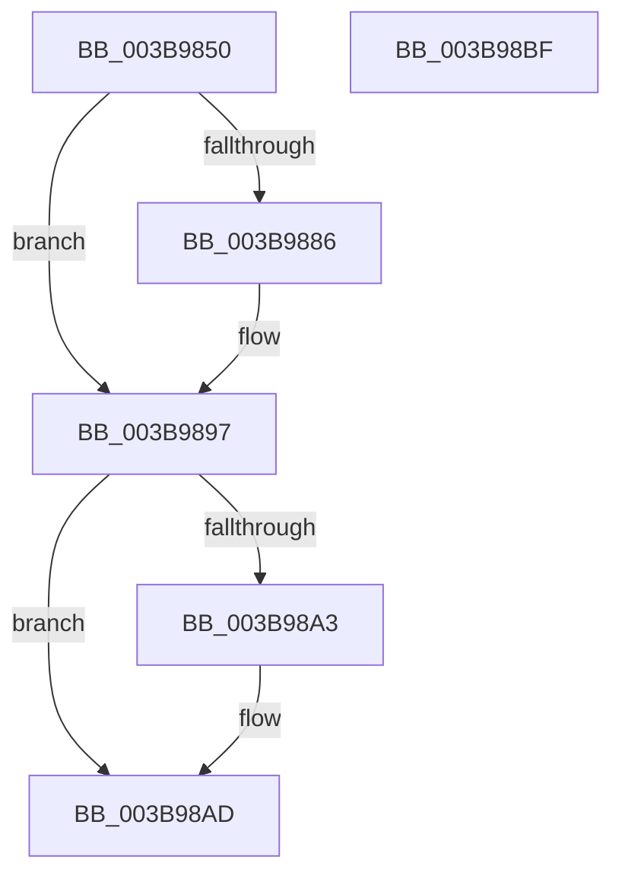

# EtwpLogMemInfoTimerCallback

- RVA: `0x003B9850`–`0x003B98C0` (길이 `112` bytes)
- VA: `0x00000001403B9850`
- 실행 섹션: `.text`
- PDB 이름 있음: `예`; PDB Function 태그: `아니요`
- unwind 정보 RVA: `0x00060904`
- 디코드: `25`개 명령, `112/112` bytes 표시
- 미해석 바이트: `0` (있으면 어셈블리에 `.byte`로 보존)

> 이 문서는 커널 이미지의 기계어와 PDB 기호를 분석해 생성했습니다. 4번과 5번은 함수 원형과 자료형을 바이너리 사용 방식에서 추정한 C 해석이며 원본 소스 복구 결과는 아닙니다.

## 1. Dependencies

- 직접 호출 지점: **5**; 고유 호출 대상: **5**
- 직접 호출자로 확인된 함수: **0**
- RIP 상대 이미지 참조: **2**

### Outgoing calls
- `0x003B9875` → [MmQuerySystemMemoryInformation](MmQuerySystemMemoryInformation_function_003B98C8.md) (function, `0x003B98C8`)
- `0x003B988D` → [EtwpLogMemInfo](EtwpLogMemInfo_function_003B9AC0.md) (function, `0x003B9AC0`)
- `0x003B9892` → [EtwpLogMemNodeInfo](EtwpLogMemNodeInfo_function_003B991C.md) (function, `0x003B991C`)
- `0x003B98A8` → [EtwpQueuePerfMemInfoWorkItem](EtwpQueuePerfMemInfoWorkItem_function_003B9C24.md) (function, `0x003B9C24`)
- `0x003B98B5` → [_security_check_cookie](../6A/_security_check_cookie_function_006AC640.md) (function, `0x006AC640`)

### Direct callers
- 이 함수 시작 RVA로 연결되는 직접 call은 확인되지 않았습니다. 간접 호출은 완전히 역산할 수 없습니다.

### Static image references
- `0x003B9854` → RVA `0x00E0A740` (`.data`; read)
- `0x003B987A` → RVA `0x00FC6B04` (`ALMOSTRO`; read)

## 2. Other-region calls and transfers

- 다른 실행 섹션으로 향하는 call: **0**
- 별도 외부 분기/꼬리 이동을 확인하지 못했습니다.

## 3. Assembly (complete function range)

```asm
003B9850  48 83 EC 58                     sub rsp, 0x58
003B9854  48 8B 05 E5 0E A5 00            mov rax, qword ptr [rip + 0xa50ee5]
003B985B  48 33 C4                        xor rax, rsp
003B985E  48 89 44 24 40                  mov qword ptr [rsp + 0x40], rax
003B9863  0F 57 C0                        xorps xmm0, xmm0
003B9866  48 8D 4C 24 20                  lea rcx, [rsp + 0x20]
003B986B  0F 11 44 24 20                  movups xmmword ptr [rsp + 0x20], xmm0
003B9870  0F 11 44 24 30                  movups xmmword ptr [rsp + 0x30], xmm0
003B9875  E8 4E 00 00 00                  call 0x1403b98c8
003B987A  F7 05 80 D2 C0 00 00 00 08 00   test dword ptr [rip + 0xc0d280], 0x80000
003B9884  74 11                           je 0x1403b9897
003B9886  48 8D 54 24 20                  lea rdx, [rsp + 0x20]
003B988B  33 C9                           xor ecx, ecx
003B988D  E8 2E 02 00 00                  call 0x1403b9ac0
003B9892  E8 85 00 00 00                  call 0x1403b991c
003B9897  F7 05 63 D2 C0 00 00 00 80 00   test dword ptr [rip + 0xc0d263], 0x800000
003B98A1  74 0A                           je 0x1403b98ad
003B98A3  48 8B 4C 24 20                  mov rcx, qword ptr [rsp + 0x20]
003B98A8  E8 77 03 00 00                  call 0x1403b9c24
003B98AD  48 8B 4C 24 40                  mov rcx, qword ptr [rsp + 0x40]
003B98B2  48 33 CC                        xor rcx, rsp
003B98B5  E8 86 2D 2F 00                  call 0x1406ac640
003B98BA  48 83 C4 58                     add rsp, 0x58
003B98BE  C3                              ret
003B98BF  CC                              int3
```

## 4. C-style interpretation (structured pseudocode)

```c
__int64 __fastcall EtwpLogMemInfoTimerCallback(void)
{
    __int64 result;
    __int64 v_rsp;
    unsigned __int64 v_stack_m18;
    unsigned __int64 v_stack_m28;
    unsigned __int64 v_stack_m38;

    v_rsp = (v_rsp) - (88);
    result = (*(unsigned __int64 *)(v_rip + 10817253)) ^ (v_rsp);
    v_stack_m18 = result;
    v_stack_m38 = v_xmm0;
    v_stack_m28 = v_xmm0;
    result = MmQuerySystemMemoryInformation(v_stack_m38, a2, a3, a4);
    if (((*(unsigned int *)(v_rip + 12636800)) & (0x80000ULL)) != 0) {
        a2 = v_stack_m38;
        a1 = 0;
        result = EtwpLogMemInfo(a1, a2, a3, a4);
        result = EtwpLogMemNodeInfo(a1, a2, a3, a4);
    }
    if (((*(unsigned int *)(v_rip + 12636771)) & (0x800000ULL)) != 0) {
        a1 = v_stack_m38;
        result = EtwpQueuePerfMemInfoWorkItem(a1, a2, a3, a4);
    }
    a1 = (v_stack_m18) ^ (v_rsp);
    result = _security_check_cookie(a1, a2, a3, a4);
    v_rsp = (v_rsp) + (88);
    return result;
}
```

## 5. (Beta) C Style

```c
void EtwpLogMemInfoTimerCallback(void)
{
    int64_t result;
    int64_t local_rsp;
    uint64_t v_stack_m18;
    uint64_t v_stack_m28;
    uint64_t v_stack_m38;

    local_rsp = (local_rsp) - (88);
    result = (*(uint64_t *)(v_rip + 0xA50EE5)) ^ (local_rsp);
    v_stack_m18 = result;
    v_stack_m38 = v_xmm0;
    v_stack_m28 = v_xmm0;
    result = MmQuerySystemMemoryInformation(v_stack_m38, a2, a3, a4);
    if (((*(uint32_t *)(v_rip + 0xC0D280)) & (0x80000ULL)) != 0) {
        a2 = v_stack_m38;
        a1 = 0;
        result = EtwpLogMemInfo(a1, a2, a3, a4);
        result = EtwpLogMemNodeInfo(a1, a2, a3, a4);
    }
    if (((*(uint32_t *)(v_rip + 0xC0D263)) & (0x800000ULL)) != 0) {
        a1 = v_stack_m38;
        result = EtwpQueuePerfMemInfoWorkItem(a1, a2, a3, a4);
    }
    a1 = (v_stack_m18) ^ (local_rsp);
    result = _security_check_cookie(a1, a2, a3, a4);
    local_rsp = (local_rsp) + (88);
    return result;
}
```

## 6. Execution-region graph

[열기: 2D/3D 그래프와 함수 탐색 컨트롤 패널](../../../control-panel.html?section=text&rva=0x003B9850&view=graph)

- 2D 그래프는 위에서 아래로 흐르고, 3D 그래프는 빈 공간을 드래그해 회전합니다. Shift+드래그는 이동, 휠은 확대·축소, 함수 노드 선택은 대상 보고서 이동입니다.

### Static fallback


