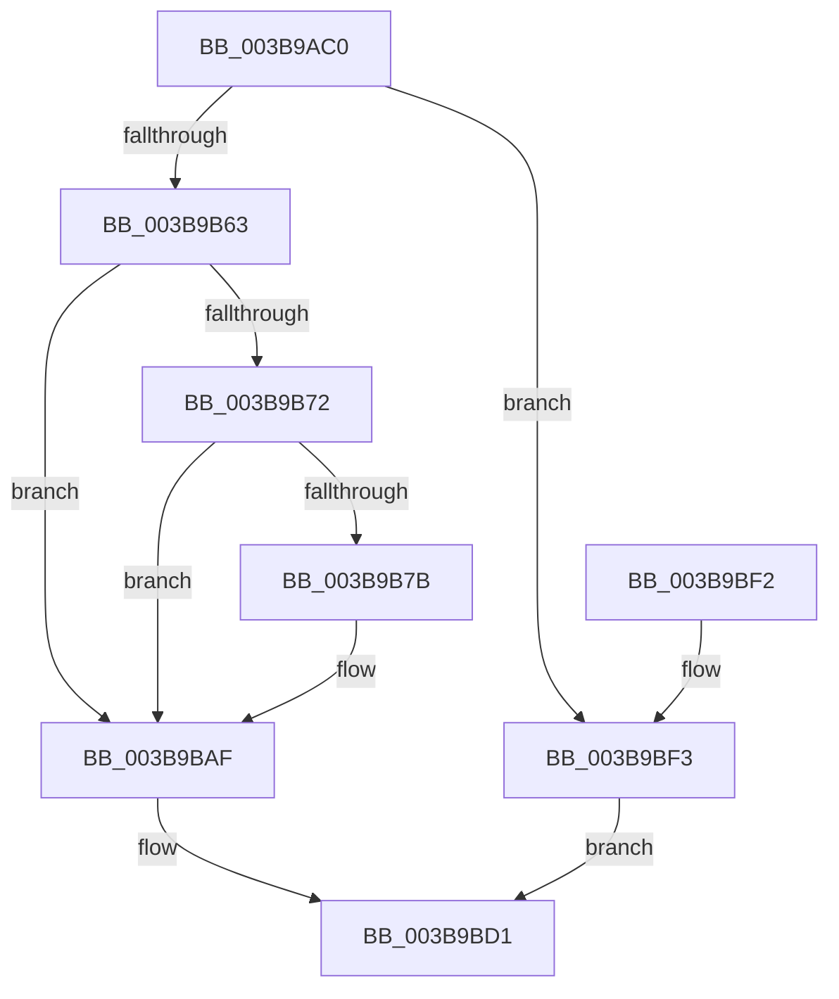

# EtwpLogMemInfo

- RVA: `0x003B9AC0`–`0x003B9C1D` (길이 `349` bytes)
- VA: `0x00000001403B9AC0`
- 실행 섹션: `.text`
- PDB 이름 있음: `예`; PDB Function 태그: `아니요`
- unwind 정보 RVA: `0x0008CABC`
- 디코드: `74`개 명령, `349/349` bytes 표시
- 미해석 바이트: `0` (있으면 어셈블리에 `.byte`로 보존)

> 이 문서는 커널 이미지의 기계어와 PDB 기호를 분석해 생성했습니다. 4번과 5번은 함수 원형과 자료형을 바이너리 사용 방식에서 추정한 C 해석이며 원본 소스 복구 결과는 아닙니다.

## 1. Dependencies

- 직접 호출 지점: **6**; 고유 호출 대상: **6**
- 직접 호출자로 확인된 함수: **2**
- RIP 상대 이미지 참조: **4**

### Outgoing calls
- `0x003B9AFD` → [memset](../6C/memset_function_006C6C40.md) (function, `0x006C6C40`)
- `0x003B9B32` → [MmQueryMemoryListInformation](MmQueryMemoryListInformation_function_003B9EDC.md) (function, `0x003B9EDC`)
- `0x003B9BAA` → [EtwWriteEx](../25/EtwWriteEx_function_0025F0D0.md) (function, `0x0025F0D0`)
- `0x003B9BCC` → [EtwTraceKernelEvent](../23/EtwTraceKernelEvent_function_00235350.md) (function, `0x00235350`)
- `0x003B9BD8` → [_security_check_cookie](../6A/_security_check_cookie_function_006AC640.md) (function, `0x006AC640`)
- `0x003B9C16` → [EtwpLogKernelEvent](../25/EtwpLogKernelEvent_function_0025CC00.md) (function, `0x0025CC00`)

### Direct callers
- [EtwpLogMemInfoTimerCallback](EtwpLogMemInfoTimerCallback_function_003B9850.md) at `0x003B988D`
- [EtwpLogMemInfoRundown](../../page/7C/EtwpLogMemInfoRundown_function_007C0144.md) at `0x007C017B`

### Static image references
- `0x003B9AD7` → RVA `0x00E0A740` (`.data`; read)
- `0x003B9B63` → RVA `0x00FC6AA8` (`ALMOSTRO`; read)
- `0x003B9B7B` → RVA `0x00EFF848` (`.data`; read)
- `0x003B9B8B` → RVA `0x00011C50` (`.rdata`; read)

## 2. Other-region calls and transfers

- 다른 실행 섹션으로 향하는 call: **0**
- 별도 외부 분기/꼬리 이동을 확인하지 못했습니다.

## 3. Assembly (complete function range)

```asm
003B9AC0  48 89 5C 24 10                  mov qword ptr [rsp + 0x10], rbx
003B9AC5  48 89 7C 24 18                  mov qword ptr [rsp + 0x18], rdi
003B9ACA  55                              push rbp
003B9ACB  48 8D 6C 24 C0                  lea rbp, [rsp - 0x40]
003B9AD0  48 81 EC 40 01 00 00            sub rsp, 0x140
003B9AD7  48 8B 05 62 0C A5 00            mov rax, qword ptr [rip + 0xa50c62]
003B9ADE  48 33 C4                        xor rax, rsp
003B9AE1  48 89 45 30                     mov qword ptr [rbp + 0x30], rax
003B9AE5  83 64 24 44 00                  and dword ptr [rsp + 0x44], 0
003B9AEA  48 8B DA                        mov rbx, rdx
003B9AED  48 8B F9                        mov rdi, rcx
003B9AF0  33 D2                           xor edx, edx
003B9AF2  48 8D 4C 24 50                  lea rcx, [rsp + 0x50]
003B9AF7  41 B8 B0 00 00 00               mov r8d, 0xb0
003B9AFD  E8 3E D1 30 00                  call 0x1406c6c40
003B9B02  83 65 0C 00                     and dword ptr [rbp + 0xc], 0
003B9B06  48 8D 44 24 40                  lea rax, [rsp + 0x40]
003B9B0B  48 89 45 00                     mov qword ptr [rbp], rax
003B9B0F  48 8D 54 24 50                  lea rdx, [rsp + 0x50]
003B9B14  48 8D 44 24 44                  lea rax, [rsp + 0x44]
003B9B19  C6 44 24 40 08                  mov byte ptr [rsp + 0x40], 8
003B9B1E  41 B8 B0 00 00 00               mov r8d, 0xb0
003B9B24  48 89 44 24 20                  mov qword ptr [rsp + 0x20], rax
003B9B29  33 C9                           xor ecx, ecx
003B9B2B  C7 45 08 01 00 00 00            mov dword ptr [rbp + 8], 1
003B9B32  E8 A5 03 00 00                  call 0x1403b9edc
003B9B37  83 65 1C 00                     and dword ptr [rbp + 0x1c], 0
003B9B3B  48 8D 44 24 50                  lea rax, [rsp + 0x50]
003B9B40  83 65 2C 00                     and dword ptr [rbp + 0x2c], 0
003B9B44  48 89 45 10                     mov qword ptr [rbp + 0x10], rax
003B9B48  C7 45 18 B0 00 00 00            mov dword ptr [rbp + 0x18], 0xb0
003B9B4F  48 89 5D 20                     mov qword ptr [rbp + 0x20], rbx
003B9B53  C7 45 28 20 00 00 00            mov dword ptr [rbp + 0x28], 0x20
003B9B5A  48 85 FF                        test rdi, rdi
003B9B5D  0F 85 90 00 00 00               jne 0x1403b9bf3
003B9B63  48 8B 05 3E CF C0 00            mov rax, qword ptr [rip + 0xc0cf3e]
003B9B6A  48 05 CC 12 00 00               add rax, 0x12cc
003B9B70  74 3D                           je 0x1403b9baf
003B9B72  F7 40 04 00 00 08 00            test dword ptr [rax + 4], 0x80000
003B9B79  74 34                           je 0x1403b9baf
003B9B7B  48 8B 0D C6 5C B4 00            mov rcx, qword ptr [rip + 0xb45cc6]
003B9B82  48 8D 45 00                     lea rax, [rbp]
003B9B86  48 89 44 24 38                  mov qword ptr [rsp + 0x38], rax
003B9B8B  48 8D 15 BE 80 C5 FF            lea rdx, [rip - 0x3a7f42]
003B9B92  C7 44 24 30 03 00 00 00         mov dword ptr [rsp + 0x30], 3
003B9B9A  45 33 C9                        xor r9d, r9d
003B9B9D  48 21 7C 24 28                  and qword ptr [rsp + 0x28], rdi
003B9BA2  45 33 C0                        xor r8d, r8d
003B9BA5  48 21 7C 24 20                  and qword ptr [rsp + 0x20], rdi
003B9BAA  E8 21 55 EA FF                  call 0x14025f0d0
003B9BAF  41 B9 70 02 00 00               mov r9d, 0x270
003B9BB5  C7 44 24 20 03 18 50 00         mov dword ptr [rsp + 0x20], 0x501803
003B9BBD  BA 02 00 00 00                  mov edx, 2
003B9BC2  48 8D 4D 10                     lea rcx, [rbp + 0x10]
003B9BC6  41 B8 00 00 08 20               mov r8d, 0x20080000
003B9BCC  E8 7F B7 E7 FF                  call 0x140235350
003B9BD1  48 8B 4D 30                     mov rcx, qword ptr [rbp + 0x30]
003B9BD5  48 33 CC                        xor rcx, rsp
003B9BD8  E8 63 2A 2F 00                  call 0x1406ac640
003B9BDD  4C 8D 9C 24 40 01 00 00         lea r11, [rsp + 0x140]
003B9BE5  49 8B 5B 18                     mov rbx, qword ptr [r11 + 0x18]
003B9BE9  49 8B 7B 20                     mov rdi, qword ptr [r11 + 0x20]
003B9BED  49 8B E3                        mov rsp, r11
003B9BF0  5D                              pop rbp
003B9BF1  C3                              ret
003B9BF2  CC                              int3
003B9BF3  44 8B 07                        mov r8d, dword ptr [rdi]
003B9BF6  48 8D 4D 10                     lea rcx, [rbp + 0x10]
003B9BFA  48 8B 97 50 05 00 00            mov rdx, qword ptr [rdi + 0x550]
003B9C01  41 B9 02 00 00 00               mov r9d, 2
003B9C07  C7 44 24 28 03 18 50 00         mov dword ptr [rsp + 0x28], 0x501803
003B9C0F  66 C7 44 24 20 70 02            mov word ptr [rsp + 0x20], 0x270
003B9C16  E8 E5 2F EA FF                  call 0x14025cc00
003B9C1B  EB B4                           jmp 0x1403b9bd1
```

## 4. C-style interpretation (structured pseudocode)

```c
__int64 __fastcall EtwpLogMemInfo(__int64 a1, __int64 a2, __int64 a3, int a4)
{
    __int64 result;
    __int64 v_rsp;
    unsigned int v_stack_m104;
    unsigned __int64 v_stack_m108;
    unsigned __int64 v_stack_m110;
    unsigned int v_stack_m118;
    unsigned __int64 v_stack_m120;
    unsigned __int64 v_stack_m128;
    unsigned __int64 v_stack_m18;
    unsigned int v_stack_m1C;
    unsigned int v_stack_m20;
    unsigned __int64 v_stack_m28;
    unsigned int v_stack_m2C;
    unsigned int v_stack_m30;
    unsigned __int64 v_stack_m38;
    unsigned int v_stack_m3C;
    unsigned int v_stack_m40;
    unsigned __int64 v_stack_m48;
    unsigned __int64 v_stack_m8;
    unsigned __int64 v_stack_mF8;
    unsigned __int64 v_stack_p10;
    unsigned __int64 v_stack_p18;

    v_stack_p10 = v_rbx;
    v_stack_p18 = v_rdi;
    v_rsp = (v_rsp) - (320);
    result = (*(unsigned __int64 *)(v_rip + 10816610)) ^ (v_rsp);
    v_stack_m18 = result;
    a2 = 0;
    result = memset(v_stack_mF8, a2, 176, a4);
    v_stack_m48 = v_stack_m108;
    v_stack_m108 = 8;
    v_stack_m128 = v_stack_m104;
    a1 = 0;
    v_stack_m40 = 1;
    result = MmQueryMemoryListInformation(a1, v_stack_mF8, 176, a4);
    v_stack_m38 = v_stack_mF8;
    v_stack_m30 = 176;
    v_stack_m28 = 0;
    v_stack_m20 = 32;
    if (0 != 0) goto loc_003B9BF3;
    result = (*(unsigned __int64 *)(v_rip + 12635966)) + (0x12CCULL);
    if (condition_is_equal) goto loc_003B9BAF;
    if (((*(unsigned int *)(result + 4)) & (0x80000ULL)) != 0) {
        a1 = *(unsigned __int64 *)(v_rip + 11820230);
        result = v_stack_m48;
        v_stack_m110 = result;
        a2 = v_rip - 3833666;
        v_stack_m118 = 3;
        a4 = 0;
        a3 = 0;
        result = EtwWriteEx(a1, a2, a3, a4);
    }
    v_stack_m128 = 0x501803ULL;
    result = EtwTraceKernelEvent(v_stack_m38, 2, (unsigned int)(0x20080000ULL), 624);
loc_003B9BD1:
    a1 = (v_stack_m18) ^ (v_rsp);
    result = _security_check_cookie(a1, 2, (unsigned int)(0x20080000ULL), 624);
    return result;
loc_003B9BF3:
    v_stack_m118 = 0x501803ULL;
    v_stack_m120 = 624;
    result = EtwpLogKernelEvent(v_stack_m38, *(unsigned __int64 *)(*(unsigned __int64 *)(v_stack_m8 + 32) + 1360), (unsigned int)(*(unsigned int *)(*(unsigned __int64 *)(v_stack_m8 + 32))), 2);
    goto loc_003B9BD1;
}
```

## 5. (Beta) C Style

```c
int64_t EtwpLogMemInfo(int64_t Arg1, int64_t Arg2, int64_t Arg3, int32_t Arg4)
{
    int64_t result;
    int64_t local_rsp;
    uint32_t v_stack_m104;
    uint64_t v_stack_m108;
    uint64_t v_stack_m110;
    uint32_t v_stack_m118;
    uint64_t v_stack_m120;
    uint64_t v_stack_m128;
    uint64_t v_stack_m18;
    uint32_t v_stack_m1C;
    uint32_t v_stack_m20;
    uint64_t v_stack_m28;
    uint32_t v_stack_m2C;
    uint32_t v_stack_m30;
    uint64_t v_stack_m38;
    uint32_t v_stack_m3C;
    uint32_t v_stack_m40;
    uint64_t v_stack_m48;
    uint64_t v_stack_m8;
    uint64_t v_stack_mF8;
    uint64_t v_stack_p10;
    uint64_t v_stack_p18;

    v_stack_p10 = local_rbx;
    v_stack_p18 = local_rdi;
    local_rsp = (local_rsp) - (320);
    result = (*(uint64_t *)(v_rip + 0xA50C62)) ^ (local_rsp);
    v_stack_m18 = result;
    Arg2 = 0;
    result = memset(v_stack_mF8, Arg2, 176, Arg4);
    v_stack_m48 = v_stack_m108;
    v_stack_m108 = 8;
    v_stack_m128 = v_stack_m104;
    Arg1 = 0;
    v_stack_m40 = 1;
    result = MmQueryMemoryListInformation(Arg1, v_stack_mF8, 176, Arg4);
    v_stack_m38 = v_stack_mF8;
    v_stack_m30 = 176;
    v_stack_m28 = 0;
    v_stack_m20 = 32;
    if (0 != 0) goto loc_003B9BF3;
    result = (*(uint64_t *)(v_rip + 0xC0CF3E)) + (0x12CCULL);
    if (condition_is_equal) goto loc_003B9BAF;
    if (((*(uint32_t *)(result + 0x4)) & (0x80000ULL)) != 0) {
        Arg1 = *(uint64_t *)(v_rip + 0xB45CC6);
        result = v_stack_m48;
        v_stack_m110 = result;
        Arg2 = v_rip - 3833666;
        v_stack_m118 = 3;
        Arg4 = 0;
        Arg3 = 0;
        result = EtwWriteEx(Arg1, Arg2, Arg3, Arg4);
    }
    v_stack_m128 = 0x501803ULL;
    result = EtwTraceKernelEvent(v_stack_m38, 2, (uint32_t)(0x20080000ULL), 624);
loc_003B9BD1:
    Arg1 = (v_stack_m18) ^ (local_rsp);
    result = _security_check_cookie(Arg1, 2, (uint32_t)(0x20080000ULL), 624);
    return result;
loc_003B9BF3:
    v_stack_m118 = 0x501803ULL;
    v_stack_m120 = 624;
    result = EtwpLogKernelEvent(v_stack_m38, *(uint64_t *)(*(uint64_t *)(v_stack_m8 + 0x20) + 0x550), (uint32_t)(*(uint32_t *)(*(uint64_t *)(v_stack_m8 + 0x20))), 2);
    goto loc_003B9BD1;
}
```

## 6. Execution-region graph

[열기: 2D/3D 그래프와 함수 탐색 컨트롤 패널](../../../control-panel.html?section=text&rva=0x003B9AC0&view=graph)

- 2D 그래프는 위에서 아래로 흐르고, 3D 그래프는 빈 공간을 드래그해 회전합니다. Shift+드래그는 이동, 휠은 확대·축소, 함수 노드 선택은 대상 보고서 이동입니다.

### Static fallback


