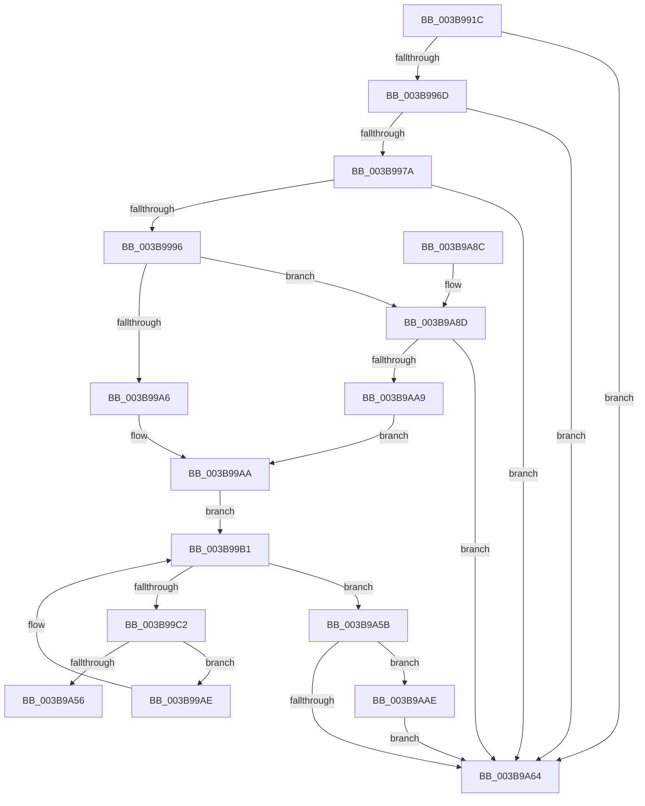

# EtwpLogMemNodeInfo

- RVA: `0x003B991C`–`0x003B9ABA` (길이 `414` bytes)
- VA: `0x00000001403B991C`
- 실행 섹션: `.text`
- PDB 이름 있음: `예`; PDB Function 태그: `예`
- unwind 정보 RVA: `0x0008CA88`
- 디코드: `91`개 명령, `414/414` bytes 표시
- 미해석 바이트: `0` (있으면 어셈블리에 `.byte`로 보존)

> 이 문서는 커널 이미지의 기계어와 PDB 기호를 분석해 생성했습니다. 4번과 5번은 함수 원형과 자료형을 바이너리 사용 방식에서 추정한 C 해석이며 원본 소스 복구 결과는 아닙니다.

## 1. Dependencies

- 직접 호출 지점: **7**; 고유 호출 대상: **7**
- 직접 호출자로 확인된 함수: **1**
- RIP 상대 이미지 참조: **6**

### Outgoing calls
- `0x003B9989` → [EtwProviderEnabled](EtwProviderEnabled_function_003BA250.md) (function, `0x003BA250`)
- `0x003B99B1` → [PsGetNextPartition](PsGetNextPartition_function_003B9D5C.md) (function, `0x003B9D5C`)
- `0x003B99D5` → [MmFillEtwNodeInformation](MmFillEtwNodeInformation_function_003B9C74.md) (function, `0x003B9C74`)
- `0x003B9A44` → [EtwWriteEx](../25/EtwWriteEx_function_0025F0D0.md) (function, `0x0025F0D0`)
- `0x003B9A6E` → [_security_check_cookie](../6A/_security_check_cookie_function_006AC640.md) (function, `0x006AC640`)
- `0x003B9A9C` → [ExAllocatePool2](../../poolcode/B8/ExAllocatePool2_function_00B820F0.md) (function, `0x00B820F0`)
- `0x003B9AB3` → [ExFreePoolWithTag](../../poolcode/B8/ExFreePoolWithTag_function_00B82870.md) (function, `0x00B82870`)

### Direct callers
- [EtwpLogMemInfoTimerCallback](EtwpLogMemInfoTimerCallback_function_003B9850.md) at `0x003B9892`

### Static image references
- `0x003B993A` → RVA `0x00E0A740` (`.data`; read)
- `0x003B994B` → RVA `0x00FC6AA8` (`ALMOSTRO`; read)
- `0x003B997A` → RVA `0x00EFF848` (`.data`; read)
- `0x003B9996` → RVA `0x00FC5000` (`ALMOSTRO`; read)
- `0x003B99E6` → RVA `0x00011C40` (`.rdata`; read)
- `0x003B9A49` → RVA `0x00E300C0` (`.data`; read)

## 2. Other-region calls and transfers

- 다른 실행 섹션으로 향하는 call: **2**
  - `0x003B9A9C` → [ExAllocatePool2](../../poolcode/B8/ExAllocatePool2_function_00B820F0.md) (`.text` → `POOLCODE`)
  - `0x003B9AB3` → [ExFreePoolWithTag](../../poolcode/B8/ExFreePoolWithTag_function_00B82870.md) (`.text` → `POOLCODE`)
- call이 아닌 외부 분기/꼬리 이동: **1**
  - `0x003B9A56` → [sub_006E7A84](../6E/Unknown_function_006E7A84.md) (`tail-transfer`)

## 3. Assembly (complete function range)

```asm
003B991C  48 8B C4                        mov rax, rsp
003B991F  48 89 58 08                     mov qword ptr [rax + 8], rbx
003B9923  48 89 70 10                     mov qword ptr [rax + 0x10], rsi
003B9927  48 89 78 18                     mov qword ptr [rax + 0x18], rdi
003B992B  55                              push rbp
003B992C  48 8D A8 08 FE FF FF            lea rbp, [rax - 0x1f8]
003B9933  48 81 EC F0 02 00 00            sub rsp, 0x2f0
003B993A  48 8B 05 FF 0D A5 00            mov rax, qword ptr [rip + 0xa50dff]
003B9941  48 33 C4                        xor rax, rsp
003B9944  48 89 85 E0 01 00 00            mov qword ptr [rbp + 0x1e0], rax
003B994B  48 8B 05 56 D1 C0 00            mov rax, qword ptr [rip + 0xc0d156]
003B9952  33 F6                           xor esi, esi
003B9954  89 74 24 44                     mov dword ptr [rsp + 0x44], esi
003B9958  40 88 74 24 40                  mov byte ptr [rsp + 0x40], sil
003B995D  89 74 24 48                     mov dword ptr [rsp + 0x48], esi
003B9961  48 05 CC 12 00 00               add rax, 0x12cc
003B9967  0F 84 F7 00 00 00               je 0x1403b9a64
003B996D  F7 40 04 00 00 08 00            test dword ptr [rax + 4], 0x80000
003B9974  0F 84 EA 00 00 00               je 0x1403b9a64
003B997A  48 8B 0D C7 5E B4 00            mov rcx, qword ptr [rip + 0xb45ec7]
003B9981  33 D2                           xor edx, edx
003B9983  41 B8 00 04 00 00               mov r8d, 0x400
003B9989  E8 C2 08 00 00                  call 0x1403ba250
003B998E  84 C0                           test al, al
003B9990  0F 84 CE 00 00 00               je 0x1403b9a64
003B9996  0F B7 05 63 B6 C0 00            movzx eax, word ptr [rip + 0xc0b663]
003B999D  83 F8 08                        cmp eax, 8
003B99A0  0F 87 E7 00 00 00               ja 0x1403b9a8d
003B99A6  48 8D 5D 80                     lea rbx, [rbp - 0x80]
003B99AA  33 C9                           xor ecx, ecx
003B99AC  EB 03                           jmp 0x1403b99b1
003B99AE  48 8B CF                        mov rcx, rdi
003B99B1  E8 A6 03 00 00                  call 0x1403b9d5c
003B99B6  48 8B F8                        mov rdi, rax
003B99B9  48 85 C0                        test rax, rax
003B99BC  0F 84 99 00 00 00               je 0x1403b9a5b
003B99C2  44 0F B7 05 36 B6 C0 00         movzx r8d, word ptr [rip + 0xc0b636]
003B99CA  4C 8D 4C 24 44                  lea r9, [rsp + 0x44]
003B99CF  48 8B D3                        mov rdx, rbx
003B99D2  48 8B C8                        mov rcx, rax
003B99D5  E8 9A 02 00 00                  call 0x1403b9c74
003B99DA  89 44 24 48                     mov dword ptr [rsp + 0x48], eax
003B99DE  48 8D 4C 24 44                  lea rcx, [rsp + 0x44]
003B99E3  6B C0 4C                        imul eax, eax, 0x4c
003B99E6  48 8D 15 53 82 C5 FF            lea rdx, [rip - 0x3a7dad]
003B99ED  48 89 4C 24 50                  mov qword ptr [rsp + 0x50], rcx
003B99F2  45 33 C9                        xor r9d, r9d
003B99F5  48 8D 4C 24 48                  lea rcx, [rsp + 0x48]
003B99FA  48 C7 44 24 58 04 00 00 00      mov qword ptr [rsp + 0x58], 4
003B9A03  48 89 4C 24 60                  mov qword ptr [rsp + 0x60], rcx
003B9A08  45 33 C0                        xor r8d, r8d
003B9A0B  48 8B 0D 36 5E B4 00            mov rcx, qword ptr [rip + 0xb45e36]
003B9A12  89 44 24 78                     mov dword ptr [rsp + 0x78], eax
003B9A16  48 8D 44 24 50                  lea rax, [rsp + 0x50]
003B9A1B  48 89 44 24 38                  mov qword ptr [rsp + 0x38], rax
003B9A20  C7 44 24 30 03 00 00 00         mov dword ptr [rsp + 0x30], 3
003B9A28  48 89 74 24 28                  mov qword ptr [rsp + 0x28], rsi
003B9A2D  48 89 74 24 20                  mov qword ptr [rsp + 0x20], rsi
003B9A32  48 C7 44 24 68 04 00 00 00      mov qword ptr [rsp + 0x68], 4
003B9A3B  48 89 5C 24 70                  mov qword ptr [rsp + 0x70], rbx
003B9A40  89 74 24 7C                     mov dword ptr [rsp + 0x7c], esi
003B9A44  E8 87 56 EA FF                  call 0x14025f0d0
003B9A49  48 39 35 70 66 A7 00            cmp qword ptr [rip + 0xa76670], rsi
003B9A50  0F 84 58 FF FF FF               je 0x1403b99ae
003B9A56  E9 29 E0 32 00                  jmp 0x1406e7a84
003B9A5B  48 8D 45 80                     lea rax, [rbp - 0x80]
003B9A5F  48 3B D8                        cmp rbx, rax
003B9A62  75 4A                           jne 0x1403b9aae
003B9A64  48 8B 8D E0 01 00 00            mov rcx, qword ptr [rbp + 0x1e0]
003B9A6B  48 33 CC                        xor rcx, rsp
003B9A6E  E8 CD 2B 2F 00                  call 0x1406ac640
003B9A73  4C 8D 9C 24 F0 02 00 00         lea r11, [rsp + 0x2f0]
003B9A7B  49 8B 5B 10                     mov rbx, qword ptr [r11 + 0x10]
003B9A7F  49 8B 73 18                     mov rsi, qword ptr [r11 + 0x18]
003B9A83  49 8B 7B 20                     mov rdi, qword ptr [r11 + 0x20]
003B9A87  49 8B E3                        mov rsp, r11
003B9A8A  5D                              pop rbp
003B9A8B  C3                              ret
003B9A8C  CC                              int3
003B9A8D  48 6B D0 4C                     imul rdx, rax, 0x4c
003B9A91  B9 40 00 00 00                  mov ecx, 0x40
003B9A96  41 B8 45 74 77 74               mov r8d, 0x74777445
003B9A9C  E8 4F 86 7C 00                  call 0x140b820f0
003B9AA1  48 8B D8                        mov rbx, rax
003B9AA4  48 85 C0                        test rax, rax
003B9AA7  74 BB                           je 0x1403b9a64
003B9AA9  E9 FC FE FF FF                  jmp 0x1403b99aa
003B9AAE  33 D2                           xor edx, edx
003B9AB0  48 8B CB                        mov rcx, rbx
003B9AB3  E8 B8 8D 7C 00                  call 0x140b82870
003B9AB8  EB AA                           jmp 0x1403b9a64
```

## 4. C-style interpretation (structured pseudocode)

```c
__int64 __fastcall EtwpLogMemNodeInfo(__int64 a1, int a2)
{
    __int64 result;
    __int64 v_rsi;
    __int64 v_rsp;
    unsigned int v_stack_m27C;
    unsigned int v_stack_m280;
    unsigned __int64 v_stack_m288;
    unsigned __int64 v_stack_m290;
    unsigned __int64 v_stack_m298;
    unsigned __int64 v_stack_m2A0;
    unsigned __int64 v_stack_m2A8;
    unsigned int v_stack_m2B0;
    unsigned int v_stack_m2B4;
    unsigned __int8 v_stack_m2B8;
    unsigned __int64 v_stack_m2C0;
    unsigned int v_stack_m2C8;
    unsigned __int64 v_stack_m2D0;
    unsigned __int64 v_stack_m2D8;
    unsigned __int64 v_stack_m8;

    *(unsigned __int64 *)(v_rsp + 8) = v_rbx;
    *(unsigned __int64 *)(v_rsp + 16) = v_rsi;
    *(unsigned __int64 *)(v_rsp + 24) = v_rdi;
    v_rsp = (v_rsp) - (752);
    result = (*(unsigned __int64 *)(v_rip + 10817023)) ^ (v_rsp);
    *(unsigned __int64 *)(v_rsp - 504 + 480) = result;
    v_rsi = 0;
    v_stack_m2B4 = 0;
    v_stack_m2B8 = 0;
    v_stack_m2B0 = 0;
    result = (*(unsigned __int64 *)(v_rip + 12636502)) + (0x12CCULL);
    if (condition_is_equal) goto loc_003B9A64;
    if (((*(unsigned int *)(result + 4)) & (0x80000ULL)) == 0) goto loc_003B9A64;
    a2 = 0;
    result = EtwProviderEnabled(*(unsigned __int64 *)(v_rip + 11820743), a2, (unsigned int)(0x400ULL), a4);
    if ((unsigned __int8)(result) == 0) goto loc_003B9A64;
    if (((unsigned int)(*(unsigned __int16 *)(v_rip + 12629603))) > 8) goto loc_003B9A8D;
loc_003B99AA:
    a1 = 0;
    goto loc_003B99B1;
loc_003B99AE:
loc_003B99B1:
    result = PsGetNextPartition(v_rdi, a2, (unsigned int)(0x400ULL), a4);
    if (result == 0) goto loc_003B9A5B;
    result = MmFillEtwNodeInformation(result, v_rsp - 504 - 128, *(unsigned __int16 *)(v_rip + 12629558), v_stack_m2B4);
    v_stack_m2B0 = (unsigned int)(result);
    result = (unsigned int)((result) * ((unsigned int)(result)));
    v_stack_m2A8 = v_stack_m2B4;
    a4 = 0;
    v_stack_m2A0 = 4;
    v_stack_m298 = v_stack_m2B0;
    a3 = 0;
    v_stack_m280 = (unsigned int)(result);
    v_stack_m2C0 = v_stack_m2A8;
    v_stack_m2C8 = 3;
    v_stack_m2D0 = 0;
    v_stack_m2D8 = 0;
    v_stack_m290 = 4;
    v_stack_m288 = v_rsp - 504 - 128;
    v_stack_m27C = 0;
    result = EtwWriteEx(*(unsigned __int64 *)(v_rip + 11820598), v_rip - 3833261, a3, a4);
    if ((*(unsigned __int64 *)(v_rip + 10970736)) == 0) goto loc_003B99AE;
loc_003B9A5B:
    if ((v_rsp - 504 - 128) != (v_rsp - 504 - 128)) goto loc_003B9AAE;
loc_003B9A64:
    a1 = (*(unsigned __int64 *)(v_rsp - 504 + 480)) ^ (v_rsp);
    result = _security_check_cookie(a1, v_rip - 3833261, a3, a4);
    return result;
loc_003B9A8D:
    a2 = (v_rip - 3833261) * (result);
    result = ExAllocatePool2(64, a2, (unsigned int)(0x74777445ULL), a4);
    if (result == 0) goto loc_003B9A64;
    goto loc_003B99AA;
loc_003B9AAE:
    a2 = 0;
    result = ExFreePoolWithTag(result, a2, (unsigned int)(0x74777445ULL), a4);
    goto loc_003B9A64;
}
```

## 5. (Beta) C Style

```c
int64_t EtwpLogMemNodeInfo(int64_t Arg1, int32_t Arg2)
{
    int64_t result;
    int64_t local_rsi;
    int64_t local_rsp;
    uint32_t v_stack_m27C;
    uint32_t v_stack_m280;
    uint64_t v_stack_m288;
    uint64_t v_stack_m290;
    uint64_t v_stack_m298;
    uint64_t v_stack_m2A0;
    uint64_t v_stack_m2A8;
    uint32_t v_stack_m2B0;
    uint32_t v_stack_m2B4;
    uint8_t v_stack_m2B8;
    uint64_t v_stack_m2C0;
    uint32_t v_stack_m2C8;
    uint64_t v_stack_m2D0;
    uint64_t v_stack_m2D8;
    uint64_t v_stack_m8;

    *(uint64_t *)(local_rsp + 0x8) = local_rbx;
    *(uint64_t *)(local_rsp + 0x10) = local_rsi;
    *(uint64_t *)(local_rsp + 0x18) = local_rdi;
    local_rsp = (local_rsp) - (752);
    result = (*(uint64_t *)(v_rip + 0xA50DFF)) ^ (local_rsp);
    *(uint64_t *)(local_rsp - 0x1F8 + 0x1E0) = result;
    local_rsi = 0;
    v_stack_m2B4 = 0;
    v_stack_m2B8 = 0;
    v_stack_m2B0 = 0;
    result = (*(uint64_t *)(v_rip + 0xC0D156)) + (0x12CCULL);
    if (condition_is_equal) goto loc_003B9A64;
    if (((*(uint32_t *)(result + 0x4)) & (0x80000ULL)) == 0) goto loc_003B9A64;
    Arg2 = 0;
    result = EtwProviderEnabled(*(uint64_t *)(v_rip + 0xB45EC7), Arg2, (uint32_t)(0x400ULL), a4);
    if ((uint8_t)(result) == 0) goto loc_003B9A64;
    if (((uint32_t)(*(uint16_t *)(v_rip + 0xC0B663))) > 8) goto loc_003B9A8D;
loc_003B99AA:
    Arg1 = 0;
    goto loc_003B99B1;
loc_003B99AE:
loc_003B99B1:
    result = PsGetNextPartition(local_rdi, Arg2, (uint32_t)(0x400ULL), a4);
    if (result == 0) goto loc_003B9A5B;
    result = MmFillEtwNodeInformation(result, local_rsp - 504 - 128, *(uint16_t *)(v_rip + 0xC0B636), v_stack_m2B4);
    v_stack_m2B0 = (uint32_t)(result);
    result = (uint32_t)((result) * ((uint32_t)(result)));
    v_stack_m2A8 = v_stack_m2B4;
    a4 = 0;
    v_stack_m2A0 = 4;
    v_stack_m298 = v_stack_m2B0;
    a3 = 0;
    v_stack_m280 = (uint32_t)(result);
    v_stack_m2C0 = v_stack_m2A8;
    v_stack_m2C8 = 3;
    v_stack_m2D0 = 0;
    v_stack_m2D8 = 0;
    v_stack_m290 = 4;
    v_stack_m288 = local_rsp - 504 - 128;
    v_stack_m27C = 0;
    result = EtwWriteEx(*(uint64_t *)(v_rip + 0xB45E36), v_rip - 3833261, a3, a4);
    if ((*(uint64_t *)(v_rip + 0xA76670)) == 0) goto loc_003B99AE;
loc_003B9A5B:
    if ((local_rsp - 504 - 128) != (local_rsp - 504 - 128)) goto loc_003B9AAE;
loc_003B9A64:
    Arg1 = (*(uint64_t *)(local_rsp - 0x1F8 + 0x1E0)) ^ (local_rsp);
    result = _security_check_cookie(Arg1, v_rip - 3833261, a3, a4);
    return result;
loc_003B9A8D:
    Arg2 = (v_rip - 3833261) * (result);
    result = ExAllocatePool2(64, Arg2, (uint32_t)(0x74777445ULL), a4);
    if (result == 0) goto loc_003B9A64;
    goto loc_003B99AA;
loc_003B9AAE:
    Arg2 = 0;
    result = ExFreePoolWithTag(result, Arg2, (uint32_t)(0x74777445ULL), a4);
    goto loc_003B9A64;
}
```

## 6. Execution-region graph

[열기: 2D/3D 그래프와 함수 탐색 컨트롤 패널](../../../control-panel.html?section=text&rva=0x003B991C&view=graph)

- 2D 그래프는 위에서 아래로 흐르고, 3D 그래프는 빈 공간을 드래그해 회전합니다. Shift+드래그는 이동, 휠은 확대·축소, 함수 노드 선택은 대상 보고서 이동입니다.

### Static fallback


