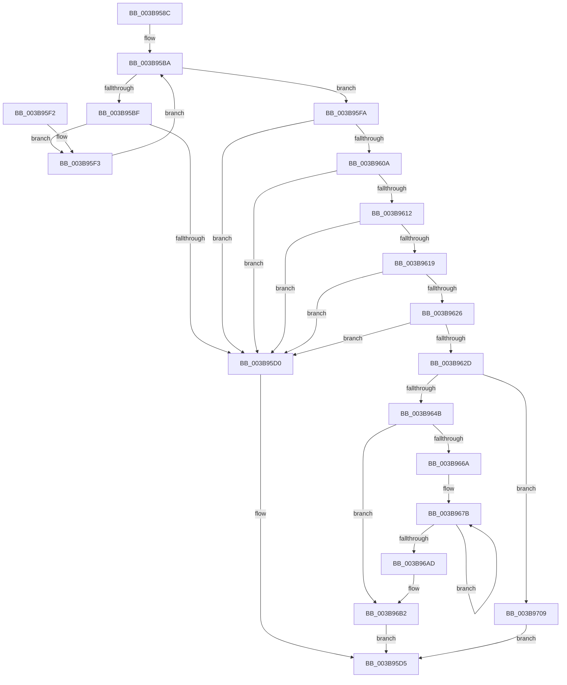

# EtwpTiAllocVadQueryEventWriteWorkItemContext

- RVA: `0x003B958C`–`0x003B9713` (길이 `391` bytes)
- VA: `0x00000001403B958C`
- 실행 섹션: `.text`
- PDB 이름 있음: `예`; PDB Function 태그: `아니요`
- unwind 정보 RVA: `0x0008CA5C`
- 디코드: `115`개 명령, `391/391` bytes 표시
- 미해석 바이트: `0` (있으면 어셈블리에 `.byte`로 보존)

> 이 문서는 커널 이미지의 기계어와 PDB 기호를 분석해 생성했습니다. 4번과 5번은 함수 원형과 자료형을 바이너리 사용 방식에서 추정한 C 해석이며 원본 소스 복구 결과는 아닙니다.

## 1. Dependencies

- 직접 호출 지점: **4**; 고유 호출 대상: **3**
- 직접 호출자로 확인된 함수: **1**
- RIP 상대 이미지 참조: **0**

### Outgoing calls
- `0x003B963A` → [ExAllocatePool2](../../poolcode/B8/ExAllocatePool2_function_00B820F0.md) (function, `0x00B820F0`)
- `0x003B9685` → [memcpy](../6C/memcpy_function_006C6840.md) (function, `0x006C6840`)
- `0x003B96BE` → [ObfReferenceObjectWithTag](../21/ObfReferenceObjectWithTag_function_00210710.md) (function, `0x00210710`)
- `0x003B96D3` → [memcpy](../6C/memcpy_function_006C6840.md) (function, `0x006C6840`)

### Direct callers
- [EtwpTiAsyncVadQueryEventWrite](EtwpTiAsyncVadQueryEventWrite_function_003B9428.md) at `0x003B94CD`

### Static image references
- 디코드된 RIP-relative 메모리 참조가 없습니다.

## 2. Other-region calls and transfers

- 다른 실행 섹션으로 향하는 call: **1**
  - `0x003B963A` → [ExAllocatePool2](../../poolcode/B8/ExAllocatePool2_function_00B820F0.md) (`.text` → `POOLCODE`)
- 별도 외부 분기/꼬리 이동을 확인하지 못했습니다.

## 3. Assembly (complete function range)

```asm
003B958C  48 8B C4                        mov rax, rsp
003B958F  48 89 58 08                     mov qword ptr [rax + 8], rbx
003B9593  48 89 68 10                     mov qword ptr [rax + 0x10], rbp
003B9597  48 89 70 18                     mov qword ptr [rax + 0x18], rsi
003B959B  4C 89 48 20                     mov qword ptr [rax + 0x20], r9
003B959F  57                              push rdi
003B95A0  41 54                           push r12
003B95A2  41 55                           push r13
003B95A4  41 56                           push r14
003B95A6  41 57                           push r15
003B95A8  48 83 EC 20                     sub rsp, 0x20
003B95AC  33 F6                           xor esi, esi
003B95AE  45 8B F8                        mov r15d, r8d
003B95B1  45 33 D2                        xor r10d, r10d
003B95B4  4D 8B E1                        mov r12, r9
003B95B7  4C 8B E9                        mov r13, rcx
003B95BA  45 3B D7                        cmp r10d, r15d
003B95BD  73 3B                           jae 0x1403b95fa
003B95BF  41 8B C2                        mov eax, r10d
003B95C2  48 03 C0                        add rax, rax
003B95C5  41 8B 4C C5 08                  mov ecx, dword ptr [r13 + rax*8 + 8]
003B95CA  03 CE                           add ecx, esi
003B95CC  3B CE                           cmp ecx, esi
003B95CE  73 23                           jae 0x1403b95f3
003B95D0  B8 95 00 00 C0                  mov eax, 0xc0000095
003B95D5  48 8B 5C 24 50                  mov rbx, qword ptr [rsp + 0x50]
003B95DA  48 8B 6C 24 58                  mov rbp, qword ptr [rsp + 0x58]
003B95DF  48 8B 74 24 60                  mov rsi, qword ptr [rsp + 0x60]
003B95E4  48 83 C4 20                     add rsp, 0x20
003B95E8  41 5F                           pop r15
003B95EA  41 5E                           pop r14
003B95EC  41 5D                           pop r13
003B95EE  41 5C                           pop r12
003B95F0  5F                              pop rdi
003B95F1  C3                              ret
003B95F2  CC                              int3
003B95F3  8B F1                           mov esi, ecx
003B95F5  41 FF C2                        inc r10d
003B95F8  EB C0                           jmp 0x1403b95ba
003B95FA  8B FA                           mov edi, edx
003B95FC  BA FF FF FF FF                  mov edx, 0xffffffff
003B9601  48 C1 E7 04                     shl rdi, 4
003B9605  48 3B FA                        cmp rdi, rdx
003B9608  77 C6                           ja 0x1403b95d0
003B960A  8D 47 58                        lea eax, [rdi + 0x58]
003B960D  83 F8 58                        cmp eax, 0x58
003B9610  72 BE                           jb 0x1403b95d0
003B9612  8D 0C 30                        lea ecx, [rax + rsi]
003B9615  3B C8                           cmp ecx, eax
003B9617  72 B7                           jb 0x1403b95d0
003B9619  8B 6C 24 78                     mov ebp, dword ptr [rsp + 0x78]
003B961D  48 C1 E5 03                     shl rbp, 3
003B9621  48 3B EA                        cmp rbp, rdx
003B9624  77 AA                           ja 0x1403b95d0
003B9626  8D 04 29                        lea eax, [rcx + rbp]
003B9629  3B C1                           cmp eax, ecx
003B962B  72 A3                           jb 0x1403b95d0
003B962D  8B D0                           mov edx, eax
003B962F  B9 40 00 00 00                  mov ecx, 0x40
003B9634  41 B8 54 49 73 6E               mov r8d, 0x6e734954
003B963A  E8 B1 8A 7C 00                  call 0x140b820f0
003B963F  48 8B D8                        mov rbx, rax
003B9642  48 85 C0                        test rax, rax
003B9645  0F 84 BE 00 00 00               je 0x1403b9709
003B964B  4C 8D 70 58                     lea r14, [rax + 0x58]
003B964F  4C 89 70 20                     mov qword ptr [rax + 0x20], r14
003B9653  8B C7                           mov eax, edi
003B9655  4C 03 F0                        add r14, rax
003B9658  8B C6                           mov eax, esi
003B965A  49 03 C6                        add rax, r14
003B965D  4C 89 73 28                     mov qword ptr [rbx + 0x28], r14
003B9661  48 89 43 48                     mov qword ptr [rbx + 0x48], rax
003B9665  45 85 FF                        test r15d, r15d
003B9668  74 48                           je 0x1403b96b2
003B966A  48 C7 C6 F8 FF FF FF            mov rsi, 0xfffffffffffffff8
003B9671  49 8D 7D 08                     lea rdi, [r13 + 8]
003B9675  49 2B F5                        sub rsi, r13
003B9678  4D 8B E7                        mov r12, r15
003B967B  44 8B 07                        mov r8d, dword ptr [rdi]
003B967E  49 8B CE                        mov rcx, r14
003B9681  48 8B 57 F8                     mov rdx, qword ptr [rdi - 8]
003B9685  E8 B6 D1 30 00                  call 0x1406c6840
003B968A  8B 07                           mov eax, dword ptr [rdi]
003B968C  48 8D 0C 3E                     lea rcx, [rsi + rdi]
003B9690  48 03 4B 20                     add rcx, qword ptr [rbx + 0x20]
003B9694  83 61 0C 00                     and dword ptr [rcx + 0xc], 0
003B9698  4C 89 31                        mov qword ptr [rcx], r14
003B969B  89 41 08                        mov dword ptr [rcx + 8], eax
003B969E  8B 07                           mov eax, dword ptr [rdi]
003B96A0  48 8D 7F 10                     lea rdi, [rdi + 0x10]
003B96A4  4C 03 F0                        add r14, rax
003B96A7  49 83 EC 01                     sub r12, 1
003B96AB  75 CE                           jne 0x1403b967b
003B96AD  4C 8B 64 24 68                  mov r12, qword ptr [rsp + 0x68]
003B96B2  BA 45 74 54 69                  mov edx, 0x69547445
003B96B7  44 89 7B 30                     mov dword ptr [rbx + 0x30], r15d
003B96BB  49 8B CC                        mov rcx, r12
003B96BE  E8 4D 70 E5 FF                  call 0x140210710
003B96C3  48 8B 54 24 70                  mov rdx, qword ptr [rsp + 0x70]
003B96C8  48 8B 4B 48                     mov rcx, qword ptr [rbx + 0x48]
003B96CC  44 8B C5                        mov r8d, ebp
003B96CF  4C 89 63 40                     mov qword ptr [rbx + 0x40], r12
003B96D3  E8 68 D1 30 00                  call 0x1406c6840
003B96D8  8B 44 24 78                     mov eax, dword ptr [rsp + 0x78]
003B96DC  89 43 34                        mov dword ptr [rbx + 0x34], eax
003B96DF  48 8B 84 24 80 00 00 00         mov rax, qword ptr [rsp + 0x80]
003B96E7  48 89 43 38                     mov qword ptr [rbx + 0x38], rax
003B96EB  48 8B 84 24 88 00 00 00         mov rax, qword ptr [rsp + 0x88]
003B96F3  48 89 43 50                     mov qword ptr [rbx + 0x50], rax
003B96F7  48 8B 84 24 90 00 00 00         mov rax, qword ptr [rsp + 0x90]
003B96FF  48 89 18                        mov qword ptr [rax], rbx
003B9702  33 C0                           xor eax, eax
003B9704  E9 CC FE FF FF                  jmp 0x1403b95d5
003B9709  B8 17 00 00 C0                  mov eax, 0xc0000017
003B970E  E9 C2 FE FF FF                  jmp 0x1403b95d5
```

## 4. C-style interpretation (structured pseudocode)

```c
__int64 __fastcall EtwpTiAllocVadQueryEventWriteWorkItemContext(__int64 a1, int a2, int a3, __int64 a4, __int64 a5, unsigned int a6, __int64 a7, __int64 a8, __int64 a9)
{
    __int64 result;
    __int64 v_r10;
    __int64 v_r12;
    __int64 v_r14;
    __int64 v_rbp;
    __int64 v_rdi;
    __int64 v_rsi;
    __int64 v_rsp;
    unsigned __int64 v_stack_p10;
    unsigned __int64 v_stack_p18;
    unsigned __int64 v_stack_p68;
    unsigned __int64 v_stack_p8;

    *(unsigned __int64 *)(v_rsp + 8) = v_rbx;
    *(unsigned __int64 *)(v_rsp + 16) = v_rbp;
    *(unsigned __int64 *)(v_rsp + 24) = v_rsi;
    *(unsigned __int64 *)(v_rsp + 32) = a4;
    v_rsp = (v_rsp) - (32);
    v_rsi = 0;
    v_r10 = 0;
loc_003B95BA:
    if (0 >= ((unsigned int)((unsigned int)(a3)))) goto loc_003B95FA;
    result = (0) + (0);
    a1 = (unsigned int)(((unsigned int)(*(unsigned int *)(a1 + result * 8 + 8))) + (0));
    if (((unsigned int)(a1)) >= 0) goto loc_003B95F3;
loc_003B95D0:
loc_003B95D5:
    v_rsp = (v_rsp) + (32);
    return (unsigned int)(0xC0000095ULL);
loc_003B95F3:
    v_r10 = (unsigned int)((v_r10) + 1);
    goto loc_003B95BA;
loc_003B95FA:
    v_rdi = ((unsigned int)(a2)) << (4);
    if (v_rdi > ((unsigned int)(0xFFFFFFFFULL))) goto loc_003B95D0;
    if (((unsigned int)(v_rdi + 88)) < 88) goto loc_003B95D0;
    if (((unsigned int)(v_rdi + 88 + (unsigned int)((unsigned int)(a1)) * 1)) < ((unsigned int)(v_rdi + 88))) goto loc_003B95D0;
    v_rbp = ((unsigned int)(a6)) << (3);
    if (v_rbp > ((unsigned int)(0xFFFFFFFFULL))) goto loc_003B95D0;
    if (((unsigned int)(v_rdi + 88 + (unsigned int)((unsigned int)(a1)) * 1 + v_rbp * 1)) < ((unsigned int)(v_rdi + 88 + (unsigned int)((unsigned int)(a1)) * 1))) goto loc_003B95D0;
    result = ExAllocatePool2(64, (unsigned int)((unsigned int)(v_rdi + 88 + (unsigned int)((unsigned int)(a1)) * 1 + v_rbp * 1)), (unsigned int)(0x6E734954ULL), a4);
    if (result == 0) goto loc_003B9709;
    *(unsigned __int64 *)(result + 32) = result + 88;
    v_r14 = (result + 88) + ((unsigned int)((unsigned int)(v_rdi)));
    result = ((unsigned int)((unsigned int)((unsigned int)((unsigned int)(a1))))) + (v_r14);
    *(unsigned __int64 *)(result + 40) = v_r14;
    *(unsigned __int64 *)(result + 72) = result;
    if ((unsigned int)((unsigned int)(a3)) == 0) goto loc_003B96B2;
    v_rsi = (-8) - (a1);
loc_003B967B:
    result = memcpy(v_r14, *(unsigned __int64 *)(a1 + 8 - 8), (unsigned int)(*(unsigned int *)(a1 + 8)), a4);
    a1 = (v_rsi + a1 + 8 * 1) + (*(unsigned __int64 *)(result + 32));
    *(unsigned __int64 *)(a1) = v_r14;
    *(unsigned int *)(a1 + 8) = (unsigned int)((unsigned int)(*(unsigned int *)(a1 + 8)));
    v_r14 = (v_r14) + ((unsigned int)(*(unsigned int *)(a1 + 8)));
    v_r12 = ((unsigned int)(a3)) - (1);
    if (condition_is_not_equal) goto loc_003B967B;
loc_003B96B2:
    *(unsigned int *)(result + 48) = (unsigned int)((unsigned int)(a3));
    result = ObfReferenceObjectWithTag(v_stack_p68, (unsigned int)(0x69547445ULL), (unsigned int)(*(unsigned int *)(a1 + 8)), a4);
    *(unsigned __int64 *)(result + 64) = v_stack_p68;
    result = memcpy(*(unsigned __int64 *)(result + 72), a5, (unsigned int)((unsigned int)(v_rbp)), a4);
    *(unsigned int *)(result + 52) = (unsigned int)((unsigned int)(a6));
    *(unsigned __int64 *)(result + 56) = a7;
    *(unsigned __int64 *)(result + 80) = a8;
    *(unsigned __int64 *)(a9) = result;
    result = 0;
    goto loc_003B95D5;
loc_003B9709:
    goto loc_003B95D5;
}
```

## 5. (Beta) C Style

```c
int64_t EtwpTiAllocVadQueryEventWriteWorkItemContext(void *Arg1, int32_t Arg2, int32_t Arg3, int64_t Arg4, int64_t Arg5, uint32_t Arg6, int64_t Arg7, int64_t Arg8, void *Arg9)
{
    uint8_t *arg1 = (uint8_t *)Arg1;
    uint8_t *arg9 = (uint8_t *)Arg9;

    int64_t result;
    int64_t local_r10;
    int64_t local_r12;
    int64_t local_r14;
    int64_t local_rbp;
    int64_t local_rdi;
    int64_t local_rsi;
    int64_t local_rsp;
    uint64_t v_stack_p10;
    uint64_t v_stack_p18;
    uint64_t v_stack_p68;
    uint64_t v_stack_p8;

    *(uint64_t *)(local_rsp + 0x8) = local_rbx;
    *(uint64_t *)(local_rsp + 0x10) = local_rbp;
    *(uint64_t *)(local_rsp + 0x18) = local_rsi;
    *(uint64_t *)(local_rsp + 0x20) = Arg4;
    local_rsp = (local_rsp) - (32);
    local_rsi = 0;
    local_r10 = 0;
loc_003B95BA:
    if (0 >= ((uint32_t)((uint32_t)(Arg3)))) goto loc_003B95FA;
    result = (0) + (0);
    Arg1 = (uint32_t)(((uint32_t)(*(uint32_t *)(arg1 + result * 8 + 0x8))) + (0));
    if (((uint32_t)(Arg1)) >= 0) goto loc_003B95F3;
loc_003B95D0:
loc_003B95D5:
    local_rsp = (local_rsp) + (32);
    return (uint32_t)(0xC0000095ULL);
loc_003B95F3:
    local_r10 = (uint32_t)((local_r10) + 1);
    goto loc_003B95BA;
loc_003B95FA:
    local_rdi = ((uint32_t)(Arg2)) << (4);
    if (local_rdi > ((uint32_t)(0xFFFFFFFFULL))) goto loc_003B95D0;
    if (((uint32_t)(local_rdi + 88)) < 88) goto loc_003B95D0;
    if (((uint32_t)(local_rdi + 88 + (uint32_t)((uint32_t)(Arg1)) * 1)) < ((uint32_t)(local_rdi + 88))) goto loc_003B95D0;
    local_rbp = ((uint32_t)(Arg6)) << (3);
    if (local_rbp > ((uint32_t)(0xFFFFFFFFULL))) goto loc_003B95D0;
    if (((uint32_t)(local_rdi + 88 + (uint32_t)((uint32_t)(Arg1)) * 1 + local_rbp * 1)) < ((uint32_t)(local_rdi + 88 + (uint32_t)((uint32_t)(Arg1)) * 1))) goto loc_003B95D0;
    result = ExAllocatePool2(64, (uint32_t)((uint32_t)(local_rdi + 88 + (uint32_t)((uint32_t)(Arg1)) * 1 + local_rbp * 1)), (uint32_t)(0x6E734954ULL), Arg4);
    if (result == 0) goto loc_003B9709;
    *(uint64_t *)(result + 0x20) = result + 88;
    local_r14 = (result + 88) + ((uint32_t)((uint32_t)(local_rdi)));
    result = ((uint32_t)((uint32_t)((uint32_t)((uint32_t)(Arg1))))) + (local_r14);
    *(uint64_t *)(result + 0x28) = local_r14;
    *(uint64_t *)(result + 0x48) = result;
    if ((uint32_t)((uint32_t)(Arg3)) == 0) goto loc_003B96B2;
    local_rsi = (-8) - (Arg1);
loc_003B967B:
    result = memcpy(local_r14, *(uint64_t *)(arg1 + 0x8 - 0x8), (uint32_t)(*(uint32_t *)(arg1 + 0x8)), Arg4);
    Arg1 = (local_rsi + Arg1 + 8 * 1) + (*(uint64_t *)(result + 0x20));
    *(uint64_t *)(arg1) = local_r14;
    *(uint32_t *)(arg1 + 0x8) = (uint32_t)((uint32_t)(*(uint32_t *)(arg1 + 0x8)));
    local_r14 = (local_r14) + ((uint32_t)(*(uint32_t *)(arg1 + 0x8)));
    local_r12 = ((uint32_t)(Arg3)) - (1);
    if (condition_is_not_equal) goto loc_003B967B;
loc_003B96B2:
    *(uint32_t *)(result + 0x30) = (uint32_t)((uint32_t)(Arg3));
    result = ObfReferenceObjectWithTag(v_stack_p68, (uint32_t)(0x69547445ULL), (uint32_t)(*(uint32_t *)(arg1 + 0x8)), Arg4);
    *(uint64_t *)(result + 0x40) = v_stack_p68;
    result = memcpy(*(uint64_t *)(result + 0x48), Arg5, (uint32_t)((uint32_t)(local_rbp)), Arg4);
    *(uint32_t *)(result + 0x34) = (uint32_t)((uint32_t)(Arg6));
    *(uint64_t *)(result + 0x38) = Arg7;
    *(uint64_t *)(result + 0x50) = Arg8;
    *(uint64_t *)(arg9) = result;
    result = 0;
    goto loc_003B95D5;
loc_003B9709:
    goto loc_003B95D5;
}
```

### 관측된 메모리 오프셋

구조체 형식이 확인되지 않은 접근은 인자 기준의 오프셋으로만 기록했습니다.

| 기준 인자 | 오프셋 표현 | 폭 (bit) | 접근 |
|---|---:|---:|---|
| `Arg1` | `- 0x8` | `64` | `R` |
| `Arg1` | `+ 0x0` | `32` | `R` |
| `Arg1` | `+ 0x8` | `64` | `R` |
| `Arg1` | `+ 0x8 + rax*8` | `32` | `R` |
| `Arg1` | `+ 0x10` | `64` | `R` |
| `Arg9` | `+ 0x0` | `64` | `W` |

## 6. Execution-region graph

[열기: 2D/3D 그래프와 함수 탐색 컨트롤 패널](../../../control-panel.html?section=text&rva=0x003B958C&view=graph)

- 2D 그래프는 위에서 아래로 흐르고, 3D 그래프는 빈 공간을 드래그해 회전합니다. Shift+드래그는 이동, 휠은 확대·축소, 함수 노드 선택은 대상 보고서 이동입니다.

### Static fallback


