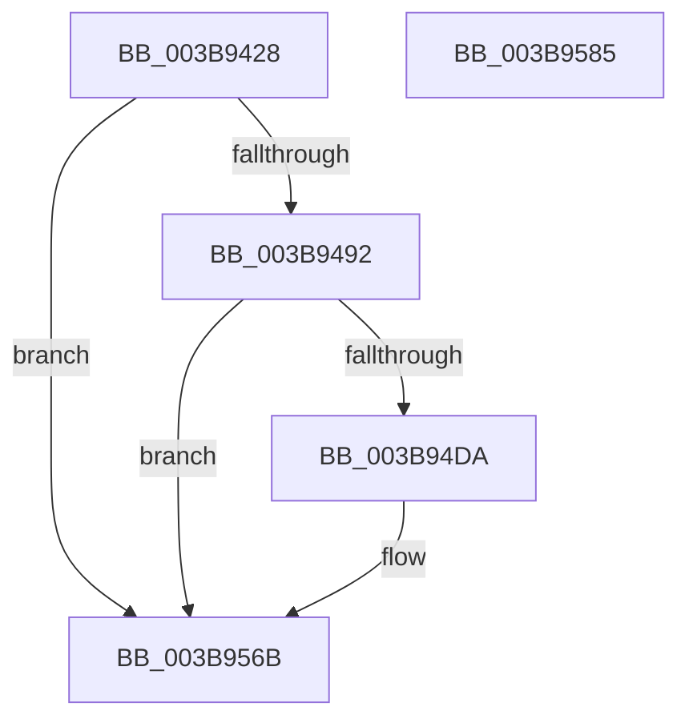

# EtwpTiAsyncVadQueryEventWrite

- RVA: `0x003B9428`–`0x003B9586` (길이 `350` bytes)
- VA: `0x00000001403B9428`
- 실행 섹션: `.text`
- PDB 이름 있음: `예`; PDB Function 태그: `아니요`
- unwind 정보 RVA: `0x0008CA40`
- 디코드: `87`개 명령, `350/350` bytes 표시
- 미해석 바이트: `0` (있으면 어셈블리에 `.byte`로 보존)

> 이 문서는 커널 이미지의 기계어와 PDB 기호를 분석해 생성했습니다. 4번과 5번은 함수 원형과 자료형을 바이너리 사용 방식에서 추정한 C 해석이며 원본 소스 복구 결과는 아닙니다.

## 1. Dependencies

- 직접 호출 지점: **4**; 고유 호출 대상: **4**
- 직접 호출자로 확인된 함수: **1**
- RIP 상대 이미지 참조: **2**

### Outgoing calls
- `0x003B9485` → [EtwpTiTestBloomFilter](EtwpTiTestBloomFilter_function_003B97CC.md) (function, `0x003B97CC`)
- `0x003B94CD` → [EtwpTiAllocVadQueryEventWriteWorkItemContext](EtwpTiAllocVadQueryEventWriteWorkItemContext_function_003B958C.md) (function, `0x003B958C`)
- `0x003B94ED` → [EtwpTiGetHashedBitNumbers](EtwpTiGetHashedBitNumbers_function_003B971C.md) (function, `0x003B971C`)
- `0x003B9566` → [ExQueueWorkItem](../2F/ExQueueWorkItem_function_002F9520.md) (function, `0x002F9520`)

### Direct callers
- [EtwpTiVadQueryEventWrite](EtwpTiVadQueryEventWrite_function_003B9360.md) at `0x003B93C3`

### Static image references
- `0x003B94FF` → RVA `0x00EFF1A8` (`.data`; read)
- `0x003B954E` → RVA `0x00A03970` (`EtwpTiVadQueryEventWriteCallback`; read)

## 2. Other-region calls and transfers

- 다른 실행 섹션으로 향하는 call: **0**
- 별도 외부 분기/꼬리 이동을 확인하지 못했습니다.

## 3. Assembly (complete function range)

```asm
003B9428  48 8B C4                        mov rax, rsp
003B942B  48 89 58 08                     mov qword ptr [rax + 8], rbx
003B942F  48 89 68 10                     mov qword ptr [rax + 0x10], rbp
003B9433  48 89 70 18                     mov qword ptr [rax + 0x18], rsi
003B9437  57                              push rdi
003B9438  41 56                           push r14
003B943A  41 57                           push r15
003B943C  48 83 EC 60                     sub rsp, 0x60
003B9440  48 83 60 20 00                  and qword ptr [rax + 0x20], 0
003B9445  44 8B F2                        mov r14d, edx
003B9448  65 48 8B 04 25 88 01 00 00      mov rax, qword ptr gs:[0x188]
003B9451  49 8B F9                        mov rdi, r9
003B9454  48 8B B4 24 A0 00 00 00         mov rsi, qword ptr [rsp + 0xa0]
003B945C  41 8B E8                        mov ebp, r8d
003B945F  4C 8B F9                        mov r15, rcx
003B9462  4C 8B 90 B8 00 00 00            mov r10, qword ptr [rax + 0xb8]
003B9469  49 8B 9A 78 06 00 00            mov rbx, qword ptr [r10 + 0x678]
003B9470  48 C1 E3 10                     shl rbx, 0x10
003B9474  49 33 99 78 06 00 00            xor rbx, qword ptr [r9 + 0x678]
003B947B  48 C1 E3 20                     shl rbx, 0x20
003B947F  48 33 1E                        xor rbx, qword ptr [rsi]
003B9482  48 8B D3                        mov rdx, rbx
003B9485  E8 42 03 00 00                  call 0x1403b97cc
003B948A  84 C0                           test al, al
003B948C  0F 85 D9 00 00 00               jne 0x1403b956b
003B9492  48 8D 84 24 98 00 00 00         lea rax, [rsp + 0x98]
003B949A  4C 8B CF                        mov r9, rdi
003B949D  48 89 44 24 40                  mov qword ptr [rsp + 0x40], rax
003B94A2  44 8B C5                        mov r8d, ebp
003B94A5  48 8B 84 24 B0 00 00 00         mov rax, qword ptr [rsp + 0xb0]
003B94AD  41 8B D6                        mov edx, r14d
003B94B0  48 89 5C 24 38                  mov qword ptr [rsp + 0x38], rbx
003B94B5  49 8B CF                        mov rcx, r15
003B94B8  48 89 44 24 30                  mov qword ptr [rsp + 0x30], rax
003B94BD  8B 84 24 A8 00 00 00            mov eax, dword ptr [rsp + 0xa8]
003B94C4  89 44 24 28                     mov dword ptr [rsp + 0x28], eax
003B94C8  48 89 74 24 20                  mov qword ptr [rsp + 0x20], rsi
003B94CD  E8 BA 00 00 00                  call 0x1403b958c
003B94D2  85 C0                           test eax, eax
003B94D4  0F 88 91 00 00 00               js 0x1403b956b
003B94DA  33 C0                           xor eax, eax
003B94DC  48 8D 4C 24 50                  lea rcx, [rsp + 0x50]
003B94E1  4C 8B C3                        mov r8, rbx
003B94E4  48 89 44 24 50                  mov qword ptr [rsp + 0x50], rax
003B94E9  89 44 24 58                     mov dword ptr [rsp + 0x58], eax
003B94ED  E8 2A 02 00 00                  call 0x1403b971c
003B94F2  8B 4C 24 50                     mov ecx, dword ptr [rsp + 0x50]
003B94F6  8B D1                           mov edx, ecx
003B94F8  83 E1 07                        and ecx, 7
003B94FB  48 C1 EA 03                     shr rdx, 3
003B94FF  48 03 15 A2 5C B4 00            add rdx, qword ptr [rip + 0xb45ca2]
003B9506  0F BE 02                        movsx eax, byte ptr [rdx]
003B9509  0F AB C8                        bts eax, ecx
003B950C  8B 4C 24 54                     mov ecx, dword ptr [rsp + 0x54]
003B9510  88 02                           mov byte ptr [rdx], al
003B9512  8B D1                           mov edx, ecx
003B9514  48 C1 EA 03                     shr rdx, 3
003B9518  83 E1 07                        and ecx, 7
003B951B  48 03 15 86 5C B4 00            add rdx, qword ptr [rip + 0xb45c86]
003B9522  0F BE 02                        movsx eax, byte ptr [rdx]
003B9525  0F AB C8                        bts eax, ecx
003B9528  8B 4C 24 58                     mov ecx, dword ptr [rsp + 0x58]
003B952C  88 02                           mov byte ptr [rdx], al
003B952E  8B D1                           mov edx, ecx
003B9530  48 C1 EA 03                     shr rdx, 3
003B9534  83 E1 07                        and ecx, 7
003B9537  48 03 15 6A 5C B4 00            add rdx, qword ptr [rip + 0xb45c6a]
003B953E  0F BE 02                        movsx eax, byte ptr [rdx]
003B9541  0F AB C8                        bts eax, ecx
003B9544  48 8B 8C 24 98 00 00 00         mov rcx, qword ptr [rsp + 0x98]
003B954C  88 02                           mov byte ptr [rdx], al
003B954E  48 8D 05 1B A4 64 00            lea rax, [rip + 0x64a41b]
003B9555  BA 01 00 00 00                  mov edx, 1
003B955A  48 83 21 00                     and qword ptr [rcx], 0
003B955E  48 89 41 10                     mov qword ptr [rcx + 0x10], rax
003B9562  48 89 49 18                     mov qword ptr [rcx + 0x18], rcx
003B9566  E8 B5 FF F3 FF                  call 0x1402f9520
003B956B  4C 8D 5C 24 60                  lea r11, [rsp + 0x60]
003B9570  49 8B 5B 20                     mov rbx, qword ptr [r11 + 0x20]
003B9574  49 8B 6B 28                     mov rbp, qword ptr [r11 + 0x28]
003B9578  49 8B 73 30                     mov rsi, qword ptr [r11 + 0x30]
003B957C  49 8B E3                        mov rsp, r11
003B957F  41 5F                           pop r15
003B9581  41 5E                           pop r14
003B9583  5F                              pop rdi
003B9584  C3                              ret
003B9585  CC                              int3
```

## 4. C-style interpretation (structured pseudocode)

```c
__int64 __fastcall EtwpTiAsyncVadQueryEventWrite(__int64 a1, int a2, int a3, __int64 a4, __int64 a5, unsigned int a6, __int64 a7)
{
    __int64 result;
    __int64 v_rbx;
    __int64 v_rsp;
    unsigned __int64 v_stack_m18;
    unsigned int v_stack_m20;
    unsigned int v_stack_m24;
    unsigned __int64 v_stack_m28;
    unsigned __int64 v_stack_m38;
    unsigned __int64 v_stack_m40;
    unsigned __int64 v_stack_m48;
    unsigned int v_stack_m50;
    unsigned __int64 v_stack_m58;
    unsigned __int64 v_stack_p20;

    *(unsigned __int64 *)(v_rsp + 8) = v_rbx;
    *(unsigned __int64 *)(v_rsp + 16) = v_rbp;
    *(unsigned __int64 *)(v_rsp + 24) = v_rsi;
    v_rsp = (v_rsp) - (96);
    v_rbx = (*(unsigned __int64 *)(*(unsigned __int64 *)(*(unsigned __int64 *)(gs_base + (0 + 392)) + 184) + 1656)) << (16);
    v_rbx = (v_rbx) ^ (*(unsigned __int64 *)(a4 + 1656));
    v_rbx = (v_rbx) << (32);
    v_rbx = (v_rbx) ^ (*(unsigned __int64 *)(a5));
    result = EtwpTiTestBloomFilter(a1, v_rbx, a3, a4);
    if ((unsigned __int8)(result) != 0) goto loc_003B956B;
    v_stack_m38 = v_stack_p20;
    v_stack_m40 = v_rbx;
    v_stack_m48 = a7;
    v_stack_m50 = (unsigned int)((unsigned int)(a6));
    v_stack_m58 = a5;
    result = EtwpTiAllocVadQueryEventWriteWorkItemContext(a1, (unsigned int)((unsigned int)((unsigned int)(a2))), (unsigned int)((unsigned int)((unsigned int)(a3))), a4);
    if (!(sign_flag)) {
        result = 0;
        a1 = v_stack_m28;
        a3 = v_rbx;
        v_stack_m28 = 0;
        v_stack_m20 = 0;
        result = EtwpTiGetHashedBitNumbers(a1, (unsigned int)((unsigned int)((unsigned int)(a2))), a3, a4);
        a1 = v_stack_m28;
        a2 = (unsigned int)(a1);
        a1 = (unsigned int)((a1) & (7));
        a2 = (a2) >> (3);
        a2 = (a2) + (*(unsigned __int64 *)(v_rip + 11820194));
        result = (__int8)(*(unsigned __int8 *)(a2));
        a1 = v_stack_m24;
        *(unsigned __int8 *)(a2) = (unsigned __int8)(result);
        a2 = (unsigned int)(a1);
        a2 = (a2) >> (3);
        a1 = (unsigned int)((a1) & (7));
        a2 = (a2) + (*(unsigned __int64 *)(v_rip + 11820166));
        result = (__int8)(*(unsigned __int8 *)(a2));
        a1 = v_stack_m20;
        *(unsigned __int8 *)(a2) = (unsigned __int8)(result);
        a2 = (unsigned int)(a1);
        a2 = (a2) >> (3);
        a1 = (unsigned int)((a1) & (7));
        a2 = (a2) + (*(unsigned __int64 *)(v_rip + 11820138));
        result = (__int8)(*(unsigned __int8 *)(a2));
        a1 = v_stack_p20;
        *(unsigned __int8 *)(a2) = (unsigned __int8)(result);
        result = v_rip + 6595611;
        a2 = 1;
        *(unsigned __int64 *)(a1 + 16) = result;
        *(unsigned __int64 *)(a1 + 24) = a1;
        result = ExQueueWorkItem(a1, a2, a3, a4);
    }
    return result;
}
```

## 5. (Beta) C Style

```c
int64_t EtwpTiAsyncVadQueryEventWrite(int64_t Arg1, int32_t Arg2, int32_t Arg3, void *Arg4, void *Arg5, uint32_t Arg6, int64_t Arg7)
{
    uint8_t *arg4 = (uint8_t *)Arg4;
    uint8_t *arg5 = (uint8_t *)Arg5;

    int64_t result;
    int64_t local_rbx;
    int64_t local_rsp;
    uint64_t v_stack_m18;
    uint32_t v_stack_m20;
    uint32_t v_stack_m24;
    uint64_t v_stack_m28;
    uint64_t v_stack_m38;
    uint64_t v_stack_m40;
    uint64_t v_stack_m48;
    uint32_t v_stack_m50;
    uint64_t v_stack_m58;
    uint64_t v_stack_p20;

    *(uint64_t *)(local_rsp + 0x8) = local_rbx;
    *(uint64_t *)(local_rsp + 0x10) = local_rbp;
    *(uint64_t *)(local_rsp + 0x18) = local_rsi;
    local_rsp = (local_rsp) - (96);
    local_rbx = (*(uint64_t *)(*(uint64_t *)(*(uint64_t *)(gs_base + (0 + 0x188)) + 0xB8) + 0x678)) << (16);
    local_rbx = (local_rbx) ^ (*(uint64_t *)(arg4 + 0x678));
    local_rbx = (local_rbx) << (32);
    local_rbx = (local_rbx) ^ (*(uint64_t *)(arg5));
    result = EtwpTiTestBloomFilter(Arg1, local_rbx, Arg3, Arg4);
    if ((uint8_t)(result) != 0) goto loc_003B956B;
    v_stack_m38 = v_stack_p20;
    v_stack_m40 = local_rbx;
    v_stack_m48 = Arg7;
    v_stack_m50 = (uint32_t)((uint32_t)(Arg6));
    v_stack_m58 = Arg5;
    result = EtwpTiAllocVadQueryEventWriteWorkItemContext(Arg1, (uint32_t)((uint32_t)((uint32_t)(Arg2))), (uint32_t)((uint32_t)((uint32_t)(Arg3))), Arg4);
    if (!(sign_flag)) {
        result = 0;
        Arg1 = v_stack_m28;
        Arg3 = local_rbx;
        v_stack_m28 = 0;
        v_stack_m20 = 0;
        result = EtwpTiGetHashedBitNumbers(Arg1, (uint32_t)((uint32_t)((uint32_t)(Arg2))), Arg3, Arg4);
        Arg1 = v_stack_m28;
        Arg2 = (uint32_t)(Arg1);
        Arg1 = (uint32_t)((Arg1) & (7));
        Arg2 = (Arg2) >> (3);
        Arg2 = (Arg2) + (*(uint64_t *)(v_rip + 0xB45CA2));
        result = (int8_t)(*(uint8_t *)(Arg2));
        Arg1 = v_stack_m24;
        *(uint8_t *)(Arg2) = (uint8_t)(result);
        Arg2 = (uint32_t)(Arg1);
        Arg2 = (Arg2) >> (3);
        Arg1 = (uint32_t)((Arg1) & (7));
        Arg2 = (Arg2) + (*(uint64_t *)(v_rip + 0xB45C86));
        result = (int8_t)(*(uint8_t *)(Arg2));
        Arg1 = v_stack_m20;
        *(uint8_t *)(Arg2) = (uint8_t)(result);
        Arg2 = (uint32_t)(Arg1);
        Arg2 = (Arg2) >> (3);
        Arg1 = (uint32_t)((Arg1) & (7));
        Arg2 = (Arg2) + (*(uint64_t *)(v_rip + 0xB45C6A));
        result = (int8_t)(*(uint8_t *)(Arg2));
        Arg1 = v_stack_p20;
        *(uint8_t *)(Arg2) = (uint8_t)(result);
        result = v_rip + 6595611;
        Arg2 = 1;
        *(uint64_t *)(Arg1 + 0x10) = result;
        *(uint64_t *)(Arg1 + 0x18) = Arg1;
        result = ExQueueWorkItem(Arg1, Arg2, Arg3, Arg4);
    }
    return result;
}
```

### 관측된 메모리 오프셋

구조체 형식이 확인되지 않은 접근은 인자 기준의 오프셋으로만 기록했습니다.

| 기준 인자 | 오프셋 표현 | 폭 (bit) | 접근 |
|---|---:|---:|---|
| `Arg4` | `+ 0x678` | `64` | `R` |
| `Arg5` | `+ 0x0` | `64` | `R` |

## 6. Execution-region graph

[열기: 2D/3D 그래프와 함수 탐색 컨트롤 패널](../../../control-panel.html?section=text&rva=0x003B9428&view=graph)

- 2D 그래프는 위에서 아래로 흐르고, 3D 그래프는 빈 공간을 드래그해 회전합니다. Shift+드래그는 이동, 휠은 확대·축소, 함수 노드 선택은 대상 보고서 이동입니다.

### Static fallback


