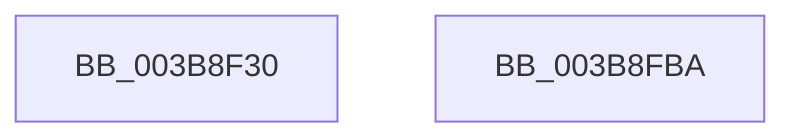

# EtwpTiFillProcessIdentity

- RVA: `0x003B8F30`–`0x003B8FBB` (길이 `139` bytes)
- VA: `0x00000001403B8F30`
- 실행 섹션: `.text`
- PDB 이름 있음: `예`; PDB Function 태그: `아니요`
- unwind 정보 RVA: `0x000DB714`
- 디코드: `25`개 명령, `139/139` bytes 표시
- 미해석 바이트: `0` (있으면 어셈블리에 `.byte`로 보존)

> 이 문서는 커널 이미지의 기계어와 PDB 기호를 분석해 생성했습니다. 4번과 5번은 함수 원형과 자료형을 바이너리 사용 방식에서 추정한 C 해석이며 원본 소스 복구 결과는 아닙니다.

## 1. Dependencies

- 직접 호출 지점: **0**; 고유 호출 대상: **0**
- 직접 호출자로 확인된 함수: **20**
- RIP 상대 이미지 참조: **0**

### Outgoing calls
- 직접 디코드된 call 명령이 없습니다.

### Direct callers
- [EtwTiLogInsertQueueUserApc](EtwTiLogInsertQueueUserApc_function_003B8FC4.md) at `0x003B90FC`
- [EtwTiLogInsertQueueUserApc](EtwTiLogInsertQueueUserApc_function_003B8FC4.md) at `0x003B914E`
- [EtwTiLogInsertQueueUserApc](EtwTiLogInsertQueueUserApc_function_003B8FC4.md) at `0x003B9196`
- [EtwTimLogBlockNonCetBinaries](../../page/7B/EtwTimLogBlockNonCetBinaries_function_007BA5B8.md) at `0x007BA6F6`
- [EtwTimLogControlProtectionUserModeReturnMismatch](../../page/7B/EtwTimLogControlProtectionUserModeReturnMismatch_function_007BA9D4.md) at `0x007BABB2`
- [EtwTimLogProhibitLowILImageMap](../../page/7B/EtwTimLogProhibitLowILImageMap_function_007BB1F4.md) at `0x007BB30F`
- [EtwTimLogProhibitNonMicrosoftBinaries](../../page/7B/EtwTimLogProhibitNonMicrosoftBinaries_function_007BB550.md) at `0x007BB66C`
- [EtwTimLogUserCetSetContextIpValidationFailure](../../page/7B/EtwTimLogUserCetSetContextIpValidationFailure_function_007BB920.md) at `0x007BBA4D`
- [EtwTiLogProtectExecVm](../../page/88/EtwTiLogProtectExecVm_function_00881A48.md) at `0x00881C28`
- [EtwTiLogProtectExecVm](../../page/88/EtwTiLogProtectExecVm_function_00881A48.md) at `0x00881C63`
- [EtwTiLogProtectExecVm](../../page/88/EtwTiLogProtectExecVm_function_00881A48.md) at `0x00881C82`
- [EtwTiLogAllocExecVm](../../page/88/EtwTiLogAllocExecVm_function_00882944.md) at `0x00882A02`
- [EtwTiLogAllocExecVm](../../page/88/EtwTiLogAllocExecVm_function_00882944.md) at `0x00882A40`
- [EtwTiLogAllocExecVm](../../page/88/EtwTiLogAllocExecVm_function_00882944.md) at `0x00882A5F`
- [NtMapViewOfSection](../../page/89/NtMapViewOfSection_function_008986E0.md) at `0x00898A91`
- [NtMapViewOfSection](../../page/89/NtMapViewOfSection_function_008986E0.md) at `0x00898AD8`
- [EtwTiLogImpersonateClient](../../page/8C/EtwTiLogImpersonateClient_function_008CC9D0.md) at `0x008CCB67`
- [EtwTiLogReadWriteVm](../../page/9B/EtwTiLogReadWriteVm_function_009BB7C8.md) at `0x009BB9A2`
- [EtwTiLogReadWriteVm](../../page/9B/EtwTiLogReadWriteVm_function_009BB7C8.md) at `0x009BB9E0`
- [EtwTiLogSetContextThread](../../page/A2/EtwTiLogSetContextThread_function_00A2FC70.md) at `0x00A2FD44`
- [EtwTiLogSetContextThread](../../page/A2/EtwTiLogSetContextThread_function_00A2FC70.md) at `0x00A2FD82`
- [EtwTiLogSuspendResumeThread](../../page/A3/EtwTiLogSuspendResumeThread_function_00A34DE0.md) at `0x00A34EA6`
- [EtwTiLogSuspendResumeThread](../../page/A3/EtwTiLogSuspendResumeThread_function_00A34DE0.md) at `0x00A34EE4`
- [EtwTimLogProhibitChildProcessCreation](../../page/A4/EtwTimLogProhibitChildProcessCreation_function_00A43694.md) at `0x00A43804`
- [EtwTiLogMapExecView](../../page/A5/EtwTiLogMapExecView_function_00A573E0.md) at `0x00A57485`
- [EtwTiLogMapExecView](../../page/A5/EtwTiLogMapExecView_function_00A573E0.md) at `0x00A574C3`
- [EtwpTimLogMitigationForProcess](../../page/A8/EtwpTimLogMitigationForProcess_function_00A81E6C.md) at `0x00A81F7F`
- [EtwTimLogRedirectionTrustPolicy](../../page/AB/EtwTimLogRedirectionTrustPolicy_function_00ABA7E0.md) at `0x00ABAC61`
- [sub_00B1B7C0](../../page/B1/Unknown_function_00B1B7C0.md) at `0x00B1B7EC`
- [sub_00B20A40](../../page/B2/Unknown_function_00B20A40.md) at `0x00B20A84`
- [sub_00B41E06](../../page/B4/Unknown_function_00B41E06.md) at `0x00B41E2D`
- [sub_00B41E06](../../page/B4/Unknown_function_00B41E06.md) at `0x00B41E67`

### Static image references
- 디코드된 RIP-relative 메모리 참조가 없습니다.

## 2. Other-region calls and transfers

- 다른 실행 섹션으로 향하는 call: **0**
- 별도 외부 분기/꼬리 이동을 확인하지 못했습니다.

## 3. Assembly (complete function range)

```asm
003B8F30  48 C7 41 08 04 00 00 00         mov qword ptr [rcx + 8], 4
003B8F38  48 8D 82 D0 01 00 00            lea rax, [rdx + 0x1d0]
003B8F3F  48 89 01                        mov qword ptr [rcx], rax
003B8F42  48 8D 82 F8 01 00 00            lea rax, [rdx + 0x1f8]
003B8F49  48 89 41 10                     mov qword ptr [rcx + 0x10], rax
003B8F4D  48 B8 C4 02 00 00 80 F7 FF FF   movabs rax, 0xfffff780000002c4
003B8F57  48 C7 41 18 08 00 00 00         mov qword ptr [rcx + 0x18], 8
003B8F5F  8B 00                           mov eax, dword ptr [rax]
003B8F61  48 C1 E0 30                     shl rax, 0x30
003B8F65  48 0B 82 78 06 00 00            or rax, qword ptr [rdx + 0x678]
003B8F6C  49 89 00                        mov qword ptr [r8], rax
003B8F6F  48 8D 82 F8 05 00 00            lea rax, [rdx + 0x5f8]
003B8F76  4C 89 41 20                     mov qword ptr [rcx + 0x20], r8
003B8F7A  48 C7 41 28 08 00 00 00         mov qword ptr [rcx + 0x28], 8
003B8F82  48 89 41 30                     mov qword ptr [rcx + 0x30], rax
003B8F86  48 8D 82 F9 05 00 00            lea rax, [rdx + 0x5f9]
003B8F8D  48 C7 41 38 01 00 00 00         mov qword ptr [rcx + 0x38], 1
003B8F95  48 89 41 40                     mov qword ptr [rcx + 0x40], rax
003B8F99  48 8D 82 FA 05 00 00            lea rax, [rdx + 0x5fa]
003B8FA0  48 C7 41 48 01 00 00 00         mov qword ptr [rcx + 0x48], 1
003B8FA8  48 89 41 50                     mov qword ptr [rcx + 0x50], rax
003B8FAC  B8 06 00 00 00                  mov eax, 6
003B8FB1  48 C7 41 58 01 00 00 00         mov qword ptr [rcx + 0x58], 1
003B8FB9  C3                              ret
003B8FBA  CC                              int3
```

## 4. C-style interpretation (structured pseudocode)

```c
__int64 __fastcall EtwpTiFillProcessIdentity(__int64 a1, __int64 a2, __int64 a3)
{
    __int64 result;

    *(unsigned __int64 *)(a1 + 8) = 4;
    *(unsigned __int64 *)(a1) = a2 + 464;
    *(unsigned __int64 *)(a1 + 16) = a2 + 504;
    *(unsigned __int64 *)(a1 + 24) = 8;
    result = ((unsigned int)(*(unsigned int *)(a2 + 504))) << (48);
    result = (result) | (*(unsigned __int64 *)(a2 + 1656));
    *(unsigned __int64 *)(a3) = result;
    *(unsigned __int64 *)(a1 + 32) = a3;
    *(unsigned __int64 *)(a1 + 40) = 8;
    *(unsigned __int64 *)(a1 + 48) = a2 + 1528;
    *(unsigned __int64 *)(a1 + 56) = 1;
    *(unsigned __int64 *)(a1 + 64) = a2 + 1529;
    *(unsigned __int64 *)(a1 + 72) = 1;
    *(unsigned __int64 *)(a1 + 80) = a2 + 1530;
    *(unsigned __int64 *)(a1 + 88) = 1;
    return 6;
}
```

## 5. (Beta) C Style

```c
int64_t EtwpTiFillProcessIdentity(void *Arg1, void *Arg2, void *Arg3)
{
    uint8_t *arg1 = (uint8_t *)Arg1;
    uint8_t *arg2 = (uint8_t *)Arg2;
    uint8_t *arg3 = (uint8_t *)Arg3;

    int64_t result;

    *(uint64_t *)(arg1 + 0x8) = 4;
    *(void **)(arg1) = Arg2 + 464;
    *(void **)(arg1 + 0x10) = Arg2 + 504;
    *(uint64_t *)(arg1 + 0x18) = 8;
    result = ((uint32_t)(*(uint32_t *)(arg2 + 0x1F8))) << (48);
    result = (result) | (*(uint64_t *)(arg2 + 0x678));
    *(uint64_t *)(arg3) = result;
    *(void **)(arg1 + 0x20) = Arg3;
    *(uint64_t *)(arg1 + 0x28) = 8;
    *(void **)(arg1 + 0x30) = Arg2 + 1528;
    *(uint64_t *)(arg1 + 0x38) = 1;
    *(void **)(arg1 + 0x40) = Arg2 + 1529;
    *(uint64_t *)(arg1 + 0x48) = 1;
    *(void **)(arg1 + 0x50) = Arg2 + 1530;
    *(uint64_t *)(arg1 + 0x58) = 1;
    return 6;
}
```

### 관측된 메모리 오프셋

구조체 형식이 확인되지 않은 접근은 인자 기준의 오프셋으로만 기록했습니다.

| 기준 인자 | 오프셋 표현 | 폭 (bit) | 접근 |
|---|---:|---:|---|
| `Arg1` | `+ 0x0` | `64` | `W` |
| `Arg1` | `+ 0x8` | `64` | `W` |
| `Arg1` | `+ 0x10` | `64` | `W` |
| `Arg1` | `+ 0x18` | `64` | `W` |
| `Arg1` | `+ 0x20` | `64` | `W` |
| `Arg1` | `+ 0x28` | `64` | `W` |
| `Arg1` | `+ 0x30` | `64` | `W` |
| `Arg1` | `+ 0x38` | `64` | `W` |
| `Arg1` | `+ 0x40` | `64` | `W` |
| `Arg1` | `+ 0x48` | `64` | `W` |
| `Arg1` | `+ 0x50` | `64` | `W` |
| `Arg1` | `+ 0x58` | `64` | `W` |
| `Arg2` | `+ 0x1D0` | `64` | `R` |
| `Arg2` | `+ 0x1F8` | `64` | `R` |
| `Arg2` | `+ 0x5F8` | `64` | `R` |
| `Arg2` | `+ 0x5F9` | `64` | `R` |
| `Arg2` | `+ 0x5FA` | `64` | `R` |
| `Arg2` | `+ 0x678` | `64` | `R` |
| `Arg3` | `+ 0x0` | `64` | `W` |

## 6. Execution-region graph

[열기: 2D/3D 그래프와 함수 탐색 컨트롤 패널](../../../control-panel.html?section=text&rva=0x003B8F30&view=graph)

- 2D 그래프는 위에서 아래로 흐르고, 3D 그래프는 빈 공간을 드래그해 회전합니다. Shift+드래그는 이동, 휠은 확대·축소, 함수 노드 선택은 대상 보고서 이동입니다.

### Static fallback


