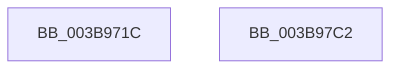

# EtwpTiGetHashedBitNumbers

- RVA: `0x003B971C`–`0x003B97C3` (길이 `167` bytes)
- VA: `0x00000001403B971C`
- 실행 섹션: `.text`
- PDB 이름 있음: `예`; PDB Function 태그: `아니요`
- unwind 정보 RVA: `0x0008CA7C`
- 디코드: `46`개 명령, `167/167` bytes 표시
- 미해석 바이트: `0` (있으면 어셈블리에 `.byte`로 보존)

> 이 문서는 커널 이미지의 기계어와 PDB 기호를 분석해 생성했습니다. 4번과 5번은 함수 원형과 자료형을 바이너리 사용 방식에서 추정한 C 해석이며 원본 소스 복구 결과는 아닙니다.

## 1. Dependencies

- 직접 호출 지점: **0**; 고유 호출 대상: **0**
- 직접 호출자로 확인된 함수: **3**
- RIP 상대 이미지 참조: **2**

### Outgoing calls
- 직접 디코드된 call 명령이 없습니다.

### Direct callers
- [EtwpTiClearBloomFilter](EtwpTiClearBloomFilter_function_003B92E4.md) at `0x003B92FB`
- [EtwpTiAsyncVadQueryEventWrite](EtwpTiAsyncVadQueryEventWrite_function_003B9428.md) at `0x003B94ED`
- [EtwpTiTestBloomFilter](EtwpTiTestBloomFilter_function_003B97CC.md) at `0x003B97E3`

### Static image references
- `0x003B9721` → RVA `0x00EFF1B0` (`.data`; read)
- `0x003B972A` → RVA `0x00EFF1A0` (`.data`; read)

## 2. Other-region calls and transfers

- 다른 실행 섹션으로 향하는 call: **0**
- 별도 외부 분기/꼬리 이동을 확인하지 못했습니다.

## 3. Assembly (complete function range)

```asm
003B971C  48 89 5C 24 08                  mov qword ptr [rsp + 8], rbx
003B9721  8B 05 89 5A B4 00               mov eax, dword ptr [rip + 0xb45a89]
003B9727  48 8B D9                        mov rbx, rcx
003B972A  44 8B 15 6F 5A B4 00            mov r10d, dword ptr [rip + 0xb45a6f]
003B9731  4D 8B D8                        mov r11, r8
003B9734  48 6B D0 25                     imul rdx, rax, 0x25
003B9738  4C 89 44 24 18                  mov qword ptr [rsp + 0x18], r8
003B973D  41 0F B6 C0                     movzx eax, r8b
003B9741  48 03 D0                        add rdx, rax
003B9744  0F B6 44 24 19                  movzx eax, byte ptr [rsp + 0x19]
003B9749  4C 6B CA 25                     imul r9, rdx, 0x25
003B974D  4C 03 C8                        add r9, rax
003B9750  0F B6 44 24 1A                  movzx eax, byte ptr [rsp + 0x1a]
003B9755  49 6B D1 25                     imul rdx, r9, 0x25
003B9759  48 03 D0                        add rdx, rax
003B975C  0F B6 44 24 1B                  movzx eax, byte ptr [rsp + 0x1b]
003B9761  4C 6B C2 25                     imul r8, rdx, 0x25
003B9765  4C 03 C0                        add r8, rax
003B9768  0F B6 44 24 1C                  movzx eax, byte ptr [rsp + 0x1c]
003B976D  49 6B C8 25                     imul rcx, r8, 0x25
003B9771  48 03 C8                        add rcx, rax
003B9774  0F B6 44 24 1D                  movzx eax, byte ptr [rsp + 0x1d]
003B9779  48 6B D1 25                     imul rdx, rcx, 0x25
003B977D  48 03 D0                        add rdx, rax
003B9780  0F B6 44 24 1E                  movzx eax, byte ptr [rsp + 0x1e]
003B9785  48 6B CA 25                     imul rcx, rdx, 0x25
003B9789  33 D2                           xor edx, edx
003B978B  48 03 C8                        add rcx, rax
003B978E  4C 6B C1 25                     imul r8, rcx, 0x25
003B9792  0F B6 4C 24 1F                  movzx ecx, byte ptr [rsp + 0x1f]
003B9797  4C 03 C1                        add r8, rcx
003B979A  41 8B C0                        mov eax, r8d
003B979D  41 C1 E8 10                     shr r8d, 0x10
003B97A1  41 F7 F2                        div r10d
003B97A4  41 8B C0                        mov eax, r8d
003B97A7  89 13                           mov dword ptr [rbx], edx
003B97A9  33 D2                           xor edx, edx
003B97AB  41 F7 F2                        div r10d
003B97AE  49 8B C3                        mov rax, r11
003B97B1  89 53 04                        mov dword ptr [rbx + 4], edx
003B97B4  33 D2                           xor edx, edx
003B97B6  49 F7 F2                        div r10
003B97B9  89 53 08                        mov dword ptr [rbx + 8], edx
003B97BC  48 8B 5C 24 08                  mov rbx, qword ptr [rsp + 8]
003B97C1  C3                              ret
003B97C2  CC                              int3
```

## 4. C-style interpretation (structured pseudocode)

```c
__int64 __fastcall EtwpTiGetHashedBitNumbers(__int64 a1, __int64 a2, __int64 a3)
{
    unsigned __int64 v_stack_p18;
    unsigned __int8 v_stack_p19;
    unsigned __int8 v_stack_p1A;
    unsigned __int8 v_stack_p1B;
    unsigned __int8 v_stack_p1C;
    unsigned __int8 v_stack_p1D;
    unsigned __int8 v_stack_p1E;
    unsigned __int8 v_stack_p1F;
    unsigned __int64 v_stack_p8;

    v_stack_p8 = v_rbx;
    a2 = (a2) * ((unsigned int)(*(unsigned int *)(v_rip + 11819657)));
    v_stack_p18 = a3;
    a2 = (a2) + ((unsigned __int8)(a3));
    a4 = (a4) * (a2);
    a4 = (a4) + (v_stack_p19);
    a2 = (a2) * (a4);
    a2 = (a2) + (v_stack_p1A);
    a3 = (a3) * (a2);
    a3 = (a3) + (v_stack_p1B);
    a1 = (a1) * (a3);
    a1 = (a1) + (v_stack_p1C);
    a2 = (a2) * (a1);
    a2 = (a2) + (v_stack_p1D);
    a1 = (a1) * (a2);
    a2 = 0;
    a1 = (a1) + (v_stack_p1E);
    a3 = (a3) * (a1);
    a3 = (a3) + (v_stack_p1F);
    a3 = (unsigned int)((a3) >> (16));
    *(unsigned int *)(a1) = 0;
    a2 = 0;
    *(unsigned int *)(a1 + 4) = 0;
    a2 = 0;
    *(unsigned int *)(a1 + 8) = 0;
    return a3;
}
```

## 5. (Beta) C Style

```c
int64_t EtwpTiGetHashedBitNumbers(void *Arg1, int64_t Arg2, int64_t Arg3)
{
    uint8_t *arg1 = (uint8_t *)Arg1;

    uint64_t v_stack_p18;
    uint8_t v_stack_p19;
    uint8_t v_stack_p1A;
    uint8_t v_stack_p1B;
    uint8_t v_stack_p1C;
    uint8_t v_stack_p1D;
    uint8_t v_stack_p1E;
    uint8_t v_stack_p1F;
    uint64_t v_stack_p8;

    v_stack_p8 = local_rbx;
    Arg2 = (Arg2) * ((uint32_t)(*(uint32_t *)(v_rip + 0xB45A89)));
    v_stack_p18 = Arg3;
    Arg2 = (Arg2) + ((uint8_t)(Arg3));
    a4 = (a4) * (Arg2);
    a4 = (a4) + (v_stack_p19);
    Arg2 = (Arg2) * (a4);
    Arg2 = (Arg2) + (v_stack_p1A);
    Arg3 = (Arg3) * (Arg2);
    Arg3 = (Arg3) + (v_stack_p1B);
    Arg1 = (Arg1) * (Arg3);
    Arg1 = (Arg1) + (v_stack_p1C);
    Arg2 = (Arg2) * (Arg1);
    Arg2 = (Arg2) + (v_stack_p1D);
    Arg1 = (Arg1) * (Arg2);
    Arg2 = 0;
    Arg1 = (Arg1) + (v_stack_p1E);
    Arg3 = (Arg3) * (Arg1);
    Arg3 = (Arg3) + (v_stack_p1F);
    Arg3 = (uint32_t)((Arg3) >> (16));
    *(uint32_t *)(arg1) = 0;
    Arg2 = 0;
    *(uint32_t *)(arg1 + 0x4) = 0;
    Arg2 = 0;
    *(uint32_t *)(arg1 + 0x8) = 0;
    return Arg3;
}
```

### 관측된 메모리 오프셋

구조체 형식이 확인되지 않은 접근은 인자 기준의 오프셋으로만 기록했습니다.

| 기준 인자 | 오프셋 표현 | 폭 (bit) | 접근 |
|---|---:|---:|---|
| `Arg1` | `+ 0x0` | `32` | `W` |
| `Arg1` | `+ 0x4` | `32` | `W` |
| `Arg1` | `+ 0x8` | `32` | `W` |

## 6. Execution-region graph

[열기: 2D/3D 그래프와 함수 탐색 컨트롤 패널](../../../control-panel.html?section=text&rva=0x003B971C&view=graph)

- 2D 그래프는 위에서 아래로 흐르고, 3D 그래프는 빈 공간을 드래그해 회전합니다. Shift+드래그는 이동, 휠은 확대·축소, 함수 노드 선택은 대상 보고서 이동입니다.

### Static fallback


