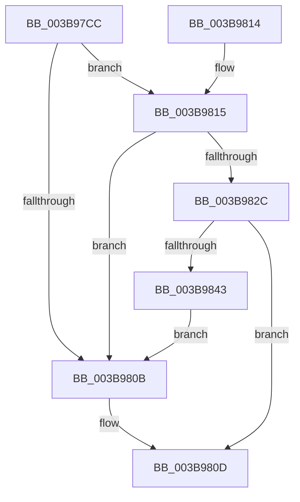

# EtwpTiTestBloomFilter

- RVA: `0x003B97CC`–`0x003B9845` (길이 `121` bytes)
- VA: `0x00000001403B97CC`
- 실행 섹션: `.text`
- PDB 이름 있음: `예`; PDB Function 태그: `아니요`
- unwind 정보 RVA: `0x00067F04`
- 디코드: `40`개 명령, `121/121` bytes 표시
- 미해석 바이트: `0` (있으면 어셈블리에 `.byte`로 보존)

> 이 문서는 커널 이미지의 기계어와 PDB 기호를 분석해 생성했습니다. 4번과 5번은 함수 원형과 자료형을 바이너리 사용 방식에서 추정한 C 해석이며 원본 소스 복구 결과는 아닙니다.

## 1. Dependencies

- 직접 호출 지점: **1**; 고유 호출 대상: **1**
- 직접 호출자로 확인된 함수: **1**
- RIP 상대 이미지 참조: **1**

### Outgoing calls
- `0x003B97E3` → [EtwpTiGetHashedBitNumbers](EtwpTiGetHashedBitNumbers_function_003B971C.md) (function, `0x003B971C`)

### Direct callers
- [EtwpTiAsyncVadQueryEventWrite](EtwpTiAsyncVadQueryEventWrite_function_003B9428.md) at `0x003B9485`

### Static image references
- `0x003B97EF` → RVA `0x00EFF1A8` (`.data`; read)

## 2. Other-region calls and transfers

- 다른 실행 섹션으로 향하는 call: **0**
- 별도 외부 분기/꼬리 이동을 확인하지 못했습니다.

## 3. Assembly (complete function range)

```asm
003B97CC  48 83 EC 38                     sub rsp, 0x38
003B97D0  33 C0                           xor eax, eax
003B97D2  48 8D 4C 24 20                  lea rcx, [rsp + 0x20]
003B97D7  4C 8B C2                        mov r8, rdx
003B97DA  48 89 44 24 20                  mov qword ptr [rsp + 0x20], rax
003B97DF  89 44 24 28                     mov dword ptr [rsp + 0x28], eax
003B97E3  E8 34 FF FF FF                  call 0x1403b971c
003B97E8  8B 4C 24 20                     mov ecx, dword ptr [rsp + 0x20]
003B97EC  41 B1 07                        mov r9b, 7
003B97EF  4C 8B 05 B2 59 B4 00            mov r8, qword ptr [rip + 0xb459b2]
003B97F6  8B C1                           mov eax, ecx
003B97F8  48 C1 E8 03                     shr rax, 3
003B97FC  41 22 C9                        and cl, r9b
003B97FF  B2 01                           mov dl, 1
003B9801  42 8A 04 00                     mov al, byte ptr [rax + r8]
003B9805  D2 F8                           sar al, cl
003B9807  84 C2                           test dl, al
003B9809  75 0A                           jne 0x1403b9815
003B980B  32 D2                           xor dl, dl
003B980D  8A C2                           mov al, dl
003B980F  48 83 C4 38                     add rsp, 0x38
003B9813  C3                              ret
003B9814  CC                              int3
003B9815  8B 4C 24 24                     mov ecx, dword ptr [rsp + 0x24]
003B9819  8B C1                           mov eax, ecx
003B981B  41 22 C9                        and cl, r9b
003B981E  48 C1 E8 03                     shr rax, 3
003B9822  42 8A 04 00                     mov al, byte ptr [rax + r8]
003B9826  D2 F8                           sar al, cl
003B9828  84 C2                           test dl, al
003B982A  74 DF                           je 0x1403b980b
003B982C  8B 4C 24 28                     mov ecx, dword ptr [rsp + 0x28]
003B9830  8B C1                           mov eax, ecx
003B9832  41 22 C9                        and cl, r9b
003B9835  48 C1 E8 03                     shr rax, 3
003B9839  42 8A 04 00                     mov al, byte ptr [rax + r8]
003B983D  D2 F8                           sar al, cl
003B983F  84 C2                           test dl, al
003B9841  75 CA                           jne 0x1403b980d
003B9843  EB C6                           jmp 0x1403b980b
```

## 4. C-style interpretation (structured pseudocode)

```c
__int64 __fastcall EtwpTiTestBloomFilter(__int64 a1, __int64 a2)
{
    __int64 result;
    __int64 v_rsp;
    unsigned int v_stack_m10;
    unsigned __int64 v_stack_m18;
    unsigned int v_stack_p24;
    unsigned int v_stack_p28;

    v_rsp = (v_rsp) - (56);
    result = 0;
    v_stack_m18 = 0;
    v_stack_m10 = 0;
    result = EtwpTiGetHashedBitNumbers(v_stack_m18, a2, a2, a4);
    result = ((unsigned int)((unsigned int)((unsigned int)(v_stack_m18)))) >> (3);
    a1 = (unsigned __int8)(((unsigned int)(v_stack_m18)) & (7));
    result = (unsigned __int8)((*(unsigned __int8 *)(result + *(unsigned __int64 *)(v_rip + 11819442) * 1)) >> ((unsigned __int8)(a1)));
    if (((1) & ((unsigned __int8)(result))) != 0) goto loc_003B9815;
loc_003B980B:
    a2 = 0;
loc_003B980D:
    v_rsp = (v_rsp) + (56);
    return 0;
loc_003B9815:
    a1 = (unsigned __int8)(((unsigned int)(v_stack_p24)) & (7));
    result = ((unsigned int)((unsigned int)((unsigned int)(v_stack_p24)))) >> (3);
    result = (unsigned __int8)((*(unsigned __int8 *)(result + *(unsigned __int64 *)(v_rip + 11819442) * 1)) >> ((unsigned __int8)(a1)));
    if (((0) & ((unsigned __int8)(result))) == 0) goto loc_003B980B;
    a1 = (unsigned __int8)(((unsigned int)(v_stack_p28)) & (7));
    result = ((unsigned int)((unsigned int)((unsigned int)(v_stack_p28)))) >> (3);
    result = (unsigned __int8)((*(unsigned __int8 *)(result + *(unsigned __int64 *)(v_rip + 11819442) * 1)) >> ((unsigned __int8)(a1)));
    if (((0) & ((unsigned __int8)(result))) != 0) goto loc_003B980D;
    goto loc_003B980B;
}
```

## 5. (Beta) C Style

```c
int64_t EtwpTiTestBloomFilter(int64_t Arg1, int64_t Arg2)
{
    int64_t result;
    int64_t local_rsp;
    uint32_t v_stack_m10;
    uint64_t v_stack_m18;
    uint32_t v_stack_p24;
    uint32_t v_stack_p28;

    local_rsp = (local_rsp) - (56);
    result = 0;
    v_stack_m18 = 0;
    v_stack_m10 = 0;
    result = EtwpTiGetHashedBitNumbers(v_stack_m18, Arg2, Arg2, a4);
    result = ((uint32_t)((uint32_t)((uint32_t)(v_stack_m18)))) >> (3);
    Arg1 = (uint8_t)(((uint32_t)(v_stack_m18)) & (7));
    result = (uint8_t)((*(uint8_t *)(result + *(uint64_t *)(v_rip + 0xB459B2) * 1)) >> ((uint8_t)(Arg1)));
    if (((1) & ((uint8_t)(result))) != 0) goto loc_003B9815;
loc_003B980B:
    Arg2 = 0;
loc_003B980D:
    local_rsp = (local_rsp) + (56);
    return 0;
loc_003B9815:
    Arg1 = (uint8_t)(((uint32_t)(v_stack_p24)) & (7));
    result = ((uint32_t)((uint32_t)((uint32_t)(v_stack_p24)))) >> (3);
    result = (uint8_t)((*(uint8_t *)(result + *(uint64_t *)(v_rip + 0xB459B2) * 1)) >> ((uint8_t)(Arg1)));
    if (((0) & ((uint8_t)(result))) == 0) goto loc_003B980B;
    Arg1 = (uint8_t)(((uint32_t)(v_stack_p28)) & (7));
    result = ((uint32_t)((uint32_t)((uint32_t)(v_stack_p28)))) >> (3);
    result = (uint8_t)((*(uint8_t *)(result + *(uint64_t *)(v_rip + 0xB459B2) * 1)) >> ((uint8_t)(Arg1)));
    if (((0) & ((uint8_t)(result))) != 0) goto loc_003B980D;
    goto loc_003B980B;
}
```

## 6. Execution-region graph

[열기: 2D/3D 그래프와 함수 탐색 컨트롤 패널](../../../control-panel.html?section=text&rva=0x003B97CC&view=graph)

- 2D 그래프는 위에서 아래로 흐르고, 3D 그래프는 빈 공간을 드래그해 회전합니다. Shift+드래그는 이동, 휠은 확대·축소, 함수 노드 선택은 대상 보고서 이동입니다.

### Static fallback


