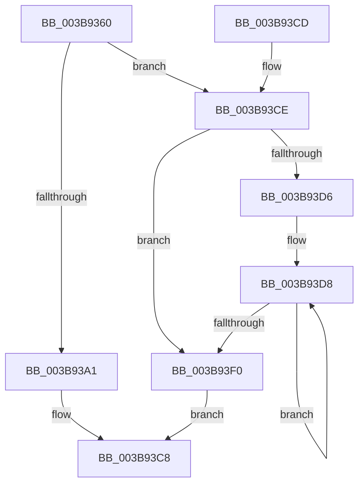

# EtwpTiVadQueryEventWrite

- RVA: `0x003B9360`–`0x003B9420` (길이 `192` bytes)
- VA: `0x00000001403B9360`
- 실행 섹션: `.text`
- PDB 이름 있음: `예`; PDB Function 태그: `아니요`
- unwind 정보 RVA: `0x0008CA34`
- 디코드: `46`개 명령, `192/192` bytes 표시
- 미해석 바이트: `0` (있으면 어셈블리에 `.byte`로 보존)

> 이 문서는 커널 이미지의 기계어와 PDB 기호를 분석해 생성했습니다. 4번과 5번은 함수 원형과 자료형을 바이너리 사용 방식에서 추정한 C 해석이며 원본 소스 복구 결과는 아닙니다.

## 1. Dependencies

- 직접 호출 지점: **3**; 고유 호출 대상: **3**
- 직접 호출자로 확인된 함수: **2**
- RIP 상대 이미지 참조: **1**

### Outgoing calls
- `0x003B93C3` → [EtwpTiAsyncVadQueryEventWrite](EtwpTiAsyncVadQueryEventWrite_function_003B9428.md) (function, `0x003B9428`)
- `0x003B93E2` → [EtwpTiFillZeroVad](../46/EtwpTiFillZeroVad_function_00469548.md) (function, `0x00469548`)
- `0x003B9419` → [EtwWriteEx](../25/EtwWriteEx_function_0025F0D0.md) (function, `0x0025F0D0`)

### Direct callers
- [EtwTiLogInsertQueueUserApc](EtwTiLogInsertQueueUserApc_function_003B8FC4.md) at `0x003B9281`
- [EtwTiLogSetContextThread](../../page/A2/EtwTiLogSetContextThread_function_00A2FC70.md) at `0x00A2FE51`

### Static image references
- `0x003B93FB` → RVA `0x00EFFA30` (`.data`; read)

## 2. Other-region calls and transfers

- 다른 실행 섹션으로 향하는 call: **0**
- 별도 외부 분기/꼬리 이동을 확인하지 못했습니다.

## 3. Assembly (complete function range)

```asm
003B9360  48 83 EC 48                     sub rsp, 0x48
003B9364  4C 8B D1                        mov r10, rcx
003B9367  48 B8 14 00 00 00 80 F7 FF FF   movabs rax, 0xfffff78000000014
003B9371  45 33 DB                        xor r11d, r11d
003B9374  48 8D 4C 24 50                  lea rcx, [rsp + 0x50]
003B9379  48 8B 00                        mov rax, qword ptr [rax]
003B937C  48 89 44 24 50                  mov qword ptr [rsp + 0x50], rax
003B9381  41 8B C0                        mov eax, r8d
003B9384  41 FF C0                        inc r8d
003B9387  48 03 C0                        add rax, rax
003B938A  49 89 0C C2                     mov qword ptr [r10 + rax*8], rcx
003B938E  49 C7 44 C2 08 08 00 00 00      mov qword ptr [r10 + rax*8 + 8], 8
003B9397  44 38 9C 24 88 00 00 00         cmp byte ptr [rsp + 0x88], r11b
003B939F  74 2D                           je 0x1403b93ce
003B93A1  48 8B 84 24 80 00 00 00         mov rax, qword ptr [rsp + 0x80]
003B93A9  49 8B CA                        mov rcx, r10
003B93AC  48 89 44 24 30                  mov qword ptr [rsp + 0x30], rax
003B93B1  8B 44 24 78                     mov eax, dword ptr [rsp + 0x78]
003B93B5  89 44 24 28                     mov dword ptr [rsp + 0x28], eax
003B93B9  48 8B 44 24 70                  mov rax, qword ptr [rsp + 0x70]
003B93BE  48 89 44 24 20                  mov qword ptr [rsp + 0x20], rax
003B93C3  E8 60 00 00 00                  call 0x1403b9428
003B93C8  48 83 C4 48                     add rsp, 0x48
003B93CC  C3                              ret
003B93CD  CC                              int3
003B93CE  8B 44 24 78                     mov eax, dword ptr [rsp + 0x78]
003B93D2  85 C0                           test eax, eax
003B93D4  74 1A                           je 0x1403b93f0
003B93D6  8B D0                           mov edx, eax
003B93D8  41 8B C8                        mov ecx, r8d
003B93DB  48 C1 E1 04                     shl rcx, 4
003B93DF  49 03 CA                        add rcx, r10
003B93E2  E8 61 01 0B 00                  call 0x140469548
003B93E7  44 03 C0                        add r8d, eax
003B93EA  48 83 EA 01                     sub rdx, 1
003B93EE  75 E8                           jne 0x1403b93d8
003B93F0  48 8B 94 24 80 00 00 00         mov rdx, qword ptr [rsp + 0x80]
003B93F8  45 33 C9                        xor r9d, r9d
003B93FB  48 8B 0D 2E 66 B4 00            mov rcx, qword ptr [rip + 0xb4662e]
003B9402  4C 89 54 24 38                  mov qword ptr [rsp + 0x38], r10
003B9407  44 89 44 24 30                  mov dword ptr [rsp + 0x30], r8d
003B940C  45 33 C0                        xor r8d, r8d
003B940F  4C 89 5C 24 28                  mov qword ptr [rsp + 0x28], r11
003B9414  4C 89 5C 24 20                  mov qword ptr [rsp + 0x20], r11
003B9419  E8 B2 5C EA FF                  call 0x14025f0d0
003B941E  EB A8                           jmp 0x1403b93c8
```

## 4. C-style interpretation (structured pseudocode)

```c
__int64 __fastcall EtwpTiVadQueryEventWrite(__int64 a1, __int64 a2, int a3, int a4, __int64 a5, unsigned int a6, __int64 a7, unsigned __int8 a8)
{
    __int64 result;
    __int64 v_r11;
    __int64 v_rsp;
    unsigned __int64 v_stack_m18;
    unsigned int v_stack_m20;
    unsigned __int64 v_stack_m28;
    unsigned __int64 v_stack_p20;
    unsigned __int64 v_stack_p28;
    unsigned int v_stack_p30;
    unsigned __int64 v_stack_p38;
    unsigned __int64 v_stack_p8;

    v_rsp = (v_rsp) - (72);
    v_r11 = 0;
    v_stack_p8 = *(unsigned __int64 *)(result);
    a3 = (unsigned int)((a3) + 1);
    result = ((unsigned int)(a3)) + ((unsigned int)(a3));
    *(unsigned __int64 *)(a1 + result * 8) = v_stack_p8;
    *(unsigned __int64 *)(a1 + result * 8 + 8) = 8;
    if (a8 == 0) goto loc_003B93CE;
    v_stack_m18 = a7;
    v_stack_m20 = (unsigned int)((unsigned int)(a6));
    v_stack_m28 = a5;
    result = EtwpTiAsyncVadQueryEventWrite(a1, a2, a3, a4);
loc_003B93C8:
    v_rsp = (v_rsp) + (72);
    return result;
loc_003B93CE:
    if ((unsigned int)((unsigned int)(a6)) == 0) goto loc_003B93F0;
loc_003B93D8:
    a1 = ((unsigned int)(a3)) << (4);
    a1 = (a1) + (a1);
    result = EtwpTiFillZeroVad(a1, (unsigned int)((unsigned int)((unsigned int)(a6))), a3, a4);
    a3 = (unsigned int)((a3) + ((unsigned int)(result)));
    a2 = ((unsigned int)((unsigned int)((unsigned int)(a6)))) - (1);
    if (condition_is_not_equal) goto loc_003B93D8;
loc_003B93F0:
    a4 = 0;
    v_stack_p38 = a1;
    v_stack_p30 = a3;
    a3 = 0;
    v_stack_p28 = 0;
    v_stack_p20 = 0;
    result = EtwWriteEx(*(unsigned __int64 *)(v_rip + 11822638), a7, a3, a4);
    goto loc_003B93C8;
}
```

## 5. (Beta) C Style

```c
int64_t EtwpTiVadQueryEventWrite(void *Arg1, int64_t Arg2, int32_t Arg3, int32_t Arg4, int64_t Arg5, uint32_t Arg6, int64_t Arg7, uint8_t Arg8)
{
    uint8_t *arg1 = (uint8_t *)Arg1;

    int64_t result;
    int64_t local_r11;
    int64_t local_rsp;
    uint64_t v_stack_m18;
    uint32_t v_stack_m20;
    uint64_t v_stack_m28;
    uint64_t v_stack_p20;
    uint64_t v_stack_p28;
    uint32_t v_stack_p30;
    uint64_t v_stack_p38;
    uint64_t v_stack_p8;

    local_rsp = (local_rsp) - (72);
    local_r11 = 0;
    v_stack_p8 = *(uint64_t *)(result);
    Arg3 = (uint32_t)((Arg3) + 1);
    result = ((uint32_t)(Arg3)) + ((uint32_t)(Arg3));
    *(uint64_t *)(arg1 + result * 8) = v_stack_p8;
    *(uint64_t *)(arg1 + result * 8 + 0x8) = 8;
    if (Arg8 == 0) goto loc_003B93CE;
    v_stack_m18 = Arg7;
    v_stack_m20 = (uint32_t)((uint32_t)(Arg6));
    v_stack_m28 = Arg5;
    result = EtwpTiAsyncVadQueryEventWrite(Arg1, Arg2, Arg3, Arg4);
loc_003B93C8:
    local_rsp = (local_rsp) + (72);
    return result;
loc_003B93CE:
    if ((uint32_t)((uint32_t)(Arg6)) == 0) goto loc_003B93F0;
loc_003B93D8:
    Arg1 = ((uint32_t)(Arg3)) << (4);
    Arg1 = (Arg1) + (Arg1);
    result = EtwpTiFillZeroVad(Arg1, (uint32_t)((uint32_t)((uint32_t)(Arg6))), Arg3, Arg4);
    Arg3 = (uint32_t)((Arg3) + ((uint32_t)(result)));
    Arg2 = ((uint32_t)((uint32_t)((uint32_t)(Arg6)))) - (1);
    if (condition_is_not_equal) goto loc_003B93D8;
loc_003B93F0:
    Arg4 = 0;
    v_stack_p38 = Arg1;
    v_stack_p30 = Arg3;
    Arg3 = 0;
    v_stack_p28 = 0;
    v_stack_p20 = 0;
    result = EtwWriteEx(*(uint64_t *)(v_rip + 0xB4662E), Arg7, Arg3, Arg4);
    goto loc_003B93C8;
}
```

### 관측된 메모리 오프셋

구조체 형식이 확인되지 않은 접근은 인자 기준의 오프셋으로만 기록했습니다.

| 기준 인자 | 오프셋 표현 | 폭 (bit) | 접근 |
|---|---:|---:|---|
| `Arg1` | `+ 0x0 + rax*8` | `64` | `W` |
| `Arg1` | `+ 0x8 + rax*8` | `64` | `W` |

## 6. Execution-region graph

[열기: 2D/3D 그래프와 함수 탐색 컨트롤 패널](../../../control-panel.html?section=text&rva=0x003B9360&view=graph)

- 2D 그래프는 위에서 아래로 흐르고, 3D 그래프는 빈 공간을 드래그해 회전합니다. Shift+드래그는 이동, 휠은 확대·축소, 함수 노드 선택은 대상 보고서 이동입니다.

### Static fallback


