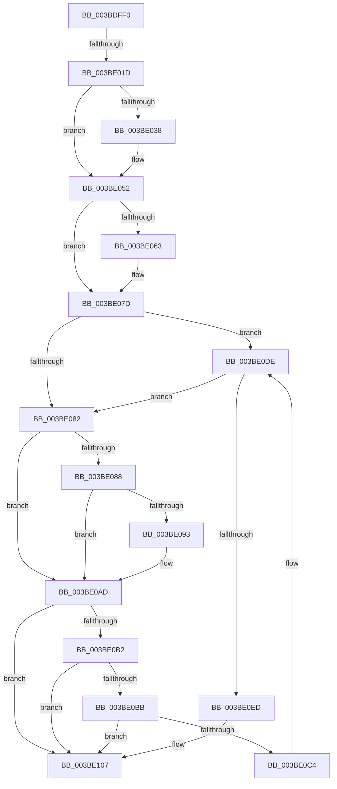

# ExAcquireFastResourceExclusive

- RVA: `0x003BDFF0`–`0x003BE10A` (길이 `282` bytes)
- VA: `0x00000001403BDFF0`
- 실행 섹션: `.text`
- PDB 이름 있음: `예`; PDB Function 태그: `아니요`
- unwind 정보 RVA: `0x0008DD88`
- 디코드: `77`개 명령, `282/282` bytes 표시
- 미해석 바이트: `0` (있으면 어셈블리에 `.byte`로 보존)

> 이 문서는 커널 이미지의 기계어와 PDB 기호를 분석해 생성했습니다. 4번과 5번은 함수 원형과 자료형을 바이너리 사용 방식에서 추정한 C 해석이며 원본 소스 복구 결과는 아닙니다.

## 1. Dependencies

- 직접 호출 지점: **5**; 고유 호출 대상: **1**
- 직접 호출자로 확인된 함수: **2**
- RIP 상대 이미지 참조: **0**

### Outgoing calls
- `0x003BE04C` → [KeBugCheckEx](../4F/KeBugCheckEx_function_004FD660.md) (function, `0x004FD660`)
- `0x003BE077` → [KeBugCheckEx](../4F/KeBugCheckEx_function_004FD660.md) (function, `0x004FD660`)
- `0x003BE0A7` → [KeBugCheckEx](../4F/KeBugCheckEx_function_004FD660.md) (function, `0x004FD660`)
- `0x003BE0D8` → [KeBugCheckEx](../4F/KeBugCheckEx_function_004FD660.md) (function, `0x004FD660`)
- `0x003BE101` → [KeBugCheckEx](../4F/KeBugCheckEx_function_004FD660.md) (function, `0x004FD660`)

### Direct callers
- [DifExAcquireFastResourceExclusiveWrapper](../61/DifExAcquireFastResourceExclusiveWrapper_function_0061D760.md) at `0x0061D845`
- [ExTryToAcquireResourceExclusiveLite](../65/ExTryToAcquireResourceExclusiveLite_function_00658E20.md) at `0x00658F14`

### Static image references
- 디코드된 RIP-relative 메모리 참조가 없습니다.

## 2. Other-region calls and transfers

- 다른 실행 섹션으로 향하는 call: **0**
- call이 아닌 외부 분기/꼬리 이동: **1**
  - `0x003BE017` → [sub_003BE28E](Unknown_function_003BE28E.md) (`tail-transfer`)

## 3. Assembly (complete function range)

```asm
003BDFF0  48 89 5C 24 18                  mov qword ptr [rsp + 0x18], rbx
003BDFF5  55                              push rbp
003BDFF6  56                              push rsi
003BDFF7  57                              push rdi
003BDFF8  41 54                           push r12
003BDFFA  41 56                           push r14
003BDFFC  48 83 EC 30                     sub rsp, 0x30
003BE000  65 48 8B 34 25 88 01 00 00      mov rsi, qword ptr gs:[0x188]
003BE009  33 DB                           xor ebx, ebx
003BE00B  48 8B F9                        mov rdi, rcx
003BE00E  41 BC 01 00 00 00               mov r12d, 1
003BE014  45 84 C0                        test r8b, r8b
003BE017  0F 84 71 02 00 00               je 0x1403be28e
003BE01D  8D 6B 08                        lea ebp, [rbx + 8]
003BE020  41 0F B6 C4                     movzx eax, r12b
003BE024  45 8D 74 24 08                  lea r14d, [r12 + 8]
003BE029  44 0F B7 41 1A                  movzx r8d, word ptr [rcx + 0x1a]
003BE02E  41 32 C4                        xor al, r12b
003BE031  FE C0                           inc al
003BE033  45 84 C4                        test r12b, r8b
003BE036  75 1A                           jne 0x1403be052
003BE038  45 33 C9                        xor r9d, r9d
003BE03B  48 89 5C 24 20                  mov qword ptr [rsp + 0x20], rbx
003BE040  4C 8B C7                        mov r8, rdi
003BE043  B9 C6 01 00 00                  mov ecx, 0x1c6
003BE048  41 8D 51 03                     lea edx, [r9 + 3]
003BE04C  E8 0F F6 13 00                  call 0x1404fd660
003BE051  CC                              int3
003BE052  44 0F 20 C1                     mov rcx, cr8
003BE056  65 48 8B 14 25 88 01 00 00      mov rdx, qword ptr gs:[0x188]
003BE05F  3A C8                           cmp cl, al
003BE061  76 1A                           jbe 0x1403be07d
003BE063  44 0F B6 C1                     movzx r8d, cl
003BE067  33 D2                           xor edx, edx
003BE069  B9 C6 01 00 00                  mov ecx, 0x1c6
003BE06E  44 0F B6 C8                     movzx r9d, al
003BE072  48 89 5C 24 20                  mov qword ptr [rsp + 0x20], rbx
003BE077  E8 E4 F5 13 00                  call 0x1404fd660
003BE07C  CC                              int3
003BE07D  80 F9 02                        cmp cl, 2
003BE080  73 5C                           jae 0x1403be0de
003BE082  41 F6 C0 08                     test r8b, 8
003BE086  75 25                           jne 0x1403be0ad
003BE088  0F B6 82 C0 00 00 00            movzx eax, byte ptr [rdx + 0xc0]
003BE08F  A8 02                           test al, 2
003BE091  74 1A                           je 0x1403be0ad
003BE093  45 33 C9                        xor r9d, r9d
003BE096  48 89 5C 24 20                  mov qword ptr [rsp + 0x20], rbx
003BE09B  45 33 C0                        xor r8d, r8d
003BE09E  B9 C6 01 00 00                  mov ecx, 0x1c6
003BE0A3  41 8D 51 06                     lea edx, [r9 + 6]
003BE0A7  E8 B4 F5 13 00                  call 0x1404fd660
003BE0AC  CC                              int3
003BE0AD  41 3A CC                        cmp cl, r12b
003BE0B0  73 55                           jae 0x1403be107
003BE0B2  F7 42 74 00 04 00 00            test dword ptr [rdx + 0x74], 0x400
003BE0B9  75 4C                           jne 0x1403be107
003BE0BB  83 BA E4 01 00 00 00            cmp dword ptr [rdx + 0x1e4], 0
003BE0C2  75 43                           jne 0x1403be107
003BE0C4  45 33 C9                        xor r9d, r9d
003BE0C7  48 89 5C 24 20                  mov qword ptr [rsp + 0x20], rbx
003BE0CC  45 33 C0                        xor r8d, r8d
003BE0CF  B9 C6 01 00 00                  mov ecx, 0x1c6
003BE0D4  41 8D 51 07                     lea edx, [r9 + 7]
003BE0D8  E8 83 F5 13 00                  call 0x1404fd660
003BE0DD  CC                              int3
003BE0DE  65 8B 04 25 3C 3A 00 00         mov eax, dword ptr gs:[0x3a3c]
003BE0E6  A9 01 00 01 00                  test eax, 0x10001
003BE0EB  74 95                           je 0x1403be082
003BE0ED  45 33 C9                        xor r9d, r9d
003BE0F0  48 89 5C 24 20                  mov qword ptr [rsp + 0x20], rbx
003BE0F5  45 33 C0                        xor r8d, r8d
003BE0F8  B9 C6 01 00 00                  mov ecx, 0x1c6
003BE0FD  41 8D 51 05                     lea edx, [r9 + 5]
003BE101  E8 5A F5 13 00                  call 0x1404fd660
003BE106  CC                              int3
003BE107  44 8B C3                        mov r8d, ebx
```

## 4. C-style interpretation (structured pseudocode)

```c
__int64 __fastcall ExAcquireFastResourceExclusive(__int64 a1, __int64 a2, unsigned __int8 a3, int a4)
{
    __int64 result;
    __int64 v_rbx;
    __int64 v_rsp;
    unsigned __int64 v_stack_m38;
    unsigned __int64 v_stack_p18;

    v_stack_p18 = v_rbx;
    v_rsp = (v_rsp) - (48);
    v_rbx = 0;
    result = (unsigned __int8)((1) ^ (1));
    result = (unsigned __int8)((result) + 1);
    if (((1) & ((unsigned __int8)(*(unsigned __int16 *)(a1 + 26)))) == 0) {
        a4 = 0;
        v_stack_m38 = 0;
        a3 = a1;
        a1 = 454;
        a2 = a4 + 3;
        result = KeBugCheckEx(a1, a2, a3, a4);
    }
    if (((unsigned __int8)(v_cr8)) >= = ((unsigned __int8)(result))) {
        a3 = (unsigned __int8)(v_cr8);
        a2 = 0;
        a1 = 454;
        a4 = (unsigned __int8)(result);
        v_stack_m38 = 0;
        result = KeBugCheckEx(a1, a2, a3, a4);
    }
    if (((unsigned __int8)(a1)) >= 2) goto loc_003BE0DE;
loc_003BE082:
    if (((a3) & (8)) != 0) goto loc_003BE0AD;
    result = *(unsigned __int8 *)(a2 + 192);
    if ((((unsigned __int8)(*(unsigned __int8 *)(a2 + 192))) & (2)) != 0) {
        a4 = 0;
        v_stack_m38 = 0;
        a3 = 0;
        a1 = 454;
        a2 = a4 + 6;
        result = KeBugCheckEx(a1, a2, a3, a4);
    }
    if (((unsigned __int8)(a1)) >= 1) goto loc_003BE107;
    if (((*(unsigned int *)(a2 + 116)) & (0x400ULL)) != 0) goto loc_003BE107;
    if ((*(unsigned int *)(a2 + 484)) != 0) goto loc_003BE107;
    a4 = 0;
    v_stack_m38 = 0;
    a3 = 0;
    result = KeBugCheckEx(454, a4 + 7, a3, a4);
loc_003BE0DE:
    if ((((unsigned int)((unsigned int)(*(unsigned int *)(gs_base + (0 + 14908))))) & (0x10001ULL)) == 0) goto loc_003BE082;
    a4 = 0;
    v_stack_m38 = 0;
    a3 = 0;
    result = KeBugCheckEx(454, a4 + 5, a3, a4);
loc_003BE107:
    return result;
}
```

## 5. (Beta) C Style

```c
int64_t ExAcquireFastResourceExclusive(void *Arg1, int64_t Arg2, uint8_t Arg3, int32_t Arg4)
{
    uint8_t *arg1 = (uint8_t *)Arg1;

    int64_t result;
    int64_t local_rbx;
    int64_t local_rsp;
    uint64_t v_stack_m38;
    uint64_t v_stack_p18;

    v_stack_p18 = local_rbx;
    local_rsp = (local_rsp) - (48);
    local_rbx = 0;
    result = (uint8_t)((1) ^ (1));
    result = (uint8_t)((result) + 1);
    if (((1) & ((uint8_t)(*(uint16_t *)(arg1 + 0x1A)))) == 0) {
        Arg4 = 0;
        v_stack_m38 = 0;
        Arg3 = Arg1;
        Arg1 = 454;
        Arg2 = Arg4 + 3;
        result = KeBugCheckEx(Arg1, Arg2, Arg3, Arg4);
    }
    if (((uint8_t)(v_cr8)) >= = ((uint8_t)(result))) {
        Arg3 = (uint8_t)(v_cr8);
        Arg2 = 0;
        Arg1 = 454;
        Arg4 = (uint8_t)(result);
        v_stack_m38 = 0;
        result = KeBugCheckEx(Arg1, Arg2, Arg3, Arg4);
    }
    if (((uint8_t)(Arg1)) >= 2) goto loc_003BE0DE;
loc_003BE082:
    if (((Arg3) & (8)) != 0) goto loc_003BE0AD;
    result = *(uint8_t *)(Arg2 + 0xC0);
    if ((((uint8_t)(*(uint8_t *)(Arg2 + 0xC0))) & (2)) != 0) {
        Arg4 = 0;
        v_stack_m38 = 0;
        Arg3 = 0;
        Arg1 = 454;
        Arg2 = Arg4 + 6;
        result = KeBugCheckEx(Arg1, Arg2, Arg3, Arg4);
    }
    if (((uint8_t)(Arg1)) >= 1) goto loc_003BE107;
    if (((*(uint32_t *)(Arg2 + 0x74)) & (0x400ULL)) != 0) goto loc_003BE107;
    if ((*(uint32_t *)(Arg2 + 0x1E4)) != 0) goto loc_003BE107;
    Arg4 = 0;
    v_stack_m38 = 0;
    Arg3 = 0;
    result = KeBugCheckEx(454, Arg4 + 7, Arg3, Arg4);
loc_003BE0DE:
    if ((((uint32_t)((uint32_t)(*(uint32_t *)(gs_base + (0 + 0x3A3C))))) & (0x10001ULL)) == 0) goto loc_003BE082;
    Arg4 = 0;
    v_stack_m38 = 0;
    Arg3 = 0;
    result = KeBugCheckEx(454, Arg4 + 5, Arg3, Arg4);
loc_003BE107:
    return result;
}
```

### 관측된 메모리 오프셋

구조체 형식이 확인되지 않은 접근은 인자 기준의 오프셋으로만 기록했습니다.

| 기준 인자 | 오프셋 표현 | 폭 (bit) | 접근 |
|---|---:|---:|---|
| `Arg1` | `+ 0x1A` | `16` | `R` |

## 6. Execution-region graph

[열기: 2D/3D 그래프와 함수 탐색 컨트롤 패널](../../../control-panel.html?section=text&rva=0x003BDFF0&view=graph)

- 2D 그래프는 위에서 아래로 흐르고, 3D 그래프는 빈 공간을 드래그해 회전합니다. Shift+드래그는 이동, 휠은 확대·축소, 함수 노드 선택은 대상 보고서 이동입니다.

### Static fallback


