# ExAcquireFastResourceSharedStarveExclusive

- RVA: `0x003BDC80`–`0x003BDFDC` (길이 `860` bytes)
- VA: `0x00000001403BDC80`
- 실행 섹션: `.text`
- PDB 이름 있음: `예`; PDB Function 태그: `아니요`
- unwind 정보 RVA: `0x0008DD68`
- 디코드: `244`개 명령, `860/860` bytes 표시
- 미해석 바이트: `0` (있으면 어셈블리에 `.byte`로 보존)

> 이 문서는 커널 이미지의 기계어와 PDB 기호를 분석해 생성했습니다. 4번과 5번은 함수 원형과 자료형을 바이너리 사용 방식에서 추정한 C 해석이며 원본 소스 복구 결과는 아닙니다.

## 1. Dependencies

- 직접 호출 지점: **14**; 고유 호출 대상: **8**
- 직접 호출자로 확인된 함수: **2**
- RIP 상대 이미지 참조: **0**

### Outgoing calls
- `0x003BDCF2` → [KeBugCheckEx](../4F/KeBugCheckEx_function_004FD660.md) (function, `0x004FD660`)
- `0x003BDD1E` → [KeBugCheckEx](../4F/KeBugCheckEx_function_004FD660.md) (function, `0x004FD660`)
- `0x003BDD4F` → [KeBugCheckEx](../4F/KeBugCheckEx_function_004FD660.md) (function, `0x004FD660`)
- `0x003BDD80` → [KeBugCheckEx](../4F/KeBugCheckEx_function_004FD660.md) (function, `0x004FD660`)
- `0x003BDDA9` → [KeBugCheckEx](../4F/KeBugCheckEx_function_004FD660.md) (function, `0x004FD660`)
- `0x003BDDCE` → [KeBugCheckEx](../4F/KeBugCheckEx_function_004FD660.md) (function, `0x004FD660`)
- `0x003BDE18` → [KeAbPreAcquire](../21/KeAbPreAcquire_function_00210230.md) (function, `0x00210230`)
- `0x003BDED2` → [ExpAcquireFastResourceSharedSlow](../21/ExpAcquireFastResourceSharedSlow_function_00211260.md) (function, `0x00211260`)
- `0x003BDF55` → [KiRemoveSystemWorkPriorityKick](../26/KiRemoveSystemWorkPriorityKick_function_002631D0.md) (function, `0x002631D0`)
- `0x003BDF69` → [ObfReferenceObjectWithTag](../21/ObfReferenceObjectWithTag_function_00210710.md) (function, `0x00210710`)
- `0x003BDF89` → [KeBugCheckEx](../4F/KeBugCheckEx_function_004FD660.md) (function, `0x004FD660`)
- `0x003BDF97` → [KeAbMarkCrossThreadReleasable](KeAbMarkCrossThreadReleasable_function_003BE8AC.md) (function, `0x003BE8AC`)
- `0x003BDFA8` → [KeAcquireSpinLockAtDpcLevel](../20/KeAcquireSpinLockAtDpcLevel_function_00208430.md) (function, `0x00208430`)
- `0x003BDFD2` → [KxReleaseSpinLock](../20/KxReleaseSpinLock_function_00206670.md) (function, `0x00206670`)

### Direct callers
- [ExpFastResourceLegacyAcquireSharedStarveExclusive](ExpFastResourceLegacyAcquireSharedStarveExclusive_function_003BDC18.md) at `0x003BDC3D`
- [DifExAcquireFastResourceSharedStarveExclusiveWrapper](../61/DifExAcquireFastResourceSharedStarveExclusiveWrapper_function_0061D8E0.md) at `0x0061D9C5`

### Static image references
- 디코드된 RIP-relative 메모리 참조가 없습니다.

## 2. Other-region calls and transfers

- 다른 실행 섹션으로 향하는 call: **0**
- 별도 외부 분기/꼬리 이동을 확인하지 못했습니다.

## 3. Assembly (complete function range)

```asm
003BDC80  48 89 5C 24 10                  mov qword ptr [rsp + 0x10], rbx
003BDC85  48 89 6C 24 18                  mov qword ptr [rsp + 0x18], rbp
003BDC8A  48 89 74 24 20                  mov qword ptr [rsp + 0x20], rsi
003BDC8F  57                              push rdi
003BDC90  41 54                           push r12
003BDC92  41 55                           push r13
003BDC94  41 56                           push r14
003BDC96  41 57                           push r15
003BDC98  48 83 EC 30                     sub rsp, 0x30
003BDC9C  44 0F B7 49 1A                  movzx r9d, word ptr [rcx + 0x1a]
003BDCA1  45 33 ED                        xor r13d, r13d
003BDCA4  45 84 C0                        test r8b, r8b
003BDCA7  B8 0C 00 00 00                  mov eax, 0xc
003BDCAC  48 8B DA                        mov rbx, rdx
003BDCAF  48 8B F1                        mov rsi, rcx
003BDCB2  41 8D 6D 02                     lea ebp, [r13 + 2]
003BDCB6  44 8D 50 F8                     lea r10d, [rax - 8]
003BDCBA  44 0F 45 D0                     cmovne r10d, eax
003BDCBE  8D 7D FF                        lea edi, [rbp - 1]
003BDCC1  45 8B DA                        mov r11d, r10d
003BDCC4  45 8B E2                        mov r12d, r10d
003BDCC7  41 83 E3 08                     and r11d, 8
003BDCCB  41 83 E4 10                     and r12d, 0x10
003BDCCF  41 8B C3                        mov eax, r11d
003BDCD2  F7 D8                           neg eax
003BDCD4  45 1A C0                        sbb r8b, r8b
003BDCD7  44 02 C5                        add r8b, bpl
003BDCDA  44 84 CF                        test dil, r9b
003BDCDD  75 19                           jne 0x1403bdcf8
003BDCDF  4C 8B C1                        mov r8, rcx
003BDCE2  4C 89 6C 24 20                  mov qword ptr [rsp + 0x20], r13
003BDCE7  B9 C6 01 00 00                  mov ecx, 0x1c6
003BDCEC  8D 55 01                        lea edx, [rbp + 1]
003BDCEF  45 33 C9                        xor r9d, r9d
003BDCF2  E8 69 F9 13 00                  call 0x1404fd660
003BDCF7  CC                              int3
003BDCF8  44 0F 20 C1                     mov rcx, cr8
003BDCFC  65 48 8B 14 25 88 01 00 00      mov rdx, qword ptr gs:[0x188]
003BDD05  41 3A C8                        cmp cl, r8b
003BDD08  76 1A                           jbe 0x1403bdd24
003BDD0A  45 0F B6 C8                     movzx r9d, r8b
003BDD0E  33 D2                           xor edx, edx
003BDD10  44 0F B6 C1                     movzx r8d, cl
003BDD14  B9 C6 01 00 00                  mov ecx, 0x1c6
003BDD19  4C 89 6C 24 20                  mov qword ptr [rsp + 0x20], r13
003BDD1E  E8 3D F9 13 00                  call 0x1404fd660
003BDD23  CC                              int3
003BDD24  40 3A CD                        cmp cl, bpl
003BDD27  73 5D                           jae 0x1403bdd86
003BDD29  41 F6 C1 08                     test r9b, 8
003BDD2D  75 26                           jne 0x1403bdd55
003BDD2F  0F B6 82 C0 00 00 00            movzx eax, byte ptr [rdx + 0xc0]
003BDD36  40 84 C5                        test bpl, al
003BDD39  74 1A                           je 0x1403bdd55
003BDD3B  45 33 C9                        xor r9d, r9d
003BDD3E  4C 89 6C 24 20                  mov qword ptr [rsp + 0x20], r13
003BDD43  45 33 C0                        xor r8d, r8d
003BDD46  B9 C6 01 00 00                  mov ecx, 0x1c6
003BDD4B  41 8D 51 06                     lea edx, [r9 + 6]
003BDD4F  E8 0C F9 13 00                  call 0x1404fd660
003BDD54  CC                              int3
003BDD55  40 3A CF                        cmp cl, dil
003BDD58  73 55                           jae 0x1403bddaf
003BDD5A  F7 42 74 00 04 00 00            test dword ptr [rdx + 0x74], 0x400
003BDD61  75 4C                           jne 0x1403bddaf
003BDD63  44 39 AA E4 01 00 00            cmp dword ptr [rdx + 0x1e4], r13d
003BDD6A  75 43                           jne 0x1403bddaf
003BDD6C  45 33 C9                        xor r9d, r9d
003BDD6F  4C 89 6C 24 20                  mov qword ptr [rsp + 0x20], r13
003BDD74  45 33 C0                        xor r8d, r8d
003BDD77  B9 C6 01 00 00                  mov ecx, 0x1c6
003BDD7C  41 8D 51 07                     lea edx, [r9 + 7]
003BDD80  E8 DB F8 13 00                  call 0x1404fd660
003BDD85  CC                              int3
003BDD86  65 8B 04 25 3C 3A 00 00         mov eax, dword ptr gs:[0x3a3c]
003BDD8E  A9 01 00 01 00                  test eax, 0x10001
003BDD93  74 94                           je 0x1403bdd29
003BDD95  45 33 C9                        xor r9d, r9d
003BDD98  4C 89 6C 24 20                  mov qword ptr [rsp + 0x20], r13
003BDD9D  45 33 C0                        xor r8d, r8d
003BDDA0  B9 C6 01 00 00                  mov ecx, 0x1c6
003BDDA5  41 8D 51 05                     lea edx, [r9 + 5]
003BDDA9  E8 B2 F8 13 00                  call 0x1404fd660
003BDDAE  CC                              int3
003BDDAF  4C 8B 4B 10                     mov r9, qword ptr [rbx + 0x10]
003BDDB3  49 83 E1 FE                     and r9, 0xfffffffffffffffe
003BDDB7  4C 3B CA                        cmp r9, rdx
003BDDBA  74 18                           je 0x1403bddd4
003BDDBC  4C 8B C3                        mov r8, rbx
003BDDBF  4C 89 6C 24 20                  mov qword ptr [rsp + 0x20], r13
003BDDC4  BA 09 00 00 00                  mov edx, 9
003BDDC9  B9 C6 01 00 00                  mov ecx, 0x1c6
003BDDCE  E8 8D F8 13 00                  call 0x1404fd660
003BDDD3  CC                              int3
003BDDD4  8A 43 25                        mov al, byte ptr [rbx + 0x25]
003BDDD7  45 8B FA                        mov r15d, r10d
003BDDDA  40 84 C5                        test bpl, al
003BDDDD  75 0D                           jne 0x1403bddec
003BDDDF  4C 8B 4B 18                     mov r9, qword ptr [rbx + 0x18]
003BDDE3  4D 85 C9                        test r9, r9
003BDDE6  0F 85 84 01 00 00               jne 0x1403bdf70
003BDDEC  8B 4B 20                        mov ecx, dword ptr [rbx + 0x20]
003BDDEF  85 C9                           test ecx, ecx
003BDDF1  0F 85 34 01 00 00               jne 0x1403bdf2b
003BDDF7  65 4C 8B 34 25 88 01 00 00      mov r14, qword ptr gs:[0x188]
003BDE00  45 85 DB                        test r11d, r11d
003BDE03  45 8B C5                        mov r8d, r13d
003BDE06  49 8B ED                        mov rbp, r13
003BDE09  41 0F 94 C0                     sete r8b
003BDE0D  44 38 6B 24                     cmp byte ptr [rbx + 0x24], r13b
003BDE11  75 0D                           jne 0x1403bde20
003BDE13  33 D2                           xor edx, edx
003BDE15  48 8B CE                        mov rcx, rsi
003BDE18  E8 13 24 E5 FF                  call 0x140210230
003BDE1D  48 8B E8                        mov rbp, rax
003BDE20  0F 0D 0E                        prefetchw byte ptr [rsi]
003BDE23  48 8B 06                        mov rax, qword ptr [rsi]
003BDE26  40 84 C7                        test dil, al
003BDE29  0F 85 92 00 00 00               jne 0x1403bdec1
003BDE2F  48 8D 48 04                     lea rcx, [rax + 4]
003BDE33  48 33 C8                        xor rcx, rax
003BDE36  48 83 E1 FC                     and rcx, 0xfffffffffffffffc
003BDE3A  48 33 C8                        xor rcx, rax
003BDE3D  F0 48 0F B1 0E                  lock cmpxchg qword ptr [rsi], rcx
003BDE42  75 DC                           jne 0x1403bde20
003BDE44  45 85 E4                        test r12d, r12d
003BDE47  B8 0F 00 00 00                  mov eax, 0xf
003BDE4C  44 8D 68 F4                     lea r13d, [rax - 0xc]
003BDE50  44 0F 45 E8                     cmovne r13d, eax
003BDE54  48 8D 46 40                     lea rax, [rsi + 0x40]
003BDE58  45 8B E5                        mov r12d, r13d
003BDE5B  45 8B FD                        mov r15d, r13d
003BDE5E  41 83 E4 02                     and r12d, 2
003BDE62  41 83 E7 04                     and r15d, 4
003BDE66  41 83 E5 08                     and r13d, 8
003BDE6A  48 3B D8                        cmp rbx, rax
003BDE6D  74 04                           je 0x1403bde73
003BDE6F  48 89 73 18                     mov qword ptr [rbx + 0x18], rsi
003BDE73  33 C0                           xor eax, eax
003BDE75  89 7B 20                        mov dword ptr [rbx + 0x20], edi
003BDE78  45 85 FF                        test r15d, r15d
003BDE7B  0F 95 C0                        setne al
003BDE7E  49 0B C6                        or rax, r14
003BDE81  48 89 43 10                     mov qword ptr [rbx + 0x10], rax
003BDE85  48 85 ED                        test rbp, rbp
003BDE88  74 11                           je 0x1403bde9b
003BDE8A  8A 45 08                        mov al, byte ptr [rbp + 8]
003BDE8D  24 3F                           and al, 0x3f
003BDE8F  40 88 7D 0A                     mov byte ptr [rbp + 0xa], dil
003BDE93  02 C0                           add al, al
003BDE95  40 0A C7                        or al, dil
003BDE98  88 43 24                        mov byte ptr [rbx + 0x24], al
003BDE9B  45 85 E4                        test r12d, r12d
003BDE9E  74 01                           je 0x1403bdea1
003BDEA0  FA                              cli
003BDEA1  45 85 FF                        test r15d, r15d
003BDEA4  0F 85 F4 00 00 00               jne 0x1403bdf9e
003BDEAA  49 8D 86 B8 06 00 00            lea rax, [r14 + 0x6b8]
003BDEB1  48 8B 08                        mov rcx, qword ptr [rax]
003BDEB4  48 39 41 08                     cmp qword ptr [rcx + 8], rax
003BDEB8  74 22                           je 0x1403bdedc
003BDEBA  B9 03 00 00 00                  mov ecx, 3
003BDEBF  CD 29                           int 0x29
003BDEC1  4D 8B CE                        mov r9, r14
003BDEC4  44 89 7C 24 20                  mov dword ptr [rsp + 0x20], r15d
003BDEC9  4C 8B C5                        mov r8, rbp
003BDECC  48 8B D3                        mov rdx, rbx
003BDECF  48 8B CE                        mov rcx, rsi
003BDED2  E8 89 33 E5 FF                  call 0x140211260
003BDED7  40 8A F8                        mov dil, al
003BDEDA  EB 2E                           jmp 0x1403bdf0a
003BDEDC  48 89 0B                        mov qword ptr [rbx], rcx
003BDEDF  48 89 43 08                     mov qword ptr [rbx + 8], rax
003BDEE3  48 89 59 08                     mov qword ptr [rcx + 8], rbx
003BDEE7  48 89 18                        mov qword ptr [rax], rbx
003BDEEA  45 85 E4                        test r12d, r12d
003BDEED  74 16                           je 0x1403bdf05
003BDEEF  65 48 8B 0C 25 20 00 00 00      mov rcx, qword ptr gs:[0x20]
003BDEF8  4C 8B 81 B8 8E 00 00            mov r8, qword ptr [rcx + 0x8eb8]
003BDEFF  4D 85 C0                        test r8, r8
003BDF02  75 37                           jne 0x1403bdf3b
003BDF04  FB                              sti
003BDF05  45 85 FF                        test r15d, r15d
003BDF08  75 52                           jne 0x1403bdf5c
003BDF0A  48 8B 5C 24 68                  mov rbx, qword ptr [rsp + 0x68]
003BDF0F  40 8A C7                        mov al, dil
003BDF12  48 8B 6C 24 70                  mov rbp, qword ptr [rsp + 0x70]
003BDF17  48 8B 74 24 78                  mov rsi, qword ptr [rsp + 0x78]
003BDF1C  48 83 C4 30                     add rsp, 0x30
003BDF20  41 5F                           pop r15
003BDF22  41 5E                           pop r14
003BDF24  41 5D                           pop r13
003BDF26  41 5C                           pop r12
003BDF28  5F                              pop rdi
003BDF29  C3                              ret
003BDF2A  CC                              int3
003BDF2B  A8 04                           test al, 4
003BDF2D  0F 85 C4 FE FF FF               jne 0x1403bddf7
003BDF33  8D 41 01                        lea eax, [rcx + 1]
003BDF36  89 43 20                        mov dword ptr [rbx + 0x20], eax
003BDF39  EB CF                           jmp 0x1403bdf0a
003BDF3B  41 0F 0D 08                     prefetchw byte ptr [r8]
003BDF3F  41 8B 00                        mov eax, dword ptr [r8]
003BDF42  8B D0                           mov edx, eax
003BDF44  0F BA F2 15                     btr edx, 0x15
003BDF48  F0 41 0F B1 10                  lock cmpxchg dword ptr [r8], edx
003BDF4D  75 F3                           jne 0x1403bdf42
003BDF4F  0F BA E0 15                     bt eax, 0x15
003BDF53  73 AF                           jae 0x1403bdf04
003BDF55  E8 76 52 EA FF                  call 0x1402631d0
003BDF5A  EB A8                           jmp 0x1403bdf04
003BDF5C  45 85 ED                        test r13d, r13d
003BDF5F  75 2E                           jne 0x1403bdf8f
003BDF61  BA 44 66 6C 74                  mov edx, 0x746c6644
003BDF66  49 8B CE                        mov rcx, r14
003BDF69  E8 A2 27 E5 FF                  call 0x140210710
003BDF6E  EB 9A                           jmp 0x1403bdf0a
003BDF70  4C 3B CE                        cmp r9, rsi
003BDF73  0F 84 73 FE FF FF               je 0x1403bddec
003BDF79  4C 8B C3                        mov r8, rbx
003BDF7C  4C 89 6C 24 20                  mov qword ptr [rsp + 0x20], r13
003BDF81  48 8B D5                        mov rdx, rbp
003BDF84  B9 C6 01 00 00                  mov ecx, 0x1c6
003BDF89  E8 D2 F6 13 00                  call 0x1404fd660
003BDF8E  CC                              int3
003BDF8F  48 85 ED                        test rbp, rbp
003BDF92  74 CD                           je 0x1403bdf61
003BDF94  48 8B D5                        mov rdx, rbp
003BDF97  E8 10 09 00 00                  call 0x1403be8ac
003BDF9C  EB C3                           jmp 0x1403bdf61
003BDF9E  49 8D B6 C8 06 00 00            lea rsi, [r14 + 0x6c8]
003BDFA5  48 8B CE                        mov rcx, rsi
003BDFA8  E8 83 A4 E4 FF                  call 0x140208430
003BDFAD  49 8D 86 D0 06 00 00            lea rax, [r14 + 0x6d0]
003BDFB4  48 8B 08                        mov rcx, qword ptr [rax]
003BDFB7  48 39 41 08                     cmp qword ptr [rcx + 8], rax
003BDFBB  0F 85 F9 FE FF FF               jne 0x1403bdeba
003BDFC1  48 89 0B                        mov qword ptr [rbx], rcx
003BDFC4  48 89 43 08                     mov qword ptr [rbx + 8], rax
003BDFC8  48 89 59 08                     mov qword ptr [rcx + 8], rbx
003BDFCC  48 8B CE                        mov rcx, rsi
003BDFCF  48 89 18                        mov qword ptr [rax], rbx
003BDFD2  E8 99 86 E4 FF                  call 0x140206670
003BDFD7  E9 0E FF FF FF                  jmp 0x1403bdeea
```

## 4. C-style interpretation (structured pseudocode)

```c
__int64 __fastcall ExAcquireFastResourceSharedStarveExclusive(__int64 a1, __int64 a2, unsigned __int8 a3)
{
    __int64 result;
    __int64 v_r10;
    __int64 v_r11;
    __int64 v_r12;
    __int64 v_r13;
    __int64 v_r15;
    __int64 v_rbp;
    __int64 v_rsp;
    unsigned __int64 v_stack_m38;
    unsigned __int64 v_stack_p10;
    unsigned __int64 v_stack_p18;
    unsigned __int64 v_stack_p20;

    v_stack_p10 = v_rbx;
    v_stack_p18 = v_rbp;
    v_stack_p20 = v_rsi;
    v_rsp = (v_rsp) - (48);
    v_r13 = 0;
    v_r10 = 12 - 8;
    if (a3 != 0) { v_r10 = 12; }
    v_r11 = (unsigned int)(((unsigned int)((unsigned int)(v_r10))) & (8));
    v_r12 = (unsigned int)(((unsigned int)((unsigned int)(v_r10))) & (16));
    result = (unsigned int)(-((unsigned int)((unsigned int)(v_r11))));
    a3 = (unsigned __int8)((a3) + ((unsigned __int8)(v_r13 + 2)));
    if ((((unsigned __int8)(v_r13 + 2 - 1)) & ((unsigned __int8)(*(unsigned __int16 *)(a1 + 26)))) == 0) {
        a3 = a1;
        v_stack_m38 = 0;
        a1 = 454;
        a2 = v_r13 + 2 + 1;
        a4 = 0;
        result = KeBugCheckEx(a1, a2, a3, a4);
    }
    if (((unsigned __int8)(v_cr8)) >= = a3) {
        a4 = a3;
        a2 = 0;
        a3 = (unsigned __int8)(v_cr8);
        a1 = 454;
        v_stack_m38 = 0;
        result = KeBugCheckEx(a1, a2, a3, a4);
    }
    if (((unsigned __int8)(a1)) >= ((unsigned __int8)(v_r13 + 2))) goto loc_003BDD86;
loc_003BDD29:
    if ((((unsigned __int8)(a4)) & (8)) != 0) goto loc_003BDD55;
    result = *(unsigned __int8 *)(a2 + 192);
    if ((((unsigned __int8)(v_r13 + 2)) & ((unsigned __int8)(*(unsigned __int8 *)(a2 + 192)))) != 0) {
        a4 = 0;
        v_stack_m38 = 0;
        a3 = 0;
        a1 = 454;
        a2 = a4 + 6;
        result = KeBugCheckEx(a1, a2, a3, a4);
    }
    if (((unsigned __int8)(a1)) >= ((unsigned __int8)(v_r13 + 2 - 1))) goto loc_003BDDAF;
    if (((*(unsigned int *)(a2 + 116)) & (0x400ULL)) != 0) goto loc_003BDDAF;
    if ((*(unsigned int *)(a2 + 484)) != 0) goto loc_003BDDAF;
    a4 = 0;
    v_stack_m38 = 0;
    a3 = 0;
    result = KeBugCheckEx(454, a4 + 7, a3, a4);
loc_003BDD86:
    if ((((unsigned int)((unsigned int)(*(unsigned int *)(gs_base + (0 + 14908))))) & (0x10001ULL)) == 0) goto loc_003BDD29;
    a4 = 0;
    v_stack_m38 = 0;
    a3 = 0;
    result = KeBugCheckEx(454, a4 + 5, a3, a4);
loc_003BDDAF:
    a4 = (*(unsigned __int64 *)(a2 + 16)) & (-2);
    if (a4 != (a4 + 5)) {
        a3 = a2;
        v_stack_m38 = 0;
        a2 = 9;
        a1 = 454;
        result = KeBugCheckEx(a1, a2, a3, a4);
    }
    if ((((unsigned __int8)(v_r13 + 2)) & ((unsigned __int8)(*(unsigned __int8 *)(a2 + 37)))) != 0) goto loc_003BDDEC;
    if (*(unsigned __int64 *)(a2 + 24) != 0) goto loc_003BDF70;
loc_003BDDEC:
    if ((unsigned int)((unsigned int)(*(unsigned int *)(a2 + 32))) != 0) goto loc_003BDF2B;
loc_003BDDF7:
    a3 = ((unsigned int)(v_r11) == 0) ? 1 : 0;
    result = *(unsigned __int8 *)(a2 + 37);
    v_rbp = 0;
    if ((*(unsigned __int8 *)(a2 + 36)) == 0) {
        a2 = 0;
        a1 = a1;
        result = KeAbPreAcquire(a1, a2, a3, *(unsigned __int64 *)(a2 + 24));
        v_rbp = result;
    }
    if ((((unsigned __int8)(v_r13 + 2 - 1)) & ((unsigned __int8)(*(unsigned __int64 *)(a1)))) != 0) goto loc_003BDEC1;
    a1 = (*(unsigned __int64 *)(a1) + 4) ^ (*(unsigned __int64 *)(a1));
    a1 = (a1) & (-4);
    a1 = (a1) ^ (*(unsigned __int64 *)(a1));
    if (condition_is_not_equal) goto loc_003BDE20;
    v_r13 = 15 - 12;
    if ((unsigned int)(v_r12) != 0) { v_r13 = 15; }
    v_r12 = (unsigned int)(((unsigned int)((unsigned int)(v_r13))) & (2));
    v_r15 = (unsigned int)(((unsigned int)((unsigned int)(v_r13))) & (4));
    v_r13 = (unsigned int)((v_r13) & (8));
    if (0 != (a1 + 64)) {
        *(unsigned __int64 *)(a2 + 24) = a1;
    }
    result = 0;
    *(unsigned int *)(a2 + 32) = (unsigned int)(v_r13 + 2 - 1);
    result = ((unsigned int)(v_r15) != 0) ? 1 : 0;
    result = (result) | (*(unsigned __int64 *)(gs_base + (0 + 392)));
    *(unsigned __int64 *)(a2 + 16) = result;
    if (v_rbp != 0) {
        result = *(unsigned __int8 *)(v_rbp + 8);
        result = (unsigned __int8)((result) & (63));
        *(unsigned __int8 *)(v_rbp + 10) = (unsigned __int8)(v_r13 + 2 - 1);
        result = (unsigned __int8)((result) + ((unsigned __int8)(result)));
        result = (unsigned __int8)((result) | ((unsigned __int8)(v_r13 + 2 - 1)));
        *(unsigned __int8 *)(a2 + 36) = (unsigned __int8)(result);
    }
    if ((unsigned int)(v_r12) != 0) {
    }
    if ((unsigned int)(v_r15) != 0) goto loc_003BDF9E;
    if ((*(unsigned __int64 *)(*(unsigned __int64 *)(*(unsigned __int64 *)(gs_base + (0 + 392)) + 1720) + 8)) == (*(unsigned __int64 *)(gs_base + (0 + 392)) + 1720)) goto loc_003BDEDC;
loc_003BDEBA:
loc_003BDEC1:
    v_stack_m38 = (unsigned int)(v_r15);
    result = ExpAcquireFastResourceSharedSlow(a1, 0, v_rbp, *(unsigned __int64 *)(gs_base + (0 + 392)));
    goto loc_003BDF0A;
loc_003BDEDC:
    *(unsigned __int64 *)(a2) = a1;
    *(unsigned __int64 *)(a2 + 8) = result;
    *(unsigned __int64 *)(a1 + 8) = 0;
    *(unsigned __int64 *)(result) = 0;
loc_003BDEEA:
    if ((unsigned int)(v_r12) == 0) goto loc_003BDF05;
    if (*(unsigned __int64 *)(*(unsigned __int64 *)(gs_base + (0 + 32)) + 36536) != 0) goto loc_003BDF3B;
loc_003BDF04:
loc_003BDF05:
    if ((unsigned int)(v_r15) != 0) goto loc_003BDF5C;
loc_003BDF0A:
    v_rsp = (v_rsp) + (48);
    return (unsigned __int8)((unsigned __int8)(result));
loc_003BDF2B:
    if ((((unsigned __int8)((unsigned __int8)((unsigned __int8)(result)))) & (4)) != 0) goto loc_003BDDF7;
    *(unsigned int *)(v_stack_p10 + 32) = (unsigned int)(*(unsigned __int64 *)(gs_base + (0 + 32)) + 1);
    goto loc_003BDF0A;
loc_003BDF3B:
loc_003BDF42:
    if ((((unsigned __int8)((unsigned __int8)((unsigned __int8)(result)))) & (4)) != 0) goto loc_003BDF42;
    if (condition_is_above_or_equal) goto loc_003BDF04;
    result = KiRemoveSystemWorkPriorityKick(*(unsigned __int64 *)(gs_base + (0 + 32)), (unsigned int)((unsigned int)((unsigned int)(*(unsigned int *)(*(unsigned __int64 *)(*(unsigned __int64 *)(gs_base + (0 + 32)) + 36536))))), *(unsigned __int64 *)(*(unsigned __int64 *)(gs_base + (0 + 32)) + 36536), *(unsigned __int64 *)(gs_base + (0 + 392)));
    goto loc_003BDF04;
loc_003BDF5C:
    if ((unsigned int)(v_r13) != 0) goto loc_003BDF8F;
loc_003BDF61:
    result = ObfReferenceObjectWithTag(*(unsigned __int64 *)(gs_base + (0 + 392)), (unsigned int)(0x746C6644ULL), *(unsigned __int64 *)(*(unsigned __int64 *)(gs_base + (0 + 32)) + 36536), *(unsigned __int64 *)(gs_base + (0 + 392)));
    goto loc_003BDF0A;
loc_003BDF70:
    if ((*(unsigned __int64 *)(gs_base + (0 + 392))) == v_stack_p20) goto loc_003BDDEC;
    v_stack_p20 = v_r13;
    result = KeBugCheckEx(454, v_stack_p18, v_stack_p10, *(unsigned __int64 *)(gs_base + (0 + 392)));
loc_003BDF8F:
    if (v_stack_p18 == 0) goto loc_003BDF61;
    result = KeAbMarkCrossThreadReleasable(454, v_stack_p18, v_stack_p10, *(unsigned __int64 *)(gs_base + (0 + 392)));
    goto loc_003BDF61;
loc_003BDF9E:
    result = KeAcquireSpinLockAtDpcLevel(*(unsigned __int64 *)(gs_base + (0 + 392)) + 1736, v_stack_p18, v_stack_p10, *(unsigned __int64 *)(gs_base + (0 + 392)));
    if ((*(unsigned __int64 *)(*(unsigned __int64 *)(*(unsigned __int64 *)(gs_base + (0 + 392)) + 1744) + 8)) != (*(unsigned __int64 *)(gs_base + (0 + 392)) + 1744)) goto loc_003BDEBA;
    *(unsigned __int64 *)(v_stack_p10) = *(unsigned __int64 *)(*(unsigned __int64 *)(gs_base + (0 + 392)) + 1744);
    *(unsigned __int64 *)(v_stack_p10 + 8) = *(unsigned __int64 *)(gs_base + (0 + 392)) + 1744;
    *(unsigned __int64 *)(*(unsigned __int64 *)(*(unsigned __int64 *)(gs_base + (0 + 392)) + 1744) + 8) = v_stack_p10;
    *(unsigned __int64 *)(*(unsigned __int64 *)(gs_base + (0 + 392)) + 1744) = v_stack_p10;
    result = KxReleaseSpinLock(*(unsigned __int64 *)(gs_base + (0 + 392)) + 1736, v_stack_p18, v_stack_p10, *(unsigned __int64 *)(gs_base + (0 + 392)));
    goto loc_003BDEEA;
}
```

## 5. (Beta) C Style

```c
int64_t ExAcquireFastResourceSharedStarveExclusive(void *Arg1, void *Arg2, uint8_t Arg3)
{
    uint8_t *arg1 = (uint8_t *)Arg1;
    uint8_t *arg2 = (uint8_t *)Arg2;

    int64_t result;
    int64_t local_r10;
    int64_t local_r11;
    int64_t local_r12;
    int64_t local_r13;
    int64_t local_r15;
    int64_t local_rbp;
    int64_t local_rsp;
    uint64_t v_stack_m38;
    uint64_t v_stack_p10;
    uint64_t v_stack_p18;
    uint64_t v_stack_p20;

    v_stack_p10 = local_rbx;
    v_stack_p18 = local_rbp;
    v_stack_p20 = local_rsi;
    local_rsp = (local_rsp) - (48);
    local_r13 = 0;
    local_r10 = 12 - 8;
    if (Arg3 != 0) { local_r10 = 12; }
    local_r11 = (uint32_t)(((uint32_t)((uint32_t)(local_r10))) & (8));
    local_r12 = (uint32_t)(((uint32_t)((uint32_t)(local_r10))) & (16));
    result = (uint32_t)(-((uint32_t)((uint32_t)(local_r11))));
    Arg3 = (uint8_t)((Arg3) + ((uint8_t)(local_r13 + 2)));
    if ((((uint8_t)(local_r13 + 2 - 1)) & ((uint8_t)(*(uint16_t *)(arg1 + 0x1A)))) == 0) {
        Arg3 = Arg1;
        v_stack_m38 = 0;
        Arg1 = 454;
        Arg2 = local_r13 + 2 + 1;
        a4 = 0;
        result = KeBugCheckEx(Arg1, Arg2, Arg3, a4);
    }
    if (((uint8_t)(v_cr8)) >= = Arg3) {
        a4 = Arg3;
        Arg2 = 0;
        Arg3 = (uint8_t)(v_cr8);
        Arg1 = 454;
        v_stack_m38 = 0;
        result = KeBugCheckEx(Arg1, Arg2, Arg3, a4);
    }
    if (((uint8_t)(Arg1)) >= ((uint8_t)(local_r13 + 2))) goto loc_003BDD86;
loc_003BDD29:
    if ((((uint8_t)(a4)) & (8)) != 0) goto loc_003BDD55;
    result = *(uint8_t *)(arg2 + 0xC0);
    if ((((uint8_t)(local_r13 + 2)) & ((uint8_t)(*(uint8_t *)(arg2 + 0xC0)))) != 0) {
        a4 = 0;
        v_stack_m38 = 0;
        Arg3 = 0;
        Arg1 = 454;
        Arg2 = a4 + 6;
        result = KeBugCheckEx(Arg1, Arg2, Arg3, a4);
    }
    if (((uint8_t)(Arg1)) >= ((uint8_t)(local_r13 + 2 - 1))) goto loc_003BDDAF;
    if (((*(uint32_t *)(arg2 + 0x74)) & (0x400ULL)) != 0) goto loc_003BDDAF;
    if ((*(uint32_t *)(arg2 + 0x1E4)) != 0) goto loc_003BDDAF;
    a4 = 0;
    v_stack_m38 = 0;
    Arg3 = 0;
    result = KeBugCheckEx(454, a4 + 7, Arg3, a4);
loc_003BDD86:
    if ((((uint32_t)((uint32_t)(*(uint32_t *)(gs_base + (0 + 0x3A3C))))) & (0x10001ULL)) == 0) goto loc_003BDD29;
    a4 = 0;
    v_stack_m38 = 0;
    Arg3 = 0;
    result = KeBugCheckEx(454, a4 + 5, Arg3, a4);
loc_003BDDAF:
    a4 = (*(uint64_t *)(arg2 + 0x10)) & (-2);
    if (a4 != (a4 + 5)) {
        Arg3 = Arg2;
        v_stack_m38 = 0;
        Arg2 = 9;
        Arg1 = 454;
        result = KeBugCheckEx(Arg1, Arg2, Arg3, a4);
    }
    if ((((uint8_t)(local_r13 + 2)) & ((uint8_t)(*(uint8_t *)(arg2 + 0x25)))) != 0) goto loc_003BDDEC;
    if (*(uint64_t *)(arg2 + 0x18) != 0) goto loc_003BDF70;
loc_003BDDEC:
    if ((uint32_t)((uint32_t)(*(uint32_t *)(arg2 + 0x20))) != 0) goto loc_003BDF2B;
loc_003BDDF7:
    Arg3 = ((uint32_t)(local_r11) == 0) ? 1 : 0;
    result = *(uint8_t *)(arg2 + 0x25);
    local_rbp = 0;
    if ((*(uint8_t *)(arg2 + 0x24)) == 0) {
        Arg2 = 0;
        Arg1 = Arg1;
        result = KeAbPreAcquire(Arg1, Arg2, Arg3, *(uint64_t *)(arg2 + 0x18));
        local_rbp = result;
    }
    if ((((uint8_t)(local_r13 + 2 - 1)) & ((uint8_t)(*(uint64_t *)(arg1)))) != 0) goto loc_003BDEC1;
    Arg1 = (*(uint64_t *)(arg1) + 4) ^ (*(uint64_t *)(arg1));
    Arg1 = (Arg1) & (-4);
    Arg1 = (Arg1) ^ (*(uint64_t *)(arg1));
    if (condition_is_not_equal) goto loc_003BDE20;
    local_r13 = 15 - 12;
    if ((uint32_t)(local_r12) != 0) { local_r13 = 15; }
    local_r12 = (uint32_t)(((uint32_t)((uint32_t)(local_r13))) & (2));
    local_r15 = (uint32_t)(((uint32_t)((uint32_t)(local_r13))) & (4));
    local_r13 = (uint32_t)((local_r13) & (8));
    if (0 != (Arg1 + 64)) {
        *(void **)(arg2 + 0x18) = Arg1;
    }
    result = 0;
    *(uint32_t *)(arg2 + 0x20) = (uint32_t)(local_r13 + 2 - 1);
    result = ((uint32_t)(local_r15) != 0) ? 1 : 0;
    result = (result) | (*(uint64_t *)(gs_base + (0 + 0x188)));
    *(uint64_t *)(arg2 + 0x10) = result;
    if (local_rbp != 0) {
        result = *(uint8_t *)(local_rbp + 0x8);
        result = (uint8_t)((result) & (63));
        *(uint8_t *)(local_rbp + 0xA) = (uint8_t)(local_r13 + 2 - 1);
        result = (uint8_t)((result) + ((uint8_t)(result)));
        result = (uint8_t)((result) | ((uint8_t)(local_r13 + 2 - 1)));
        *(uint8_t *)(arg2 + 0x24) = (uint8_t)(result);
    }
    if ((uint32_t)(local_r12) != 0) {
    }
    if ((uint32_t)(local_r15) != 0) goto loc_003BDF9E;
    if ((*(uint64_t *)(*(uint64_t *)(*(uint64_t *)(gs_base + (0 + 0x188)) + 0x6B8) + 0x8)) == (*(uint64_t *)(gs_base + (0 + 0x188)) + 1720)) goto loc_003BDEDC;
loc_003BDEBA:
loc_003BDEC1:
    v_stack_m38 = (uint32_t)(local_r15);
    result = ExpAcquireFastResourceSharedSlow(Arg1, 0, local_rbp, *(uint64_t *)(gs_base + (0 + 0x188)));
    goto loc_003BDF0A;
loc_003BDEDC:
    *(void **)(arg2) = Arg1;
    *(uint64_t *)(arg2 + 0x8) = result;
    *(uint64_t *)(arg1 + 0x8) = 0;
    *(uint64_t *)(result) = 0;
loc_003BDEEA:
    if ((uint32_t)(local_r12) == 0) goto loc_003BDF05;
    if (*(uint64_t *)(*(uint64_t *)(gs_base + (0 + 0x20)) + 0x8EB8) != 0) goto loc_003BDF3B;
loc_003BDF04:
loc_003BDF05:
    if ((uint32_t)(local_r15) != 0) goto loc_003BDF5C;
loc_003BDF0A:
    local_rsp = (local_rsp) + (48);
    return (uint8_t)((uint8_t)(result));
loc_003BDF2B:
    if ((((uint8_t)((uint8_t)((uint8_t)(result)))) & (4)) != 0) goto loc_003BDDF7;
    *(uint32_t *)(v_stack_p10 + 0x20) = (uint32_t)(*(uint64_t *)(gs_base + (0 + 0x20)) + 1);
    goto loc_003BDF0A;
loc_003BDF3B:
loc_003BDF42:
    if ((((uint8_t)((uint8_t)((uint8_t)(result)))) & (4)) != 0) goto loc_003BDF42;
    if (condition_is_above_or_equal) goto loc_003BDF04;
    result = KiRemoveSystemWorkPriorityKick(*(uint64_t *)(gs_base + (0 + 0x20)), (uint32_t)((uint32_t)((uint32_t)(*(uint32_t *)(*(uint64_t *)(*(uint64_t *)(gs_base + (0 + 0x20)) + 0x8EB8))))), *(uint64_t *)(*(uint64_t *)(gs_base + (0 + 0x20)) + 0x8EB8), *(uint64_t *)(gs_base + (0 + 0x188)));
    goto loc_003BDF04;
loc_003BDF5C:
    if ((uint32_t)(local_r13) != 0) goto loc_003BDF8F;
loc_003BDF61:
    result = ObfReferenceObjectWithTag(*(uint64_t *)(gs_base + (0 + 0x188)), (uint32_t)(0x746C6644ULL), *(uint64_t *)(*(uint64_t *)(gs_base + (0 + 0x20)) + 0x8EB8), *(uint64_t *)(gs_base + (0 + 0x188)));
    goto loc_003BDF0A;
loc_003BDF70:
    if ((*(uint64_t *)(gs_base + (0 + 0x188))) == v_stack_p20) goto loc_003BDDEC;
    v_stack_p20 = local_r13;
    result = KeBugCheckEx(454, v_stack_p18, v_stack_p10, *(uint64_t *)(gs_base + (0 + 0x188)));
loc_003BDF8F:
    if (v_stack_p18 == 0) goto loc_003BDF61;
    result = KeAbMarkCrossThreadReleasable(454, v_stack_p18, v_stack_p10, *(uint64_t *)(gs_base + (0 + 0x188)));
    goto loc_003BDF61;
loc_003BDF9E:
    result = KeAcquireSpinLockAtDpcLevel(*(uint64_t *)(gs_base + (0 + 0x188)) + 1736, v_stack_p18, v_stack_p10, *(uint64_t *)(gs_base + (0 + 0x188)));
    if ((*(uint64_t *)(*(uint64_t *)(*(uint64_t *)(gs_base + (0 + 0x188)) + 0x6D0) + 0x8)) != (*(uint64_t *)(gs_base + (0 + 0x188)) + 1744)) goto loc_003BDEBA;
    *(uint64_t *)(v_stack_p10) = *(uint64_t *)(*(uint64_t *)(gs_base + (0 + 0x188)) + 0x6D0);
    *(uint64_t *)(v_stack_p10 + 0x8) = *(uint64_t *)(gs_base + (0 + 0x188)) + 1744;
    *(uint64_t *)(*(uint64_t *)(*(uint64_t *)(gs_base + (0 + 0x188)) + 0x6D0) + 0x8) = v_stack_p10;
    *(uint64_t *)(*(uint64_t *)(gs_base + (0 + 0x188)) + 0x6D0) = v_stack_p10;
    result = KxReleaseSpinLock(*(uint64_t *)(gs_base + (0 + 0x188)) + 1736, v_stack_p18, v_stack_p10, *(uint64_t *)(gs_base + (0 + 0x188)));
    goto loc_003BDEEA;
}
```

### 관측된 메모리 오프셋

구조체 형식이 확인되지 않은 접근은 인자 기준의 오프셋으로만 기록했습니다.

| 기준 인자 | 오프셋 표현 | 폭 (bit) | 접근 |
|---|---:|---:|---|
| `Arg1` | `+ 0x0` | `8` | `R` |
| `Arg1` | `+ 0x0` | `64` | `R` |
| `Arg1` | `+ 0x1A` | `16` | `R` |
| `Arg1` | `+ 0x40` | `64` | `R` |
| `Arg2` | `+ 0x10` | `64` | `R` |
| `Arg2` | `+ 0x18` | `64` | `R` |
| `Arg2` | `+ 0x20` | `32` | `R` |
| `Arg2` | `+ 0x20` | `32` | `W` |
| `Arg2` | `+ 0x24` | `8` | `R` |
| `Arg2` | `+ 0x25` | `8` | `R` |

## 6. Execution-region graph

[열기: 2D/3D 그래프와 함수 탐색 컨트롤 패널](../../../control-panel.html?section=text&rva=0x003BDC80&view=graph)

- 2D 그래프는 위에서 아래로 흐르고, 3D 그래프는 빈 공간을 드래그해 회전합니다. Shift+드래그는 이동, 휠은 확대·축소, 함수 노드 선택은 대상 보고서 이동입니다.

### Static fallback

```mermaid
flowchart TD
  bb_003BDC80[BB_003BDC80]
  bb_003BDCDF[BB_003BDCDF]
  bb_003BDCF8[BB_003BDCF8]
  bb_003BDD0A[BB_003BDD0A]
  bb_003BDD24[BB_003BDD24]
  bb_003BDD29[BB_003BDD29]
  bb_003BDD2F[BB_003BDD2F]
  bb_003BDD3B[BB_003BDD3B]
  bb_003BDD55[BB_003BDD55]
  bb_003BDD5A[BB_003BDD5A]
  bb_003BDD63[BB_003BDD63]
  bb_003BDD6C[BB_003BDD6C]
  bb_003BDD86[BB_003BDD86]
  bb_003BDD95[BB_003BDD95]
  bb_003BDDAF[BB_003BDDAF]
  bb_003BDDBC[BB_003BDDBC]
  bb_003BDDD4[BB_003BDDD4]
  bb_003BDDDF[BB_003BDDDF]
  bb_003BDDEC[BB_003BDDEC]
  bb_003BDDF7[BB_003BDDF7]
  bb_003BDE13[BB_003BDE13]
  bb_003BDE20[BB_003BDE20]
  bb_003BDE2F[BB_003BDE2F]
  bb_003BDE44[BB_003BDE44]
  bb_003BDE6F[BB_003BDE6F]
  bb_003BDE73[BB_003BDE73]
  bb_003BDE8A[BB_003BDE8A]
  bb_003BDE9B[BB_003BDE9B]
  bb_003BDEA0[BB_003BDEA0]
  bb_003BDEA1[BB_003BDEA1]
  bb_003BDEAA[BB_003BDEAA]
  bb_003BDEBA[BB_003BDEBA]
  bb_003BDEC1[BB_003BDEC1]
  bb_003BDEDC[BB_003BDEDC]
  bb_003BDEEA[BB_003BDEEA]
  bb_003BDEEF[BB_003BDEEF]
  bb_003BDF04[BB_003BDF04]
  bb_003BDF05[BB_003BDF05]
  bb_003BDF0A[BB_003BDF0A]
  bb_003BDF2A[BB_003BDF2A]
  bb_003BDF2B[BB_003BDF2B]
  bb_003BDF33[BB_003BDF33]
  bb_003BDF3B[BB_003BDF3B]
  bb_003BDF42[BB_003BDF42]
  bb_003BDF4F[BB_003BDF4F]
  bb_003BDF55[BB_003BDF55]
  bb_003BDF5C[BB_003BDF5C]
  bb_003BDF61[BB_003BDF61]
  bb_003BDF70[BB_003BDF70]
  bb_003BDF79[BB_003BDF79]
  bb_003BDF8F[BB_003BDF8F]
  bb_003BDF94[BB_003BDF94]
  bb_003BDF9E[BB_003BDF9E]
  bb_003BDFC1[BB_003BDFC1]
  bb_003BDC80 -->|branch| bb_003BDCF8
  bb_003BDC80 -->|fallthrough| bb_003BDCDF
  bb_003BDCDF -->|flow| bb_003BDCF8
  bb_003BDCF8 -->|branch| bb_003BDD24
  bb_003BDCF8 -->|fallthrough| bb_003BDD0A
  bb_003BDD0A -->|flow| bb_003BDD24
  bb_003BDD24 -->|branch| bb_003BDD86
  bb_003BDD24 -->|fallthrough| bb_003BDD29
  bb_003BDD29 -->|branch| bb_003BDD55
  bb_003BDD29 -->|fallthrough| bb_003BDD2F
  bb_003BDD2F -->|branch| bb_003BDD55
  bb_003BDD2F -->|fallthrough| bb_003BDD3B
  bb_003BDD3B -->|flow| bb_003BDD55
  bb_003BDD55 -->|branch| bb_003BDDAF
  bb_003BDD55 -->|fallthrough| bb_003BDD5A
  bb_003BDD5A -->|branch| bb_003BDDAF
  bb_003BDD5A -->|fallthrough| bb_003BDD63
  bb_003BDD63 -->|branch| bb_003BDDAF
  bb_003BDD63 -->|fallthrough| bb_003BDD6C
  bb_003BDD6C -->|flow| bb_003BDD86
  bb_003BDD86 -->|branch| bb_003BDD29
  bb_003BDD86 -->|fallthrough| bb_003BDD95
  bb_003BDD95 -->|flow| bb_003BDDAF
  bb_003BDDAF -->|branch| bb_003BDDD4
  bb_003BDDAF -->|fallthrough| bb_003BDDBC
  bb_003BDDBC -->|flow| bb_003BDDD4
  bb_003BDDD4 -->|branch| bb_003BDDEC
  bb_003BDDD4 -->|fallthrough| bb_003BDDDF
  bb_003BDDDF -->|branch| bb_003BDF70
  bb_003BDDDF -->|fallthrough| bb_003BDDEC
  bb_003BDDEC -->|branch| bb_003BDF2B
  bb_003BDDEC -->|fallthrough| bb_003BDDF7
  bb_003BDDF7 -->|branch| bb_003BDE20
  bb_003BDDF7 -->|fallthrough| bb_003BDE13
  bb_003BDE13 -->|flow| bb_003BDE20
  bb_003BDE20 -->|branch| bb_003BDEC1
  bb_003BDE20 -->|fallthrough| bb_003BDE2F
  bb_003BDE2F -->|branch| bb_003BDE20
  bb_003BDE2F -->|fallthrough| bb_003BDE44
  bb_003BDE44 -->|branch| bb_003BDE73
  bb_003BDE44 -->|fallthrough| bb_003BDE6F
  bb_003BDE6F -->|flow| bb_003BDE73
  bb_003BDE73 -->|branch| bb_003BDE9B
  bb_003BDE73 -->|fallthrough| bb_003BDE8A
  bb_003BDE8A -->|flow| bb_003BDE9B
  bb_003BDE9B -->|branch| bb_003BDEA1
  bb_003BDE9B -->|fallthrough| bb_003BDEA0
  bb_003BDEA0 -->|flow| bb_003BDEA1
  bb_003BDEA1 -->|branch| bb_003BDF9E
  bb_003BDEA1 -->|fallthrough| bb_003BDEAA
  bb_003BDEAA -->|branch| bb_003BDEDC
  bb_003BDEAA -->|fallthrough| bb_003BDEBA
  bb_003BDEBA -->|flow| bb_003BDEC1
  bb_003BDEC1 -->|branch| bb_003BDF0A
  bb_003BDEDC -->|flow| bb_003BDEEA
  bb_003BDEEA -->|branch| bb_003BDF05
  bb_003BDEEA -->|fallthrough| bb_003BDEEF
  bb_003BDEEF -->|branch| bb_003BDF3B
  bb_003BDEEF -->|fallthrough| bb_003BDF04
  bb_003BDF04 -->|flow| bb_003BDF05
  bb_003BDF05 -->|branch| bb_003BDF5C
  bb_003BDF05 -->|fallthrough| bb_003BDF0A
  bb_003BDF2A -->|flow| bb_003BDF2B
  bb_003BDF2B -->|branch| bb_003BDDF7
  bb_003BDF2B -->|fallthrough| bb_003BDF33
  bb_003BDF33 -->|branch| bb_003BDF0A
  bb_003BDF3B -->|flow| bb_003BDF42
  bb_003BDF42 -->|branch| bb_003BDF42
  bb_003BDF42 -->|fallthrough| bb_003BDF4F
  bb_003BDF4F -->|branch| bb_003BDF04
  bb_003BDF4F -->|fallthrough| bb_003BDF55
  bb_003BDF55 -->|branch| bb_003BDF04
  bb_003BDF5C -->|branch| bb_003BDF8F
  bb_003BDF5C -->|fallthrough| bb_003BDF61
  bb_003BDF61 -->|branch| bb_003BDF0A
  bb_003BDF70 -->|branch| bb_003BDDEC
  bb_003BDF70 -->|fallthrough| bb_003BDF79
  bb_003BDF79 -->|flow| bb_003BDF8F
  bb_003BDF8F -->|branch| bb_003BDF61
  bb_003BDF8F -->|fallthrough| bb_003BDF94
  bb_003BDF94 -->|branch| bb_003BDF61
  bb_003BDF9E -->|branch| bb_003BDEBA
  bb_003BDF9E -->|fallthrough| bb_003BDFC1
  bb_003BDFC1 -->|branch| bb_003BDEEA
```


