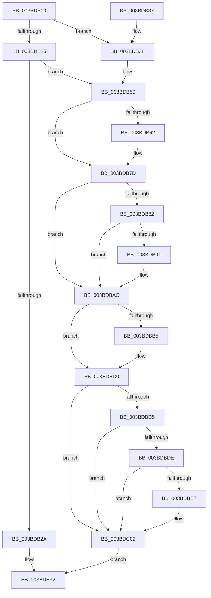

# ExAcquireSharedStarveExclusive

- RVA: `0x003BDB00`–`0x003BDC12` (길이 `274` bytes)
- VA: `0x00000001403BDB00`
- 실행 섹션: `.text`
- PDB 이름 있음: `예`; PDB Function 태그: `아니요`
- unwind 정보 RVA: `0x0008DD5C`
- 디코드: `75`개 명령, `274/274` bytes 표시
- 미해석 바이트: `0` (있으면 어셈블리에 `.byte`로 보존)

> 이 문서는 커널 이미지의 기계어와 PDB 기호를 분석해 생성했습니다. 4번과 5번은 함수 원형과 자료형을 바이너리 사용 방식에서 추정한 C 해석이며 원본 소스 복구 결과는 아닙니다.

## 1. Dependencies

- 직접 호출 지점: **7**; 고유 호출 대상: **3**
- 직접 호출자로 확인된 함수: **3**
- RIP 상대 이미지 참조: **0**

### Outgoing calls
- `0x003BDB2D` → [ExpAcquireSharedStarveExclusive](../34/ExpAcquireSharedStarveExclusive_function_003411C0.md) (function, `0x003411C0`)
- `0x003BDB4A` → [KeBugCheckEx](../4F/KeBugCheckEx_function_004FD660.md) (function, `0x004FD660`)
- `0x003BDB77` → [KeBugCheckEx](../4F/KeBugCheckEx_function_004FD660.md) (function, `0x004FD660`)
- `0x003BDBA6` → [KeBugCheckEx](../4F/KeBugCheckEx_function_004FD660.md) (function, `0x004FD660`)
- `0x003BDBCA` → [KeBugCheckEx](../4F/KeBugCheckEx_function_004FD660.md) (function, `0x004FD660`)
- `0x003BDBFC` → [KeBugCheckEx](../4F/KeBugCheckEx_function_004FD660.md) (function, `0x004FD660`)
- `0x003BDC08` → [ExpFastResourceLegacyAcquireSharedStarveExclusive](ExpFastResourceLegacyAcquireSharedStarveExclusive_function_003BDC18.md) (function, `0x003BDC18`)

### Direct callers
- [CcPinFileData](../33/CcPinFileData_function_0033FB40.md) at `0x00340215`
- [CcPinFileData](../33/CcPinFileData_function_0033FB40.md) at `0x003403E7`
- [CcPinFileData](../33/CcPinFileData_function_0033FB40.md) at `0x00340459`
- [CcPinFileData](../33/CcPinFileData_function_0033FB40.md) at `0x0034049B`
- [DifExAcquireSharedStarveExclusiveWrapper](../61/DifExAcquireSharedStarveExclusiveWrapper_function_0061DEC0.md) at `0x0061DF94`
- [CcPinMappedData](../../page/9D/CcPinMappedData_function_009D5B50.md) at `0x009D5C71`

### Static image references
- 디코드된 RIP-relative 메모리 참조가 없습니다.

## 2. Other-region calls and transfers

- 다른 실행 섹션으로 향하는 call: **0**
- 별도 외부 분기/꼬리 이동을 확인하지 못했습니다.

## 3. Assembly (complete function range)

```asm
003BDB00  48 83 EC 38                     sub rsp, 0x38
003BDB04  8A C2                           mov al, dl
003BDB06  4C 8B C1                        mov r8, rcx
003BDB09  0F B7 49 1A                     movzx ecx, word ptr [rcx + 0x1a]
003BDB0D  F6 D8                           neg al
003BDB0F  8A C1                           mov al, cl
003BDB11  41 B3 01                        mov r11b, 1
003BDB14  45 1A C9                        sbb r9b, r9b
003BDB17  44 8A D2                        mov r10b, dl
003BDB1A  41 80 C1 02                     add r9b, 2
003BDB1E  24 41                           and al, 0x41
003BDB20  41 3A C3                        cmp al, r11b
003BDB23  74 13                           je 0x1403bdb38
003BDB25  41 84 CB                        test r11b, cl
003BDB28  75 26                           jne 0x1403bdb50
003BDB2A  49 8B C8                        mov rcx, r8
003BDB2D  E8 8E 36 F8 FF                  call 0x1403411c0
003BDB32  48 83 C4 38                     add rsp, 0x38
003BDB36  C3                              ret
003BDB37  CC                              int3
003BDB38  48 83 64 24 20 00               and qword ptr [rsp + 0x20], 0
003BDB3E  45 33 C9                        xor r9d, r9d
003BDB41  B9 C6 01 00 00                  mov ecx, 0x1c6
003BDB46  41 8D 51 0F                     lea edx, [r9 + 0xf]
003BDB4A  E8 11 FB 13 00                  call 0x1404fd660
003BDB4F  CC                              int3
003BDB50  44 0F 20 C1                     mov rcx, cr8
003BDB54  65 48 8B 14 25 88 01 00 00      mov rdx, qword ptr gs:[0x188]
003BDB5D  41 3A C9                        cmp cl, r9b
003BDB60  76 1B                           jbe 0x1403bdb7d
003BDB62  48 83 64 24 20 00               and qword ptr [rsp + 0x20], 0
003BDB68  33 D2                           xor edx, edx
003BDB6A  44 0F B6 C1                     movzx r8d, cl
003BDB6E  B9 C6 01 00 00                  mov ecx, 0x1c6
003BDB73  45 0F B6 C9                     movzx r9d, r9b
003BDB77  E8 E4 FA 13 00                  call 0x1404fd660
003BDB7C  CC                              int3
003BDB7D  80 F9 02                        cmp cl, 2
003BDB80  72 2A                           jb 0x1403bdbac
003BDB82  65 8B 04 25 3C 3A 00 00         mov eax, dword ptr gs:[0x3a3c]
003BDB8A  A9 01 00 01 00                  test eax, 0x10001
003BDB8F  74 1B                           je 0x1403bdbac
003BDB91  48 83 64 24 20 00               and qword ptr [rsp + 0x20], 0
003BDB97  45 33 C9                        xor r9d, r9d
003BDB9A  45 33 C0                        xor r8d, r8d
003BDB9D  B9 C6 01 00 00                  mov ecx, 0x1c6
003BDBA2  41 8D 51 05                     lea edx, [r9 + 5]
003BDBA6  E8 B5 FA 13 00                  call 0x1404fd660
003BDBAB  CC                              int3
003BDBAC  F6 82 C0 00 00 00 02            test byte ptr [rdx + 0xc0], 2
003BDBB3  74 1B                           je 0x1403bdbd0
003BDBB5  48 83 64 24 20 00               and qword ptr [rsp + 0x20], 0
003BDBBB  45 33 C9                        xor r9d, r9d
003BDBBE  45 33 C0                        xor r8d, r8d
003BDBC1  B9 C6 01 00 00                  mov ecx, 0x1c6
003BDBC6  41 8D 51 06                     lea edx, [r9 + 6]
003BDBCA  E8 91 FA 13 00                  call 0x1404fd660
003BDBCF  CC                              int3
003BDBD0  41 3A CB                        cmp cl, r11b
003BDBD3  73 2D                           jae 0x1403bdc02
003BDBD5  F7 42 74 00 04 00 00            test dword ptr [rdx + 0x74], 0x400
003BDBDC  75 24                           jne 0x1403bdc02
003BDBDE  83 BA E4 01 00 00 00            cmp dword ptr [rdx + 0x1e4], 0
003BDBE5  75 1B                           jne 0x1403bdc02
003BDBE7  48 83 64 24 20 00               and qword ptr [rsp + 0x20], 0
003BDBED  45 33 C9                        xor r9d, r9d
003BDBF0  45 33 C0                        xor r8d, r8d
003BDBF3  B9 C6 01 00 00                  mov ecx, 0x1c6
003BDBF8  41 8D 51 07                     lea edx, [r9 + 7]
003BDBFC  E8 5F FA 13 00                  call 0x1404fd660
003BDC01  CC                              int3
003BDC02  41 8A D2                        mov dl, r10b
003BDC05  49 8B C8                        mov rcx, r8
003BDC08  E8 0B 00 00 00                  call 0x1403bdc18
003BDC0D  E9 20 FF FF FF                  jmp 0x1403bdb32
```

## 4. C-style interpretation (structured pseudocode)

```c
__int64 __fastcall ExAcquireSharedStarveExclusive(__int64 a1, unsigned __int8 a2, __int64 a3, unsigned __int8 a4)
{
    __int64 result;
    __int64 v_rsp;
    unsigned __int64 v_stack_p20;

    v_rsp = (v_rsp) - (56);
    result = (unsigned __int8)(-(a2));
    a4 = (unsigned __int8)((a4) + (2));
    result = (unsigned __int8)(((unsigned __int8)(*(unsigned __int16 *)(a1 + 26))) & (65));
    if (((unsigned __int8)(result)) == 1) goto loc_003BDB38;
    if (((1) & ((unsigned __int8)(*(unsigned __int16 *)(a1 + 26)))) != 0) goto loc_003BDB50;
    result = ExpAcquireSharedStarveExclusive(a1, a2, a1, a4);
loc_003BDB32:
    v_rsp = (v_rsp) + (56);
    return result;
loc_003BDB38:
    a4 = 0;
    result = KeBugCheckEx(454, a4 + 15, a1, a4);
loc_003BDB50:
    if (((unsigned __int8)(v_cr8)) >= = 0) {
        a2 = 0;
        a3 = (unsigned __int8)(v_cr8);
        a1 = 454;
        a4 = 0;
        result = KeBugCheckEx(a1, a2, a3, a4);
    }
    if (((unsigned __int8)(a1)) < 2) goto loc_003BDBAC;
    result = (unsigned int)(*(unsigned int *)(gs_base + (0 + 14908)));
    if ((((unsigned int)((unsigned int)(*(unsigned int *)(gs_base + (0 + 14908))))) & (0x10001ULL)) != 0) {
        a4 = 0;
        a3 = 0;
        a1 = 454;
        a2 = a4 + 5;
        result = KeBugCheckEx(a1, a2, a3, a4);
    }
    if (((*(unsigned __int8 *)(a2 + 192)) & (2)) != 0) {
        a4 = 0;
        a3 = 0;
        a1 = 454;
        a2 = a4 + 6;
        result = KeBugCheckEx(a1, a2, a3, a4);
    }
    if (((unsigned __int8)(a1)) >= 1) goto loc_003BDC02;
    if (((*(unsigned int *)(a2 + 116)) & (0x400ULL)) != 0) goto loc_003BDC02;
    if ((*(unsigned int *)(a2 + 484)) == 0) {
        a4 = 0;
        a3 = 0;
        a1 = 454;
        a2 = a4 + 7;
        result = KeBugCheckEx(a1, a2, a3, a4);
    }
    result = ExpFastResourceLegacyAcquireSharedStarveExclusive(0, a2, a3, a4);
    goto loc_003BDB32;
}
```

## 5. (Beta) C Style

```c
int64_t ExAcquireSharedStarveExclusive(void *Arg1, uint8_t Arg2, int64_t Arg3, uint8_t Arg4)
{
    uint8_t *arg1 = (uint8_t *)Arg1;

    int64_t result;
    int64_t local_rsp;
    uint64_t v_stack_p20;

    local_rsp = (local_rsp) - (56);
    result = (uint8_t)(-(Arg2));
    Arg4 = (uint8_t)((Arg4) + (2));
    result = (uint8_t)(((uint8_t)(*(uint16_t *)(arg1 + 0x1A))) & (65));
    if (((uint8_t)(result)) == 1) goto loc_003BDB38;
    if (((1) & ((uint8_t)(*(uint16_t *)(arg1 + 0x1A)))) != 0) goto loc_003BDB50;
    result = ExpAcquireSharedStarveExclusive(Arg1, Arg2, Arg1, Arg4);
loc_003BDB32:
    local_rsp = (local_rsp) + (56);
    return result;
loc_003BDB38:
    Arg4 = 0;
    result = KeBugCheckEx(454, Arg4 + 15, Arg1, Arg4);
loc_003BDB50:
    if (((uint8_t)(v_cr8)) >= = 0) {
        Arg2 = 0;
        Arg3 = (uint8_t)(v_cr8);
        Arg1 = 454;
        Arg4 = 0;
        result = KeBugCheckEx(Arg1, Arg2, Arg3, Arg4);
    }
    if (((uint8_t)(Arg1)) < 2) goto loc_003BDBAC;
    result = (uint32_t)(*(uint32_t *)(gs_base + (0 + 0x3A3C)));
    if ((((uint32_t)((uint32_t)(*(uint32_t *)(gs_base + (0 + 0x3A3C))))) & (0x10001ULL)) != 0) {
        Arg4 = 0;
        Arg3 = 0;
        Arg1 = 454;
        Arg2 = Arg4 + 5;
        result = KeBugCheckEx(Arg1, Arg2, Arg3, Arg4);
    }
    if (((*(uint8_t *)(Arg2 + 0xC0)) & (2)) != 0) {
        Arg4 = 0;
        Arg3 = 0;
        Arg1 = 454;
        Arg2 = Arg4 + 6;
        result = KeBugCheckEx(Arg1, Arg2, Arg3, Arg4);
    }
    if (((uint8_t)(Arg1)) >= 1) goto loc_003BDC02;
    if (((*(uint32_t *)(Arg2 + 0x74)) & (0x400ULL)) != 0) goto loc_003BDC02;
    if ((*(uint32_t *)(Arg2 + 0x1E4)) == 0) {
        Arg4 = 0;
        Arg3 = 0;
        Arg1 = 454;
        Arg2 = Arg4 + 7;
        result = KeBugCheckEx(Arg1, Arg2, Arg3, Arg4);
    }
    result = ExpFastResourceLegacyAcquireSharedStarveExclusive(0, Arg2, Arg3, Arg4);
    goto loc_003BDB32;
}
```

### 관측된 메모리 오프셋

구조체 형식이 확인되지 않은 접근은 인자 기준의 오프셋으로만 기록했습니다.

| 기준 인자 | 오프셋 표현 | 폭 (bit) | 접근 |
|---|---:|---:|---|
| `Arg1` | `+ 0x1A` | `16` | `R` |

## 6. Execution-region graph

[열기: 2D/3D 그래프와 함수 탐색 컨트롤 패널](../../../control-panel.html?section=text&rva=0x003BDB00&view=graph)

- 2D 그래프는 위에서 아래로 흐르고, 3D 그래프는 빈 공간을 드래그해 회전합니다. Shift+드래그는 이동, 휠은 확대·축소, 함수 노드 선택은 대상 보고서 이동입니다.

### Static fallback


