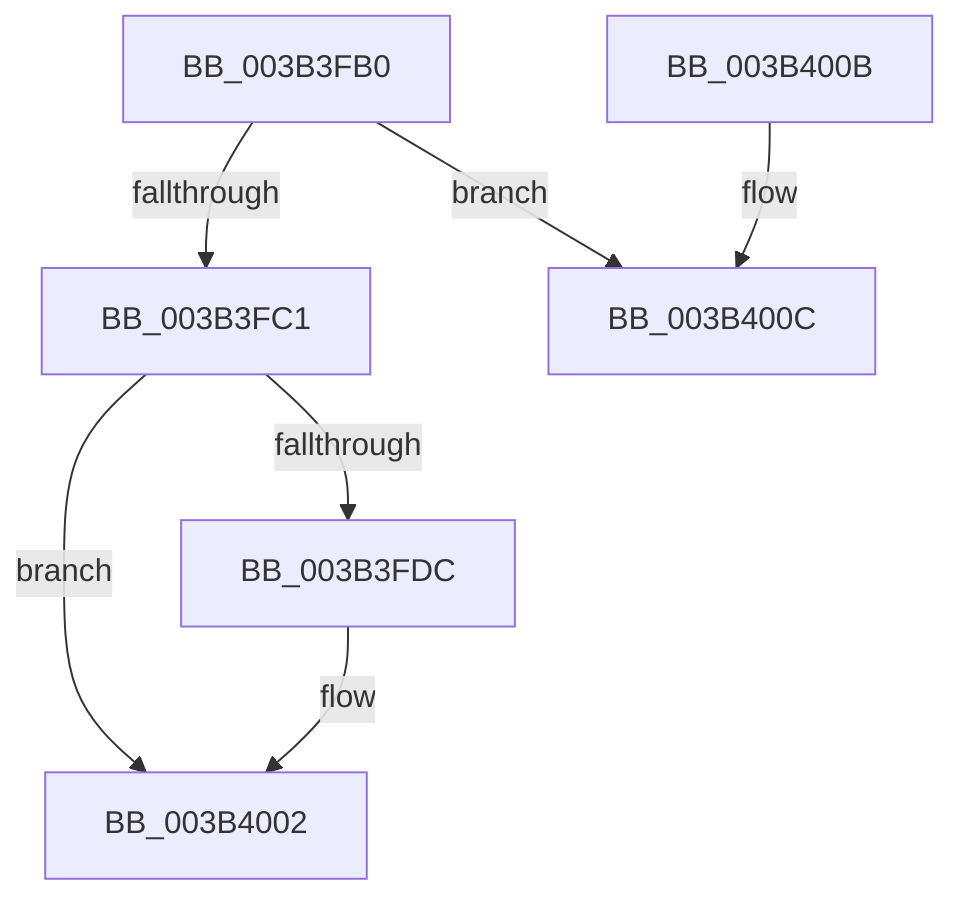

# ExSaAllocate

- RVA: `0x003B3FB0`–`0x003B4025` (길이 `117` bytes)
- VA: `0x00000001403B3FB0`
- 실행 섹션: `.text`
- PDB 이름 있음: `예`; PDB Function 태그: `아니요`
- unwind 정보 RVA: `0x0008C510`
- 디코드: `31`개 명령, `117/117` bytes 표시
- 미해석 바이트: `0` (있으면 어셈블리에 `.byte`로 보존)

> 이 문서는 커널 이미지의 기계어와 PDB 기호를 분석해 생성했습니다. 4번과 5번은 함수 원형과 자료형을 바이너리 사용 방식에서 추정한 C 해석이며 원본 소스 복구 결과는 아닙니다.

## 1. Dependencies

- 직접 호출 지점: **3**; 고유 호출 대상: **3**
- 직접 호출자로 확인된 함수: **4**
- RIP 상대 이미지 참조: **2**

### Outgoing calls
- `0x003B3FF5` → [ExpSaAllocatorAllocate](ExpSaAllocatorAllocate_function_003B402C.md) (function, `0x003B402C`)
- `0x003B3FFD` → [KeLeaveGuardedRegion](../2E/KeLeaveGuardedRegion_function_002E2C40.md) (function, `0x002E2C40`)
- `0x003B401F` → [KeBugCheckEx](../4F/KeBugCheckEx_function_004FD660.md) (function, `0x004FD660`)

### Direct callers
- [ExpAllocateFannedOutPushLock](ExpAllocateFannedOutPushLock_function_003B2B48.md) at `0x003B2B5F`
- [RtlpHpEnvTlsAlloc](../60/RtlpHpEnvTlsAlloc_function_0060411C.md) at `0x00604131`
- [EtwpCovSampCaptureContextStart](../../page/7C/EtwpCovSampCaptureContextStart_function_007C14AC.md) at `0x007C1693`
- [KeInitializeProcess](../../page/A6/KeInitializeProcess_function_00A63CF4.md) at `0x00A63FBA`

### Static image references
- `0x003B3FC1` → RVA `0x00EFA290` (`.data`; read)
- `0x003B3FCB` → RVA `0x00EFA298` (`.data`; read)

## 2. Other-region calls and transfers

- 다른 실행 섹션으로 향하는 call: **0**
- 별도 외부 분기/꼬리 이동을 확인하지 못했습니다.

## 3. Assembly (complete function range)

```asm
003B3FB0  40 53                           push rbx
003B3FB2  48 83 EC 30                     sub rsp, 0x30
003B3FB6  44 8B C1                        mov r8d, ecx
003B3FB9  F7 C2 FE FF FF FF               test edx, 0xfffffffe
003B3FBF  75 4B                           jne 0x1403b400c
003B3FC1  48 8B 0D C8 62 B4 00            mov rcx, qword ptr [rip + 0xb462c8]
003B3FC8  F6 C2 01                        test dl, 1
003B3FCB  48 0F 45 0D C5 62 B4 00         cmovne rcx, qword ptr [rip + 0xb462c5]
003B3FD3  48 83 CB FF                     or rbx, 0xffffffffffffffff
003B3FD7  48 85 C9                        test rcx, rcx
003B3FDA  74 26                           je 0x1403b4002
003B3FDC  65 48 8B 04 25 88 01 00 00      mov rax, qword ptr gs:[0x188]
003B3FE5  49 8D 50 07                     lea rdx, [r8 + 7]
003B3FE9  48 C1 EA 03                     shr rdx, 3
003B3FED  66 01 98 E6 01 00 00            add word ptr [rax + 0x1e6], bx
003B3FF4  90                              nop
003B3FF5  E8 32 00 00 00                  call 0x1403b402c
003B3FFA  48 8B D8                        mov rbx, rax
003B3FFD  E8 3E EC F2 FF                  call 0x1402e2c40
003B4002  48 8B C3                        mov rax, rbx
003B4005  48 83 C4 30                     add rsp, 0x30
003B4009  5B                              pop rbx
003B400A  C3                              ret
003B400B  CC                              int3
003B400C  48 83 64 24 20 00               and qword ptr [rsp + 0x20], 0
003B4012  45 33 C9                        xor r9d, r9d
003B4015  8B D2                           mov edx, edx
003B4017  45 33 C0                        xor r8d, r8d
003B401A  B9 6D 01 00 00                  mov ecx, 0x16d
003B401F  E8 3C 96 14 00                  call 0x1404fd660
003B4024  CC                              int3
```

## 4. C-style interpretation (structured pseudocode)

```c
__int64 __fastcall ExSaAllocate(int a1, int a2, __int64 a3, int a4)
{
    __int64 result;
    __int64 v_rbx;
    __int64 v_rsp;
    unsigned __int64 v_stack_p20;

    v_rsp = (v_rsp) - (48);
    if (((a2) & (0xFFFFFFFEULL)) != 0) goto loc_003B400C;
    a1 = *(unsigned __int64 *)(v_rip + 11821768);
    if ((((unsigned __int8)(a2)) & (1)) != 0) { a1 = *(unsigned __int64 *)(v_rip + 11821765); }
    v_rbx = (v_rbx) | (-1);
    if (a1 != 0) {
        result = *(unsigned __int64 *)(gs_base + (0 + 392));
        a2 = (unsigned int)(a1) + 7;
        a2 = (a2) >> (3);
        result = ExpSaAllocatorAllocate(a1, a2, (unsigned int)(a1), a4);
        v_rbx = result;
        result = KeLeaveGuardedRegion(a1, a2, (unsigned int)(a1), a4);
    }
    v_rsp = (v_rsp) + (48);
    return v_rbx;
loc_003B400C:
    a4 = 0;
    a3 = 0;
    result = KeBugCheckEx(365, (unsigned int)(a2), a3, a4);
    return result;
}
```

## 5. (Beta) C Style

```c
int64_t ExSaAllocate(void *Arg1, int32_t Arg2, int64_t Arg3, int32_t Arg4)
{
    uint8_t *arg1 = (uint8_t *)Arg1;

    int64_t result;
    int64_t local_rbx;
    int64_t local_rsp;
    uint64_t v_stack_p20;

    local_rsp = (local_rsp) - (48);
    if (((Arg2) & (0xFFFFFFFEULL)) != 0) goto loc_003B400C;
    Arg1 = *(uint64_t *)(v_rip + 0xB462C8);
    if ((((uint8_t)(Arg2)) & (1)) != 0) { Arg1 = *(uint64_t *)(v_rip + 0xB462C5); }
    local_rbx = (local_rbx) | (-1);
    if (Arg1 != NULL) {
        result = *(uint64_t *)(gs_base + (0 + 0x188));
        Arg2 = (uint32_t)(Arg1) + 7;
        Arg2 = (Arg2) >> (3);
        result = ExpSaAllocatorAllocate(Arg1, Arg2, (uint32_t)(Arg1), Arg4);
        local_rbx = result;
        result = KeLeaveGuardedRegion(Arg1, Arg2, (uint32_t)(Arg1), Arg4);
    }
    local_rsp = (local_rsp) + (48);
    return local_rbx;
loc_003B400C:
    Arg4 = 0;
    Arg3 = 0;
    result = KeBugCheckEx(365, (uint32_t)(Arg2), Arg3, Arg4);
    return result;
}
```

### 관측된 메모리 오프셋

구조체 형식이 확인되지 않은 접근은 인자 기준의 오프셋으로만 기록했습니다.

| 기준 인자 | 오프셋 표현 | 폭 (bit) | 접근 |
|---|---:|---:|---|
| `Arg1` | `+ 0x7` | `64` | `R` |

## 6. Execution-region graph

[열기: 2D/3D 그래프와 함수 탐색 컨트롤 패널](../../../control-panel.html?section=text&rva=0x003B3FB0&view=graph)

- 2D 그래프는 위에서 아래로 흐르고, 3D 그래프는 빈 공간을 드래그해 회전합니다. Shift+드래그는 이동, 휠은 확대·축소, 함수 노드 선택은 대상 보고서 이동입니다.

### Static fallback


