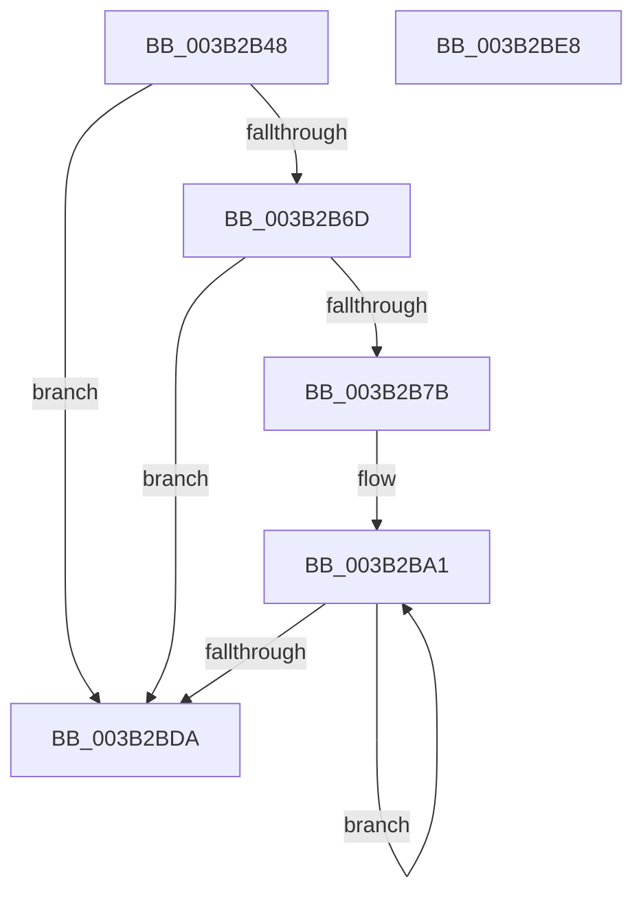

# ExpAllocateFannedOutPushLock

- RVA: `0x003B2B48`–`0x003B2BE9` (길이 `161` bytes)
- VA: `0x00000001403B2B48`
- 실행 섹션: `.text`
- PDB 이름 있음: `예`; PDB Function 태그: `아니요`
- unwind 정보 RVA: `0x0005CAAC`
- 디코드: `44`개 명령, `161/161` bytes 표시
- 미해석 바이트: `0` (있으면 어셈블리에 `.byte`로 보존)

> 이 문서는 커널 이미지의 기계어와 PDB 기호를 분석해 생성했습니다. 4번과 5번은 함수 원형과 자료형을 바이너리 사용 방식에서 추정한 C 해석이며 원본 소스 복구 결과는 아닙니다.

## 1. Dependencies

- 직접 호출 지점: **2**; 고유 호출 대상: **2**
- 직접 호출자로 확인된 함수: **1**
- RIP 상대 이미지 참조: **1**

### Outgoing calls
- `0x003B2B5F` → [ExSaAllocate](ExSaAllocate_function_003B3FB0.md) (function, `0x003B3FB0`)
- `0x003B2B72` → [KeQueryMaximumProcessorCountEx](../26/KeQueryMaximumProcessorCountEx_function_00264D60.md) (function, `0x00264D60`)

### Direct callers
- [ExpTryExpandAutoExpandPushLock](../4D/ExpTryExpandAutoExpandPushLock_function_004DF4F8.md) at `0x004DF529`

### Static image references
- `0x003B2B7B` → RVA `0x00EFA278` (`.data`; read)

## 2. Other-region calls and transfers

- 다른 실행 섹션으로 향하는 call: **0**
- 별도 외부 분기/꼬리 이동을 확인하지 못했습니다.

## 3. Assembly (complete function range)

```asm
003B2B48  48 89 5C 24 08                  mov qword ptr [rsp + 8], rbx
003B2B4D  57                              push rdi
003B2B4E  48 83 EC 20                     sub rsp, 0x20
003B2B52  F7 D2                           not edx
003B2B54  48 8B F9                        mov rdi, rcx
003B2B57  83 E2 01                        and edx, 1
003B2B5A  B9 10 00 00 00                  mov ecx, 0x10
003B2B5F  E8 4C 14 00 00                  call 0x1403b3fb0
003B2B64  48 8B D8                        mov rbx, rax
003B2B67  48 83 F8 FF                     cmp rax, -1
003B2B6B  74 6D                           je 0x1403b2bda
003B2B6D  B9 FF FF 00 00                  mov ecx, 0xffff
003B2B72  E8 E9 21 EB FF                  call 0x140264d60
003B2B77  85 C0                           test eax, eax
003B2B79  74 5F                           je 0x1403b2bda
003B2B7B  4C 8B 15 F6 76 B4 00            mov r10, qword ptr [rip + 0xb476f6]
003B2B82  44 8B CB                        mov r9d, ebx
003B2B85  41 C1 E9 0D                     shr r9d, 0xd
003B2B89  44 8B C3                        mov r8d, ebx
003B2B8C  41 81 E1 FF FF 03 00            and r9d, 0x3ffff
003B2B93  49 C1 E8 04                     shr r8, 4
003B2B97  41 81 E0 FF 01 00 00            and r8d, 0x1ff
003B2B9E  44 8B D8                        mov r11d, eax
003B2BA1  83 64 24 38 00                  and dword ptr [rsp + 0x38], 0
003B2BA6  BA 01 00 00 00                  mov edx, 1
003B2BAB  41 0F BD C9                     bsr ecx, r9d
003B2BAF  41 8B C1                        mov eax, r9d
003B2BB2  D3 E2                           shl edx, cl
003B2BB4  83 C1 FE                        add ecx, -2
003B2BB7  48 33 D0                        xor rdx, rax
003B2BBA  49 8B 02                        mov rax, qword ptr [r10]
003B2BBD  4D 8D 52 08                     lea r10, [r10 + 8]
003B2BC1  48 8B 0C C8                     mov rcx, qword ptr [rax + rcx*8]
003B2BC5  48 8B 44 D1 08                  mov rax, qword ptr [rcx + rdx*8 + 8]
003B2BCA  4A 83 24 C0 00                  and qword ptr [rax + r8*8], 0
003B2BCF  4A 89 7C C0 08                  mov qword ptr [rax + r8*8 + 8], rdi
003B2BD4  49 83 EB 01                     sub r11, 1
003B2BD8  75 C7                           jne 0x1403b2ba1
003B2BDA  48 8B C3                        mov rax, rbx
003B2BDD  48 8B 5C 24 30                  mov rbx, qword ptr [rsp + 0x30]
003B2BE2  48 83 C4 20                     add rsp, 0x20
003B2BE6  5F                              pop rdi
003B2BE7  C3                              ret
003B2BE8  CC                              int3
```

## 4. C-style interpretation (structured pseudocode)

```c
__int64 __fastcall ExpAllocateFannedOutPushLock(__int64 a1, int a2)
{
    __int64 result;
    __int64 v_r11;
    __int64 v_rsp;
    unsigned int v_stack_p10;
    unsigned __int64 v_stack_p8;

    v_stack_p8 = v_rbx;
    v_rsp = (v_rsp) - (32);
    a2 = (unsigned int)(~(a2));
    a2 = (unsigned int)((a2) & (1));
    result = ExSaAllocate(16, a2, a3, a4);
    if (result == -1) goto loc_003B2BDA;
    result = KeQueryMaximumProcessorCountEx((unsigned int)(0xFFFFULL), a2, a3, a4);
    if ((unsigned int)(result) == 0) goto loc_003B2BDA;
    a4 = (unsigned int)(((unsigned int)((unsigned int)(result))) >> (13));
    a4 = (unsigned int)((a4) & (0x3FFFFULL));
    a3 = ((unsigned int)((unsigned int)(result))) >> (4);
    a3 = (unsigned int)((a3) & (511));
loc_003B2BA1:
    a2 = (unsigned int)((1) << ((unsigned __int8)((unsigned int)(0xFFFFULL))));
    a1 = (unsigned int)(((unsigned int)(0xFFFFULL)) + (-2));
    a2 = (a2) ^ ((unsigned int)((unsigned int)(a4)));
    *(unsigned __int64 *)(*(unsigned __int64 *)(*(unsigned __int64 *)(*(unsigned __int64 *)(*(unsigned __int64 *)(v_rip + 11826934)) + a1 * 8) + a2 * 8 + 8) + a3 * 8 + 8) = a1;
    v_r11 = ((unsigned int)((unsigned int)(result))) - (1);
    if (condition_is_not_equal) goto loc_003B2BA1;
loc_003B2BDA:
    v_rsp = (v_rsp) + (32);
    return result;
}
```

## 5. (Beta) C Style

```c
int64_t ExpAllocateFannedOutPushLock(int64_t Arg1, int32_t Arg2)
{
    int64_t result;
    int64_t local_r11;
    int64_t local_rsp;
    uint32_t v_stack_p10;
    uint64_t v_stack_p8;

    v_stack_p8 = local_rbx;
    local_rsp = (local_rsp) - (32);
    Arg2 = (uint32_t)(~(Arg2));
    Arg2 = (uint32_t)((Arg2) & (1));
    result = ExSaAllocate(16, Arg2, a3, a4);
    if (result == -1) goto loc_003B2BDA;
    result = KeQueryMaximumProcessorCountEx((uint32_t)(0xFFFFULL), Arg2, a3, a4);
    if ((uint32_t)(result) == 0) goto loc_003B2BDA;
    a4 = (uint32_t)(((uint32_t)((uint32_t)(result))) >> (13));
    a4 = (uint32_t)((a4) & (0x3FFFFULL));
    a3 = ((uint32_t)((uint32_t)(result))) >> (4);
    a3 = (uint32_t)((a3) & (511));
loc_003B2BA1:
    Arg2 = (uint32_t)((1) << ((uint8_t)((uint32_t)(0xFFFFULL))));
    Arg1 = (uint32_t)(((uint32_t)(0xFFFFULL)) + (-2));
    Arg2 = (Arg2) ^ ((uint32_t)((uint32_t)(a4)));
    *(uint64_t *)(*(uint64_t *)(*(uint64_t *)(*(uint64_t *)(*(uint64_t *)(v_rip + 0xB476F6)) + Arg1 * 8) + Arg2 * 8 + 0x8) + a3 * 8 + 0x8) = Arg1;
    local_r11 = ((uint32_t)((uint32_t)(result))) - (1);
    if (condition_is_not_equal) goto loc_003B2BA1;
loc_003B2BDA:
    local_rsp = (local_rsp) + (32);
    return result;
}
```

## 6. Execution-region graph

[열기: 2D/3D 그래프와 함수 탐색 컨트롤 패널](../../../control-panel.html?section=text&rva=0x003B2B48&view=graph)

- 2D 그래프는 위에서 아래로 흐르고, 3D 그래프는 빈 공간을 드래그해 회전합니다. Shift+드래그는 이동, 휠은 확대·축소, 함수 노드 선택은 대상 보고서 이동입니다.

### Static fallback


