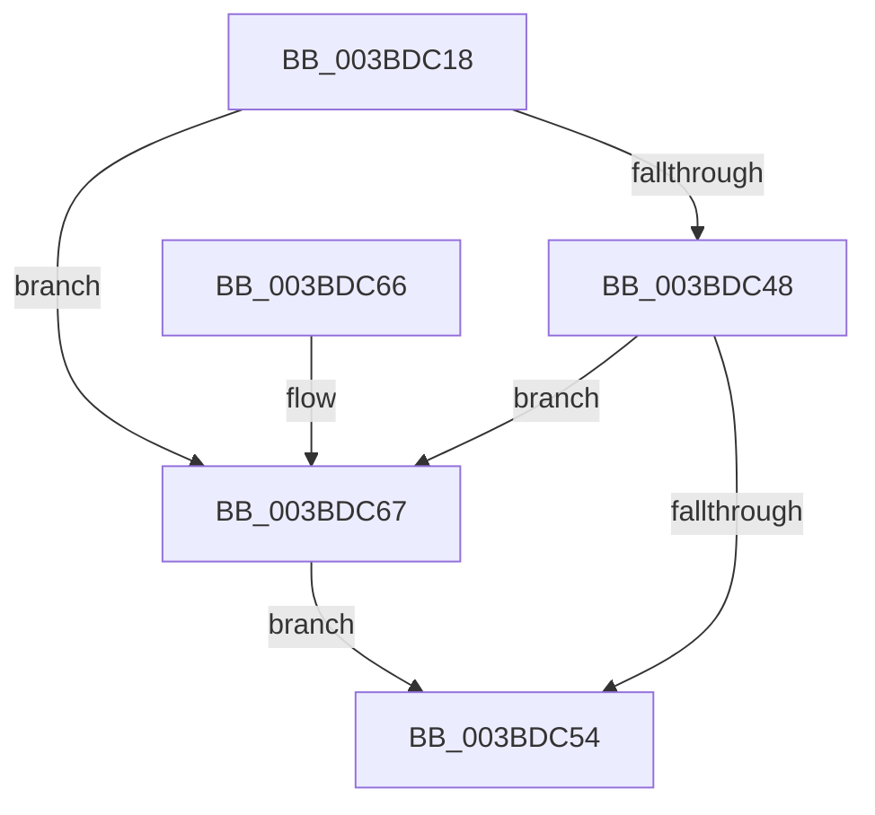

# ExpFastResourceLegacyAcquireSharedStarveExclusive

- RVA: `0x003BDC18`–`0x003BDC73` (길이 `91` bytes)
- VA: `0x00000001403BDC18`
- 실행 섹션: `.text`
- PDB 이름 있음: `예`; PDB Function 태그: `아니요`
- unwind 정보 RVA: `0x00065C48`
- 디코드: `30`개 명령, `91/91` bytes 표시
- 미해석 바이트: `0` (있으면 어셈블리에 `.byte`로 보존)

> 이 문서는 커널 이미지의 기계어와 PDB 기호를 분석해 생성했습니다. 4번과 5번은 함수 원형과 자료형을 바이너리 사용 방식에서 추정한 C 해석이며 원본 소스 복구 결과는 아닙니다.

## 1. Dependencies

- 직접 호출 지점: **4**; 고유 호출 대상: **4**
- 직접 호출자로 확인된 함수: **2**
- RIP 상대 이미지 참조: **0**

### Outgoing calls
- `0x003BDC2C` → [ExpAllocateOwnerEntryForLegacyShim](../21/ExpAllocateOwnerEntryForLegacyShim_function_00213B50.md) (function, `0x00213B50`)
- `0x003BDC3D` → [ExAcquireFastResourceSharedStarveExclusive](ExAcquireFastResourceSharedStarveExclusive_function_003BDC80.md) (function, `0x003BDC80`)
- `0x003BDC4B` → [ExIsFastResourceHeldExclusive](../21/ExIsFastResourceHeldExclusive_function_00213450.md) (function, `0x00213450`)
- `0x003BDC6C` → [ExFreePoolWithTag](../../poolcode/B8/ExFreePoolWithTag_function_00B82870.md) (function, `0x00B82870`)

### Direct callers
- [CcPinFileData](../33/CcPinFileData_function_0033FB40.md) at `0x0034097E`
- [CcPinFileData](../33/CcPinFileData_function_0033FB40.md) at `0x00340A2B`
- [ExAcquireSharedStarveExclusive](ExAcquireSharedStarveExclusive_function_003BDB00.md) at `0x003BDC08`

### Static image references
- 디코드된 RIP-relative 메모리 참조가 없습니다.

## 2. Other-region calls and transfers

- 다른 실행 섹션으로 향하는 call: **1**
  - `0x003BDC6C` → [ExFreePoolWithTag](../../poolcode/B8/ExFreePoolWithTag_function_00B82870.md) (`.text` → `POOLCODE`)
- 별도 외부 분기/꼬리 이동을 확인하지 못했습니다.

## 3. Assembly (complete function range)

```asm
003BDC18  48 89 5C 24 08                  mov qword ptr [rsp + 8], rbx
003BDC1D  48 89 74 24 10                  mov qword ptr [rsp + 0x10], rsi
003BDC22  57                              push rdi
003BDC23  48 83 EC 20                     sub rsp, 0x20
003BDC27  8A DA                           mov bl, dl
003BDC29  48 8B F1                        mov rsi, rcx
003BDC2C  E8 1F 5F E5 FF                  call 0x140213b50
003BDC31  44 8A C3                        mov r8b, bl
003BDC34  48 8B D0                        mov rdx, rax
003BDC37  48 8B CE                        mov rcx, rsi
003BDC3A  48 8B F8                        mov rdi, rax
003BDC3D  E8 3E 00 00 00                  call 0x1403bdc80
003BDC42  8A D8                           mov bl, al
003BDC44  84 C0                           test al, al
003BDC46  74 1F                           je 0x1403bdc67
003BDC48  48 8B CE                        mov rcx, rsi
003BDC4B  E8 00 58 E5 FF                  call 0x140213450
003BDC50  84 C0                           test al, al
003BDC52  75 13                           jne 0x1403bdc67
003BDC54  48 8B 74 24 38                  mov rsi, qword ptr [rsp + 0x38]
003BDC59  8A C3                           mov al, bl
003BDC5B  48 8B 5C 24 30                  mov rbx, qword ptr [rsp + 0x30]
003BDC60  48 83 C4 20                     add rsp, 0x20
003BDC64  5F                              pop rdi
003BDC65  C3                              ret
003BDC66  CC                              int3
003BDC67  33 D2                           xor edx, edx
003BDC69  48 8B CF                        mov rcx, rdi
003BDC6C  E8 FF 4B 7C 00                  call 0x140b82870
003BDC71  EB E1                           jmp 0x1403bdc54
```

## 4. C-style interpretation (structured pseudocode)

```c
__int64 __fastcall ExpFastResourceLegacyAcquireSharedStarveExclusive(__int64 a1, unsigned __int8 a2)
{
    __int64 result;
    __int64 v_rsp;
    unsigned __int64 v_stack_p10;
    unsigned __int64 v_stack_p8;

    v_stack_p8 = v_rbx;
    v_stack_p10 = v_rsi;
    v_rsp = (v_rsp) - (32);
    result = ExpAllocateOwnerEntryForLegacyShim(a1, a2, a3, a4);
    result = ExAcquireFastResourceSharedStarveExclusive(a1, result, a2, a4);
    if ((unsigned __int8)(result) == 0) goto loc_003BDC67;
    result = ExIsFastResourceHeldExclusive(a1, result, a2, a4);
    if ((unsigned __int8)(result) != 0) goto loc_003BDC67;
loc_003BDC54:
    v_rsp = (v_rsp) + (32);
    return (unsigned __int8)((unsigned __int8)(result));
loc_003BDC67:
    a2 = 0;
    result = ExFreePoolWithTag(result, a2, a2, a4);
    goto loc_003BDC54;
}
```

## 5. (Beta) C Style

```c
int64_t ExpFastResourceLegacyAcquireSharedStarveExclusive(int64_t Arg1, uint8_t Arg2)
{
    int64_t result;
    int64_t local_rsp;
    uint64_t v_stack_p10;
    uint64_t v_stack_p8;

    v_stack_p8 = local_rbx;
    v_stack_p10 = local_rsi;
    local_rsp = (local_rsp) - (32);
    result = ExpAllocateOwnerEntryForLegacyShim(Arg1, Arg2, a3, a4);
    result = ExAcquireFastResourceSharedStarveExclusive(Arg1, result, Arg2, a4);
    if ((uint8_t)(result) == 0) goto loc_003BDC67;
    result = ExIsFastResourceHeldExclusive(Arg1, result, Arg2, a4);
    if ((uint8_t)(result) != 0) goto loc_003BDC67;
loc_003BDC54:
    local_rsp = (local_rsp) + (32);
    return (uint8_t)((uint8_t)(result));
loc_003BDC67:
    Arg2 = 0;
    result = ExFreePoolWithTag(result, Arg2, Arg2, a4);
    goto loc_003BDC54;
}
```

## 6. Execution-region graph

[열기: 2D/3D 그래프와 함수 탐색 컨트롤 패널](../../../control-panel.html?section=text&rva=0x003BDC18&view=graph)

- 2D 그래프는 위에서 아래로 흐르고, 3D 그래프는 빈 공간을 드래그해 회전합니다. Shift+드래그는 이동, 휠은 확대·축소, 함수 노드 선택은 대상 보고서 이동입니다.

### Static fallback


