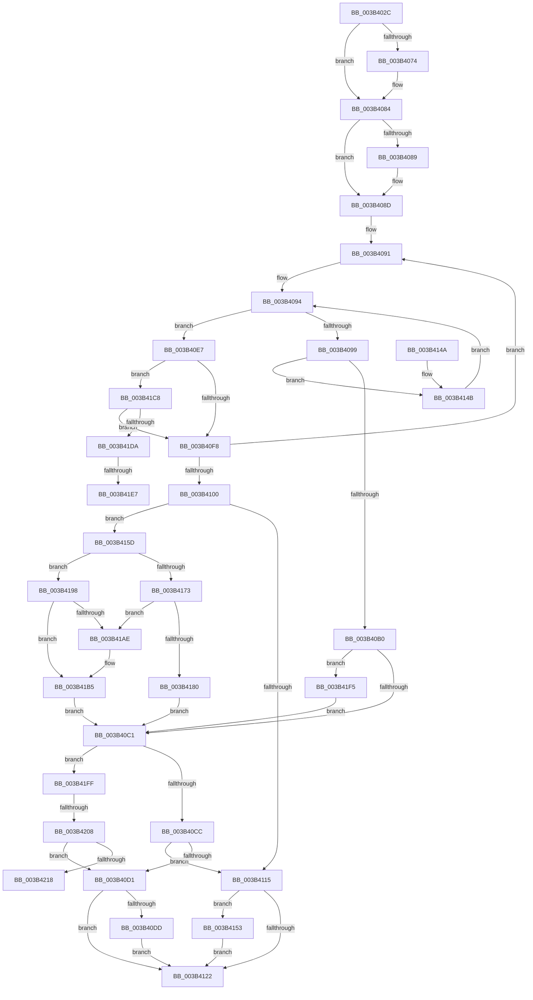

# ExpSaAllocatorAllocate

- RVA: `0x003B402C`–`0x003B421D` (길이 `497` bytes)
- VA: `0x00000001403B402C`
- 실행 섹션: `.text`
- PDB 이름 있음: `예`; PDB Function 태그: `예`
- unwind 정보 RVA: `0x0008C51C`
- 디코드: `144`개 명령, `497/497` bytes 표시
- 미해석 바이트: `0` (있으면 어셈블리에 `.byte`로 보존)

> 이 문서는 커널 이미지의 기계어와 PDB 기호를 분석해 생성했습니다. 4번과 5번은 함수 원형과 자료형을 바이너리 사용 방식에서 추정한 C 해석이며 원본 소스 복구 결과는 아닙니다.

## 1. Dependencies

- 직접 호출 지점: **9**; 고유 호출 대상: **7**
- 직접 호출자로 확인된 함수: **1**
- RIP 상대 이미지 참조: **0**

### Outgoing calls
- `0x003B4060` → [KeAbPreAcquire](../21/KeAbPreAcquire_function_00210230.md) (function, `0x00210230`)
- `0x003B407F` → [ExfAcquirePushLockSharedEx](../21/ExfAcquirePushLockSharedEx_function_0021044C.md) (function, `0x0021044C`)
- `0x003B409F` → [ExpSaPageGroupAllocateMemory](ExpSaPageGroupAllocateMemory_function_003B5FF0.md) (function, `0x003B5FF0`)
- `0x003B40E0` → [ExfReleasePushLockShared](../26/ExfReleasePushLockShared_function_00263440.md) (function, `0x00263440`)
- `0x003B4108` → [ExpSaPageGroupDescriptorAllocate](ExpSaPageGroupDescriptorAllocate_function_003B4224.md) (function, `0x003B4224`)
- `0x003B4125` → [KeAbPostRelease](../2E/KeAbPostRelease_function_002E1600.md) (function, `0x002E1600`)
- `0x003B4156` → [ExfTryToWakePushLock](../26/ExfTryToWakePushLock_function_00265DD0.md) (function, `0x00265DD0`)
- `0x003B4163` → [ExpSaPageGroupAllocateMemory](ExpSaPageGroupAllocateMemory_function_003B5FF0.md) (function, `0x003B5FF0`)
- `0x003B41EA` → [ExfReleasePushLockShared](../26/ExfReleasePushLockShared_function_00263440.md) (function, `0x00263440`)

### Direct callers
- [ExSaAllocate](ExSaAllocate_function_003B3FB0.md) at `0x003B3FF5`

### Static image references
- 디코드된 RIP-relative 메모리 참조가 없습니다.

## 2. Other-region calls and transfers

- 다른 실행 섹션으로 향하는 call: **0**
- call이 아닌 외부 분기/꼬리 이동: **4**
  - `0x003B41E1` → [sub_006E7298](../6E/Unknown_function_006E7298.md) (`tail-transfer`)
  - `0x003B41F0` → [sub_006E7298](../6E/Unknown_function_006E7298.md) (`tail-transfer`)
  - `0x003B4202` → [sub_006E7298 + 0x42](../6E/Unknown_function_006E7298.md) (`tail-transfer`)
  - `0x003B4218` → [sub_006E7298 + 0x42](../6E/Unknown_function_006E7298.md) (`tail-transfer`)

## 3. Assembly (complete function range)

```asm
003B402C  48 89 5C 24 08                  mov qword ptr [rsp + 8], rbx
003B4031  48 89 6C 24 10                  mov qword ptr [rsp + 0x10], rbp
003B4036  48 89 74 24 18                  mov qword ptr [rsp + 0x18], rsi
003B403B  57                              push rdi
003B403C  41 54                           push r12
003B403E  41 55                           push r13
003B4040  41 56                           push r14
003B4042  41 57                           push r15
003B4044  48 83 EC 20                     sub rsp, 0x20
003B4048  44 8B EA                        mov r13d, edx
003B404B  45 33 F6                        xor r14d, r14d
003B404E  48 83 CB FF                     or rbx, 0xffffffffffffffff
003B4052  33 D2                           xor edx, edx
003B4054  45 33 C0                        xor r8d, r8d
003B4057  45 8A E6                        mov r12b, r14b
003B405A  48 8B FB                        mov rdi, rbx
003B405D  48 8B F1                        mov rsi, rcx
003B4060  E8 CB C1 E5 FF                  call 0x140210230
003B4065  48 8B E8                        mov rbp, rax
003B4068  8D 53 12                        lea edx, [rbx + 0x12]
003B406B  33 C0                           xor eax, eax
003B406D  F0 48 0F B1 16                  lock cmpxchg qword ptr [rsi], rdx
003B4072  74 10                           je 0x1403b4084
003B4074  4C 8B CE                        mov r9, rsi
003B4077  4C 8B C5                        mov r8, rbp
003B407A  33 D2                           xor edx, edx
003B407C  48 8B CE                        mov rcx, rsi
003B407F  E8 C8 C3 E5 FF                  call 0x14021044c
003B4084  48 85 ED                        test rbp, rbp
003B4087  74 04                           je 0x1403b408d
003B4089  C6 45 0A 01                     mov byte ptr [rbp + 0xa], 1
003B408D  4C 8D 7E 08                     lea r15, [rsi + 8]
003B4091  4D 8B 37                        mov r14, qword ptr [r15]
003B4094  4D 3B F7                        cmp r14, r15
003B4097  74 4E                           je 0x1403b40e7
003B4099  41 8B D5                        mov edx, r13d
003B409C  49 8B CE                        mov rcx, r14
003B409F  E8 4C 1F 00 00                  call 0x1403b5ff0
003B40A4  48 8B F8                        mov rdi, rax
003B40A7  48 3B C3                        cmp rax, rbx
003B40AA  0F 84 9B 00 00 00               je 0x1403b414b
003B40B0  41 8B 46 24                     mov eax, dword ptr [r14 + 0x24]
003B40B4  33 ED                           xor ebp, ebp
003B40B6  8D 55 01                        lea edx, [rbp + 1]
003B40B9  85 C0                           test eax, eax
003B40BB  0F 84 34 01 00 00               je 0x1403b41f5
003B40C1  8B 46 40                        mov eax, dword ptr [rsi + 0x40]
003B40C4  A8 02                           test al, 2
003B40C6  0F 85 33 01 00 00               jne 0x1403b41ff
003B40CC  45 84 E4                        test r12b, r12b
003B40CF  75 44                           jne 0x1403b4115
003B40D1  B8 11 00 00 00                  mov eax, 0x11
003B40D6  F0 48 0F B1 2E                  lock cmpxchg qword ptr [rsi], rbp
003B40DB  74 45                           je 0x1403b4122
003B40DD  48 8B CE                        mov rcx, rsi
003B40E0  E8 5B F3 EA FF                  call 0x140263440
003B40E5  EB 3B                           jmp 0x1403b4122
003B40E7  4D 8B 37                        mov r14, qword ptr [r15]
003B40EA  33 ED                           xor ebp, ebp
003B40EC  8D 4D 01                        lea ecx, [rbp + 1]
003B40EF  45 84 E4                        test r12b, r12b
003B40F2  0F 84 D0 00 00 00               je 0x1403b41c8
003B40F8  44 8A E1                        mov r12b, cl
003B40FB  4D 3B 37                        cmp r14, qword ptr [r15]
003B40FE  75 91                           jne 0x1403b4091
003B4100  8B 56 40                        mov edx, dword ptr [rsi + 0x40]
003B4103  22 D1                           and dl, cl
003B4105  48 8B CE                        mov rcx, rsi
003B4108  E8 17 01 00 00                  call 0x1403b4224
003B410D  4C 8B F0                        mov r14, rax
003B4110  48 85 C0                        test rax, rax
003B4113  75 48                           jne 0x1403b415d
003B4115  F0 48 0F C1 1E                  lock xadd qword ptr [rsi], rbx
003B411A  80 E3 06                        and bl, 6
003B411D  80 FB 02                        cmp bl, 2
003B4120  74 31                           je 0x1403b4153
003B4122  48 8B CE                        mov rcx, rsi
003B4125  E8 D6 D4 F2 FF                  call 0x1402e1600
003B412A  48 8B 5C 24 50                  mov rbx, qword ptr [rsp + 0x50]
003B412F  48 8B C7                        mov rax, rdi
003B4132  48 8B 6C 24 58                  mov rbp, qword ptr [rsp + 0x58]
003B4137  48 8B 74 24 60                  mov rsi, qword ptr [rsp + 0x60]
003B413C  48 83 C4 20                     add rsp, 0x20
003B4140  41 5F                           pop r15
003B4142  41 5E                           pop r14
003B4144  41 5D                           pop r13
003B4146  41 5C                           pop r12
003B4148  5F                              pop rdi
003B4149  C3                              ret
003B414A  CC                              int3
003B414B  4D 8B 36                        mov r14, qword ptr [r14]
003B414E  E9 41 FF FF FF                  jmp 0x1403b4094
003B4153  48 8B CE                        mov rcx, rsi
003B4156  E8 75 1C EB FF                  call 0x140265dd0
003B415B  EB C5                           jmp 0x1403b4122
003B415D  41 8B D5                        mov edx, r13d
003B4160  49 8B CE                        mov rcx, r14
003B4163  E8 88 1E 00 00                  call 0x1403b5ff0
003B4168  41 8B 4E 24                     mov ecx, dword ptr [r14 + 0x24]
003B416C  48 8B F8                        mov rdi, rax
003B416F  85 C9                           test ecx, ecx
003B4171  74 25                           je 0x1403b4198
003B4173  41 89 6E 28                     mov dword ptr [r14 + 0x28], ebp
003B4177  49 8B 07                        mov rax, qword ptr [r15]
003B417A  4C 39 78 08                     cmp qword ptr [rax + 8], r15
003B417E  75 2E                           jne 0x1403b41ae
003B4180  49 89 06                        mov qword ptr [r14], rax
003B4183  BA 01 00 00 00                  mov edx, 1
003B4188  4D 89 7E 08                     mov qword ptr [r14 + 8], r15
003B418C  4C 89 70 08                     mov qword ptr [rax + 8], r14
003B4190  4D 89 37                        mov qword ptr [r15], r14
003B4193  E9 29 FF FF FF                  jmp 0x1403b40c1
003B4198  48 8D 46 18                     lea rax, [rsi + 0x18]
003B419C  BA 01 00 00 00                  mov edx, 1
003B41A1  41 89 56 28                     mov dword ptr [r14 + 0x28], edx
003B41A5  48 8B 48 08                     mov rcx, qword ptr [rax + 8]
003B41A9  48 39 01                        cmp qword ptr [rcx], rax
003B41AC  74 07                           je 0x1403b41b5
003B41AE  B9 03 00 00 00                  mov ecx, 3
003B41B3  CD 29                           int 0x29
003B41B5  49 89 06                        mov qword ptr [r14], rax
003B41B8  49 89 4E 08                     mov qword ptr [r14 + 8], rcx
003B41BC  4C 89 31                        mov qword ptr [rcx], r14
003B41BF  4C 89 70 08                     mov qword ptr [rax + 8], r14
003B41C3  E9 F9 FE FF FF                  jmp 0x1403b40c1
003B41C8  BA 11 00 00 00                  mov edx, 0x11
003B41CD  8B C2                           mov eax, edx
003B41CF  F0 48 0F B1 0E                  lock cmpxchg qword ptr [rsi], rcx
003B41D4  0F 84 1E FF FF FF               je 0x1403b40f8
003B41DA  8B C2                           mov eax, edx
003B41DC  F0 48 0F B1 2E                  lock cmpxchg qword ptr [rsi], rbp
003B41E1  0F 84 B1 30 33 00               je 0x1406e7298
003B41E7  48 8B CE                        mov rcx, rsi
003B41EA  E8 51 F2 EA FF                  call 0x140263440
003B41EF  90                              nop
003B41F0  E9 A3 30 33 00                  jmp 0x1406e7298
003B41F5  F0 83 4E 40 02                  lock or dword ptr [rsi + 0x40], 2
003B41FA  E9 C2 FE FF FF                  jmp 0x1403b40c1
003B41FF  45 84 E4                        test r12b, r12b
003B4202  0F 85 D2 30 33 00               jne 0x1406e72da
003B4208  B8 11 00 00 00                  mov eax, 0x11
003B420D  F0 48 0F B1 16                  lock cmpxchg qword ptr [rsi], rdx
003B4212  0F 85 B9 FE FF FF               jne 0x1403b40d1
003B4218  E9 BD 30 33 00                  jmp 0x1406e72da
```

## 4. C-style interpretation (structured pseudocode)

```c
__int64 __fastcall ExpSaAllocatorAllocate(__int64 a1, int a2, int a3)
{
    __int64 result;
    __int64 v_r14;
    __int64 v_rbp;
    __int64 v_rbx;
    __int64 v_rsp;
    unsigned __int64 v_stack_p10;
    unsigned __int64 v_stack_p18;
    unsigned __int64 v_stack_p8;

    v_stack_p8 = v_rbx;
    v_stack_p10 = v_rbp;
    v_stack_p18 = v_rsi;
    v_rsp = (v_rsp) - (32);
    v_r14 = 0;
    v_rbx = (v_rbx) | (-1);
    a2 = 0;
    a3 = 0;
    result = KeAbPreAcquire(a1, a2, a3, a4);
    result = 0;
    if (!(condition_is_equal)) {
        a4 = a1;
        a3 = 0;
        a2 = 0;
        a1 = a1;
        result = ExfAcquirePushLockSharedEx(a1, a2, a3, a4);
    }
    if (result != 0) {
        *(unsigned __int8 *)(result + 10) = 1;
    }
loc_003B4091:
loc_003B4094:
    if ((*(unsigned __int64 *)(a1 + 8)) == (a1 + 8)) goto loc_003B40E7;
    result = ExpSaPageGroupAllocateMemory(*(unsigned __int64 *)(a1 + 8), (unsigned int)((unsigned int)((unsigned int)(a2))), a3, a4);
    if (result == v_rbx) goto loc_003B414B;
    v_rbp = 0;
    if ((unsigned int)((unsigned int)(*(unsigned int *)(*(unsigned __int64 *)(a1 + 8) + 36))) == 0) goto loc_003B41F5;
loc_003B40C1:
    if ((((unsigned __int8)((unsigned int)(*(unsigned int *)(a1 + 64)))) & (2)) != 0) goto loc_003B41FF;
    if (0 != 0) goto loc_003B4115;
loc_003B40D1:
    if (0 == 0) goto loc_003B4122;
    result = ExfReleasePushLockShared(a1, v_rbp + 1, a3, a4);
    goto loc_003B4122;
loc_003B40E7:
    v_rbp = 0;
    if (0 == 0) goto loc_003B41C8;
loc_003B40F8:
    if ((*(unsigned __int64 *)(a1 + 8)) != (*(unsigned __int64 *)(a1 + 8))) goto loc_003B4091;
    a2 = (unsigned __int8)(((unsigned int)(*(unsigned int *)(a1 + 64))) & ((unsigned __int8)(v_rbp + 1)));
    result = ExpSaPageGroupDescriptorAllocate(a1, a2, a3, a4);
    if (result != 0) goto loc_003B415D;
loc_003B4115:
    v_rbx = (unsigned __int8)((v_rbx) & (6));
    if (((unsigned __int8)(v_rbx)) == 2) goto loc_003B4153;
loc_003B4122:
    result = KeAbPostRelease(a1, a2, a3, a4);
    v_rsp = (v_rsp) + (32);
    return result;
loc_003B414B:
    goto loc_003B4094;
loc_003B4153:
    result = ExfTryToWakePushLock(v_stack_p18, a2, a3, a4);
    goto loc_003B4122;
loc_003B415D:
    result = ExpSaPageGroupAllocateMemory(*(unsigned __int64 *)(result), (unsigned int)((unsigned int)((unsigned int)(a2))), a3, a4);
    if ((unsigned int)((unsigned int)(*(unsigned int *)(*(unsigned __int64 *)(result) + 36))) == 0) goto loc_003B4198;
    *(unsigned int *)(*(unsigned __int64 *)(result) + 40) = (unsigned int)(v_stack_p10);
    if ((*(unsigned __int64 *)(*(unsigned __int64 *)(a1 + 8) + 8)) != (a1 + 8)) goto loc_003B41AE;
    *(unsigned __int64 *)(*(unsigned __int64 *)(result)) = *(unsigned __int64 *)(a1 + 8);
    *(unsigned __int64 *)(*(unsigned __int64 *)(result) + 8) = a1 + 8;
    *(unsigned __int64 *)(*(unsigned __int64 *)(a1 + 8) + 8) = *(unsigned __int64 *)(result);
    *(unsigned __int64 *)(a1 + 8) = *(unsigned __int64 *)(result);
    goto loc_003B40C1;
loc_003B4198:
    *(unsigned int *)(*(unsigned __int64 *)(result) + 40) = 1;
    if ((*(unsigned __int64 *)(*(unsigned __int64 *)(v_stack_p18 + 24 + 8))) != (v_stack_p18 + 24)) {
        a1 = 3;
    }
    *(unsigned __int64 *)(*(unsigned __int64 *)(result)) = v_stack_p18 + 24;
    *(unsigned __int64 *)(*(unsigned __int64 *)(result) + 8) = a1;
    *(unsigned __int64 *)(a1) = *(unsigned __int64 *)(result);
    *(unsigned __int64 *)(v_stack_p18 + 24 + 8) = *(unsigned __int64 *)(result);
    goto loc_003B40C1;
loc_003B41C8:
    if ((*(unsigned __int64 *)(*(unsigned __int64 *)(v_stack_p18 + 24 + 8))) == (v_stack_p18 + 24)) goto loc_003B40F8;
    result = ExfReleasePushLockShared(v_stack_p18, 17, a3, a4);
loc_003B41F5:
    goto loc_003B40C1;
loc_003B41FF:
    if ((unsigned __int8)((unsigned __int8)(v_rbp + 1)) != 0) goto loc_003B40D1;
}
```

## 5. (Beta) C Style

```c
int64_t ExpSaAllocatorAllocate(void *Arg1, int32_t Arg2, int32_t Arg3)
{
    uint8_t *arg1 = (uint8_t *)Arg1;

    int64_t result;
    int64_t local_r14;
    int64_t local_rbp;
    int64_t local_rbx;
    int64_t local_rsp;
    uint64_t v_stack_p10;
    uint64_t v_stack_p18;
    uint64_t v_stack_p8;

    v_stack_p8 = local_rbx;
    v_stack_p10 = local_rbp;
    v_stack_p18 = local_rsi;
    local_rsp = (local_rsp) - (32);
    local_r14 = 0;
    local_rbx = (local_rbx) | (-1);
    Arg2 = 0;
    Arg3 = 0;
    result = KeAbPreAcquire(Arg1, Arg2, Arg3, a4);
    result = 0;
    if (!(condition_is_equal)) {
        a4 = Arg1;
        Arg3 = 0;
        Arg2 = 0;
        Arg1 = Arg1;
        result = ExfAcquirePushLockSharedEx(Arg1, Arg2, Arg3, a4);
    }
    if (result != 0) {
        *(uint8_t *)(result + 0xA) = 1;
    }
loc_003B4091:
loc_003B4094:
    if ((*(uint64_t *)(arg1 + 0x8)) == (Arg1 + 8)) goto loc_003B40E7;
    result = ExpSaPageGroupAllocateMemory(*(uint64_t *)(arg1 + 0x8), (uint32_t)((uint32_t)((uint32_t)(Arg2))), Arg3, a4);
    if (result == local_rbx) goto loc_003B414B;
    local_rbp = 0;
    if ((uint32_t)((uint32_t)(*(uint32_t *)(*(uint64_t *)(arg1 + 0x8) + 0x24))) == 0) goto loc_003B41F5;
loc_003B40C1:
    if ((((uint8_t)((uint32_t)(*(uint32_t *)(arg1 + 0x40)))) & (2)) != 0) goto loc_003B41FF;
    if (0 != 0) goto loc_003B4115;
loc_003B40D1:
    if (0 == 0) goto loc_003B4122;
    result = ExfReleasePushLockShared(Arg1, local_rbp + 1, Arg3, a4);
    goto loc_003B4122;
loc_003B40E7:
    local_rbp = 0;
    if (0 == 0) goto loc_003B41C8;
loc_003B40F8:
    if ((*(uint64_t *)(arg1 + 0x8)) != (*(uint64_t *)(arg1 + 0x8))) goto loc_003B4091;
    Arg2 = (uint8_t)(((uint32_t)(*(uint32_t *)(arg1 + 0x40))) & ((uint8_t)(local_rbp + 1)));
    result = ExpSaPageGroupDescriptorAllocate(Arg1, Arg2, Arg3, a4);
    if (result != 0) goto loc_003B415D;
loc_003B4115:
    local_rbx = (uint8_t)((local_rbx) & (6));
    if (((uint8_t)(local_rbx)) == 2) goto loc_003B4153;
loc_003B4122:
    result = KeAbPostRelease(Arg1, Arg2, Arg3, a4);
    local_rsp = (local_rsp) + (32);
    return result;
loc_003B414B:
    goto loc_003B4094;
loc_003B4153:
    result = ExfTryToWakePushLock(v_stack_p18, Arg2, Arg3, a4);
    goto loc_003B4122;
loc_003B415D:
    result = ExpSaPageGroupAllocateMemory(*(uint64_t *)(result), (uint32_t)((uint32_t)((uint32_t)(Arg2))), Arg3, a4);
    if ((uint32_t)((uint32_t)(*(uint32_t *)(*(uint64_t *)(result) + 0x24))) == 0) goto loc_003B4198;
    *(uint32_t *)(*(uint64_t *)(result) + 0x28) = (uint32_t)(v_stack_p10);
    if ((*(uint64_t *)(*(uint64_t *)(arg1 + 0x8) + 0x8)) != (Arg1 + 8)) goto loc_003B41AE;
    *(uint64_t *)(*(uint64_t *)(result)) = *(uint64_t *)(arg1 + 0x8);
    *(void **)(*(uint64_t *)(result) + 0x8) = Arg1 + 8;
    *(uint64_t *)(*(uint64_t *)(arg1 + 0x8) + 0x8) = *(uint64_t *)(result);
    *(uint64_t *)(arg1 + 0x8) = *(uint64_t *)(result);
    goto loc_003B40C1;
loc_003B4198:
    *(uint32_t *)(*(uint64_t *)(result) + 0x28) = 1;
    if ((*(uint64_t *)(*(uint64_t *)(v_stack_p18 + 0x18 + 0x8))) != (v_stack_p18 + 24)) {
        Arg1 = 3;
    }
    *(uint64_t *)(*(uint64_t *)(result)) = v_stack_p18 + 24;
    *(void **)(*(uint64_t *)(result) + 0x8) = Arg1;
    *(uint64_t *)(arg1) = *(uint64_t *)(result);
    *(uint64_t *)(v_stack_p18 + 0x18 + 0x8) = *(uint64_t *)(result);
    goto loc_003B40C1;
loc_003B41C8:
    if ((*(uint64_t *)(*(uint64_t *)(v_stack_p18 + 0x18 + 0x8))) == (v_stack_p18 + 24)) goto loc_003B40F8;
    result = ExfReleasePushLockShared(v_stack_p18, 17, Arg3, a4);
loc_003B41F5:
    goto loc_003B40C1;
loc_003B41FF:
    if ((uint8_t)((uint8_t)(local_rbp + 1)) != 0) goto loc_003B40D1;
}
```

### 관측된 메모리 오프셋

구조체 형식이 확인되지 않은 접근은 인자 기준의 오프셋으로만 기록했습니다.

| 기준 인자 | 오프셋 표현 | 폭 (bit) | 접근 |
|---|---:|---:|---|
| `Arg1` | `+ 0x0` | `64` | `R` |
| `Arg1` | `+ 0x0` | `64` | `R/W` |
| `Arg1` | `+ 0x0` | `64` | `W` |
| `Arg1` | `+ 0x8` | `64` | `R` |
| `Arg1` | `+ 0x18` | `64` | `R` |
| `Arg1` | `+ 0x40` | `32` | `R` |
| `Arg1` | `+ 0x40` | `32` | `R/W` |

## 6. Execution-region graph

[열기: 2D/3D 그래프와 함수 탐색 컨트롤 패널](../../../control-panel.html?section=text&rva=0x003B402C&view=graph)

- 2D 그래프는 위에서 아래로 흐르고, 3D 그래프는 빈 공간을 드래그해 회전합니다. Shift+드래그는 이동, 휠은 확대·축소, 함수 노드 선택은 대상 보고서 이동입니다.

### Static fallback


