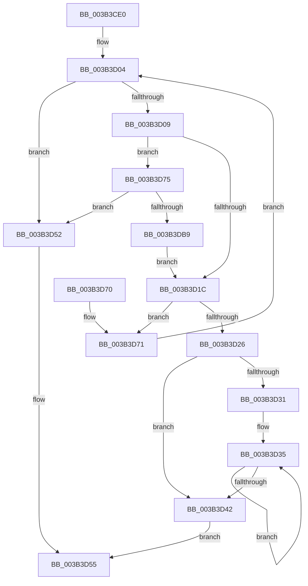

# ExpSaBinaryArrayInsert

- RVA: `0x003B3CE0`–`0x003B3DC2` (길이 `226` bytes)
- VA: `0x00000001403B3CE0`
- 실행 섹션: `.text`
- PDB 이름 있음: `예`; PDB Function 태그: `아니요`
- unwind 정보 RVA: `0x0008C4D8`
- 디코드: `66`개 명령, `226/226` bytes 표시
- 미해석 바이트: `0` (있으면 어셈블리에 `.byte`로 보존)

> 이 문서는 커널 이미지의 기계어와 PDB 기호를 분석해 생성했습니다. 4번과 5번은 함수 원형과 자료형을 바이너리 사용 방식에서 추정한 C 해석이며 원본 소스 복구 결과는 아닙니다.

## 1. Dependencies

- 직접 호출 지점: **1**; 고유 호출 대상: **1**
- 직접 호출자로 확인된 함수: **1**
- RIP 상대 이미지 참조: **0**

### Outgoing calls
- `0x003B3DAC` → [ExAllocatePool3](../../poolcode/B8/ExAllocatePool3_function_00B84270.md) (function, `0x00B84270`)

### Direct callers
- [ExpSaPageGroupDescriptorAllocate](ExpSaPageGroupDescriptorAllocate_function_003B4224.md) at `0x003B436A`
- [ExpSaPageGroupDescriptorAllocate](ExpSaPageGroupDescriptorAllocate_function_003B4224.md) at `0x003B4400`

### Static image references
- 디코드된 RIP-relative 메모리 참조가 없습니다.

## 2. Other-region calls and transfers

- 다른 실행 섹션으로 향하는 call: **1**
  - `0x003B3DAC` → [ExAllocatePool3](../../poolcode/B8/ExAllocatePool3_function_00B84270.md) (`.text` → `POOLCODE`)
- 별도 외부 분기/꼬리 이동을 확인하지 못했습니다.

## 3. Assembly (complete function range)

```asm
003B3CE0  48 89 5C 24 08                  mov qword ptr [rsp + 8], rbx
003B3CE5  48 89 6C 24 10                  mov qword ptr [rsp + 0x10], rbp
003B3CEA  48 89 74 24 18                  mov qword ptr [rsp + 0x18], rsi
003B3CEF  57                              push rdi
003B3CF0  41 56                           push r14
003B3CF2  41 57                           push r15
003B3CF4  48 83 EC 40                     sub rsp, 0x40
003B3CF8  45 0F B7 F8                     movzx r15d, r8w
003B3CFC  4C 8B F2                        mov r14, rdx
003B3CFF  48 8B F1                        mov rsi, rcx
003B3D02  33 FF                           xor edi, edi
003B3D04  83 FF 10                        cmp edi, 0x10
003B3D07  73 49                           jae 0x1403b3d52
003B3D09  48 8B 14 FE                     mov rdx, qword ptr [rsi + rdi*8]
003B3D0D  8D 4F 02                        lea ecx, [rdi + 2]
003B3D10  BB 01 00 00 00                  mov ebx, 1
003B3D15  D3 E3                           shl ebx, cl
003B3D17  48 85 D2                        test rdx, rdx
003B3D1A  74 59                           je 0x1403b3d75
003B3D1C  4C 8B 02                        mov r8, qword ptr [rdx]
003B3D1F  8B CB                           mov ecx, ebx
003B3D21  4C 3B C1                        cmp r8, rcx
003B3D24  73 4B                           jae 0x1403b3d71
003B3D26  41 8B C8                        mov ecx, r8d
003B3D29  48 83 7C CA 08 00               cmp qword ptr [rdx + rcx*8 + 8], 0
003B3D2F  74 11                           je 0x1403b3d42
003B3D31  44 8D 4B FF                     lea r9d, [rbx - 1]
003B3D35  FF C1                           inc ecx
003B3D37  41 23 C9                        and ecx, r9d
003B3D3A  48 83 7C CA 08 00               cmp qword ptr [rdx + rcx*8 + 8], 0
003B3D40  75 F3                           jne 0x1403b3d35
003B3D42  49 8D 40 01                     lea rax, [r8 + 1]
003B3D46  0B D9                           or ebx, ecx
003B3D48  48 89 02                        mov qword ptr [rdx], rax
003B3D4B  4C 89 74 CA 08                  mov qword ptr [rdx + rcx*8 + 8], r14
003B3D50  EB 03                           jmp 0x1403b3d55
003B3D52  83 CB FF                        or ebx, 0xffffffff
003B3D55  48 8B 6C 24 68                  mov rbp, qword ptr [rsp + 0x68]
003B3D5A  8B C3                           mov eax, ebx
003B3D5C  48 8B 5C 24 60                  mov rbx, qword ptr [rsp + 0x60]
003B3D61  48 8B 74 24 70                  mov rsi, qword ptr [rsp + 0x70]
003B3D66  48 83 C4 40                     add rsp, 0x40
003B3D6A  41 5F                           pop r15
003B3D6C  41 5E                           pop r14
003B3D6E  5F                              pop rdi
003B3D6F  C3                              ret
003B3D70  CC                              int3
003B3D71  FF C7                           inc edi
003B3D73  EB 8F                           jmp 0x1403b3d04
003B3D75  41 8B C7                        mov eax, r15d
003B3D78  C7 44 24 20 01 00 00 00         mov dword ptr [rsp + 0x20], 1
003B3D80  0F 57 C0                        xorps xmm0, xmm0
003B3D83  8D 14 DD 08 00 00 00            lea edx, [rbx*8 + 8]
003B3D8A  0F 11 44 24 30                  movups xmmword ptr [rsp + 0x30], xmm0
003B3D8F  0F BA E8 1F                     bts eax, 0x1f
003B3D93  C6 44 24 30 03                  mov byte ptr [rsp + 0x30], 3
003B3D98  4C 8D 4C 24 30                  lea r9, [rsp + 0x30]
003B3D9D  89 44 24 38                     mov dword ptr [rsp + 0x38], eax
003B3DA1  B9 40 00 00 00                  mov ecx, 0x40
003B3DA6  41 B8 45 78 53 61               mov r8d, 0x61537845
003B3DAC  E8 BF 04 7D 00                  call 0x140b84270
003B3DB1  48 8B D0                        mov rdx, rax
003B3DB4  48 85 C0                        test rax, rax
003B3DB7  74 99                           je 0x1403b3d52
003B3DB9  48 89 04 FE                     mov qword ptr [rsi + rdi*8], rax
003B3DBD  E9 5A FF FF FF                  jmp 0x1403b3d1c
```

## 4. C-style interpretation (structured pseudocode)

```c
__int64 __fastcall ExpSaBinaryArrayInsert(__int64 a1, __int64 a2, unsigned __int16 a3)
{
    __int64 result;
    __int64 v_rbx;
    __int64 v_rdi;
    __int64 v_rsp;
    unsigned __int64 v_stack_p10;
    unsigned __int64 v_stack_p18;
    unsigned int v_stack_p20;
    unsigned __int64 v_stack_p30;
    unsigned int v_stack_p38;
    unsigned __int64 v_stack_p8;

    v_stack_p8 = v_rbx;
    v_stack_p10 = v_rbp;
    v_stack_p18 = v_rsi;
    v_rsp = (v_rsp) - (64);
    v_rdi = 0;
loc_003B3D04:
    if (0 >= 16) goto loc_003B3D52;
    v_rbx = (unsigned int)((1) << ((unsigned __int8)(v_rdi + 2)));
    if (*(unsigned __int64 *)(a1 + v_rdi * 8) == 0) goto loc_003B3D75;
loc_003B3D1C:
    if ((*(unsigned __int64 *)(*(unsigned __int64 *)(a1 + v_rdi * 8))) >= ((unsigned int)((unsigned int)(v_rbx)))) goto loc_003B3D71;
    if ((*(unsigned __int64 *)(*(unsigned __int64 *)(a1 + v_rdi * 8) + (unsigned int)((unsigned int)(*(unsigned __int64 *)(*(unsigned __int64 *)(a1 + v_rdi * 8)))) * 8 + 8)) == 0) goto loc_003B3D42;
loc_003B3D35:
    a1 = (unsigned int)(((unsigned int)((unsigned int)(*(unsigned __int64 *)(*(unsigned __int64 *)(a1 + v_rdi * 8))))) + 1);
    a1 = (unsigned int)((a1) & ((unsigned int)(v_rbx - 1)));
    if ((*(unsigned __int64 *)(*(unsigned __int64 *)(a1 + v_rdi * 8) + a1 * 8 + 8)) != 0) goto loc_003B3D35;
loc_003B3D42:
    v_rbx = (unsigned int)((v_rbx) | ((unsigned int)(a1)));
    *(unsigned __int64 *)(*(unsigned __int64 *)(a1 + v_rdi * 8)) = *(unsigned __int64 *)(*(unsigned __int64 *)(a1 + v_rdi * 8)) + 1;
    *(unsigned __int64 *)(*(unsigned __int64 *)(a1 + v_rdi * 8) + a1 * 8 + 8) = a2;
    goto loc_003B3D55;
loc_003B3D52:
    v_rbx = (unsigned int)((v_rbx) | (0xFFFFFFFFULL));
loc_003B3D55:
    v_rsp = (v_rsp) + (64);
    return (unsigned int)((unsigned int)(v_rbx));
loc_003B3D71:
    v_rdi = (unsigned int)((v_rdi) + 1);
    goto loc_003B3D04;
loc_003B3D75:
    v_stack_p20 = 1;
    v_stack_p30 = v_xmm0;
    v_stack_p30 = 3;
    v_stack_p38 = (unsigned int)((unsigned int)(a3));
    result = ExAllocatePool3(64, v_stack_p8 * 8 + 8, (unsigned int)(0x61537845ULL), v_stack_p30);
    if (result == 0) goto loc_003B3D52;
    *(unsigned __int64 *)(v_stack_p18 + v_rdi * 8) = result;
    goto loc_003B3D1C;
}
```

## 5. (Beta) C Style

```c
int64_t ExpSaBinaryArrayInsert(void *Arg1, int64_t Arg2, uint16_t Arg3)
{
    uint8_t *arg1 = (uint8_t *)Arg1;

    int64_t result;
    int64_t local_rbx;
    int64_t local_rdi;
    int64_t local_rsp;
    uint64_t v_stack_p10;
    uint64_t v_stack_p18;
    uint32_t v_stack_p20;
    uint64_t v_stack_p30;
    uint32_t v_stack_p38;
    uint64_t v_stack_p8;

    v_stack_p8 = local_rbx;
    v_stack_p10 = local_rbp;
    v_stack_p18 = local_rsi;
    local_rsp = (local_rsp) - (64);
    local_rdi = 0;
loc_003B3D04:
    if (0 >= 16) goto loc_003B3D52;
    local_rbx = (uint32_t)((1) << ((uint8_t)(local_rdi + 2)));
    if (*(uint64_t *)(arg1 + local_rdi * 8) == 0) goto loc_003B3D75;
loc_003B3D1C:
    if ((*(uint64_t *)(*(uint64_t *)(arg1 + local_rdi * 8))) >= ((uint32_t)((uint32_t)(local_rbx)))) goto loc_003B3D71;
    if ((*(uint64_t *)(*(uint64_t *)(arg1 + local_rdi * 8) + (uint32_t)((uint32_t)(*(uint64_t *)(*(uint64_t *)(arg1 + local_rdi * 8)))) * 8 + 0x8)) == 0) goto loc_003B3D42;
loc_003B3D35:
    Arg1 = (uint32_t)(((uint32_t)((uint32_t)(*(uint64_t *)(*(uint64_t *)(arg1 + local_rdi * 8))))) + 1);
    Arg1 = (uint32_t)((Arg1) & ((uint32_t)(local_rbx - 1)));
    if ((*(uint64_t *)(*(uint64_t *)(arg1 + local_rdi * 8) + arg1 * 8 + 0x8)) != 0) goto loc_003B3D35;
loc_003B3D42:
    local_rbx = (uint32_t)((local_rbx) | ((uint32_t)(Arg1)));
    *(uint64_t *)(*(uint64_t *)(arg1 + local_rdi * 8)) = *(uint64_t *)(*(uint64_t *)(arg1 + local_rdi * 8)) + 1;
    *(uint64_t *)(*(uint64_t *)(arg1 + local_rdi * 8) + arg1 * 8 + 0x8) = Arg2;
    goto loc_003B3D55;
loc_003B3D52:
    local_rbx = (uint32_t)((local_rbx) | (0xFFFFFFFFULL));
loc_003B3D55:
    local_rsp = (local_rsp) + (64);
    return (uint32_t)((uint32_t)(local_rbx));
loc_003B3D71:
    local_rdi = (uint32_t)((local_rdi) + 1);
    goto loc_003B3D04;
loc_003B3D75:
    v_stack_p20 = 1;
    v_stack_p30 = v_xmm0;
    v_stack_p30 = 3;
    v_stack_p38 = (uint32_t)((uint32_t)(Arg3));
    result = ExAllocatePool3(64, v_stack_p8 * 8 + 8, (uint32_t)(0x61537845ULL), v_stack_p30);
    if (result == 0) goto loc_003B3D52;
    *(uint64_t *)(v_stack_p18 + local_rdi * 8) = result;
    goto loc_003B3D1C;
}
```

### 관측된 메모리 오프셋

구조체 형식이 확인되지 않은 접근은 인자 기준의 오프셋으로만 기록했습니다.

| 기준 인자 | 오프셋 표현 | 폭 (bit) | 접근 |
|---|---:|---:|---|
| `Arg1` | `+ 0x0 + rdi*8` | `64` | `R` |
| `Arg1` | `+ 0x0 + rdi*8` | `64` | `W` |

## 6. Execution-region graph

[열기: 2D/3D 그래프와 함수 탐색 컨트롤 패널](../../../control-panel.html?section=text&rva=0x003B3CE0&view=graph)

- 2D 그래프는 위에서 아래로 흐르고, 3D 그래프는 빈 공간을 드래그해 회전합니다. Shift+드래그는 이동, 휠은 확대·축소, 함수 노드 선택은 대상 보고서 이동입니다.

### Static fallback


