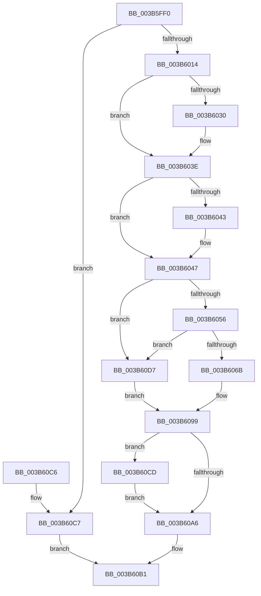

# ExpSaPageGroupAllocateMemory

- RVA: `0x003B5FF0`–`0x003B60DC` (길이 `236` bytes)
- VA: `0x00000001403B5FF0`
- 실행 섹션: `.text`
- PDB 이름 있음: `예`; PDB Function 태그: `아니요`
- unwind 정보 RVA: `0x0008C6A8`
- 디코드: `68`개 명령, `236/236` bytes 표시
- 미해석 바이트: `0` (있으면 어셈블리에 `.byte`로 보존)

> 이 문서는 커널 이미지의 기계어와 PDB 기호를 분석해 생성했습니다. 4번과 5번은 함수 원형과 자료형을 바이너리 사용 방식에서 추정한 C 해석이며 원본 소스 복구 결과는 아닙니다.

## 1. Dependencies

- 직접 호출 지점: **5**; 고유 호출 대상: **5**
- 직접 호출자로 확인된 함수: **1**
- RIP 상대 이미지 참조: **0**

### Outgoing calls
- `0x003B6020` → [KeAbPreAcquire](../21/KeAbPreAcquire_function_00210230.md) (function, `0x00210230`)
- `0x003B6039` → [ExfAcquirePushLockExclusiveEx](../20/ExfAcquirePushLockExclusiveEx_function_0020FC90.md) (function, `0x0020FC90`)
- `0x003B6061` → [RtlFindClearBitsAndSetEx](RtlFindClearBitsAndSetEx_function_003B60F0.md) (function, `0x003B60F0`)
- `0x003B60A9` → [KeAbPostRelease](../2E/KeAbPostRelease_function_002E1600.md) (function, `0x002E1600`)
- `0x003B60D0` → [ExfTryToWakePushLock](../26/ExfTryToWakePushLock_function_00265DD0.md) (function, `0x00265DD0`)

### Direct callers
- [ExpSaAllocatorAllocate](ExpSaAllocatorAllocate_function_003B402C.md) at `0x003B409F`
- [ExpSaAllocatorAllocate](ExpSaAllocatorAllocate_function_003B402C.md) at `0x003B4163`

### Static image references
- 디코드된 RIP-relative 메모리 참조가 없습니다.

## 2. Other-region calls and transfers

- 다른 실행 섹션으로 향하는 call: **0**
- 별도 외부 분기/꼬리 이동을 확인하지 못했습니다.

## 3. Assembly (complete function range)

```asm
003B5FF0  48 89 5C 24 10                  mov qword ptr [rsp + 0x10], rbx
003B5FF5  48 89 6C 24 18                  mov qword ptr [rsp + 0x18], rbp
003B5FFA  48 89 74 24 20                  mov qword ptr [rsp + 0x20], rsi
003B5FFF  57                              push rdi
003B6000  48 83 EC 20                     sub rsp, 0x20
003B6004  8B 41 24                        mov eax, dword ptr [rcx + 0x24]
003B6007  48 8B F9                        mov rdi, rcx
003B600A  8B EA                           mov ebp, edx
003B600C  3B C2                           cmp eax, edx
003B600E  0F 82 B3 00 00 00               jb 0x1403b60c7
003B6014  48 8D 71 18                     lea rsi, [rcx + 0x18]
003B6018  45 33 C0                        xor r8d, r8d
003B601B  48 8B CE                        mov rcx, rsi
003B601E  33 D2                           xor edx, edx
003B6020  E8 0B A2 E5 FF                  call 0x140210230
003B6025  F0 48 0F BA 2E 00               lock bts qword ptr [rsi], 0
003B602B  48 8B D8                        mov rbx, rax
003B602E  73 0E                           jae 0x1403b603e
003B6030  4C 8B C6                        mov r8, rsi
003B6033  48 8B D0                        mov rdx, rax
003B6036  48 8B CE                        mov rcx, rsi
003B6039  E8 52 9C E5 FF                  call 0x14020fc90
003B603E  48 85 DB                        test rbx, rbx
003B6041  74 04                           je 0x1403b6047
003B6043  C6 43 0A 01                     mov byte ptr [rbx + 0xa], 1
003B6047  8B 47 24                        mov eax, dword ptr [rdi + 0x24]
003B604A  48 83 CB FF                     or rbx, 0xffffffffffffffff
003B604E  3B C5                           cmp eax, ebp
003B6050  0F 82 81 00 00 00               jb 0x1403b60d7
003B6056  44 8B 47 2C                     mov r8d, dword ptr [rdi + 0x2c]
003B605A  48 8D 4F 30                     lea rcx, [rdi + 0x30]
003B605E  48 8B D5                        mov rdx, rbp
003B6061  E8 8A 00 00 00                  call 0x1403b60f0
003B6066  48 3B C3                        cmp rax, rbx
003B6069  74 6C                           je 0x1403b60d7
003B606B  48 83 64 24 30 00               and qword ptr [rsp + 0x30], 0
003B6071  8D 0C 28                        lea ecx, [rax + rbp]
003B6074  29 6F 24                        sub dword ptr [rdi + 0x24], ebp
003B6077  25 FF 01 00 00                  and eax, 0x1ff
003B607C  89 4F 2C                        mov dword ptr [rdi + 0x2c], ecx
003B607F  8B 4F 20                        mov ecx, dword ptr [rdi + 0x20]
003B6082  81 E1 FF FF 03 00               and ecx, 0x3ffff
003B6088  C1 E1 09                        shl ecx, 9
003B608B  0B C8                           or ecx, eax
003B608D  C1 E1 04                        shl ecx, 4
003B6090  89 4C 24 30                     mov dword ptr [rsp + 0x30], ecx
003B6094  48 8B 7C 24 30                  mov rdi, qword ptr [rsp + 0x30]
003B6099  F0 48 0F C1 1E                  lock xadd qword ptr [rsi], rbx
003B609E  80 E3 06                        and bl, 6
003B60A1  80 FB 02                        cmp bl, 2
003B60A4  74 27                           je 0x1403b60cd
003B60A6  48 8B CE                        mov rcx, rsi
003B60A9  E8 52 B5 F2 FF                  call 0x1402e1600
003B60AE  48 8B C7                        mov rax, rdi
003B60B1  48 8B 5C 24 38                  mov rbx, qword ptr [rsp + 0x38]
003B60B6  48 8B 6C 24 40                  mov rbp, qword ptr [rsp + 0x40]
003B60BB  48 8B 74 24 48                  mov rsi, qword ptr [rsp + 0x48]
003B60C0  48 83 C4 20                     add rsp, 0x20
003B60C4  5F                              pop rdi
003B60C5  C3                              ret
003B60C6  CC                              int3
003B60C7  48 83 C8 FF                     or rax, 0xffffffffffffffff
003B60CB  EB E4                           jmp 0x1403b60b1
003B60CD  48 8B CE                        mov rcx, rsi
003B60D0  E8 FB FC EA FF                  call 0x140265dd0
003B60D5  EB CF                           jmp 0x1403b60a6
003B60D7  48 8B FB                        mov rdi, rbx
003B60DA  EB BD                           jmp 0x1403b6099
```

## 4. C-style interpretation (structured pseudocode)

```c
__int64 __fastcall ExpSaPageGroupAllocateMemory(__int64 a1, int a2, int a3)
{
    __int64 result;
    __int64 v_rbx;
    __int64 v_rsp;
    unsigned __int64 v_stack_p10;
    unsigned __int64 v_stack_p18;
    unsigned __int64 v_stack_p20;
    unsigned __int64 v_stack_p8;

    v_stack_p10 = v_rbx;
    v_stack_p18 = v_rbp;
    v_stack_p20 = v_rsi;
    v_rsp = (v_rsp) - (32);
    if (((unsigned int)((unsigned int)(*(unsigned int *)(a1 + 36)))) < a2) goto loc_003B60C7;
    a3 = 0;
    a2 = 0;
    result = KeAbPreAcquire(a1 + 24, a2, a3, a4);
    if (!(condition_is_above_or_equal)) {
        a3 = a1 + 24;
        a2 = result;
        a1 = a1 + 24;
        result = ExfAcquirePushLockExclusiveEx(a1, a2, a3, a4);
    }
    if (result != 0) {
        *(unsigned __int8 *)(result + 10) = 1;
    }
    v_rbx = (result) | (-1);
    if (((unsigned int)((unsigned int)(*(unsigned int *)(a1 + 36)))) < ((unsigned int)((unsigned int)(a2)))) goto loc_003B60D7;
    result = RtlFindClearBitsAndSetEx(a1 + 48, (unsigned int)(a2), (unsigned int)(*(unsigned int *)(a1 + 44)), a4);
    if (result == v_rbx) goto loc_003B60D7;
    result = (unsigned int)((result) & (511));
    *(unsigned int *)(a1 + 44) = (unsigned int)(result + (unsigned int)(a2) * 1);
    a1 = (unsigned int)(((unsigned int)(*(unsigned int *)(a1 + 32))) & (0x3FFFFULL));
    a1 = (unsigned int)((a1) << (9));
    a1 = (unsigned int)((a1) | ((unsigned int)(result)));
    a1 = (unsigned int)((a1) << (4));
    v_stack_p8 = (unsigned int)(a1);
loc_003B6099:
    v_rbx = (unsigned __int8)((v_rbx) & (6));
    if (((unsigned __int8)(v_rbx)) == 2) goto loc_003B60CD;
loc_003B60A6:
    result = KeAbPostRelease(a1 + 24, (unsigned int)(a2), (unsigned int)(*(unsigned int *)(a1 + 44)), a4);
loc_003B60B1:
    v_rsp = (v_rsp) + (32);
    return v_stack_p8;
loc_003B60C7:
    result = (v_stack_p8) | (-1);
    goto loc_003B60B1;
loc_003B60CD:
    result = ExfTryToWakePushLock(v_stack_p20, (unsigned int)(a2), (unsigned int)(*(unsigned int *)(a1 + 44)), a4);
    goto loc_003B60A6;
loc_003B60D7:
    goto loc_003B6099;
}
```

## 5. (Beta) C Style

```c
int64_t ExpSaPageGroupAllocateMemory(void *Arg1, int32_t Arg2, int32_t Arg3)
{
    uint8_t *arg1 = (uint8_t *)Arg1;

    int64_t result;
    int64_t local_rbx;
    int64_t local_rsp;
    uint64_t v_stack_p10;
    uint64_t v_stack_p18;
    uint64_t v_stack_p20;
    uint64_t v_stack_p8;

    v_stack_p10 = local_rbx;
    v_stack_p18 = local_rbp;
    v_stack_p20 = local_rsi;
    local_rsp = (local_rsp) - (32);
    if (((uint32_t)((uint32_t)(*(uint32_t *)(arg1 + 0x24)))) < Arg2) goto loc_003B60C7;
    Arg3 = 0;
    Arg2 = 0;
    result = KeAbPreAcquire(Arg1 + 24, Arg2, Arg3, a4);
    if (!(condition_is_above_or_equal)) {
        Arg3 = Arg1 + 24;
        Arg2 = result;
        Arg1 = Arg1 + 24;
        result = ExfAcquirePushLockExclusiveEx(Arg1, Arg2, Arg3, a4);
    }
    if (result != 0) {
        *(uint8_t *)(result + 0xA) = 1;
    }
    local_rbx = (result) | (-1);
    if (((uint32_t)((uint32_t)(*(uint32_t *)(arg1 + 0x24)))) < ((uint32_t)((uint32_t)(Arg2)))) goto loc_003B60D7;
    result = RtlFindClearBitsAndSetEx(Arg1 + 48, (uint32_t)(Arg2), (uint32_t)(*(uint32_t *)(arg1 + 0x2C)), a4);
    if (result == local_rbx) goto loc_003B60D7;
    result = (uint32_t)((result) & (511));
    *(uint32_t *)(arg1 + 0x2C) = (uint32_t)(result + (uint32_t)(Arg2) * 1);
    Arg1 = (uint32_t)(((uint32_t)(*(uint32_t *)(arg1 + 0x20))) & (0x3FFFFULL));
    Arg1 = (uint32_t)((Arg1) << (9));
    Arg1 = (uint32_t)((Arg1) | ((uint32_t)(result)));
    Arg1 = (uint32_t)((Arg1) << (4));
    v_stack_p8 = (uint32_t)(Arg1);
loc_003B6099:
    local_rbx = (uint8_t)((local_rbx) & (6));
    if (((uint8_t)(local_rbx)) == 2) goto loc_003B60CD;
loc_003B60A6:
    result = KeAbPostRelease(Arg1 + 24, (uint32_t)(Arg2), (uint32_t)(*(uint32_t *)(arg1 + 0x2C)), a4);
loc_003B60B1:
    local_rsp = (local_rsp) + (32);
    return v_stack_p8;
loc_003B60C7:
    result = (v_stack_p8) | (-1);
    goto loc_003B60B1;
loc_003B60CD:
    result = ExfTryToWakePushLock(v_stack_p20, (uint32_t)(Arg2), (uint32_t)(*(uint32_t *)(arg1 + 0x2C)), a4);
    goto loc_003B60A6;
loc_003B60D7:
    goto loc_003B6099;
}
```

### 관측된 메모리 오프셋

구조체 형식이 확인되지 않은 접근은 인자 기준의 오프셋으로만 기록했습니다.

| 기준 인자 | 오프셋 표현 | 폭 (bit) | 접근 |
|---|---:|---:|---|
| `Arg1` | `+ 0x0` | `64` | `R/W` |
| `Arg1` | `+ 0x18` | `64` | `R` |
| `Arg1` | `+ 0x20` | `32` | `R` |
| `Arg1` | `+ 0x24` | `32` | `R` |
| `Arg1` | `+ 0x24` | `32` | `R/W` |
| `Arg1` | `+ 0x2C` | `32` | `R` |
| `Arg1` | `+ 0x2C` | `32` | `W` |
| `Arg1` | `+ 0x30` | `64` | `R` |

## 6. Execution-region graph

[열기: 2D/3D 그래프와 함수 탐색 컨트롤 패널](../../../control-panel.html?section=text&rva=0x003B5FF0&view=graph)

- 2D 그래프는 위에서 아래로 흐르고, 3D 그래프는 빈 공간을 드래그해 회전합니다. Shift+드래그는 이동, 휠은 확대·축소, 함수 노드 선택은 대상 보고서 이동입니다.

### Static fallback


