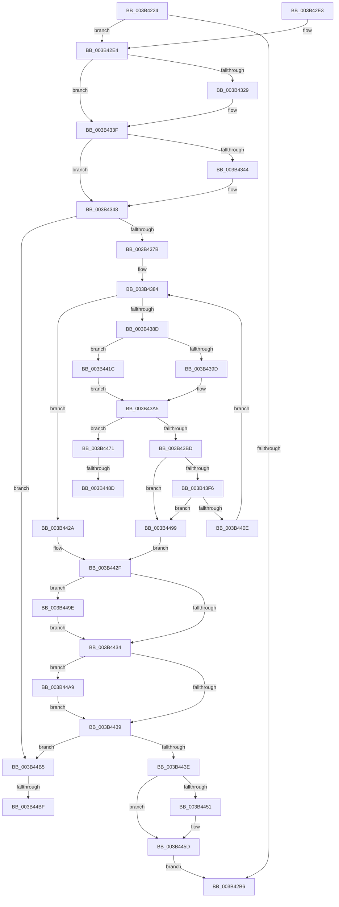

# ExpSaPageGroupDescriptorAllocate

- RVA: `0x003B4224`–`0x003B44C4` (길이 `672` bytes)
- VA: `0x00000001403B4224`
- 실행 섹션: `.text`
- PDB 이름 있음: `예`; PDB Function 태그: `예`
- unwind 정보 RVA: `0x0008C54C`
- 디코드: `168`개 명령, `672/672` bytes 표시
- 미해석 바이트: `0` (있으면 어셈블리에 `.byte`로 보존)

> 이 문서는 커널 이미지의 기계어와 PDB 기호를 분석해 생성했습니다. 4번과 5번은 함수 원형과 자료형을 바이너리 사용 방식에서 추정한 C 해석이며 원본 소스 복구 결과는 아닙니다.

## 1. Dependencies

- 직접 호출 지점: **15**; 고유 호출 대상: **14**
- 직접 호출자로 확인된 함수: **1**
- RIP 상대 이미지 참조: **6**

### Outgoing calls
- `0x003B4277` → [KeQueryMaximumProcessorCountEx](../26/KeQueryMaximumProcessorCountEx_function_00264D60.md) (function, `0x00264D60`)
- `0x003B42A9` → [ExAllocatePool2](../../poolcode/B8/ExAllocatePool2_function_00B820F0.md) (function, `0x00B820F0`)
- `0x003B42BD` → [_security_check_cookie](../6A/_security_check_cookie_function_006AC640.md) (function, `0x006AC640`)
- `0x003B42EC` → [memset](../6C/memset_function_006C6C40.md) (function, `0x006C6C40`)
- `0x003B4315` → [KeAbPreAcquire](../21/KeAbPreAcquire_function_00210230.md) (function, `0x00210230`)
- `0x003B433A` → [ExfAcquirePushLockExclusiveEx](../20/ExfAcquirePushLockExclusiveEx_function_0020FC90.md) (function, `0x0020FC90`)
- `0x003B436A` → [ExpSaBinaryArrayInsert](ExpSaBinaryArrayInsert_function_003B3CE0.md) (function, `0x003B3CE0`)
- `0x003B43A0` → [KeGetPrcb](../2D/KeGetPrcb_function_002D85D0.md) (function, `0x002D85D0`)
- `0x003B43E5` → [ExAllocatePool3](../../poolcode/B8/ExAllocatePool3_function_00B84270.md) (function, `0x00B84270`)
- `0x003B4400` → [ExpSaBinaryArrayInsert](ExpSaBinaryArrayInsert_function_003B3CE0.md) (function, `0x003B3CE0`)
- `0x003B4458` → [ExfTryToWakePushLock](../26/ExfTryToWakePushLock_function_00265DD0.md) (function, `0x00265DD0`)
- `0x003B4464` → [KeAbPostRelease](../2E/KeAbPostRelease_function_002E1600.md) (function, `0x002E1600`)
- `0x003B447B` → [KeQueryNodeActiveAffinity](../43/KeQueryNodeActiveAffinity_function_0043EF80.md) (function, `0x0043EF80`)
- `0x003B44A2` → [KeRevertToUserGroupAffinityThread](../39/KeRevertToUserGroupAffinityThread_function_00398EC0.md) (function, `0x00398EC0`)
- `0x003B44AE` → [ExFreePoolWithTag](../../poolcode/B8/ExFreePoolWithTag_function_00B82870.md) (function, `0x00B82870`)

### Direct callers
- [ExpSaAllocatorAllocate](ExpSaAllocatorAllocate_function_003B402C.md) at `0x003B4108`

### Static image references
- `0x003B4246` → RVA `0x00E0A740` (`.data`; read)
- `0x003B430A` → RVA `0x00EFA288` (`.data`; read)
- `0x003B431A` → RVA `0x00EFA288` (`.data`; read/write)
- `0x003B4363` → RVA `0x00EFA280` (`.data`; read)
- `0x003B437B` → RVA `0x00FC6A80` (`ALMOSTRO`; read)
- `0x003B438D` → RVA `0x00EFA278` (`.data`; read)

## 2. Other-region calls and transfers

- 다른 실행 섹션으로 향하는 call: **3**
  - `0x003B42A9` → [ExAllocatePool2](../../poolcode/B8/ExAllocatePool2_function_00B820F0.md) (`.text` → `POOLCODE`)
  - `0x003B43E5` → [ExAllocatePool3](../../poolcode/B8/ExAllocatePool3_function_00B84270.md) (`.text` → `POOLCODE`)
  - `0x003B44AE` → [ExFreePoolWithTag](../../poolcode/B8/ExFreePoolWithTag_function_00B82870.md) (`.text` → `POOLCODE`)
- call이 아닌 외부 분기/꼬리 이동: **4**
  - `0x003B4487` → [sub_006E72E8](../6E/Unknown_function_006E72E8.md) (`tail-transfer`)
  - `0x003B4494` → [sub_006E72E8 + 0x2](../6E/Unknown_function_006E72E8.md) (`tail-transfer`)
  - `0x003B44B9` → [sub_006E72E8 + 0x6B](../6E/Unknown_function_006E72E8.md) (`tail-transfer`)
  - `0x003B44BF` → [sub_006E72E8 + 0x7F](../6E/Unknown_function_006E72E8.md) (`tail-transfer`)

## 3. Assembly (complete function range)

```asm
003B4224  48 89 5C 24 08                  mov qword ptr [rsp + 8], rbx
003B4229  48 89 74 24 10                  mov qword ptr [rsp + 0x10], rsi
003B422E  48 89 7C 24 18                  mov qword ptr [rsp + 0x18], rdi
003B4233  55                              push rbp
003B4234  41 54                           push r12
003B4236  41 55                           push r13
003B4238  41 56                           push r14
003B423A  41 57                           push r15
003B423C  48 8B EC                        mov rbp, rsp
003B423F  48 81 EC 80 00 00 00            sub rsp, 0x80
003B4246  48 8B 05 F3 64 A5 00            mov rax, qword ptr [rip + 0xa564f3]
003B424D  48 33 C4                        xor rax, rsp
003B4250  48 89 45 F0                     mov qword ptr [rbp - 0x10], rax
003B4254  0F 57 C0                        xorps xmm0, xmm0
003B4257  88 55 B0                        mov byte ptr [rbp - 0x50], dl
003B425A  48 8B D9                        mov rbx, rcx
003B425D  0F 57 C9                        xorps xmm1, xmm1
003B4260  B9 FF FF 00 00                  mov ecx, 0xffff
003B4265  40 8A FA                        mov dil, dl
003B4268  0F 11 45 C0                     movups xmmword ptr [rbp - 0x40], xmm0
003B426C  45 32 FF                        xor r15b, r15b
003B426F  0F 11 4D E0                     movups xmmword ptr [rbp - 0x20], xmm1
003B4273  0F 11 45 D0                     movups xmmword ptr [rbp - 0x30], xmm0
003B4277  E8 E4 0A EB FF                  call 0x140264d60
003B427C  40 8A CF                        mov cl, dil
003B427F  89 45 B4                        mov dword ptr [rbp - 0x4c], eax
003B4282  45 33 F6                        xor r14d, r14d
003B4285  41 BD 80 00 00 00               mov r13d, 0x80
003B428B  F6 D9                           neg cl
003B428D  41 B8 45 78 53 61               mov r8d, 0x61537845
003B4293  41 8B D5                        mov edx, r13d
003B4296  8B F0                           mov esi, eax
003B4298  4D 1B E4                        sbb r12, r12
003B429B  41 81 E4 C0 00 00 00            and r12d, 0xc0
003B42A2  49 83 C4 40                     add r12, 0x40
003B42A6  49 8B CC                        mov rcx, r12
003B42A9  E8 42 DE 7C 00                  call 0x140b820f0
003B42AE  48 8B F8                        mov rdi, rax
003B42B1  48 85 C0                        test rax, rax
003B42B4  75 2E                           jne 0x1403b42e4
003B42B6  48 8B 4D F0                     mov rcx, qword ptr [rbp - 0x10]
003B42BA  48 33 CC                        xor rcx, rsp
003B42BD  E8 7E 83 2F 00                  call 0x1406ac640
003B42C2  4C 8D 9C 24 80 00 00 00         lea r11, [rsp + 0x80]
003B42CA  49 8B 5B 30                     mov rbx, qword ptr [r11 + 0x30]
003B42CE  49 8B 73 38                     mov rsi, qword ptr [r11 + 0x38]
003B42D2  49 8B 7B 40                     mov rdi, qword ptr [r11 + 0x40]
003B42D6  49 8B E3                        mov rsp, r11
003B42D9  41 5F                           pop r15
003B42DB  41 5E                           pop r14
003B42DD  41 5D                           pop r13
003B42DF  41 5C                           pop r12
003B42E1  5D                              pop rbp
003B42E2  C3                              ret
003B42E3  CC                              int3
003B42E4  4D 8B C5                        mov r8, r13
003B42E7  33 D2                           xor edx, edx
003B42E9  48 8B CF                        mov rcx, rdi
003B42EC  E8 4F 29 31 00                  call 0x1406c6c40
003B42F1  B9 00 02 00 00                  mov ecx, 0x200
003B42F6  48 8D 47 40                     lea rax, [rdi + 0x40]
003B42FA  48 89 4F 30                     mov qword ptr [rdi + 0x30], rcx
003B42FE  45 33 C0                        xor r8d, r8d
003B4301  48 89 47 38                     mov qword ptr [rdi + 0x38], rax
003B4305  33 D2                           xor edx, edx
003B4307  89 4F 24                        mov dword ptr [rdi + 0x24], ecx
003B430A  48 8D 0D 77 5F B4 00            lea rcx, [rip + 0xb45f77]
003B4311  48 89 5F 10                     mov qword ptr [rdi + 0x10], rbx
003B4315  E8 16 BF E5 FF                  call 0x140210230
003B431A  F0 48 0F BA 2D 64 5F B4 00 00   lock bts qword ptr [rip + 0xb45f64], 0
003B4324  48 8B D8                        mov rbx, rax
003B4327  73 16                           jae 0x1403b433f
003B4329  4C 8D 05 58 5F B4 00            lea r8, [rip + 0xb45f58]
003B4330  48 8B D0                        mov rdx, rax
003B4333  48 8D 0D 4E 5F B4 00            lea rcx, [rip + 0xb45f4e]
003B433A  E8 51 B9 E5 FF                  call 0x14020fc90
003B433F  48 85 DB                        test rbx, rbx
003B4342  74 04                           je 0x1403b4348
003B4344  C6 43 0A 01                     mov byte ptr [rbx + 0xa], 1
003B4348  65 48 8B 04 25 20 00 00 00      mov rax, qword ptr gs:[0x20]
003B4351  48 8B D7                        mov rdx, rdi
003B4354  48 8B 88 C0 00 00 00            mov rcx, qword ptr [rax + 0xc0]
003B435B  44 0F B7 81 8A 00 00 00         movzx r8d, word ptr [rcx + 0x8a]
003B4363  48 8B 0D 16 5F B4 00            mov rcx, qword ptr [rip + 0xb45f16]
003B436A  E8 71 F9 FF FF                  call 0x1403b3ce0
003B436F  89 47 20                        mov dword ptr [rdi + 0x20], eax
003B4372  83 F8 FF                        cmp eax, -1
003B4375  0F 84 3A 01 00 00               je 0x1403b44b5
003B437B  8B 15 FF 26 C1 00               mov edx, dword ptr [rip + 0xc126ff]
003B4381  89 55 B8                        mov dword ptr [rbp - 0x48], edx
003B4384  44 3B F6                        cmp r14d, esi
003B4387  0F 83 9D 00 00 00               jae 0x1403b442a
003B438D  48 8B 05 E4 5E B4 00            mov rax, qword ptr [rip + 0xb45ee4]
003B4394  4E 8B 2C F0                     mov r13, qword ptr [rax + r14*8]
003B4398  44 3B F2                        cmp r14d, edx
003B439B  73 7F                           jae 0x1403b441c
003B439D  41 8B CE                        mov ecx, r14d
003B43A0  E8 2B 42 F2 FF                  call 0x1402d85d0
003B43A5  80 7D B0 00                     cmp byte ptr [rbp - 0x50], 0
003B43A9  48 8B 88 C0 00 00 00            mov rcx, qword ptr [rax + 0xc0]
003B43B0  0F B7 B1 8A 00 00 00            movzx esi, word ptr [rcx + 0x8a]
003B43B7  0F 85 B4 00 00 00               jne 0x1403b4471
003B43BD  0F B7 C6                        movzx eax, si
003B43C0  4C 8D 4D D0                     lea r9, [rbp - 0x30]
003B43C4  0F BA E8 1F                     bts eax, 0x1f
003B43C8  C6 45 D0 03                     mov byte ptr [rbp - 0x30], 3
003B43CC  BA 00 10 00 00                  mov edx, 0x1000
003B43D1  89 45 D8                        mov dword ptr [rbp - 0x28], eax
003B43D4  41 B8 45 78 53 61               mov r8d, 0x61537845
003B43DA  C7 44 24 20 01 00 00 00         mov dword ptr [rsp + 0x20], 1
003B43E2  49 8B CC                        mov rcx, r12
003B43E5  E8 86 FE 7C 00                  call 0x140b84270
003B43EA  48 8B D8                        mov rbx, rax
003B43ED  48 85 C0                        test rax, rax
003B43F0  0F 84 A3 00 00 00               je 0x1403b4499
003B43F6  44 0F B7 C6                     movzx r8d, si
003B43FA  48 8B D3                        mov rdx, rbx
003B43FD  49 8B CD                        mov rcx, r13
003B4400  E8 DB F8 FF FF                  call 0x1403b3ce0
003B4405  83 F8 FF                        cmp eax, -1
003B4408  0F 84 8B 00 00 00               je 0x1403b4499
003B440E  8B 55 B8                        mov edx, dword ptr [rbp - 0x48]
003B4411  41 FF C6                        inc r14d
003B4414  8B 75 B4                        mov esi, dword ptr [rbp - 0x4c]
003B4417  E9 68 FF FF FF                  jmp 0x1403b4384
003B441C  65 48 8B 04 25 20 00 00 00      mov rax, qword ptr gs:[0x20]
003B4425  E9 7B FF FF FF                  jmp 0x1403b43a5
003B442A  33 DB                           xor ebx, ebx
003B442C  40 B6 01                        mov sil, 1
003B442F  45 84 FF                        test r15b, r15b
003B4432  75 6A                           jne 0x1403b449e
003B4434  48 85 DB                        test rbx, rbx
003B4437  75 70                           jne 0x1403b44a9
003B4439  40 84 F6                        test sil, sil
003B443C  74 77                           je 0x1403b44b5
003B443E  48 83 C8 FF                     or rax, 0xffffffffffffffff
003B4442  F0 48 0F C1 05 3D 5E B4 00      lock xadd qword ptr [rip + 0xb45e3d], rax
003B444B  24 06                           and al, 6
003B444D  3C 02                           cmp al, 2
003B444F  75 0C                           jne 0x1403b445d
003B4451  48 8D 0D 30 5E B4 00            lea rcx, [rip + 0xb45e30]
003B4458  E8 73 19 EB FF                  call 0x140265dd0
003B445D  48 8D 0D 24 5E B4 00            lea rcx, [rip + 0xb45e24]
003B4464  E8 97 D1 F2 FF                  call 0x1402e1600
003B4469  48 8B C7                        mov rax, rdi
003B446C  E9 45 FE FF FF                  jmp 0x1403b42b6
003B4471  45 33 C0                        xor r8d, r8d
003B4474  48 8D 55 C0                     lea rdx, [rbp - 0x40]
003B4478  0F B7 CE                        movzx ecx, si
003B447B  E8 00 AB 08 00                  call 0x14043ef80
003B4480  48 8D 4D C0                     lea rcx, [rbp - 0x40]
003B4484  45 84 FF                        test r15b, r15b
003B4487  0F 85 5B 2E 33 00               jne 0x1406e72e8
003B448D  41 B7 01                        mov r15b, 1
003B4490  48 8D 55 E0                     lea rdx, [rbp - 0x20]
003B4494  E9 51 2E 33 00                  jmp 0x1406e72ea
003B4499  40 32 F6                        xor sil, sil
003B449C  EB 91                           jmp 0x1403b442f
003B449E  48 8D 4D E0                     lea rcx, [rbp - 0x20]
003B44A2  E8 19 4A FE FF                  call 0x140398ec0
003B44A7  EB 8B                           jmp 0x1403b4434
003B44A9  33 D2                           xor edx, edx
003B44AB  48 8B CB                        mov rcx, rbx
003B44AE  E8 BD E3 7C 00                  call 0x140b82870
003B44B3  EB 84                           jmp 0x1403b4439
003B44B5  83 7F 20 FF                     cmp dword ptr [rdi + 0x20], -1
003B44B9  0F 85 94 2E 33 00               jne 0x1406e7353
003B44BF  E9 A3 2E 33 00                  jmp 0x1406e7367
```

## 4. C-style interpretation (structured pseudocode)

```c
__int64 __fastcall ExpSaPageGroupDescriptorAllocate(__int64 a1, unsigned __int8 a2)
{
    __int64 result;
    __int64 v_r12;
    __int64 v_r14;
    __int64 v_r15;
    __int64 v_rbx;
    __int64 v_rsi;
    __int64 v_rsp;
    unsigned __int64 v_stack_m28;
    unsigned __int64 v_stack_m38;
    unsigned __int64 v_stack_m48;
    unsigned int v_stack_m50;
    unsigned __int64 v_stack_m58;
    unsigned int v_stack_m60;
    unsigned __int64 v_stack_m68;
    unsigned int v_stack_m70;
    unsigned int v_stack_m74;
    unsigned __int8 v_stack_m78;
    unsigned __int64 v_stack_p10;
    unsigned __int64 v_stack_p18;
    unsigned __int64 v_stack_p8;

    v_stack_p8 = v_rbx;
    v_stack_p10 = v_rsi;
    v_stack_p18 = v_rdi;
    v_rsp = (v_rsp) - (128);
    result = (*(unsigned __int64 *)(v_rip + 10839283)) ^ (v_rsp);
    v_stack_m38 = result;
    v_stack_m78 = a2;
    v_stack_m68 = v_xmm0;
    v_r15 = 0;
    v_stack_m48 = v_xmm1;
    v_stack_m58 = v_xmm0;
    result = KeQueryMaximumProcessorCountEx((unsigned int)(0xFFFFULL), a2, a3, a4);
    v_stack_m74 = (unsigned int)(result);
    v_r14 = 0;
    a1 = (unsigned __int8)(-(a2));
    v_r12 = (unsigned int)((v_r12) & (192));
    v_r12 = (v_r12) + (64);
    result = ExAllocatePool2(v_r12, 128, (unsigned int)(0x61537845ULL), a4);
    if (result != 0) goto loc_003B42E4;
loc_003B42B6:
    a1 = (v_stack_m38) ^ (v_rsp);
    result = _security_check_cookie(a1, 128, (unsigned int)(0x61537845ULL), a4);
    return result;
loc_003B42E4:
    a2 = 0;
    result = memset(*(unsigned __int64 *)(v_stack_m28 + 64), a2, 128, a4);
    *(unsigned __int64 *)(*(unsigned __int64 *)(v_stack_m28 + 64) + 48) = 512;
    a3 = 0;
    *(unsigned __int64 *)(*(unsigned __int64 *)(v_stack_m28 + 64) + 56) = *(unsigned __int64 *)(v_stack_m28 + 64) + 64;
    a2 = 0;
    *(unsigned int *)(*(unsigned __int64 *)(v_stack_m28 + 64) + 36) = 512;
    *(unsigned __int64 *)(*(unsigned __int64 *)(v_stack_m28 + 64) + 16) = *(unsigned __int64 *)(v_stack_m28 + 48);
    result = KeAbPreAcquire(v_rip + 11820919, a2, a3, a4);
    if (!(condition_is_above_or_equal)) {
        a3 = v_rip + 11820888;
        a2 = result;
        a1 = v_rip + 11820878;
        result = ExfAcquirePushLockExclusiveEx(a1, a2, a3, a4);
    }
    if (result != 0) {
        *(unsigned __int8 *)(result + 10) = 1;
    }
    result = ExpSaBinaryArrayInsert(*(unsigned __int64 *)(v_rip + 11820822), *(unsigned __int64 *)(v_stack_m28 + 64), *(unsigned __int16 *)(*(unsigned __int64 *)(*(unsigned __int64 *)(gs_base + (0 + 32)) + 192) + 138), a4);
    *(unsigned int *)(*(unsigned __int64 *)(v_stack_m28 + 64) + 32) = (unsigned int)(result);
    if (((unsigned int)(result)) == -1) goto loc_003B44B5;
    v_stack_m70 = (unsigned int)((unsigned int)(*(unsigned int *)(v_rip + 12658431)));
loc_003B4384:
    if (0 >= ((unsigned int)(*(unsigned __int64 *)(v_stack_m28 + 56)))) goto loc_003B442A;
    if (0 >= ((unsigned int)((unsigned int)(*(unsigned int *)(v_rip + 12658431))))) goto loc_003B441C;
    result = KeGetPrcb(0, (unsigned int)(*(unsigned int *)(v_rip + 12658431)), *(unsigned __int16 *)(*(unsigned __int64 *)(*(unsigned __int64 *)(gs_base + (0 + 32)) + 192) + 138), a4);
loc_003B43A5:
    if (v_stack_m78 != 0) goto loc_003B4471;
    v_stack_m58 = 3;
    v_stack_m50 = (unsigned int)((unsigned __int16)(*(unsigned __int16 *)(*(unsigned __int64 *)(result + 192) + 138)));
    v_stack_m60 = 1;
    result = ExAllocatePool3(v_r12, (unsigned int)(0x1000ULL), (unsigned int)(0x61537845ULL), v_stack_m58);
    if (result == 0) goto loc_003B4499;
    result = ExpSaBinaryArrayInsert(*(unsigned __int64 *)(*(unsigned __int64 *)(v_rip + 11820772) + v_r14 * 8), result, (unsigned __int16)(*(unsigned __int16 *)(*(unsigned __int64 *)(result + 192) + 138)), v_stack_m58);
    if (((unsigned int)(result)) == -1) goto loc_003B4499;
    v_r14 = (unsigned int)((v_r14) + 1);
    goto loc_003B4384;
loc_003B441C:
    goto loc_003B43A5;
loc_003B442A:
    v_rbx = 0;
loc_003B442F:
    if (0 != 0) goto loc_003B449E;
loc_003B4434:
    if (0 != 0) goto loc_003B44A9;
loc_003B4439:
    if (1 == 0) goto loc_003B44B5;
    result = (*(unsigned __int64 *)(gs_base + (0 + 32))) | (-1);
    result = (unsigned __int8)((result) & (6));
    if (((unsigned __int8)(result)) == 2) {
        a1 = v_rip + 11820592;
        result = ExfTryToWakePushLock(a1, (unsigned int)(v_stack_m70), (unsigned __int16)(*(unsigned __int16 *)(*(unsigned __int64 *)(result + 192) + 138)), v_stack_m58);
    }
    result = KeAbPostRelease(v_rip + 11820580, (unsigned int)(v_stack_m70), (unsigned __int16)(*(unsigned __int16 *)(*(unsigned __int64 *)(result + 192) + 138)), v_stack_m58);
    goto loc_003B42B6;
loc_003B4471:
    a3 = 0;
    result = KeQueryNodeActiveAffinity(1, v_stack_m68, a3, v_stack_m58);
loc_003B4499:
    v_rsi = 0;
    goto loc_003B442F;
loc_003B449E:
    result = KeRevertToUserGroupAffinityThread(v_stack_m48, v_stack_m48, a3, v_stack_m58);
    goto loc_003B4434;
loc_003B44A9:
    a2 = 0;
    result = ExFreePoolWithTag(0, a2, a3, v_stack_m58);
    goto loc_003B4439;
loc_003B44B5:
}
```

## 5. (Beta) C Style

```c
int64_t ExpSaPageGroupDescriptorAllocate(int64_t Arg1, uint8_t Arg2)
{
    int64_t result;
    int64_t local_r12;
    int64_t local_r14;
    int64_t local_r15;
    int64_t local_rbx;
    int64_t local_rsi;
    int64_t local_rsp;
    uint64_t v_stack_m28;
    uint64_t v_stack_m38;
    uint64_t v_stack_m48;
    uint32_t v_stack_m50;
    uint64_t v_stack_m58;
    uint32_t v_stack_m60;
    uint64_t v_stack_m68;
    uint32_t v_stack_m70;
    uint32_t v_stack_m74;
    uint8_t v_stack_m78;
    uint64_t v_stack_p10;
    uint64_t v_stack_p18;
    uint64_t v_stack_p8;

    v_stack_p8 = local_rbx;
    v_stack_p10 = local_rsi;
    v_stack_p18 = local_rdi;
    local_rsp = (local_rsp) - (128);
    result = (*(uint64_t *)(v_rip + 0xA564F3)) ^ (local_rsp);
    v_stack_m38 = result;
    v_stack_m78 = Arg2;
    v_stack_m68 = v_xmm0;
    local_r15 = 0;
    v_stack_m48 = v_xmm1;
    v_stack_m58 = v_xmm0;
    result = KeQueryMaximumProcessorCountEx((uint32_t)(0xFFFFULL), Arg2, a3, a4);
    v_stack_m74 = (uint32_t)(result);
    local_r14 = 0;
    Arg1 = (uint8_t)(-(Arg2));
    local_r12 = (uint32_t)((local_r12) & (192));
    local_r12 = (local_r12) + (64);
    result = ExAllocatePool2(local_r12, 128, (uint32_t)(0x61537845ULL), a4);
    if (result != 0) goto loc_003B42E4;
loc_003B42B6:
    Arg1 = (v_stack_m38) ^ (local_rsp);
    result = _security_check_cookie(Arg1, 128, (uint32_t)(0x61537845ULL), a4);
    return result;
loc_003B42E4:
    Arg2 = 0;
    result = memset(*(uint64_t *)(v_stack_m28 + 0x40), Arg2, 128, a4);
    *(uint64_t *)(*(uint64_t *)(v_stack_m28 + 0x40) + 0x30) = 512;
    a3 = 0;
    *(uint64_t *)(*(uint64_t *)(v_stack_m28 + 0x40) + 0x38) = *(uint64_t *)(v_stack_m28 + 0x40) + 64;
    Arg2 = 0;
    *(uint32_t *)(*(uint64_t *)(v_stack_m28 + 0x40) + 0x24) = 512;
    *(uint64_t *)(*(uint64_t *)(v_stack_m28 + 0x40) + 0x10) = *(uint64_t *)(v_stack_m28 + 0x30);
    result = KeAbPreAcquire(v_rip + 11820919, Arg2, a3, a4);
    if (!(condition_is_above_or_equal)) {
        a3 = v_rip + 11820888;
        Arg2 = result;
        Arg1 = v_rip + 11820878;
        result = ExfAcquirePushLockExclusiveEx(Arg1, Arg2, a3, a4);
    }
    if (result != 0) {
        *(uint8_t *)(result + 0xA) = 1;
    }
    result = ExpSaBinaryArrayInsert(*(uint64_t *)(v_rip + 0xB45F16), *(uint64_t *)(v_stack_m28 + 0x40), *(uint16_t *)(*(uint64_t *)(*(uint64_t *)(gs_base + (0 + 0x20)) + 0xC0) + 0x8A), a4);
    *(uint32_t *)(*(uint64_t *)(v_stack_m28 + 0x40) + 0x20) = (uint32_t)(result);
    if (((uint32_t)(result)) == -1) goto loc_003B44B5;
    v_stack_m70 = (uint32_t)((uint32_t)(*(uint32_t *)(v_rip + 0xC126FF)));
loc_003B4384:
    if (0 >= ((uint32_t)(*(uint64_t *)(v_stack_m28 + 0x38)))) goto loc_003B442A;
    if (0 >= ((uint32_t)((uint32_t)(*(uint32_t *)(v_rip + 0xC126FF))))) goto loc_003B441C;
    result = KeGetPrcb(0, (uint32_t)(*(uint32_t *)(v_rip + 0xC126FF)), *(uint16_t *)(*(uint64_t *)(*(uint64_t *)(gs_base + (0 + 0x20)) + 0xC0) + 0x8A), a4);
loc_003B43A5:
    if (v_stack_m78 != 0) goto loc_003B4471;
    v_stack_m58 = 3;
    v_stack_m50 = (uint32_t)((uint16_t)(*(uint16_t *)(*(uint64_t *)(result + 0xC0) + 0x8A)));
    v_stack_m60 = 1;
    result = ExAllocatePool3(local_r12, (uint32_t)(0x1000ULL), (uint32_t)(0x61537845ULL), v_stack_m58);
    if (result == 0) goto loc_003B4499;
    result = ExpSaBinaryArrayInsert(*(uint64_t *)(*(uint64_t *)(v_rip + 0xB45EE4) + local_r14 * 8), result, (uint16_t)(*(uint16_t *)(*(uint64_t *)(result + 0xC0) + 0x8A)), v_stack_m58);
    if (((uint32_t)(result)) == -1) goto loc_003B4499;
    local_r14 = (uint32_t)((local_r14) + 1);
    goto loc_003B4384;
loc_003B441C:
    goto loc_003B43A5;
loc_003B442A:
    local_rbx = 0;
loc_003B442F:
    if (0 != 0) goto loc_003B449E;
loc_003B4434:
    if (0 != 0) goto loc_003B44A9;
loc_003B4439:
    if (1 == 0) goto loc_003B44B5;
    result = (*(uint64_t *)(gs_base + (0 + 0x20))) | (-1);
    result = (uint8_t)((result) & (6));
    if (((uint8_t)(result)) == 2) {
        Arg1 = v_rip + 11820592;
        result = ExfTryToWakePushLock(Arg1, (uint32_t)(v_stack_m70), (uint16_t)(*(uint16_t *)(*(uint64_t *)(result + 0xC0) + 0x8A)), v_stack_m58);
    }
    result = KeAbPostRelease(v_rip + 11820580, (uint32_t)(v_stack_m70), (uint16_t)(*(uint16_t *)(*(uint64_t *)(result + 0xC0) + 0x8A)), v_stack_m58);
    goto loc_003B42B6;
loc_003B4471:
    a3 = 0;
    result = KeQueryNodeActiveAffinity(1, v_stack_m68, a3, v_stack_m58);
loc_003B4499:
    local_rsi = 0;
    goto loc_003B442F;
loc_003B449E:
    result = KeRevertToUserGroupAffinityThread(v_stack_m48, v_stack_m48, a3, v_stack_m58);
    goto loc_003B4434;
loc_003B44A9:
    Arg2 = 0;
    result = ExFreePoolWithTag(0, Arg2, a3, v_stack_m58);
    goto loc_003B4439;
loc_003B44B5:
}
```

## 6. Execution-region graph

[열기: 2D/3D 그래프와 함수 탐색 컨트롤 패널](../../../control-panel.html?section=text&rva=0x003B4224&view=graph)

- 2D 그래프는 위에서 아래로 흐르고, 3D 그래프는 빈 공간을 드래그해 회전합니다. Shift+드래그는 이동, 휠은 확대·축소, 함수 노드 선택은 대상 보고서 이동입니다.

### Static fallback


