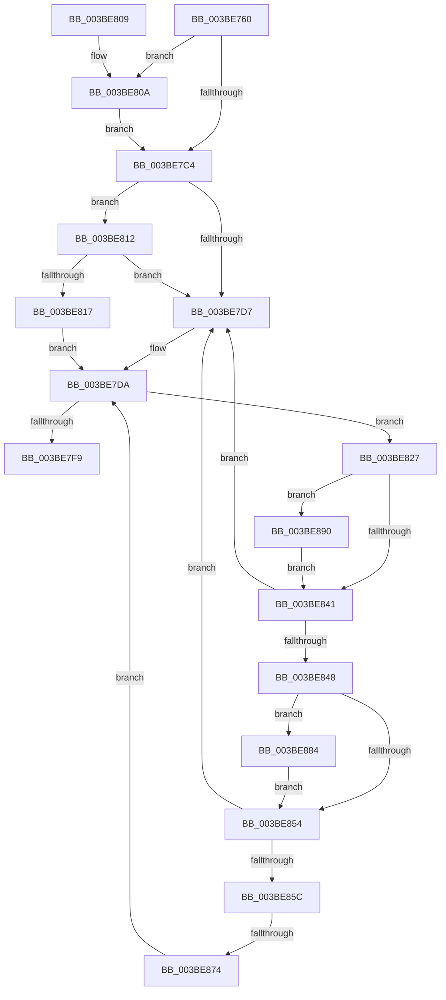

# ExpWaitForFastResource

- RVA: `0x003BE760`–`0x003BE8A4` (길이 `324` bytes)
- VA: `0x00000001403BE760`
- 실행 섹션: `.text`
- PDB 이름 있음: `예`; PDB Function 태그: `예`
- unwind 정보 RVA: `0x0008DE24`
- 디코드: `88`개 명령, `324/324` bytes 표시
- 미해석 바이트: `0` (있으면 어셈블리에 `.byte`로 보존)

> 이 문서는 커널 이미지의 기계어와 PDB 기호를 분석해 생성했습니다. 4번과 5번은 함수 원형과 자료형을 바이너리 사용 방식에서 추정한 C 해석이며 원본 소스 복구 결과는 아닙니다.

## 1. Dependencies

- 직접 호출 지점: **2**; 고유 호출 대상: **2**
- 직접 호출자로 확인된 함수: **2**
- RIP 상대 이미지 참조: **3**

### Outgoing calls
- `0x003BE7ED` → [KeWaitForSingleObject](../20/KeWaitForSingleObject_function_0020E6B0.md) (function, `0x0020E6B0`)
- `0x003BE89D` → [PerfLogExecutiveResourceWait](../4B/PerfLogExecutiveResourceWait_function_004B9E90.md) (function, `0x004B9E90`)

### Direct callers
- [ExpAcquireFastResourceSharedSlow](../21/ExpAcquireFastResourceSharedSlow_function_00211260.md) at `0x002116A9`
- [ExpAcquireFastResourceExclusiveSlow](ExpAcquireFastResourceExclusiveSlow_function_003BE2E0.md) at `0x003BE44C`

### Static image references
- `0x003BE80A` → RVA `0x00EEEFEC` (`.data`; read)
- `0x003BE835` → RVA `0x00FC6B04` (`ALMOSTRO`; read)
- `0x003BE874` → RVA `0x00EFA100` (`.data`; read)

## 2. Other-region calls and transfers

- 다른 실행 섹션으로 향하는 call: **0**
- call이 아닌 외부 분기/꼬리 이동: **1**
  - `0x003BE86E` → [sub_006E7CBA](../6E/Unknown_function_006E7CBA.md) (`tail-transfer`)

## 3. Assembly (complete function range)

```asm
003BE760  44 89 44 24 18                  mov dword ptr [rsp + 0x18], r8d
003BE765  48 89 54 24 10                  mov qword ptr [rsp + 0x10], rdx
003BE76A  48 89 4C 24 08                  mov qword ptr [rsp + 8], rcx
003BE76F  53                              push rbx
003BE770  56                              push rsi
003BE771  57                              push rdi
003BE772  41 54                           push r12
003BE774  41 55                           push r13
003BE776  41 56                           push r14
003BE778  41 57                           push r15
003BE77A  48 83 EC 70                     sub rsp, 0x70
003BE77E  4C 8B FA                        mov r15, rdx
003BE781  48 8B D9                        mov rbx, rcx
003BE784  48 C7 44 24 40 00 00 00 00      mov qword ptr [rsp + 0x40], 0
003BE78D  65 FF 04 25 68 90 00 00         inc dword ptr gs:[0x9068]
003BE795  C7 44 24 30 00 00 00 00         mov dword ptr [rsp + 0x30], 0
003BE79D  C7 84 24 C8 00 00 00 00 00 00 00  mov dword ptr [rsp + 0xc8], 0
003BE7A8  48 8D 71 3C                     lea rsi, [rcx + 0x3c]
003BE7AC  48 89 74 24 60                  mov qword ptr [rsp + 0x60], rsi
003BE7B1  FF 06                           inc dword ptr [rsi]
003BE7B3  4C 8D 71 1C                     lea r14, [rcx + 0x1c]
003BE7B7  4C 89 74 24 58                  mov qword ptr [rsp + 0x58], r14
003BE7BC  41 8B 06                        mov eax, dword ptr [r14]
003BE7BF  83 F8 FF                        cmp eax, -1
003BE7C2  74 46                           je 0x1403be80a
003BE7C4  48 8D 79 19                     lea rdi, [rcx + 0x19]
003BE7C8  4C 8B E7                        mov r12, rdi
003BE7CB  48 89 7C 24 50                  mov qword ptr [rsp + 0x50], rdi
003BE7D0  0F B6 0F                        movzx ecx, byte ptr [rdi]
003BE7D3  85 C0                           test eax, eax
003BE7D5  75 3B                           jne 0x1403be812
003BE7D7  45 33 ED                        xor r13d, r13d
003BE7DA  49 8D 4F 18                     lea rcx, [r15 + 0x18]
003BE7DE  4C 89 6C 24 20                  mov qword ptr [rsp + 0x20], r13
003BE7E3  45 33 C9                        xor r9d, r9d
003BE7E6  45 33 C0                        xor r8d, r8d
003BE7E9  41 8D 51 1B                     lea edx, [r9 + 0x1b]
003BE7ED  E8 BE FE E4 FF                  call 0x14020e6b0
003BE7F2  3D 02 01 00 00                  cmp eax, 0x102
003BE7F7  74 2E                           je 0x1403be827
003BE7F9  48 83 C4 70                     add rsp, 0x70
003BE7FD  41 5F                           pop r15
003BE7FF  41 5E                           pop r14
003BE801  41 5D                           pop r13
003BE803  41 5C                           pop r12
003BE805  5F                              pop rdi
003BE806  5E                              pop rsi
003BE807  5B                              pop rbx
003BE808  C3                              ret
003BE809  CC                              int3
003BE80A  8B 05 DC 07 B3 00               mov eax, dword ptr [rip + 0xb307dc]
003BE810  EB B2                           jmp 0x1403be7c4
003BE812  F6 C1 01                        test cl, 1
003BE815  75 C0                           jne 0x1403be7d7
003BE817  48 C7 44 24 40 C0 B4 B3 FF      mov qword ptr [rsp + 0x40], 0xffffffffffb3b4c0
003BE820  4C 8D 6C 24 40                  lea r13, [rsp + 0x40]
003BE825  EB B3                           jmp 0x1403be7da
003BE827  8B 4C 24 30                     mov ecx, dword ptr [rsp + 0x30]
003BE82B  FF C1                           inc ecx
003BE82D  89 4C 24 30                     mov dword ptr [rsp + 0x30], ecx
003BE831  89 4C 24 3C                     mov dword ptr [rsp + 0x3c], ecx
003BE835  F7 05 C5 82 C0 00 00 00 02 00   test dword ptr [rip + 0xc082c5], 0x20000
003BE83F  75 4F                           jne 0x1403be890
003BE841  0F B6 07                        movzx eax, byte ptr [rdi]
003BE844  A8 01                           test al, 1
003BE846  75 8F                           jne 0x1403be7d7
003BE848  41 8B 0E                        mov ecx, dword ptr [r14]
003BE84B  89 4C 24 34                     mov dword ptr [rsp + 0x34], ecx
003BE84F  83 F9 FF                        cmp ecx, -1
003BE852  74 30                           je 0x1403be884
003BE854  85 C9                           test ecx, ecx
003BE856  0F 84 7B FF FF FF               je 0x1403be7d7
003BE85C  8B 84 24 C8 00 00 00            mov eax, dword ptr [rsp + 0xc8]
003BE863  FF C0                           inc eax
003BE865  89 84 24 C8 00 00 00            mov dword ptr [rsp + 0xc8], eax
003BE86C  3B C1                           cmp eax, ecx
003BE86E  0F 87 46 94 32 00               ja 0x1406e7cba
003BE874  48 8B 05 85 B8 B3 00            mov rax, qword ptr [rip + 0xb3b885]
003BE87B  49 89 45 00                     mov qword ptr [r13], rax
003BE87F  E9 56 FF FF FF                  jmp 0x1403be7da
003BE884  8B 0D 62 07 B3 00               mov ecx, dword ptr [rip + 0xb30762]
003BE88A  89 4C 24 34                     mov dword ptr [rsp + 0x34], ecx
003BE88E  EB C4                           jmp 0x1403be854
003BE890  44 8B C1                        mov r8d, ecx
003BE893  48 8B D3                        mov rdx, rbx
003BE896  8B 8C 24 C0 00 00 00            mov ecx, dword ptr [rsp + 0xc0]
003BE89D  E8 EE B5 0F 00                  call 0x1404b9e90
003BE8A2  EB 9D                           jmp 0x1403be841
```

## 4. C-style interpretation (structured pseudocode)

```c
__int64 __fastcall ExpWaitForFastResource(__int64 a1, __int64 a2, int a3, int a4)
{
    __int64 result;
    __int64 v_r13;
    __int64 v_rsp;
    unsigned __int64 v_stack_m48;
    unsigned __int64 v_stack_m50;
    unsigned __int64 v_stack_m58;
    unsigned __int64 v_stack_m68;
    unsigned int v_stack_m78;
    unsigned __int64 v_stack_m88;
    unsigned __int64 v_stack_p10;
    unsigned int v_stack_p18;
    unsigned int v_stack_p20;
    unsigned int v_stack_p30;
    unsigned int v_stack_p34;
    unsigned int v_stack_p3C;
    unsigned __int64 v_stack_p40;
    unsigned __int64 v_stack_p8;
    unsigned int v_stack_pC0;
    unsigned int v_stack_pC8;

    v_stack_p18 = a3;
    v_stack_p10 = a2;
    v_stack_p8 = a1;
    v_rsp = (v_rsp) - (112);
    v_stack_m68 = 0;
    v_stack_m78 = 0;
    v_stack_p20 = 0;
    v_stack_m48 = a1 + 60;
    v_stack_m50 = a1 + 28;
    if (((unsigned int)((unsigned int)(*(unsigned int *)(a1 + 28)))) == -1) goto loc_003BE80A;
loc_003BE7C4:
    v_stack_m58 = a1 + 25;
    if ((unsigned int)((unsigned int)(*(unsigned int *)(a1 + 28))) != 0) goto loc_003BE812;
loc_003BE7D7:
    v_r13 = 0;
loc_003BE7DA:
    v_stack_m88 = 0;
    a4 = 0;
    a3 = 0;
    result = KeWaitForSingleObject(a2 + 24, a4 + 27, a3, a4);
    if (((unsigned int)(result)) == 258) goto loc_003BE827;
    v_rsp = (v_rsp) + (112);
    return result;
loc_003BE80A:
    goto loc_003BE7C4;
loc_003BE812:
    if ((((unsigned __int8)(a2 + 24)) & (1)) != 0) goto loc_003BE7D7;
    v_stack_p40 = 0xFFFFFFFFFFB3B4C0ULL;
    goto loc_003BE7DA;
loc_003BE827:
    a1 = (unsigned int)(((unsigned int)(v_stack_p30)) + 1);
    v_stack_p30 = (unsigned int)(a1);
    v_stack_p3C = (unsigned int)(a1);
    if (((*(unsigned int *)(v_rip + 12616389)) & (0x20000ULL)) != 0) goto loc_003BE890;
loc_003BE841:
    if ((((unsigned __int8)(*(unsigned __int8 *)(a1 + 25))) & (1)) != 0) goto loc_003BE7D7;
    v_stack_p34 = (unsigned int)((unsigned int)(*(unsigned int *)(a1 + 28)));
    if (((unsigned int)((unsigned int)(*(unsigned int *)(a1 + 28)))) == -1) goto loc_003BE884;
loc_003BE854:
    if ((unsigned int)((unsigned int)(*(unsigned int *)(a1 + 28))) == 0) goto loc_003BE7D7;
    result = (unsigned int)(((unsigned int)(v_stack_pC8)) + 1);
    v_stack_pC8 = (unsigned int)(result);
    *(unsigned __int64 *)(v_stack_p40) = *(unsigned __int64 *)(v_rip + 11778181);
    goto loc_003BE7DA;
loc_003BE884:
    v_stack_p34 = (unsigned int)((unsigned int)(*(unsigned int *)(v_rip + 11732834)));
    goto loc_003BE854;
loc_003BE890:
    result = PerfLogExecutiveResourceWait((unsigned int)(v_stack_pC0), a1, (unsigned int)((unsigned int)((unsigned int)(*(unsigned int *)(v_rip + 11732834)))), a4);
    goto loc_003BE841;
}
```

## 5. (Beta) C Style

```c
int64_t ExpWaitForFastResource(void *Arg1, void *Arg2, int32_t Arg3, int32_t Arg4)
{
    uint8_t *arg1 = (uint8_t *)Arg1;
    uint8_t *arg2 = (uint8_t *)Arg2;

    int64_t result;
    int64_t local_r13;
    int64_t local_rsp;
    uint64_t v_stack_m48;
    uint64_t v_stack_m50;
    uint64_t v_stack_m58;
    uint64_t v_stack_m68;
    uint32_t v_stack_m78;
    uint64_t v_stack_m88;
    uint64_t v_stack_p10;
    uint32_t v_stack_p18;
    uint32_t v_stack_p20;
    uint32_t v_stack_p30;
    uint32_t v_stack_p34;
    uint32_t v_stack_p3C;
    uint64_t v_stack_p40;
    uint64_t v_stack_p8;
    uint32_t v_stack_pC0;
    uint32_t v_stack_pC8;

    v_stack_p18 = Arg3;
    v_stack_p10 = Arg2;
    v_stack_p8 = Arg1;
    local_rsp = (local_rsp) - (112);
    v_stack_m68 = 0;
    v_stack_m78 = 0;
    v_stack_p20 = 0;
    v_stack_m48 = Arg1 + 60;
    v_stack_m50 = Arg1 + 28;
    if (((uint32_t)((uint32_t)(*(uint32_t *)(arg1 + 0x1C)))) == -1) goto loc_003BE80A;
loc_003BE7C4:
    v_stack_m58 = Arg1 + 25;
    if ((uint32_t)((uint32_t)(*(uint32_t *)(arg1 + 0x1C))) != 0) goto loc_003BE812;
loc_003BE7D7:
    local_r13 = 0;
loc_003BE7DA:
    v_stack_m88 = 0;
    Arg4 = 0;
    Arg3 = 0;
    result = KeWaitForSingleObject(Arg2 + 24, Arg4 + 27, Arg3, Arg4);
    if (((uint32_t)(result)) == 258) goto loc_003BE827;
    local_rsp = (local_rsp) + (112);
    return result;
loc_003BE80A:
    goto loc_003BE7C4;
loc_003BE812:
    if ((((uint8_t)(Arg2 + 24)) & (1)) != 0) goto loc_003BE7D7;
    v_stack_p40 = 0xFFFFFFFFFFB3B4C0ULL;
    goto loc_003BE7DA;
loc_003BE827:
    Arg1 = (uint32_t)(((uint32_t)(v_stack_p30)) + 1);
    v_stack_p30 = (uint32_t)(Arg1);
    v_stack_p3C = (uint32_t)(Arg1);
    if (((*(uint32_t *)(v_rip + 0xC082C5)) & (0x20000ULL)) != 0) goto loc_003BE890;
loc_003BE841:
    if ((((uint8_t)(*(uint8_t *)(arg1 + 0x19))) & (1)) != 0) goto loc_003BE7D7;
    v_stack_p34 = (uint32_t)((uint32_t)(*(uint32_t *)(arg1 + 0x1C)));
    if (((uint32_t)((uint32_t)(*(uint32_t *)(arg1 + 0x1C)))) == -1) goto loc_003BE884;
loc_003BE854:
    if ((uint32_t)((uint32_t)(*(uint32_t *)(arg1 + 0x1C))) == 0) goto loc_003BE7D7;
    result = (uint32_t)(((uint32_t)(v_stack_pC8)) + 1);
    v_stack_pC8 = (uint32_t)(result);
    *(uint64_t *)(v_stack_p40) = *(uint64_t *)(v_rip + 0xB3B885);
    goto loc_003BE7DA;
loc_003BE884:
    v_stack_p34 = (uint32_t)((uint32_t)(*(uint32_t *)(v_rip + 0xB30762)));
    goto loc_003BE854;
loc_003BE890:
    result = PerfLogExecutiveResourceWait((uint32_t)(v_stack_pC0), Arg1, (uint32_t)((uint32_t)((uint32_t)(*(uint32_t *)(v_rip + 0xB30762)))), Arg4);
    goto loc_003BE841;
}
```

### 관측된 메모리 오프셋

구조체 형식이 확인되지 않은 접근은 인자 기준의 오프셋으로만 기록했습니다.

| 기준 인자 | 오프셋 표현 | 폭 (bit) | 접근 |
|---|---:|---:|---|
| `Arg1` | `+ 0x0` | `8` | `R` |
| `Arg1` | `+ 0x0` | `32` | `R` |
| `Arg1` | `+ 0x0` | `32` | `R/W` |
| `Arg1` | `+ 0x19` | `64` | `R` |
| `Arg1` | `+ 0x1C` | `64` | `R` |
| `Arg1` | `+ 0x3C` | `64` | `R` |
| `Arg2` | `+ 0x18` | `64` | `R` |

## 6. Execution-region graph

[열기: 2D/3D 그래프와 함수 탐색 컨트롤 패널](../../../control-panel.html?section=text&rva=0x003BE760&view=graph)

- 2D 그래프는 위에서 아래로 흐르고, 3D 그래프는 빈 공간을 드래그해 회전합니다. Shift+드래그는 이동, 휠은 확대·축소, 함수 노드 선택은 대상 보고서 이동입니다.

### Static fallback


