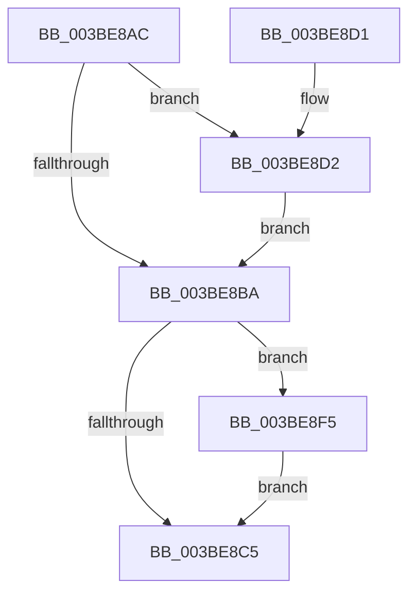

# KeAbMarkCrossThreadReleasable

- RVA: `0x003BE8AC`–`0x003BE8FF` (길이 `83` bytes)
- VA: `0x00000001403BE8AC`
- 실행 섹션: `.text`
- PDB 이름 있음: `예`; PDB Function 태그: `아니요`
- unwind 정보 RVA: `0x000783B4`
- 디코드: `27`개 명령, `83/83` bytes 표시
- 미해석 바이트: `0` (있으면 어셈블리에 `.byte`로 보존)

> 이 문서는 커널 이미지의 기계어와 PDB 기호를 분석해 생성했습니다. 4번과 5번은 함수 원형과 자료형을 바이너리 사용 방식에서 추정한 C 해석이며 원본 소스 복구 결과는 아닙니다.

## 1. Dependencies

- 직접 호출 지점: **1**; 고유 호출 대상: **1**
- 직접 호출자로 확인된 함수: **11**
- RIP 상대 이미지 참조: **0**

### Outgoing calls
- `0x003BE8F8` → [KiAbForceProcessLockEntry](../41/KiAbForceProcessLockEntry_function_00419078.md) (function, `0x00419078`)

### Direct callers
- [sub_00211104](../21/Unknown_function_00211104.md) at `0x00211251`
- [ExpAcquireFastResourceSharedSlow](../21/ExpAcquireFastResourceSharedSlow_function_00211260.md) at `0x002119F7`
- [ExpAcquireFastResourceSharedSlow](../21/ExpAcquireFastResourceSharedSlow_function_00211260.md) at `0x00211AE4`
- [ExpAcquireFastResourceSharedSlow](../21/ExpAcquireFastResourceSharedSlow_function_00211260.md) at `0x00211BAF`
- [sub_00211E87](../21/Unknown_function_00211E87.md) at `0x00211FA2`
- [sub_00215166](../21/Unknown_function_00215166.md) at `0x00215A48`
- [ExAcquireFastResourceSharedStarveExclusive](ExAcquireFastResourceSharedStarveExclusive_function_003BDC80.md) at `0x003BDF97`
- [sub_003BE220](Unknown_function_003BE220.md) at `0x003BE287`
- [ExpAcquireFastResourceExclusiveSlow](ExpAcquireFastResourceExclusiveSlow_function_003BE2E0.md) at `0x003BE740`
- [ExpMoveSharedFastResourceOwnershipWithFlags](../41/ExpMoveSharedFastResourceOwnershipWithFlags_function_00415C4C.md) at `0x00415FDE`
- [ExDisownFastResource](../4A/ExDisownFastResource_function_004A2C10.md) at `0x004A2E12`
- [KeAbCrossThreadDeleteDpcRoutine](../5C/KeAbCrossThreadDeleteDpcRoutine_function_005C55D0.md) at `0x005C55EC`
- [ExAcquireFastResourceWithFlags](../65/ExAcquireFastResourceWithFlags_function_00658120.md) at `0x0065860A`

### Static image references
- 디코드된 RIP-relative 메모리 참조가 없습니다.

## 2. Other-region calls and transfers

- 다른 실행 섹션으로 향하는 call: **0**
- 별도 외부 분기/꼬리 이동을 확인하지 못했습니다.

## 3. Assembly (complete function range)

```asm
003BE8AC  40 53                           push rbx
003BE8AE  48 83 EC 20                     sub rsp, 0x20
003BE8B2  48 8B DA                        mov rbx, rdx
003BE8B5  F6 C2 01                        test dl, 1
003BE8B8  75 18                           jne 0x1403be8d2
003BE8BA  48 8B 03                        mov rax, qword ptr [rbx]
003BE8BD  48 C1 E8 3F                     shr rax, 0x3f
003BE8C1  84 C0                           test al, al
003BE8C3  74 30                           je 0x1403be8f5
003BE8C5  8A 03                           mov al, byte ptr [rbx]
003BE8C7  0C 01                           or al, 1
003BE8C9  88 03                           mov byte ptr [rbx], al
003BE8CB  48 83 C4 20                     add rsp, 0x20
003BE8CF  5B                              pop rbx
003BE8D0  C3                              ret
003BE8D1  CC                              int3
003BE8D2  65 4C 8B 04 25 88 01 00 00      mov r8, qword ptr gs:[0x188]
003BE8DB  48 D1 EB                        shr rbx, 1
003BE8DE  0F B6 C3                        movzx eax, bl
003BE8E1  48 6B D8 58                     imul rbx, rax, 0x58
003BE8E5  49 8B 80 70 04 00 00            mov rax, qword ptr [r8 + 0x470]
003BE8EC  48 83 C0 10                     add rax, 0x10
003BE8F0  48 03 D8                        add rbx, rax
003BE8F3  EB C5                           jmp 0x1403be8ba
003BE8F5  48 8B CB                        mov rcx, rbx
003BE8F8  E8 7B A7 05 00                  call 0x140419078
003BE8FD  EB C6                           jmp 0x1403be8c5
```

## 4. C-style interpretation (structured pseudocode)

```c
__int64 __fastcall KeAbMarkCrossThreadReleasable(__int64 a1, __int64 a2)
{
    __int64 result;
    __int64 v_rbx;
    __int64 v_rsp;

    v_rsp = (v_rsp) - (32);
    if ((((unsigned __int8)(a2)) & (1)) != 0) goto loc_003BE8D2;
loc_003BE8BA:
    result = (*(unsigned __int64 *)(a2)) >> (63);
    if ((unsigned __int8)(result) == 0) goto loc_003BE8F5;
loc_003BE8C5:
    result = (unsigned __int8)((*(unsigned __int8 *)(a2)) | (1));
    *(unsigned __int8 *)(a2) = (unsigned __int8)(result);
    v_rsp = (v_rsp) + (32);
    return result;
loc_003BE8D2:
    v_rbx = (a2) >> (1);
    v_rbx = (v_rbx) * ((unsigned __int8)(v_rbx));
    result = (*(unsigned __int64 *)(*(unsigned __int64 *)(gs_base + (0 + 392)) + 1136)) + (16);
    v_rbx = (v_rbx) + (result);
    goto loc_003BE8BA;
loc_003BE8F5:
    result = KiAbForceProcessLockEntry(v_rbx, a2, *(unsigned __int64 *)(gs_base + (0 + 392)), a4);
    goto loc_003BE8C5;
}
```

## 5. (Beta) C Style

```c
int64_t KeAbMarkCrossThreadReleasable(int64_t Arg1, int64_t Arg2)
{
    int64_t result;
    int64_t local_rbx;
    int64_t local_rsp;

    local_rsp = (local_rsp) - (32);
    if ((((uint8_t)(Arg2)) & (1)) != 0) goto loc_003BE8D2;
loc_003BE8BA:
    result = (*(uint64_t *)(Arg2)) >> (63);
    if ((uint8_t)(result) == 0) goto loc_003BE8F5;
loc_003BE8C5:
    result = (uint8_t)((*(uint8_t *)(Arg2)) | (1));
    *(uint8_t *)(Arg2) = (uint8_t)(result);
    local_rsp = (local_rsp) + (32);
    return result;
loc_003BE8D2:
    local_rbx = (Arg2) >> (1);
    local_rbx = (local_rbx) * ((uint8_t)(local_rbx));
    result = (*(uint64_t *)(*(uint64_t *)(gs_base + (0 + 0x188)) + 0x470)) + (16);
    local_rbx = (local_rbx) + (result);
    goto loc_003BE8BA;
loc_003BE8F5:
    result = KiAbForceProcessLockEntry(local_rbx, Arg2, *(uint64_t *)(gs_base + (0 + 0x188)), a4);
    goto loc_003BE8C5;
}
```

## 6. Execution-region graph

[열기: 2D/3D 그래프와 함수 탐색 컨트롤 패널](../../../control-panel.html?section=text&rva=0x003BE8AC&view=graph)

- 2D 그래프는 위에서 아래로 흐르고, 3D 그래프는 빈 공간을 드래그해 회전합니다. Shift+드래그는 이동, 휠은 확대·축소, 함수 노드 선택은 대상 보고서 이동입니다.

### Static fallback


