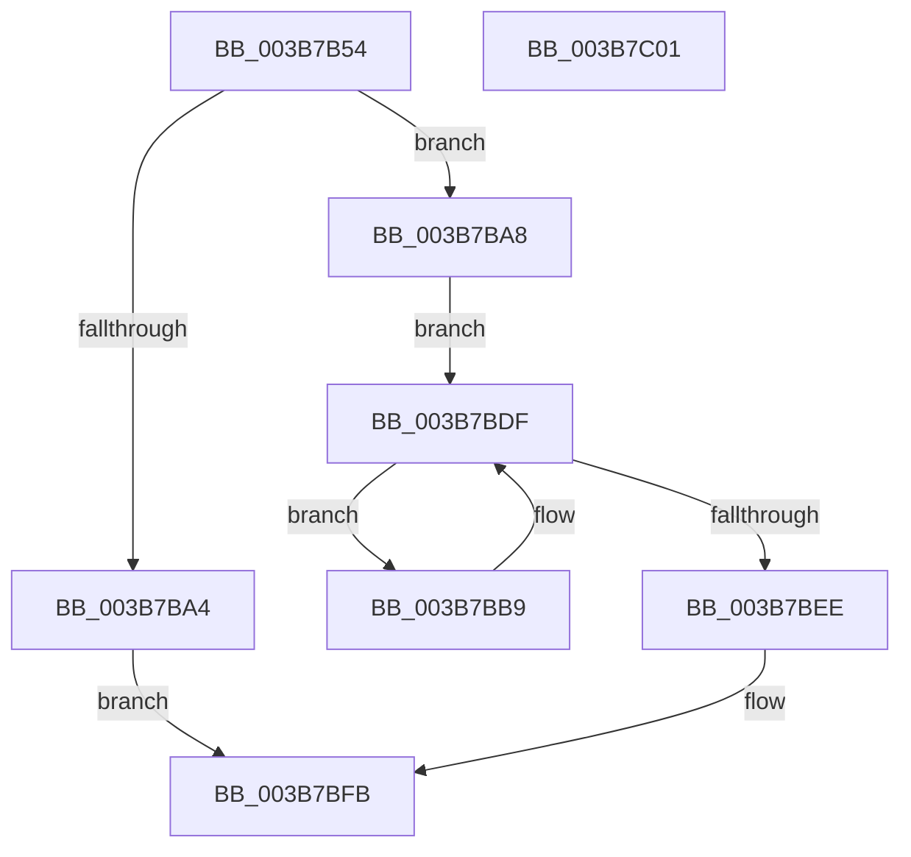

# MiAllocateEnclavePagesForMdl

- RVA: `0x003B7B54`–`0x003B7C02` (길이 `174` bytes)
- VA: `0x00000001403B7B54`
- 실행 섹션: `.text`
- PDB 이름 있음: `예`; PDB Function 태그: `아니요`
- unwind 정보 RVA: `0x00071A74`
- 디코드: `46`개 명령, `174/174` bytes 표시
- 미해석 바이트: `0` (있으면 어셈블리에 `.byte`로 보존)

> 이 문서는 커널 이미지의 기계어와 PDB 기호를 분석해 생성했습니다. 4번과 5번은 함수 원형과 자료형을 바이너리 사용 방식에서 추정한 C 해석이며 원본 소스 복구 결과는 아닙니다.

## 1. Dependencies

- 직접 호출 지점: **2**; 고유 호출 대상: **2**
- 직접 호출자로 확인된 함수: **1**
- RIP 상대 이미지 참조: **0**

### Outgoing calls
- `0x003B7B95` → [MiAllocateEnclavePages](MiAllocateEnclavePages_function_003BC43C.md) (function, `0x003BC43C`)
- `0x003B7BE4` → [MiUnlinkPageChainHead](../36/MiUnlinkPageChainHead_function_00365C40.md) (function, `0x00365C40`)

### Direct callers
- [MiFindPagesForMdl](MiFindPagesForMdl_function_003B770C.md) at `0x003B77F3`

### Static image references
- 디코드된 RIP-relative 메모리 참조가 없습니다.

## 2. Other-region calls and transfers

- 다른 실행 섹션으로 향하는 call: **0**
- 별도 외부 분기/꼬리 이동을 확인하지 못했습니다.

## 3. Assembly (complete function range)

```asm
003B7B54  40 53                           push rbx
003B7B56  48 83 EC 50                     sub rsp, 0x50
003B7B5A  41 8B C0                        mov eax, r8d
003B7B5D  45 8B D0                        mov r10d, r8d
003B7B60  83 E0 02                        and eax, 2
003B7B63  48 8B DA                        mov rbx, rdx
003B7B66  33 D2                           xor edx, edx
003B7B68  44 8B C0                        mov r8d, eax
003B7B6B  41 83 C8 01                     or r8d, 1
003B7B6F  48 89 54 24 40                  mov qword ptr [rsp + 0x40], rdx
003B7B74  8B 94 24 80 00 00 00            mov edx, dword ptr [rsp + 0x80]
003B7B7B  41 F6 C2 04                     test r10b, 4
003B7B7F  0F 57 C0                        xorps xmm0, xmm0
003B7B82  44 0F 44 C0                     cmove r8d, eax
003B7B86  48 8D 44 24 30                  lea rax, [rsp + 0x30]
003B7B8B  48 89 44 24 20                  mov qword ptr [rsp + 0x20], rax
003B7B90  0F 11 44 24 30                  movups xmmword ptr [rsp + 0x30], xmm0
003B7B95  E8 A2 48 00 00                  call 0x1403bc43c
003B7B9A  4C 8B 44 24 40                  mov r8, qword ptr [rsp + 0x40]
003B7B9F  4D 85 C0                        test r8, r8
003B7BA2  75 04                           jne 0x1403b7ba8
003B7BA4  33 C0                           xor eax, eax
003B7BA6  EB 53                           jmp 0x1403b7bfb
003B7BA8  8B 43 28                        mov eax, dword ptr [rbx + 0x28]
003B7BAB  48 C1 E8 0C                     shr rax, 0xc
003B7BAF  48 83 C0 06                     add rax, 6
003B7BB3  4C 8D 0C C3                     lea r9, [rbx + rax*8]
003B7BB7  EB 26                           jmp 0x1403b7bdf
003B7BB9  48 B9 00 00 00 00 00 DE FF FF   movabs rcx, 0xffffde0000000000
003B7BC3  48 2B C1                        sub rax, rcx
003B7BC6  48 B9 AB AA AA AA AA AA AA AA   movabs rcx, 0xaaaaaaaaaaaaaaab
003B7BD0  48 C1 F8 04                     sar rax, 4
003B7BD4  48 0F AF C1                     imul rax, rcx
003B7BD8  49 89 01                        mov qword ptr [r9], rax
003B7BDB  4D 8D 49 08                     lea r9, [r9 + 8]
003B7BDF  48 8D 4C 24 30                  lea rcx, [rsp + 0x30]
003B7BE4  E8 57 E0 FA FF                  call 0x140365c40
003B7BE9  48 85 C0                        test rax, rax
003B7BEC  75 CB                           jne 0x1403b7bb9
003B7BEE  49 C1 E0 0C                     shl r8, 0xc
003B7BF2  B8 01 00 00 00                  mov eax, 1
003B7BF7  44 01 43 28                     add dword ptr [rbx + 0x28], r8d
003B7BFB  48 83 C4 50                     add rsp, 0x50
003B7BFF  5B                              pop rbx
003B7C00  C3                              ret
003B7C01  CC                              int3
```

## 4. C-style interpretation (structured pseudocode)

```c
__int64 __fastcall MiAllocateEnclavePagesForMdl(__int64 a1, __int64 a2, int a3, __int64 a4, unsigned int a5)
{
    __int64 result;
    __int64 v_rsp;
    unsigned __int64 v_stack_m18;
    unsigned __int64 v_stack_m28;
    unsigned __int64 v_stack_m38;

    v_rsp = (v_rsp) - (80);
    result = (unsigned int)(((unsigned int)(a3)) & (2));
    a2 = 0;
    a3 = (unsigned int)(((unsigned int)((unsigned int)(result))) | (1));
    v_stack_m18 = 0;
    if ((((unsigned __int8)((unsigned int)(a3))) & (4)) == 0) { a3 = (unsigned int)(result); }
    v_stack_m38 = v_stack_m28;
    v_stack_m28 = v_xmm0;
    result = MiAllocateEnclavePages(a1, (unsigned int)(a5), a3, a4);
    if (v_stack_m18 != 0) goto loc_003B7BA8;
    result = 0;
    goto loc_003B7BFB;
loc_003B7BA8:
    result = ((unsigned int)(*(unsigned int *)(a2 + 40))) >> (12);
    result = (result) + (6);
    goto loc_003B7BDF;
loc_003B7BB9:
    result = (result) - (a1);
    result = (result) >> (4);
    result = (result) * (a1);
    *(unsigned __int64 *)(a2 + result * 8) = result;
loc_003B7BDF:
    result = MiUnlinkPageChainHead(v_stack_m28, (unsigned int)(a5), v_stack_m18, a2 + result * 8 + 8);
    if (result != 0) goto loc_003B7BB9;
    a3 = (v_stack_m18) << (12);
loc_003B7BFB:
    v_rsp = (v_rsp) + (80);
    return 1;
}
```

## 5. (Beta) C Style

```c
int64_t MiAllocateEnclavePagesForMdl(int64_t Arg1, void *Arg2, int32_t Arg3, int64_t Arg4, uint32_t Arg5)
{
    uint8_t *arg2 = (uint8_t *)Arg2;

    int64_t result;
    int64_t local_rsp;
    uint64_t v_stack_m18;
    uint64_t v_stack_m28;
    uint64_t v_stack_m38;

    local_rsp = (local_rsp) - (80);
    result = (uint32_t)(((uint32_t)(Arg3)) & (2));
    Arg2 = 0;
    Arg3 = (uint32_t)(((uint32_t)((uint32_t)(result))) | (1));
    v_stack_m18 = 0;
    if ((((uint8_t)((uint32_t)(Arg3))) & (4)) == 0) { Arg3 = (uint32_t)(result); }
    v_stack_m38 = v_stack_m28;
    v_stack_m28 = v_xmm0;
    result = MiAllocateEnclavePages(Arg1, (uint32_t)(Arg5), Arg3, Arg4);
    if (v_stack_m18 != 0) goto loc_003B7BA8;
    result = 0;
    goto loc_003B7BFB;
loc_003B7BA8:
    result = ((uint32_t)(*(uint32_t *)(arg2 + 0x28))) >> (12);
    result = (result) + (6);
    goto loc_003B7BDF;
loc_003B7BB9:
    result = (result) - (Arg1);
    result = (result) >> (4);
    result = (result) * (Arg1);
    *(uint64_t *)(arg2 + result * 8) = result;
loc_003B7BDF:
    result = MiUnlinkPageChainHead(v_stack_m28, (uint32_t)(Arg5), v_stack_m18, Arg2 + result * 8 + 8);
    if (result != 0) goto loc_003B7BB9;
    Arg3 = (v_stack_m18) << (12);
loc_003B7BFB:
    local_rsp = (local_rsp) + (80);
    return 1;
}
```

### 관측된 메모리 오프셋

구조체 형식이 확인되지 않은 접근은 인자 기준의 오프셋으로만 기록했습니다.

| 기준 인자 | 오프셋 표현 | 폭 (bit) | 접근 |
|---|---:|---:|---|
| `Arg2` | `+ 0x0 + rax*8` | `64` | `R` |
| `Arg2` | `+ 0x28` | `32` | `R` |
| `Arg2` | `+ 0x28` | `32` | `R/W` |

## 6. Execution-region graph

[열기: 2D/3D 그래프와 함수 탐색 컨트롤 패널](../../../control-panel.html?section=text&rva=0x003B7B54&view=graph)

- 2D 그래프는 위에서 아래로 흐르고, 3D 그래프는 빈 공간을 드래그해 회전합니다. Shift+드래그는 이동, 휠은 확대·축소, 함수 노드 선택은 대상 보고서 이동입니다.

### Static fallback


