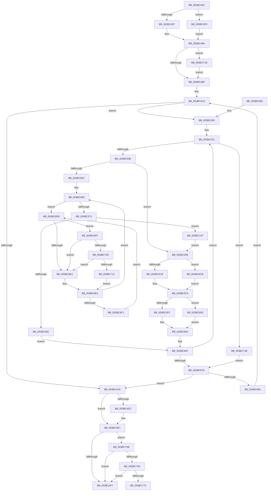

# MiAllocateEnclavePages

- RVA: `0x003BC43C`–`0x003BC781` (길이 `837` bytes)
- VA: `0x00000001403BC43C`
- 실행 섹션: `.text`
- PDB 이름 있음: `예`; PDB Function 태그: `예`
- unwind 정보 RVA: `0x0008CD84`
- 디코드: `188`개 명령, `837/837` bytes 표시
- 미해석 바이트: `0` (있으면 어셈블리에 `.byte`로 보존)

> 이 문서는 커널 이미지의 기계어와 PDB 기호를 분석해 생성했습니다. 4번과 5번은 함수 원형과 자료형을 바이너리 사용 방식에서 추정한 C 해석이며 원본 소스 복구 결과는 아닙니다.

## 1. Dependencies

- 직접 호출 지점: **13**; 고유 호출 대상: **9**
- 직접 호출자로 확인된 함수: **5**
- RIP 상대 이미지 참조: **5**

### Outgoing calls
- `0x003BC4E2` → [KiLowerIrqlProcessIrqlFlags](../4F/KiLowerIrqlProcessIrqlFlags_function_004F5698.md) (function, `0x004F5698`)
- `0x003BC525` → [ExAcquireSpinLockExclusiveAtDpcLevel](../24/ExAcquireSpinLockExclusiveAtDpcLevel_function_00248E80.md) (function, `0x00248E80`)
- `0x003BC55F` → [ExReleaseSpinLockExclusiveFromDpcLevel](../24/ExReleaseSpinLockExclusiveFromDpcLevel_function_002497E0.md) (function, `0x002497E0`)
- `0x003BC576` → [ExAcquireSpinLockExclusiveAtDpcLevel](../24/ExAcquireSpinLockExclusiveAtDpcLevel_function_00248E80.md) (function, `0x00248E80`)
- `0x003BC58F` → [ExReleaseSpinLockExclusiveFromDpcLevel](../24/ExReleaseSpinLockExclusiveFromDpcLevel_function_002497E0.md) (function, `0x002497E0`)
- `0x003BC5DF` → [MiSetPfnBlink](MiSetPfnBlink_function_003BC790.md) (function, `0x003BC790`)
- `0x003BC610` → [ExReleaseSpinLockExclusiveFromDpcLevel](../24/ExReleaseSpinLockExclusiveFromDpcLevel_function_002497E0.md) (function, `0x002497E0`)
- `0x003BC647` → [MiInsertPageChainHead](../2A/MiInsertPageChainHead_function_002A24EC.md) (function, `0x002A24EC`)
- `0x003BC709` → [KiCheckVpBackingLongSpinWaitHypercall](../30/KiCheckVpBackingLongSpinWaitHypercall_function_0030F490.md) (function, `0x0030F490`)
- `0x003BC714` → [HvlNotifyLongSpinWait](../30/HvlNotifyLongSpinWait_function_0030F460.md) (function, `0x0030F460`)
- `0x003BC71D` → [KiRaiseIrqlProcessIrqlFlags](../4F/KiRaiseIrqlProcessIrqlFlags_function_004F56FC.md) (function, `0x004F56FC`)
- `0x003BC741` → [ExReleaseSpinLockExclusiveFromDpcLevel](../24/ExReleaseSpinLockExclusiveFromDpcLevel_function_002497E0.md) (function, `0x002497E0`)
- `0x003BC764` → [MiUnlinkPageChainHead](../36/MiUnlinkPageChainHead_function_00365C40.md) (function, `0x00365C40`)

### Direct callers
- [MiAllocateEnclavePagesForMdl](MiAllocateEnclavePagesForMdl_function_003B7B54.md) at `0x003B7B95`
- [MiReserveEnclavePages](MiReserveEnclavePages_function_003BD430.md) at `0x003BD48A`
- [MiPrepareEnclaveMetadataPage](../68/MiPrepareEnclaveMetadataPage_function_00686EAC.md) at `0x00686F67`
- [sub_006E3572](../6E/Unknown_function_006E3572.md) at `0x006E35B0`
- [MiCreateHardwareEnclave](../../page/80/MiCreateHardwareEnclave_function_00808500.md) at `0x008086C8`

### Static image references
- `0x003BC465` → RVA `0x00FC5000` (`ALMOSTRO`; read)
- `0x003BC47E` → RVA `0x00E2DBD0` (`.data`; read)
- `0x003BC4B2` → RVA `0x00FC6D20` (`ALMOSTRO`; read)
- `0x003BC6DA` → RVA `0x00FC52AC` (`ALMOSTRO`; reference)
- `0x003BC6FF` → RVA `0x00FC6AB8` (`ALMOSTRO`; read)

## 2. Other-region calls and transfers

- 다른 실행 섹션으로 향하는 call: **0**
- call이 아닌 외부 분기/꼬리 이동: **1**
  - `0x003BC77C` → [sub_006E7C8A](../6E/Unknown_function_006E7C8A.md) (`tail-transfer`)

## 3. Assembly (complete function range)

```asm
003BC43C  4C 89 4C 24 20                  mov qword ptr [rsp + 0x20], r9
003BC441  44 89 44 24 18                  mov dword ptr [rsp + 0x18], r8d
003BC446  48 89 4C 24 08                  mov qword ptr [rsp + 8], rcx
003BC44B  53                              push rbx
003BC44C  55                              push rbp
003BC44D  56                              push rsi
003BC44E  57                              push rdi
003BC44F  41 54                           push r12
003BC451  41 55                           push r13
003BC453  41 56                           push r14
003BC455  41 57                           push r15
003BC457  48 83 EC 48                     sub rsp, 0x48
003BC45B  48 8B 9C 24 B0 00 00 00         mov rbx, qword ptr [rsp + 0xb0]
003BC463  33 C0                           xor eax, eax
003BC465  44 0F B7 15 93 8B C0 00         movzx r10d, word ptr [rip + 0xc08b93]
003BC46D  0F 57 C0                        xorps xmm0, xmm0
003BC470  41 0F AF D2                     imul edx, r10d
003BC474  49 8B F9                        mov rdi, r9
003BC477  0F 11 03                        movups xmmword ptr [rbx], xmm0
003BC47A  48 89 43 10                     mov qword ptr [rbx + 0x10], rax
003BC47E  48 8B 05 4B 17 A7 00            mov rax, qword ptr [rip + 0xa7174b]
003BC485  4C 8D 24 90                     lea r12, [rax + rdx*4]
003BC489  BA 02 00 00 00                  mov edx, 2
003BC48E  44 84 C2                        test dl, r8b
003BC491  0F 84 5C 02 00 00               je 0x1403bc6f3
003BC497  8D 42 02                        lea eax, [rdx + 2]
003BC49A  49 03 C4                        add rax, r12
003BC49D  48 89 44 24 30                  mov qword ptr [rsp + 0x30], rax
003BC4A2  45 33 ED                        xor r13d, r13d
003BC4A5  44 0F 20 C3                     mov rbx, cr8
003BC4A9  48 89 5C 24 20                  mov qword ptr [rsp + 0x20], rbx
003BC4AE  44 0F 22 C2                     mov cr8, rdx
003BC4B2  44 39 2D 67 A8 C0 00            cmp dword ptr [rip + 0xc0a867], r13d
003BC4B9  0F 85 5C 02 00 00               jne 0x1403bc71b
003BC4BF  48 BB FF FF FF FF 3F 00 00 00   movabs rbx, 0x3fffffffff
003BC4C9  4C 3B EF                        cmp r13, rdi
003BC4CC  75 3B                           jne 0x1403bc509
003BC4CE  83 3D 4B A8 C0 00 00            cmp dword ptr [rip + 0xc0a84b], 0
003BC4D5  48 8B 5C 24 20                  mov rbx, qword ptr [rsp + 0x20]
003BC4DA  74 0B                           je 0x1403bc4e7
003BC4DC  44 0F 20 C1                     mov rcx, cr8
003BC4E0  8A D3                           mov dl, bl
003BC4E2  E8 B1 91 13 00                  call 0x1404f5698
003BC4E7  0F B6 C3                        movzx eax, bl
003BC4EA  44 0F 22 C0                     mov cr8, rax
003BC4EE  4C 3B EF                        cmp r13, rdi
003BC4F1  0F 85 54 02 00 00               jne 0x1403bc74b
003BC4F7  48 83 C4 48                     add rsp, 0x48
003BC4FB  41 5F                           pop r15
003BC4FD  41 5E                           pop r14
003BC4FF  41 5D                           pop r13
003BC501  41 5C                           pop r12
003BC503  5F                              pop rdi
003BC504  5E                              pop rsi
003BC505  5D                              pop rbp
003BC506  5B                              pop rbx
003BC507  C3                              ret
003BC508  CC                              int3
003BC509  41 8B 04 24                     mov eax, dword ptr [r12]
003BC50D  4C 8B 71 10                     mov r14, qword ptr [rcx + 0x10]
003BC511  48 69 E8 80 DF 00 00            imul rbp, rax, 0xdf80
003BC518  4C 8D BD E0 DE 00 00            lea r15, [rbp + 0xdee0]
003BC51F  4D 03 FE                        add r15, r14
003BC522  49 8B CF                        mov rcx, r15
003BC525  E8 56 C9 E8 FF                  call 0x140248e80
003BC52A  49 8B B4 2E D0 DE 00 00         mov rsi, qword ptr [r14 + rbp + 0xded0]
003BC532  48 3B F3                        cmp rsi, rbx
003BC535  0F 84 03 02 00 00               je 0x1403bc73e
003BC53B  48 8D 1C 76                     lea rbx, [rsi + rsi*2]
003BC53F  49 B8 00 00 00 00 00 DE FF FF   movabs r8, 0xffffde0000000000
003BC549  48 C1 E3 04                     shl rbx, 4
003BC54D  49 8B C0                        mov rax, r8
003BC550  48 03 D8                        add rbx, rax
003BC553  F0 48 0F BA 6B 18 3F            lock bts qword ptr [rbx + 0x18], 0x3f
003BC55A  73 3D                           jae 0x1403bc599
003BC55C  49 8B CF                        mov rcx, r15
003BC55F  E8 7C D2 E8 FF                  call 0x1402497e0
003BC564  33 FF                           xor edi, edi
003BC566  F0 48 0F BA 6B 18 3F            lock bts qword ptr [rbx + 0x18], 0x3f
003BC56D  0F 82 65 01 00 00               jb 0x1403bc6d8
003BC573  49 8B CF                        mov rcx, r15
003BC576  E8 05 C9 E8 FF                  call 0x140248e80
003BC57B  49 8B 84 2E D0 DE 00 00         mov rax, qword ptr [r14 + rbp + 0xded0]
003BC583  48 3B C6                        cmp rax, rsi
003BC586  0F 84 A3 01 00 00               je 0x1403bc72f
003BC58C  49 8B CF                        mov rcx, r15
003BC58F  E8 4C D2 E8 FF                  call 0x1402497e0
003BC594  E9 B6 00 00 00                  jmp 0x1403bc64f
003BC599  48 8B 13                        mov rdx, qword ptr [rbx]
003BC59C  48 B8 FF FF FF FF FF 00 00 00   movabs rax, 0xffffffffff
003BC5A6  48 8B 7B 18                     mov rdi, qword ptr [rbx + 0x18]
003BC5AA  48 8B F2                        mov rsi, rdx
003BC5AD  48 23 F0                        and rsi, rax
003BC5B0  48 89 54 24 28                  mov qword ptr [rsp + 0x28], rdx
003BC5B5  48 23 F8                        and rdi, rax
003BC5B8  48 B8 FF FF FF FF 3F 00 00 00   movabs rax, 0x3fffffffff
003BC5C2  48 3B F0                        cmp rsi, rax
003BC5C5  0F 84 00 01 00 00               je 0x1403bc6cb
003BC5CB  48 8D 0C 76                     lea rcx, [rsi + rsi*2]
003BC5CF  48 C1 E1 04                     shl rcx, 4
003BC5D3  49 8B C0                        mov rax, r8
003BC5D6  48 03 C8                        add rcx, rax
003BC5D9  45 33 C0                        xor r8d, r8d
003BC5DC  48 8B D7                        mov rdx, rdi
003BC5DF  E8 AC 01 00 00                  call 0x1403bc790
003BC5E4  48 8B 54 24 28                  mov rdx, qword ptr [rsp + 0x28]
003BC5E9  48 B8 FF FF FF FF 3F 00 00 00   movabs rax, 0x3fffffffff
003BC5F3  48 3B F8                        cmp rdi, rax
003BC5F6  0F 85 99 00 00 00               jne 0x1403bc695
003BC5FC  49 89 B4 2E D0 DE 00 00         mov qword ptr [r14 + rbp + 0xded0], rsi
003BC604  F0 49 FF 8C 2E C0 DE 00 00      lock dec qword ptr [r14 + rbp + 0xdec0]
003BC60D  49 8B CF                        mov rcx, r15
003BC610  E8 CB D1 E8 FF                  call 0x1402497e0
003BC615  48 8B 8C 24 B0 00 00 00         mov rcx, qword ptr [rsp + 0xb0]
003BC61D  48 8B D3                        mov rdx, rbx
003BC620  48 C7 03 00 00 00 00            mov qword ptr [rbx], 0
003BC627  8B 43 20                        mov eax, dword ptr [rbx + 0x20]
003BC62A  89 84 24 98 00 00 00            mov dword ptr [rsp + 0x98], eax
003BC631  C1 E8 18                        shr eax, 0x18
003BC634  24 EF                           and al, 0xef
003BC636  88 84 24 9B 00 00 00            mov byte ptr [rsp + 0x9b], al
003BC63D  8B 84 24 98 00 00 00            mov eax, dword ptr [rsp + 0x98]
003BC644  89 43 20                        mov dword ptr [rbx + 0x20], eax
003BC647  E8 A0 5E EE FF                  call 0x1402a24ec
003BC64C  49 FF C5                        inc r13
003BC64F  48 B8 FF FF FF FF FF FF FF 7F   movabs rax, 0x7fffffffffffffff
003BC659  F0 48 21 43 18                  lock and qword ptr [rbx + 0x18], rax
003BC65E  48 8B BC 24 A8 00 00 00         mov rdi, qword ptr [rsp + 0xa8]
003BC666  48 BB FF FF FF FF 3F 00 00 00   movabs rbx, 0x3fffffffff
003BC670  4C 3B EF                        cmp r13, rdi
003BC673  0F 85 A9 FE FF FF               jne 0x1403bc522
003BC679  48 8B 8C 24 90 00 00 00         mov rcx, qword ptr [rsp + 0x90]
003BC681  49 83 C4 04                     add r12, 4
003BC685  4C 3B 64 24 30                  cmp r12, qword ptr [rsp + 0x30]
003BC68A  0F 84 3E FE FF FF               je 0x1403bc4ce
003BC690  E9 34 FE FF FF                  jmp 0x1403bc4c9
003BC695  48 8D 0C 7F                     lea rcx, [rdi + rdi*2]
003BC699  48 B8 00 00 00 00 00 DE FF FF   movabs rax, 0xffffde0000000000
003BC6A3  48 C1 E1 04                     shl rcx, 4
003BC6A7  48 8B C0                        mov rax, rax
003BC6AA  48 03 C8                        add rcx, rax
003BC6AD  49 B8 00 00 00 00 00 FF FF FF   movabs r8, 0xffffff0000000000
003BC6B7  48 8B C2                        mov rax, rdx
003BC6BA  48 33 01                        xor rax, qword ptr [rcx]
003BC6BD  49 23 C0                        and rax, r8
003BC6C0  48 33 C2                        xor rax, rdx
003BC6C3  48 89 01                        mov qword ptr [rcx], rax
003BC6C6  E9 39 FF FF FF                  jmp 0x1403bc604
003BC6CB  49 89 BC 2E D8 DE 00 00         mov qword ptr [r14 + rbp + 0xded8], rdi
003BC6D3  E9 1B FF FF FF                  jmp 0x1403bc5f3
003BC6D8  FF C7                           inc edi
003BC6DA  85 3D CC 8B C0 00               test dword ptr [rip + 0xc08bcc], edi
003BC6E0  74 1D                           je 0x1403bc6ff
003BC6E2  F3 90                           pause
003BC6E4  48 8B 43 18                     mov rax, qword ptr [rbx + 0x18]
003BC6E8  48 85 C0                        test rax, rax
003BC6EB  0F 89 75 FE FF FF               jns 0x1403bc566
003BC6F1  EB E5                           jmp 0x1403bc6d8
003BC6F3  49 8B C2                        mov rax, r10
003BC6F6  48 C1 E0 02                     shl rax, 2
003BC6FA  E9 9B FD FF FF                  jmp 0x1403bc49a
003BC6FF  8B 05 B3 A3 C0 00               mov eax, dword ptr [rip + 0xc0a3b3]
003BC705  A8 40                           test al, 0x40
003BC707  74 D9                           je 0x1403bc6e2
003BC709  E8 82 2D F5 FF                  call 0x14030f490
003BC70E  84 C0                           test al, al
003BC710  74 D0                           je 0x1403bc6e2
003BC712  8B CF                           mov ecx, edi
003BC714  E8 47 2D F5 FF                  call 0x14030f460
003BC719  EB C9                           jmp 0x1403bc6e4
003BC71B  8A CB                           mov cl, bl
003BC71D  E8 DA 8F 13 00                  call 0x1404f56fc
003BC722  48 8B 8C 24 90 00 00 00         mov rcx, qword ptr [rsp + 0x90]
003BC72A  E9 90 FD FF FF                  jmp 0x1403bc4bf
003BC72F  49 B8 00 00 00 00 00 DE FF FF   movabs r8, 0xffffde0000000000
003BC739  E9 5B FE FF FF                  jmp 0x1403bc599
003BC73E  49 8B CF                        mov rcx, r15
003BC741  E8 9A D0 E8 FF                  call 0x1402497e0
003BC746  E9 2E FF FF FF                  jmp 0x1403bc679
003BC74B  F6 84 24 A0 00 00 00 01         test byte ptr [rsp + 0xa0], 1
003BC753  0F 84 9E FD FF FF               je 0x1403bc4f7
003BC759  48 8B 9C 24 B0 00 00 00         mov rbx, qword ptr [rsp + 0xb0]
003BC761  48 8B CB                        mov rcx, rbx
003BC764  E8 D7 94 FA FF                  call 0x140365c40
003BC769  48 85 C0                        test rax, rax
003BC76C  0F 84 85 FD FF FF               je 0x1403bc4f7
003BC772  48 BE 00 00 00 00 00 DE FF FF   movabs rsi, 0xffffde0000000000
003BC77C  E9 09 B5 32 00                  jmp 0x1406e7c8a
```

## 4. C-style interpretation (structured pseudocode)

```c
__int64 __fastcall MiAllocateEnclavePages(__int64 a1, int a2, int a3, __int64 a4, __int64 a5)
{
    __int64 result;
    __int64 v_r12;
    __int64 v_r13;
    __int64 v_r15;
    __int64 v_rbp;
    __int64 v_rbx;
    __int64 v_rdi;
    __int64 v_rsi;
    __int64 v_rsp;
    unsigned __int64 v_stack_m58;
    unsigned __int64 v_stack_m68;
    unsigned int v_stack_p18;
    unsigned __int64 v_stack_p20;
    unsigned __int64 v_stack_p28;
    unsigned __int64 v_stack_p30;
    unsigned __int64 v_stack_p8;
    unsigned __int64 v_stack_p90;
    unsigned int v_stack_p98;
    unsigned __int8 v_stack_p9B;
    unsigned __int8 v_stack_pA0;
    unsigned __int64 v_stack_pA8;

    v_stack_p20 = a4;
    v_stack_p18 = a3;
    v_stack_p8 = a1;
    v_rsp = (v_rsp) - (72);
    result = 0;
    a2 = (unsigned int)((a2) * ((unsigned int)(*(unsigned __int16 *)(v_rip + 12618643))));
    *(unsigned __int64 *)(a5) = v_xmm0;
    *(unsigned __int64 *)(a5 + 16) = 0;
    if (((2) & ((unsigned __int8)(a3))) == 0) goto loc_003BC6F3;
loc_003BC49A:
    result = (2 + 2) + (*(unsigned __int64 *)(v_rip + 10950475) + a2 * 4);
    v_stack_m58 = result;
    v_r13 = 0;
    v_stack_m68 = v_cr8;
    if ((*(unsigned int *)(v_rip + 12626023)) != 0) goto loc_003BC71B;
loc_003BC4BF:
loc_003BC4C9:
    if (0 != a4) goto loc_003BC509;
loc_003BC4CE:
    if ((*(unsigned int *)(v_rip + 12625995)) != 0) {
        a1 = 2;
        a2 = (unsigned __int8)(v_stack_m68);
        result = KiLowerIrqlProcessIrqlFlags(a1, a2, a3, a4);
    }
    if (0 != a4) goto loc_003BC74B;
loc_003BC4F7:
    v_rsp = (v_rsp) + (72);
    return (unsigned __int8)(v_stack_m68);
loc_003BC509:
    v_rbp = (v_rbp) * ((unsigned int)(*(unsigned int *)(*(unsigned __int64 *)(v_rip + 10950475) + a2 * 4)));
    v_r15 = (v_rbp + 57056) + (*(unsigned __int64 *)(a1 + 16));
loc_003BC522:
    result = ExAcquireSpinLockExclusiveAtDpcLevel(v_r15, a2, a3, a4);
    if ((*(unsigned __int64 *)(*(unsigned __int64 *)(a1 + 16) + v_rbp * 1 + 57040)) == v_stack_m68) goto loc_003BC73E;
    v_rbx = (*(unsigned __int64 *)(*(unsigned __int64 *)(a1 + 16) + v_rbp * 1 + 57040) + *(unsigned __int64 *)(*(unsigned __int64 *)(a1 + 16) + v_rbp * 1 + 57040) * 2) << (4);
    v_rbx = (v_rbx) + (a3);
    if (condition_is_above_or_equal) goto loc_003BC599;
    result = ExReleaseSpinLockExclusiveFromDpcLevel(v_r15, a2, a3, a4);
    v_rdi = 0;
loc_003BC566:
    if (condition_is_below) goto loc_003BC6D8;
    result = ExAcquireSpinLockExclusiveAtDpcLevel(v_r15, a2, a3, a4);
    if ((*(unsigned __int64 *)(*(unsigned __int64 *)(a1 + 16) + v_rbp * 1 + 57040)) == (*(unsigned __int64 *)(*(unsigned __int64 *)(a1 + 16) + v_rbp * 1 + 57040))) goto loc_003BC72F;
    result = ExReleaseSpinLockExclusiveFromDpcLevel(v_r15, a2, a3, a4);
    goto loc_003BC64F;
loc_003BC599:
    v_rsi = (*(unsigned __int64 *)(v_rbx)) & (result);
    v_stack_p28 = *(unsigned __int64 *)(v_rbx);
    v_rdi = (*(unsigned __int64 *)(v_rbx + 24)) & (result);
    if (v_rsi == result) goto loc_003BC6CB;
    a1 = (v_rsi + v_rsi * 2) << (4);
    a1 = (a1) + (a3);
    a3 = 0;
    result = MiSetPfnBlink(a1, v_rdi, a3, a4);
loc_003BC5F3:
    if (v_rdi != result) goto loc_003BC695;
    *(unsigned __int64 *)(*(unsigned __int64 *)(a1 + 16) + v_rbp * 1 + 57040) = v_rsi;
loc_003BC604:
    result = ExReleaseSpinLockExclusiveFromDpcLevel(v_r15, v_stack_p28, a3, a4);
    *(unsigned __int64 *)(v_rbx) = 0;
    v_stack_p98 = (unsigned int)((unsigned int)(*(unsigned int *)(v_rbx + 32)));
    result = (unsigned int)(((unsigned int)(*(unsigned int *)(v_rbx + 32))) >> (24));
    result = (unsigned __int8)((result) & (239));
    v_stack_p9B = (unsigned __int8)(result);
    *(unsigned int *)(v_rbx + 32) = (unsigned int)((unsigned int)(v_stack_p98));
    result = MiInsertPageChainHead(a5, v_rbx, a3, a4);
    v_r13 = (v_r13) + 1;
loc_003BC64F:
    if (v_r13 != v_stack_pA8) goto loc_003BC522;
loc_003BC679:
    v_r12 = (*(unsigned __int64 *)(v_rip + 10950475) + a2 * 4) + (4);
    if (v_r12 == v_stack_p30) goto loc_003BC4CE;
    goto loc_003BC4C9;
loc_003BC695:
    a1 = (v_stack_pA8 + v_stack_pA8 * 2) << (4);
    a1 = (a1) + (result);
    result = (v_rbx) ^ (*(unsigned __int64 *)(a1));
    result = (result) & (0);
    result = (result) ^ (v_rbx);
    *(unsigned __int64 *)(a1) = result;
    goto loc_003BC604;
loc_003BC6CB:
    *(unsigned __int64 *)(*(unsigned __int64 *)(a1 + 16) + v_rbp * 1 + 57048) = v_stack_pA8;
    goto loc_003BC5F3;
loc_003BC6D8:
    v_rdi = (unsigned int)((v_stack_pA8) + 1);
    if (((*(unsigned int *)(v_rip + 12618700)) & ((unsigned int)(v_rdi))) == 0) goto loc_003BC6FF;
loc_003BC6E2:
loc_003BC6E4:
    if (!sign_flag) goto loc_003BC566;
    goto loc_003BC6D8;
loc_003BC6F3:
    result = (*(unsigned __int16 *)(v_rip + 12618643)) << (2);
    goto loc_003BC49A;
loc_003BC6FF:
    if ((((unsigned __int8)((unsigned int)(*(unsigned int *)(v_rip + 12624819)))) & (64)) == 0) goto loc_003BC6E2;
    result = KiCheckVpBackingLongSpinWaitHypercall(a1, v_rbx, a3, a4);
    if ((unsigned __int8)(result) == 0) goto loc_003BC6E2;
    result = HvlNotifyLongSpinWait((unsigned int)((unsigned int)(v_rdi)), v_rbx, a3, a4);
    goto loc_003BC6E4;
loc_003BC71B:
    result = KiRaiseIrqlProcessIrqlFlags((unsigned __int8)(v_rbx), v_rbx, a3, a4);
    goto loc_003BC4BF;
loc_003BC72F:
    goto loc_003BC599;
loc_003BC73E:
    result = ExReleaseSpinLockExclusiveFromDpcLevel(v_r15, v_rbx, a3, a4);
    goto loc_003BC679;
loc_003BC74B:
    if (((v_stack_pA0) & (1)) == 0) goto loc_003BC4F7;
    result = MiUnlinkPageChainHead(a5, v_rbx, a3, a4);
    if (result == 0) goto loc_003BC4F7;
}
```

## 5. (Beta) C Style

```c
int64_t MiAllocateEnclavePages(int64_t Arg1, int32_t Arg2, int32_t Arg3, int64_t Arg4, void *Arg5)
{
    uint8_t *arg5 = (uint8_t *)Arg5;

    int64_t result;
    int64_t local_r12;
    int64_t local_r13;
    int64_t local_r15;
    int64_t local_rbp;
    int64_t local_rbx;
    int64_t local_rdi;
    int64_t local_rsi;
    int64_t local_rsp;
    uint64_t v_stack_m58;
    uint64_t v_stack_m68;
    uint32_t v_stack_p18;
    uint64_t v_stack_p20;
    uint64_t v_stack_p28;
    uint64_t v_stack_p30;
    uint64_t v_stack_p8;
    uint64_t v_stack_p90;
    uint32_t v_stack_p98;
    uint8_t v_stack_p9B;
    uint8_t v_stack_pA0;
    uint64_t v_stack_pA8;

    v_stack_p20 = Arg4;
    v_stack_p18 = Arg3;
    v_stack_p8 = Arg1;
    local_rsp = (local_rsp) - (72);
    result = 0;
    Arg2 = (uint32_t)((Arg2) * ((uint32_t)(*(uint16_t *)(v_rip + 0xC08B93))));
    *(uint64_t *)(arg5) = v_xmm0;
    *(uint64_t *)(arg5 + 0x10) = 0;
    if (((2) & ((uint8_t)(Arg3))) == 0) goto loc_003BC6F3;
loc_003BC49A:
    result = (2 + 2) + (*(uint64_t *)(v_rip + 0xA7174B) + Arg2 * 4);
    v_stack_m58 = result;
    local_r13 = 0;
    v_stack_m68 = v_cr8;
    if ((*(uint32_t *)(v_rip + 0xC0A867)) != 0) goto loc_003BC71B;
loc_003BC4BF:
loc_003BC4C9:
    if (0 != Arg4) goto loc_003BC509;
loc_003BC4CE:
    if ((*(uint32_t *)(v_rip + 0xC0A84B)) != 0) {
        Arg1 = 2;
        Arg2 = (uint8_t)(v_stack_m68);
        result = KiLowerIrqlProcessIrqlFlags(Arg1, Arg2, Arg3, Arg4);
    }
    if (0 != Arg4) goto loc_003BC74B;
loc_003BC4F7:
    local_rsp = (local_rsp) + (72);
    return (uint8_t)(v_stack_m68);
loc_003BC509:
    local_rbp = (local_rbp) * ((uint32_t)(*(uint32_t *)(*(uint64_t *)(v_rip + 0xA7174B) + Arg2 * 4)));
    local_r15 = (local_rbp + 57056) + (*(uint64_t *)(Arg1 + 0x10));
loc_003BC522:
    result = ExAcquireSpinLockExclusiveAtDpcLevel(local_r15, Arg2, Arg3, Arg4);
    if ((*(uint64_t *)(*(uint64_t *)(Arg1 + 0x10) + local_rbp * 1 + 0xDED0)) == v_stack_m68) goto loc_003BC73E;
    local_rbx = (*(uint64_t *)(*(uint64_t *)(Arg1 + 0x10) + local_rbp * 1 + 0xDED0) + *(uint64_t *)(*(uint64_t *)(Arg1 + 0x10) + local_rbp * 1 + 0xDED0) * 2) << (4);
    local_rbx = (local_rbx) + (Arg3);
    if (condition_is_above_or_equal) goto loc_003BC599;
    result = ExReleaseSpinLockExclusiveFromDpcLevel(local_r15, Arg2, Arg3, Arg4);
    local_rdi = 0;
loc_003BC566:
    if (condition_is_below) goto loc_003BC6D8;
    result = ExAcquireSpinLockExclusiveAtDpcLevel(local_r15, Arg2, Arg3, Arg4);
    if ((*(uint64_t *)(*(uint64_t *)(Arg1 + 0x10) + local_rbp * 1 + 0xDED0)) == (*(uint64_t *)(*(uint64_t *)(Arg1 + 0x10) + local_rbp * 1 + 0xDED0))) goto loc_003BC72F;
    result = ExReleaseSpinLockExclusiveFromDpcLevel(local_r15, Arg2, Arg3, Arg4);
    goto loc_003BC64F;
loc_003BC599:
    local_rsi = (*(uint64_t *)(local_rbx)) & (result);
    v_stack_p28 = *(uint64_t *)(local_rbx);
    local_rdi = (*(uint64_t *)(local_rbx + 0x18)) & (result);
    if (local_rsi == result) goto loc_003BC6CB;
    Arg1 = (local_rsi + local_rsi * 2) << (4);
    Arg1 = (Arg1) + (Arg3);
    Arg3 = 0;
    result = MiSetPfnBlink(Arg1, local_rdi, Arg3, Arg4);
loc_003BC5F3:
    if (local_rdi != result) goto loc_003BC695;
    *(uint64_t *)(*(uint64_t *)(Arg1 + 0x10) + local_rbp * 1 + 0xDED0) = local_rsi;
loc_003BC604:
    result = ExReleaseSpinLockExclusiveFromDpcLevel(local_r15, v_stack_p28, Arg3, Arg4);
    *(uint64_t *)(local_rbx) = 0;
    v_stack_p98 = (uint32_t)((uint32_t)(*(uint32_t *)(local_rbx + 0x20)));
    result = (uint32_t)(((uint32_t)(*(uint32_t *)(local_rbx + 0x20))) >> (24));
    result = (uint8_t)((result) & (239));
    v_stack_p9B = (uint8_t)(result);
    *(uint32_t *)(local_rbx + 0x20) = (uint32_t)((uint32_t)(v_stack_p98));
    result = MiInsertPageChainHead(Arg5, local_rbx, Arg3, Arg4);
    local_r13 = (local_r13) + 1;
loc_003BC64F:
    if (local_r13 != v_stack_pA8) goto loc_003BC522;
loc_003BC679:
    local_r12 = (*(uint64_t *)(v_rip + 0xA7174B) + Arg2 * 4) + (4);
    if (local_r12 == v_stack_p30) goto loc_003BC4CE;
    goto loc_003BC4C9;
loc_003BC695:
    Arg1 = (v_stack_pA8 + v_stack_pA8 * 2) << (4);
    Arg1 = (Arg1) + (result);
    result = (local_rbx) ^ (*(uint64_t *)(Arg1));
    result = (result) & (0);
    result = (result) ^ (local_rbx);
    *(uint64_t *)(Arg1) = result;
    goto loc_003BC604;
loc_003BC6CB:
    *(uint64_t *)(*(uint64_t *)(Arg1 + 0x10) + local_rbp * 1 + 0xDED8) = v_stack_pA8;
    goto loc_003BC5F3;
loc_003BC6D8:
    local_rdi = (uint32_t)((v_stack_pA8) + 1);
    if (((*(uint32_t *)(v_rip + 0xC08BCC)) & ((uint32_t)(local_rdi))) == 0) goto loc_003BC6FF;
loc_003BC6E2:
loc_003BC6E4:
    if (!sign_flag) goto loc_003BC566;
    goto loc_003BC6D8;
loc_003BC6F3:
    result = (*(uint16_t *)(v_rip + 0xC08B93)) << (2);
    goto loc_003BC49A;
loc_003BC6FF:
    if ((((uint8_t)((uint32_t)(*(uint32_t *)(v_rip + 0xC0A3B3)))) & (64)) == 0) goto loc_003BC6E2;
    result = KiCheckVpBackingLongSpinWaitHypercall(Arg1, local_rbx, Arg3, Arg4);
    if ((uint8_t)(result) == 0) goto loc_003BC6E2;
    result = HvlNotifyLongSpinWait((uint32_t)((uint32_t)(local_rdi)), local_rbx, Arg3, Arg4);
    goto loc_003BC6E4;
loc_003BC71B:
    result = KiRaiseIrqlProcessIrqlFlags((uint8_t)(local_rbx), local_rbx, Arg3, Arg4);
    goto loc_003BC4BF;
loc_003BC72F:
    goto loc_003BC599;
loc_003BC73E:
    result = ExReleaseSpinLockExclusiveFromDpcLevel(local_r15, local_rbx, Arg3, Arg4);
    goto loc_003BC679;
loc_003BC74B:
    if (((v_stack_pA0) & (1)) == 0) goto loc_003BC4F7;
    result = MiUnlinkPageChainHead(Arg5, local_rbx, Arg3, Arg4);
    if (result == 0) goto loc_003BC4F7;
}
```

### 관측된 메모리 오프셋

구조체 형식이 확인되지 않은 접근은 인자 기준의 오프셋으로만 기록했습니다.

| 기준 인자 | 오프셋 표현 | 폭 (bit) | 접근 |
|---|---:|---:|---|
| `Arg5` | `+ 0x0` | `128` | `R` |
| `Arg5` | `+ 0x10` | `64` | `W` |

## 6. Execution-region graph

[열기: 2D/3D 그래프와 함수 탐색 컨트롤 패널](../../../control-panel.html?section=text&rva=0x003BC43C&view=graph)

- 2D 그래프는 위에서 아래로 흐르고, 3D 그래프는 빈 공간을 드래그해 회전합니다. Shift+드래그는 이동, 휠은 확대·축소, 함수 노드 선택은 대상 보고서 이동입니다.

### Static fallback


