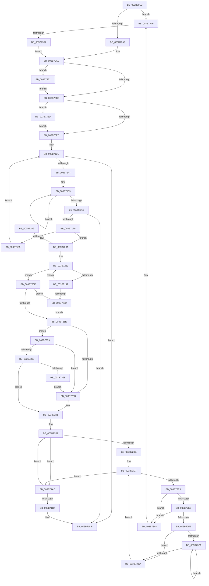

# MiAllocateFastLargePagesForMdl

- RVA: `0x003B701C`–`0x003B739D` (길이 `897` bytes)
- VA: `0x00000001403B701C`
- 실행 섹션: `.text`
- PDB 이름 있음: `예`; PDB Function 태그: `예`
- unwind 정보 RVA: `0x0008C7A4`
- 디코드: `219`개 명령, `897/897` bytes 표시
- 미해석 바이트: `0` (있으면 어셈블리에 `.byte`로 보존)

> 이 문서는 커널 이미지의 기계어와 PDB 기호를 분석해 생성했습니다. 4번과 5번은 함수 원형과 자료형을 바이너리 사용 방식에서 추정한 C 해석이며 원본 소스 복구 결과는 아닙니다.

## 1. Dependencies

- 직접 호출 지점: **8**; 고유 호출 대상: **7**
- 직접 호출자로 확인된 함수: **1**
- RIP 상대 이미지 참조: **4**

### Outgoing calls
- `0x003B7060` → [memset](../6C/memset_function_006C6C40.md) (function, `0x006C6C40`)
- `0x003B7072` → [memset](../6C/memset_function_006C6C40.md) (function, `0x006C6C40`)
- `0x003B716D` → [MiAllocateLargeZeroPages](MiAllocateLargeZeroPages_function_003B743C.md) (function, `0x003B743C`)
- `0x003B71A0` → [MiFreeLargeZeroPages](MiFreeLargeZeroPages_function_003B5F0C.md) (function, `0x003B5F0C`)
- `0x003B71CC` → [MiStartDpcGang](../2C/MiStartDpcGang_function_002C8C34.md) (function, `0x002C8C34`)
- `0x003B71E9` → [_security_check_cookie](../6A/_security_check_cookie_function_006AC640.md) (function, `0x006AC640`)
- `0x003B729A` → [MiInitializeDpcGang](../43/MiInitializeDpcGang_function_0043E9DC.md) (function, `0x0043E9DC`)
- `0x003B7341` → [MiInsertDpcGang](MiInsertDpcGang_function_003B73A4.md) (function, `0x003B73A4`)

### Direct callers
- [MiFindPagesForMdl](MiFindPagesForMdl_function_003B770C.md) at `0x003B7873`

### Static image references
- `0x003B703B` → RVA `0x00E0A740` (`.data`; read)
- `0x003B712C` → RVA `0x00E2ECF0` (`.data`; read)
- `0x003B7211` → RVA `0x00E2DBF8` (`.data`; read)
- `0x003B72BD` → RVA `0x00011C60` (`.rdata`; read)

## 2. Other-region calls and transfers

- 다른 실행 섹션으로 향하는 call: **0**
- call이 아닌 외부 분기/꼬리 이동: **1**
  - `0x003B7351` → [sub_006E75A8](../6E/Unknown_function_006E75A8.md) (`tail-transfer`)

## 3. Assembly (complete function range)

```asm
003B701C  48 89 5C 24 18                  mov qword ptr [rsp + 0x18], rbx
003B7021  55                              push rbp
003B7022  56                              push rsi
003B7023  57                              push rdi
003B7024  41 54                           push r12
003B7026  41 55                           push r13
003B7028  41 56                           push r14
003B702A  41 57                           push r15
003B702C  48 8D AC 24 A0 FE FF FF         lea rbp, [rsp - 0x160]
003B7034  48 81 EC 60 02 00 00            sub rsp, 0x260
003B703B  48 8B 05 FE 36 A5 00            mov rax, qword ptr [rip + 0xa536fe]
003B7042  48 33 C4                        xor rax, rsp
003B7045  48 89 85 50 01 00 00            mov qword ptr [rbp + 0x150], rax
003B704C  45 8B F0                        mov r14d, r8d
003B704F  8B DA                           mov ebx, edx
003B7051  48 8B F9                        mov rdi, rcx
003B7054  33 D2                           xor edx, edx
003B7056  41 B8 68 01 00 00               mov r8d, 0x168
003B705C  48 8D 4D 80                     lea rcx, [rbp - 0x80]
003B7060  E8 DB FB 30 00                  call 0x1406c6c40
003B7065  33 D2                           xor edx, edx
003B7067  48 8D 8D F0 00 00 00            lea rcx, [rbp + 0xf0]
003B706E  44 8D 42 60                     lea r8d, [rdx + 0x60]
003B7072  E8 C9 FB 30 00                  call 0x1406c6c40
003B7077  48 8B 77 40                     mov rsi, qword ptr [rdi + 0x40]
003B707B  33 C0                           xor eax, eax
003B707D  B9 02 00 00 00                  mov ecx, 2
003B7082  48 89 44 24 20                  mov qword ptr [rsp + 0x20], rax
003B7087  48 89 44 24 68                  mov qword ptr [rsp + 0x68], rax
003B708C  45 33 E4                        xor r12d, r12d
003B708F  8B 87 90 00 00 00               mov eax, dword ptr [rdi + 0x90]
003B7095  0F 57 C0                        xorps xmm0, xmm0
003B7098  0F 29 44 24 50                  movaps xmmword ptr [rsp + 0x50], xmm0
003B709D  44 8D 49 0A                     lea r9d, [rcx + 0xa]
003B70A1  85 C0                           test eax, eax
003B70A3  0F 85 A6 02 00 00               jne 0x1403b734f
003B70A9  41 8B D1                        mov edx, r9d
003B70AC  4C 8B 6F 30                     mov r13, qword ptr [rdi + 0x30]
003B70B0  B9 08 00 00 00                  mov ecx, 8
003B70B5  44 8B 7E 28                     mov r15d, dword ptr [rsi + 0x28]
003B70B9  4D 8B C5                        mov r8, r13
003B70BC  49 C1 EF 0C                     shr r15, 0xc
003B70C0  4D 0F AF C7                     imul r8, r15
003B70C4  41 F6 C6 01                     test r14b, 1
003B70C8  41 0F 45 C9                     cmovne ecx, r9d
003B70CC  48 81 7F 08 00 00 10 00         cmp qword ptr [rdi + 8], 0x100000
003B70D4  89 4C 24 20                     mov dword ptr [rsp + 0x20], ecx
003B70D8  0F 84 83 02 00 00               je 0x1403b7361
003B70DE  8B 87 94 00 00 00               mov eax, dword ptr [rdi + 0x94]
003B70E4  A8 04                           test al, 4
003B70E6  0F 85 81 02 00 00               jne 0x1403b736d
003B70EC  48 8B 07                        mov rax, qword ptr [rdi]
003B70EF  48 89 44 24 28                  mov qword ptr [rsp + 0x28], rax
003B70F4  48 8B 47 20                     mov rax, qword ptr [rdi + 0x20]
003B70F8  49 2B C0                        sub rax, r8
003B70FB  89 5C 24 40                     mov dword ptr [rsp + 0x40], ebx
003B70FF  48 83 4C 24 48 FF               or qword ptr [rsp + 0x48], 0xffffffffffffffff
003B7105  48 89 44 24 30                  mov qword ptr [rsp + 0x30], rax
003B710A  48 8B 47 18                     mov rax, qword ptr [rdi + 0x18]
003B710E  48 89 44 24 38                  mov qword ptr [rsp + 0x38], rax
003B7113  48 8D 47 50                     lea rax, [rdi + 0x50]
003B7117  48 89 44 24 60                  mov qword ptr [rsp + 0x60], rax
003B711C  48 8D 85 F0 00 00 00            lea rax, [rbp + 0xf0]
003B7123  48 89 44 24 70                  mov qword ptr [rsp + 0x70], rax
003B7128  89 54 24 44                     mov dword ptr [rsp + 0x44], edx
003B712C  4C 8B 35 BD 7B A7 00            mov r14, qword ptr [rip + 0xa77bbd]
003B7133  48 8B 07                        mov rax, qword ptr [rdi]
003B7136  48 8B 88 48 48 00 00            mov rcx, qword ptr [rax + 0x4848]
003B713D  48 39 4F 10                     cmp qword ptr [rdi + 0x10], rcx
003B7141  0F 82 98 00 00 00               jb 0x1403b71df
003B7147  48 8D 85 F0 00 00 00            lea rax, [rbp + 0xf0]
003B714E  B9 04 00 00 00                  mov ecx, 4
003B7153  4C 89 60 10                     mov qword ptr [rax + 0x10], r12
003B7157  48 89 40 08                     mov qword ptr [rax + 8], rax
003B715B  48 89 00                        mov qword ptr [rax], rax
003B715E  48 83 C0 18                     add rax, 0x18
003B7162  48 83 E9 01                     sub rcx, 1
003B7166  75 EB                           jne 0x1403b7153
003B7168  48 8D 4C 24 20                  lea rcx, [rsp + 0x20]
003B716D  E8 CA 02 00 00                  call 0x1403b743c
003B7172  4C 39 64 24 68                  cmp qword ptr [rsp + 0x68], r12
003B7177  74 66                           je 0x1403b71df
003B7179  48 8B 05 70 7B A7 00            mov rax, qword ptr [rip + 0xa77b70]
003B7180  4C 3B F0                        cmp r14, rax
003B7183  0F 84 81 00 00 00               je 0x1403b720a
003B7189  44 8B 44 24 20                  mov r8d, dword ptr [rsp + 0x20]
003B718E  48 8D 95 F0 00 00 00            lea rdx, [rbp + 0xf0]
003B7195  48 8B 0F                        mov rcx, qword ptr [rdi]
003B7198  41 C1 E8 02                     shr r8d, 2
003B719C  41 83 E0 01                     and r8d, 1
003B71A0  E8 67 ED FF FF                  call 0x1403b5f0c
003B71A5  4C 89 64 24 68                  mov qword ptr [rsp + 0x68], r12
003B71AA  EB 80                           jmp 0x1403b712c
003B71AC  FF C3                           inc ebx
003B71AE  83 FB 04                        cmp ebx, 4
003B71B1  0F 82 FB 00 00 00               jb 0x1403b72b2
003B71B7  48 8B 44 24 68                  mov rax, qword ptr [rsp + 0x68]
003B71BC  48 8D 4D 80                     lea rcx, [rbp - 0x80]
003B71C0  48 C1 E0 0C                     shl rax, 0xc
003B71C4  33 D2                           xor edx, edx
003B71C6  49 F7 F5                        div r13
003B71C9  01 46 28                        add dword ptr [rsi + 0x28], eax
003B71CC  E8 63 1A F1 FF                  call 0x1402c8c34
003B71D1  48 83 66 10 00                  and qword ptr [rsi + 0x10], 0
003B71D6  B8 02 00 00 00                  mov eax, 2
003B71DB  66 09 46 0A                     or word ptr [rsi + 0xa], ax
003B71DF  48 8B 8D 50 01 00 00            mov rcx, qword ptr [rbp + 0x150]
003B71E6  48 33 CC                        xor rcx, rsp
003B71E9  E8 52 54 2F 00                  call 0x1406ac640
003B71EE  48 8B 9C 24 B0 02 00 00         mov rbx, qword ptr [rsp + 0x2b0]
003B71F6  48 81 C4 60 02 00 00            add rsp, 0x260
003B71FD  41 5F                           pop r15
003B71FF  41 5E                           pop r14
003B7201  41 5D                           pop r13
003B7203  41 5C                           pop r12
003B7205  5F                              pop rdi
003B7206  5E                              pop rsi
003B7207  5D                              pop rbp
003B7208  C3                              ret
003B7209  CC                              int3
003B720A  48 8B 44 24 68                  mov rax, qword ptr [rsp + 0x68]
003B720F  33 D2                           xor edx, edx
003B7211  48 8B 0D E0 69 A7 00            mov rcx, qword ptr [rip + 0xa769e0]
003B7218  4D 8B CC                        mov r9, r12
003B721B  44 8D 5A 04                     lea r11d, [rdx + 4]
003B721F  49 F7 F5                        div r13
003B7222  48 8D 14 5B                     lea rdx, [rbx + rbx*2]
003B7226  48 C1 E2 07                     shl rdx, 7
003B722A  4C 8B D0                        mov r10, rax
003B722D  4C 8B 84 0A 78 01 00 00         mov r8, qword ptr [rdx + rcx + 0x178]
003B7235  49 83 E8 80                     sub r8, -0x80
003B7239  49 8B 48 30                     mov rcx, qword ptr [r8 + 0x30]
003B723D  48 85 C9                        test rcx, rcx
003B7240  75 1C                           jne 0x1403b725e
003B7242  49 FF C1                        inc r9
003B7245  49 81 C0 A8 00 00 00            add r8, 0xa8
003B724C  49 83 F9 03                     cmp r9, 3
003B7250  7C E7                           jl 0x1403b7239
003B7252  B8 C0 04 00 00                  mov eax, 0x4c0
003B7257  B9 00 00 20 00                  mov ecx, 0x200000
003B725C  EB 10                           jmp 0x1403b726e
003B725E  48 8B 01                        mov rax, qword ptr [rcx]
003B7261  41 8B 08                        mov ecx, dword ptr [r8]
003B7264  49 0F AF 48 08                  imul rcx, qword ptr [r8 + 8]
003B7269  48 85 C9                        test rcx, rcx
003B726C  74 E4                           je 0x1403b7252
003B726E  4C 0F AF D0                     imul r10, rax
003B7272  33 D2                           xor edx, edx
003B7274  4B 8D 04 52                     lea rax, [r10 + r10*2]
003B7278  48 C1 E0 04                     shl rax, 4
003B727C  48 F7 F1                        div rcx
003B727F  48 3D 88 13 00 00               cmp rax, 0x1388
003B7285  0F 83 EE 00 00 00               jae 0x1403b7379
003B728B  41 BB 06 00 00 00               mov r11d, 6
003B7291  45 8B C3                        mov r8d, r11d
003B7294  48 8D 4D 80                     lea rcx, [rbp - 0x80]
003B7298  8B D3                           mov edx, ebx
003B729A  E8 3D 77 08 00                  call 0x14043e9dc
003B729F  83 4D 38 40                     or dword ptr [rbp + 0x38], 0x40
003B72A3  4C 8D 76 30                     lea r14, [rsi + 0x30]
003B72A7  4F 8D 34 FE                     lea r14, [r14 + r15*8]
003B72AB  48 89 7D 80                     mov qword ptr [rbp - 0x80], rdi
003B72AF  41 8B DC                        mov ebx, r12d
003B72B2  83 FB 03                        cmp ebx, 3
003B72B5  0F 84 F1 FE FF FF               je 0x1403b71ac
003B72BB  8B C3                           mov eax, ebx
003B72BD  4C 8D 25 9C A9 C5 FF            lea r12, [rip - 0x3a5664]
003B72C4  48 8D BD F0 00 00 00            lea rdi, [rbp + 0xf0]
003B72CB  4D 8B 24 C4                     mov r12, qword ptr [r12 + rax*8]
003B72CF  4C 8D 3C 40                     lea r15, [rax + rax*2]
003B72D3  4A 8D 3C FF                     lea rdi, [rdi + r15*8]
003B72D7  48 8B 17                        mov rdx, qword ptr [rdi]
003B72DA  48 3B D7                        cmp rdx, rdi
003B72DD  0F 84 C9 FE FF FF               je 0x1403b71ac
003B72E3  48 39 7A 08                     cmp qword ptr [rdx + 8], rdi
003B72E7  75 5F                           jne 0x1403b7348
003B72E9  48 8B 02                        mov rax, qword ptr [rdx]
003B72EC  48 39 50 08                     cmp qword ptr [rax + 8], rdx
003B72F0  75 56                           jne 0x1403b7348
003B72F2  48 89 07                        mov qword ptr [rdi], rax
003B72F5  48 89 78 08                     mov qword ptr [rax + 8], rdi
003B72F9  4A FF 8C FD 00 01 00 00         dec qword ptr [rbp + r15*8 + 0x100]
003B7301  48 B8 00 00 00 00 00 DE FF FF   movabs rax, 0xffffde0000000000
003B730B  4C 8B C2                        mov r8, rdx
003B730E  33 C9                           xor ecx, ecx
003B7310  4C 2B C0                        sub r8, rax
003B7313  48 B8 AB AA AA AA AA AA AA AA   movabs rax, 0xaaaaaaaaaaaaaaab
003B731D  49 C1 F8 04                     sar r8, 4
003B7321  4C 0F AF C0                     imul r8, rax
003B7325  4D 85 E4                        test r12, r12
003B7328  74 13                           je 0x1403b733d
003B732A  49 8D 04 08                     lea rax, [r8 + rcx]
003B732E  49 03 CD                        add rcx, r13
003B7331  49 89 06                        mov qword ptr [r14], rax
003B7334  49 83 C6 08                     add r14, 8
003B7338  49 3B CC                        cmp rcx, r12
003B733B  72 ED                           jb 0x1403b732a
003B733D  48 8D 4D 80                     lea rcx, [rbp - 0x80]
003B7341  E8 5E 00 00 00                  call 0x1403b73a4
003B7346  EB 8F                           jmp 0x1403b72d7
003B7348  B9 03 00 00 00                  mov ecx, 3
003B734D  CD 29                           int 0x29
003B734F  3B C1                           cmp eax, ecx
003B7351  0F 85 51 02 33 00               jne 0x1406e75a8
003B7357  BA 1C 00 00 00                  mov edx, 0x1c
003B735C  E9 4B FD FF FF                  jmp 0x1403b70ac
003B7361  83 C9 01                        or ecx, 1
003B7364  89 4C 24 20                     mov dword ptr [rsp + 0x20], ecx
003B7368  E9 71 FD FF FF                  jmp 0x1403b70de
003B736D  83 C9 10                        or ecx, 0x10
003B7370  89 4C 24 20                     mov dword ptr [rsp + 0x20], ecx
003B7374  E9 73 FD FF FF                  jmp 0x1403b70ec
003B7379  44 0F 20 C0                     mov rax, cr8
003B737D  3C 02                           cmp al, 2
003B737F  0F 83 06 FF FF FF               jae 0x1403b728b
003B7385  65 8B 04 25 3C 3A 00 00         mov eax, dword ptr gs:[0x3a3c]
003B738D  A9 01 00 01 00                  test eax, 0x10001
003B7392  0F 84 F9 FE FF FF               je 0x1403b7291
003B7398  E9 EE FE FF FF                  jmp 0x1403b728b
```

## 4. C-style interpretation (structured pseudocode)

```c
__int64 __fastcall MiAllocateFastLargePagesForMdl(__int64 a1, int a2, int a3)
{
    __int64 result;
    __int64 v_r10;
    __int64 v_r12;
    __int64 v_r14;
    __int64 v_r15;
    __int64 v_rbx;
    __int64 v_rsp;
    unsigned int v_stack_m160;
    unsigned __int64 v_stack_m198;
    unsigned __int64 v_stack_m218;
    unsigned __int64 v_stack_m228;
    unsigned __int64 v_stack_m230;
    unsigned __int64 v_stack_m238;
    unsigned __int64 v_stack_m248;
    unsigned __int64 v_stack_m250;
    unsigned int v_stack_m254;
    unsigned int v_stack_m258;
    unsigned __int64 v_stack_m260;
    unsigned __int64 v_stack_m268;
    unsigned __int64 v_stack_m270;
    unsigned __int64 v_stack_m278;
    unsigned __int64 v_stack_m48;
    unsigned __int64 v_stack_mA8;
    unsigned __int64 v_stack_p18;
    unsigned int v_stack_p20;
    unsigned __int64 v_stack_p68;

    v_stack_p18 = v_rbx;
    v_rsp = (v_rsp) - (608);
    result = (*(unsigned __int64 *)(v_rip + 10827518)) ^ (v_rsp);
    v_stack_m48 = result;
    a2 = 0;
    result = memset(v_stack_m218, a2, 360, a4);
    a2 = 0;
    result = memset(v_stack_mA8, a2, a2 + 96, a4);
    result = 0;
    v_stack_m278 = 0;
    v_stack_m230 = 0;
    v_r12 = 0;
    v_stack_m248 = v_xmm0;
    if ((unsigned int)((unsigned int)(*(unsigned int *)(a1 + 144))) != 0) goto loc_003B734F;
loc_003B70AC:
    v_r15 = ((unsigned int)(*(unsigned int *)(*(unsigned __int64 *)(a1 + 64) + 40))) >> (12);
    a3 = (*(unsigned __int64 *)(a1 + 48)) * (v_r15);
    a1 = 8;
    if ((((unsigned __int8)((unsigned int)(a3))) & (1)) != 0) { a1 = (unsigned int)(2 + 10); }
    v_stack_m278 = (unsigned int)(a1);
    if ((*(unsigned __int64 *)(a1 + 8)) == 0x100000ULL) goto loc_003B7361;
loc_003B70DE:
    if ((((unsigned __int8)((unsigned int)(*(unsigned int *)(a1 + 148)))) & (4)) != 0) goto loc_003B736D;
loc_003B70EC:
    v_stack_m270 = *(unsigned __int64 *)(a1);
    result = (*(unsigned __int64 *)(a1 + 32)) - (a3);
    v_stack_m258 = (unsigned int)((unsigned int)(a2));
    v_stack_m268 = result;
    v_stack_m260 = *(unsigned __int64 *)(a1 + 24);
    v_stack_m238 = a1 + 80;
    v_stack_m228 = v_stack_mA8;
    v_stack_m254 = (unsigned int)((unsigned int)((unsigned int)(2 + 10)));
loc_003B712C:
    if ((*(unsigned __int64 *)(a1 + 16)) < (*(unsigned __int64 *)(*(unsigned __int64 *)(a1) + 18504))) goto loc_003B71DF;
loc_003B7153:
    *(unsigned __int64 *)(v_stack_mA8 + 16) = 0;
    *(unsigned __int64 *)(v_stack_mA8 + 8) = v_stack_mA8;
    *(unsigned __int64 *)(v_stack_mA8) = v_stack_mA8;
    result = (v_stack_mA8) + (24);
    a1 = (4) - (1);
    if (condition_is_not_equal) goto loc_003B7153;
    result = MiAllocateLargeZeroPages(v_stack_m278, (unsigned int)((unsigned int)(2 + 10)), a3, 2 + 10);
    if (v_stack_m230 == 0) goto loc_003B71DF;
    if ((*(unsigned __int64 *)(v_rip + 10976189)) == (*(unsigned __int64 *)(v_rip + 10976112))) goto loc_003B720A;
    a3 = (unsigned int)(((unsigned int)(v_stack_m278)) >> (2));
    a3 = (unsigned int)((a3) & (1));
    result = MiFreeLargeZeroPages(*(unsigned __int64 *)(a1), v_stack_mA8, a3, 2 + 10);
    v_stack_m230 = 0;
    goto loc_003B712C;
loc_003B71AC:
    v_rbx = (unsigned int)(((unsigned int)(a2)) + 1);
    if (((unsigned int)(v_rbx)) < 4) goto loc_003B72B2;
    result = (v_stack_m230) << (12);
    a2 = 0;
    result = MiStartDpcGang(v_stack_m218, a2, a3, 2 + 10);
loc_003B71DF:
    a1 = (v_stack_m48) ^ (v_rsp);
    result = _security_check_cookie(a1, a2, a3, 2 + 10);
    v_rsp = (v_rsp) + (608);
    return result;
loc_003B720A:
    a2 = 0;
    a2 = (v_stack_p18 + v_stack_p18 * 2) << (7);
    a3 = (*(unsigned __int64 *)(a2 + *(unsigned __int64 *)(v_rip + 10971616) * 1 + 376)) - (-128);
loc_003B7239:
    if (*(unsigned __int64 *)(a3 + 48) != 0) goto loc_003B725E;
    a4 = (0) + 1;
    a3 = (a3) + (168);
    if (a4 < 3) goto loc_003B7239;
loc_003B7252:
    goto loc_003B726E;
loc_003B725E:
    a1 = ((unsigned int)(*(unsigned int *)(a3))) * (*(unsigned __int64 *)(a3 + 8));
    if (a1 == 0) goto loc_003B7252;
loc_003B726E:
    v_r10 = (v_stack_p68) * (*(unsigned __int64 *)((unsigned int)(0x200000ULL)));
    a2 = 0;
    result = (v_r10 + v_r10 * 2) << (4);
    if (result >= 0x1388ULL) goto loc_003B7379;
loc_003B728B:
loc_003B7291:
    result = MiInitializeDpcGang(v_stack_m218, (unsigned int)((unsigned int)(v_stack_p18)), 6, a4);
    v_stack_m218 = a1;
loc_003B72B2:
    if (0 == 3) goto loc_003B71AC;
loc_003B72D7:
    if ((*(unsigned __int64 *)(v_stack_mA8 + 0 + 0 * 2 * 8)) == (v_stack_mA8 + 0 + 0 * 2 * 8)) goto loc_003B71AC;
    if ((*(unsigned __int64 *)(*(unsigned __int64 *)(v_stack_mA8 + 0 + 0 * 2 * 8) + 8)) != (v_stack_mA8 + 0 + 0 * 2 * 8)) goto loc_003B7348;
    if ((*(unsigned __int64 *)(*(unsigned __int64 *)(*(unsigned __int64 *)(v_stack_mA8 + 0 + 0 * 2 * 8)) + 8)) != (*(unsigned __int64 *)(v_stack_mA8 + 0 + 0 * 2 * 8))) goto loc_003B7348;
    *(unsigned __int64 *)(v_stack_mA8 + 0 + 0 * 2 * 8) = *(unsigned __int64 *)(*(unsigned __int64 *)(v_stack_mA8 + 0 + 0 * 2 * 8));
    *(unsigned __int64 *)(*(unsigned __int64 *)(*(unsigned __int64 *)(v_stack_mA8 + 0 + 0 * 2 * 8)) + 8) = v_stack_mA8 + 0 + 0 * 2 * 8;
    a1 = 0;
    a3 = (*(unsigned __int64 *)(v_stack_mA8 + 0 + 0 * 2 * 8)) - (*(unsigned __int64 *)(*(unsigned __int64 *)(v_stack_mA8 + 0 + 0 * 2 * 8)));
    a3 = (a3) >> (4);
    a3 = (a3) * (*(unsigned __int64 *)(*(unsigned __int64 *)(v_stack_mA8 + 0 + 0 * 2 * 8)));
    if (*(unsigned __int64 *)(v_rip - 3823204 + 0 * 8) == 0) goto loc_003B733D;
loc_003B732A:
    a1 = (a1) + (*(unsigned __int64 *)(a1 + 48));
    *(unsigned __int64 *)(*(unsigned __int64 *)(a1 + 64) + 48 + v_r15 * 8) = a3 + a1 * 1;
    v_r14 = (*(unsigned __int64 *)(a1 + 64) + 48 + v_r15 * 8) + (8);
    if (a1 < (*(unsigned __int64 *)(v_rip - 3823204 + 0 * 8))) goto loc_003B732A;
loc_003B733D:
    result = MiInsertDpcGang(v_stack_m218, *(unsigned __int64 *)(v_stack_mA8 + 0 + 0 * 2 * 8), a3, a4);
    goto loc_003B72D7;
loc_003B7348:
loc_003B734F:
    goto loc_003B70AC;
loc_003B7361:
    a1 = (unsigned int)((3) | (1));
    v_stack_p20 = (unsigned int)(a1);
    goto loc_003B70DE;
loc_003B736D:
    a1 = (unsigned int)((a1) | (16));
    v_stack_p20 = (unsigned int)(a1);
    goto loc_003B70EC;
loc_003B7379:
    if (((unsigned __int8)(v_cr8)) >= 2) goto loc_003B728B;
    if ((((unsigned int)((unsigned int)(*(unsigned int *)(gs_base + (0 + 14908))))) & (0x10001ULL)) == 0) goto loc_003B7291;
    goto loc_003B728B;
}
```

## 5. (Beta) C Style

```c
int64_t MiAllocateFastLargePagesForMdl(void *Arg1, int32_t Arg2, int32_t Arg3)
{
    uint8_t *arg1 = (uint8_t *)Arg1;

    int64_t result;
    int64_t local_r10;
    int64_t local_r12;
    int64_t local_r14;
    int64_t local_r15;
    int64_t local_rbx;
    int64_t local_rsp;
    uint32_t v_stack_m160;
    uint64_t v_stack_m198;
    uint64_t v_stack_m218;
    uint64_t v_stack_m228;
    uint64_t v_stack_m230;
    uint64_t v_stack_m238;
    uint64_t v_stack_m248;
    uint64_t v_stack_m250;
    uint32_t v_stack_m254;
    uint32_t v_stack_m258;
    uint64_t v_stack_m260;
    uint64_t v_stack_m268;
    uint64_t v_stack_m270;
    uint64_t v_stack_m278;
    uint64_t v_stack_m48;
    uint64_t v_stack_mA8;
    uint64_t v_stack_p18;
    uint32_t v_stack_p20;
    uint64_t v_stack_p68;

    v_stack_p18 = local_rbx;
    local_rsp = (local_rsp) - (608);
    result = (*(uint64_t *)(v_rip + 0xA536FE)) ^ (local_rsp);
    v_stack_m48 = result;
    Arg2 = 0;
    result = memset(v_stack_m218, Arg2, 360, a4);
    Arg2 = 0;
    result = memset(v_stack_mA8, Arg2, Arg2 + 96, a4);
    result = 0;
    v_stack_m278 = 0;
    v_stack_m230 = 0;
    local_r12 = 0;
    v_stack_m248 = v_xmm0;
    if ((uint32_t)((uint32_t)(*(uint32_t *)(arg1 + 0x90))) != 0) goto loc_003B734F;
loc_003B70AC:
    local_r15 = ((uint32_t)(*(uint32_t *)(*(uint64_t *)(arg1 + 0x40) + 0x28))) >> (12);
    Arg3 = (*(uint64_t *)(arg1 + 0x30)) * (local_r15);
    Arg1 = 8;
    if ((((uint8_t)((uint32_t)(Arg3))) & (1)) != 0) { Arg1 = (uint32_t)(2 + 10); }
    v_stack_m278 = (uint32_t)(Arg1);
    if ((*(uint64_t *)(arg1 + 0x8)) == 0x100000ULL) goto loc_003B7361;
loc_003B70DE:
    if ((((uint8_t)((uint32_t)(*(uint32_t *)(arg1 + 0x94)))) & (4)) != 0) goto loc_003B736D;
loc_003B70EC:
    v_stack_m270 = *(uint64_t *)(arg1);
    result = (*(uint64_t *)(arg1 + 0x20)) - (Arg3);
    v_stack_m258 = (uint32_t)((uint32_t)(Arg2));
    v_stack_m268 = result;
    v_stack_m260 = *(uint64_t *)(arg1 + 0x18);
    v_stack_m238 = Arg1 + 80;
    v_stack_m228 = v_stack_mA8;
    v_stack_m254 = (uint32_t)((uint32_t)((uint32_t)(2 + 10)));
loc_003B712C:
    if ((*(uint64_t *)(arg1 + 0x10)) < (*(uint64_t *)(*(uint64_t *)(arg1) + 0x4848))) goto loc_003B71DF;
loc_003B7153:
    *(uint64_t *)(v_stack_mA8 + 0x10) = 0;
    *(uint64_t *)(v_stack_mA8 + 0x8) = v_stack_mA8;
    *(uint64_t *)(v_stack_mA8) = v_stack_mA8;
    result = (v_stack_mA8) + (24);
    Arg1 = (4) - (1);
    if (condition_is_not_equal) goto loc_003B7153;
    result = MiAllocateLargeZeroPages(v_stack_m278, (uint32_t)((uint32_t)(2 + 10)), Arg3, 2 + 10);
    if (v_stack_m230 == 0) goto loc_003B71DF;
    if ((*(uint64_t *)(v_rip + 0xA77BBD)) == (*(uint64_t *)(v_rip + 0xA77B70))) goto loc_003B720A;
    Arg3 = (uint32_t)(((uint32_t)(v_stack_m278)) >> (2));
    Arg3 = (uint32_t)((Arg3) & (1));
    result = MiFreeLargeZeroPages(*(uint64_t *)(arg1), v_stack_mA8, Arg3, 2 + 10);
    v_stack_m230 = 0;
    goto loc_003B712C;
loc_003B71AC:
    local_rbx = (uint32_t)(((uint32_t)(Arg2)) + 1);
    if (((uint32_t)(local_rbx)) < 4) goto loc_003B72B2;
    result = (v_stack_m230) << (12);
    Arg2 = 0;
    result = MiStartDpcGang(v_stack_m218, Arg2, Arg3, 2 + 10);
loc_003B71DF:
    Arg1 = (v_stack_m48) ^ (local_rsp);
    result = _security_check_cookie(Arg1, Arg2, Arg3, 2 + 10);
    local_rsp = (local_rsp) + (608);
    return result;
loc_003B720A:
    Arg2 = 0;
    Arg2 = (v_stack_p18 + v_stack_p18 * 2) << (7);
    Arg3 = (*(uint64_t *)(Arg2 + *(uint64_t *)(v_rip + 0xA769E0) * 1 + 0x178)) - (-128);
loc_003B7239:
    if (*(uint64_t *)(Arg3 + 0x30) != 0) goto loc_003B725E;
    a4 = (0) + 1;
    Arg3 = (Arg3) + (168);
    if (a4 < 3) goto loc_003B7239;
loc_003B7252:
    goto loc_003B726E;
loc_003B725E:
    Arg1 = ((uint32_t)(*(uint32_t *)(Arg3))) * (*(uint64_t *)(Arg3 + 0x8));
    if (Arg1 == NULL) goto loc_003B7252;
loc_003B726E:
    local_r10 = (v_stack_p68) * (*(uint64_t *)((uint32_t)(0x200000ULL)));
    Arg2 = 0;
    result = (local_r10 + local_r10 * 2) << (4);
    if (result >= 0x1388ULL) goto loc_003B7379;
loc_003B728B:
loc_003B7291:
    result = MiInitializeDpcGang(v_stack_m218, (uint32_t)((uint32_t)(v_stack_p18)), 6, a4);
    v_stack_m218 = Arg1;
loc_003B72B2:
    if (0 == 3) goto loc_003B71AC;
loc_003B72D7:
    if ((*(uint64_t *)(v_stack_mA8 + 0x0 + 0x0 * 2 * 8)) == (v_stack_mA8 + 0 + 0 * 2 * 8)) goto loc_003B71AC;
    if ((*(uint64_t *)(*(uint64_t *)(v_stack_mA8 + 0x0 + 0x0 * 2 * 8) + 0x8)) != (v_stack_mA8 + 0 + 0 * 2 * 8)) goto loc_003B7348;
    if ((*(uint64_t *)(*(uint64_t *)(*(uint64_t *)(v_stack_mA8 + 0x0 + 0x0 * 2 * 8)) + 0x8)) != (*(uint64_t *)(v_stack_mA8 + 0x0 + 0x0 * 2 * 8))) goto loc_003B7348;
    *(uint64_t *)(v_stack_mA8 + 0x0 + 0x0 * 2 * 8) = *(uint64_t *)(*(uint64_t *)(v_stack_mA8 + 0x0 + 0x0 * 2 * 8));
    *(uint64_t *)(*(uint64_t *)(*(uint64_t *)(v_stack_mA8 + 0x0 + 0x0 * 2 * 8)) + 0x8) = v_stack_mA8 + 0 + 0 * 2 * 8;
    Arg1 = 0;
    Arg3 = (*(uint64_t *)(v_stack_mA8 + 0x0 + 0x0 * 2 * 8)) - (*(uint64_t *)(*(uint64_t *)(v_stack_mA8 + 0x0 + 0x0 * 2 * 8)));
    Arg3 = (Arg3) >> (4);
    Arg3 = (Arg3) * (*(uint64_t *)(*(uint64_t *)(v_stack_mA8 + 0x0 + 0x0 * 2 * 8)));
    if (*(uint64_t *)(v_rip - 0x3A5664 + 0x0 * 8) == 0) goto loc_003B733D;
loc_003B732A:
    Arg1 = (Arg1) + (*(uint64_t *)(arg1 + 0x30));
    *(uint64_t *)(*(uint64_t *)(arg1 + 0x40) + 0x30 + local_r15 * 8) = Arg3 + Arg1 * 1;
    local_r14 = (*(uint64_t *)(arg1 + 0x40) + 48 + local_r15 * 8) + (8);
    if (Arg1 < (*(uint64_t *)(v_rip - 0x3A5664 + 0x0 * 8))) goto loc_003B732A;
loc_003B733D:
    result = MiInsertDpcGang(v_stack_m218, *(uint64_t *)(v_stack_mA8 + 0x0 + 0x0 * 2 * 8), Arg3, a4);
    goto loc_003B72D7;
loc_003B7348:
loc_003B734F:
    goto loc_003B70AC;
loc_003B7361:
    Arg1 = (uint32_t)((3) | (1));
    v_stack_p20 = (uint32_t)(Arg1);
    goto loc_003B70DE;
loc_003B736D:
    Arg1 = (uint32_t)((Arg1) | (16));
    v_stack_p20 = (uint32_t)(Arg1);
    goto loc_003B70EC;
loc_003B7379:
    if (((uint8_t)(v_cr8)) >= 2) goto loc_003B728B;
    if ((((uint32_t)((uint32_t)(*(uint32_t *)(gs_base + (0 + 0x3A3C))))) & (0x10001ULL)) == 0) goto loc_003B7291;
    goto loc_003B728B;
}
```

### 관측된 메모리 오프셋

구조체 형식이 확인되지 않은 접근은 인자 기준의 오프셋으로만 기록했습니다.

| 기준 인자 | 오프셋 표현 | 폭 (bit) | 접근 |
|---|---:|---:|---|
| `Arg1` | `+ 0x40` | `64` | `R` |
| `Arg1` | `+ 0x90` | `32` | `R` |

## 6. Execution-region graph

[열기: 2D/3D 그래프와 함수 탐색 컨트롤 패널](../../../control-panel.html?section=text&rva=0x003B701C&view=graph)

- 2D 그래프는 위에서 아래로 흐르고, 3D 그래프는 빈 공간을 드래그해 회전합니다. Shift+드래그는 이동, 휠은 확대·축소, 함수 노드 선택은 대상 보고서 이동입니다.

### Static fallback


