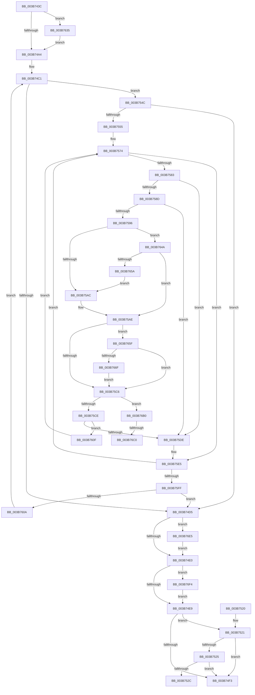

# MiAllocateLargeZeroPages

- RVA: `0x003B743C`–`0x003B7705` (길이 `713` bytes)
- VA: `0x00000001403B743C`
- 실행 섹션: `.text`
- PDB 이름 있음: `예`; PDB Function 태그: `예`
- unwind 정보 RVA: `0x0008C7DC`
- 디코드: `183`개 명령, `713/713` bytes 표시
- 미해석 바이트: `0` (있으면 어셈블리에 `.byte`로 보존)

> 이 문서는 커널 이미지의 기계어와 PDB 기호를 분석해 생성했습니다. 4번과 5번은 함수 원형과 자료형을 바이너리 사용 방식에서 추정한 C 해석이며 원본 소스 복구 결과는 아닙니다.

## 1. Dependencies

- 직접 호출 지점: **13**; 고유 호출 대상: **12**
- 직접 호출자로 확인된 함수: **5**
- RIP 상대 이미지 참조: **3**

### Outgoing calls
- `0x003B747D` → [memset](../6C/memset_function_006C6C40.md) (function, `0x006C6C40`)
- `0x003B748C` → [memset](../6C/memset_function_006C6C40.md) (function, `0x006C6C40`)
- `0x003B74B8` → [MiProtectionToCacheAttribute](../2B/MiProtectionToCacheAttribute_function_002B8530.md) (function, `0x002B8530`)
- `0x003B74FA` → [_security_check_cookie](../6A/_security_check_cookie_function_006AC640.md) (function, `0x006AC640`)
- `0x003B753A` → [MiFindLargePageMemory](../../page/AA/MiFindLargePageMemory_function_00AA8334.md) (function, `0x00AA8334`)
- `0x003B755C` → [MiGetFastLargePages](MiGetFastLargePages_function_003B7EE0.md) (function, `0x003B7EE0`)
- `0x003B75B9` → [MiIsFreeZeroPfnCold](../31/MiIsFreeZeroPfnCold_function_0031E5E4.md) (function, `0x0031E5E4`)
- `0x003B769C` → [MiAddPageToHeatList](../44/MiAddPageToHeatList_function_0044603C.md) (function, `0x0044603C`)
- `0x003B76A6` → [MiSetFreeZeroPfnCold](../37/MiSetFreeZeroPfnCold_function_00379428.md) (function, `0x00379428`)
- `0x003B76CD` → [MiPfnBestZeroAttribute](../2C/MiPfnBestZeroAttribute_function_002C8600.md) (function, `0x002C8600`)
- `0x003B76DA` → [MiChangePageAttribute](../33/MiChangePageAttribute_function_00332ECC.md) (function, `0x00332ECC`)
- `0x003B76EA` → [MiIssuePageHeatList](../44/MiIssuePageHeatList_function_0044615C.md) (function, `0x0044615C`)
- `0x003B76FB` → [MiProcessPageGroupInfo](../37/MiProcessPageGroupInfo_function_00376910.md) (function, `0x00376910`)

### Direct callers
- [MiCreateSlabEntry](../37/MiCreateSlabEntry_function_00374DEC.md) at `0x00374FBC`
- [MiAllocateFastLargePagesForMdl](MiAllocateFastLargePagesForMdl_function_003B701C.md) at `0x003B716D`
- [MiCreateLargePfnList](../3D/MiCreateLargePfnList_function_003D2DA8.md) at `0x003D2F70`
- [MiCreateLargePfnList](../3D/MiCreateLargePfnList_function_003D2DA8.md) at `0x003D3040`
- [MiGetLargePagesForSystemMapping](../../page/AC/MiGetLargePagesForSystemMapping_function_00AC5094.md) at `0x00AC51FF`
- [sub_00B2AD32](../../page/B2/Unknown_function_00B2AD32.md) at `0x00B2ADD2`
- [sub_00B2AD32](../../page/B2/Unknown_function_00B2AD32.md) at `0x00B2ADF6`

### Static image references
- `0x003B745F` → RVA `0x00E0A740` (`.data`; read)
- `0x003B74C5` → RVA `0x00011C60` (`.rdata`; read)
- `0x003B765F` → RVA `0x00FC6AB8` (`ALMOSTRO`; read)

## 2. Other-region calls and transfers

- 다른 실행 섹션으로 향하는 call: **1**
  - `0x003B753A` → [MiFindLargePageMemory](../../page/AA/MiFindLargePageMemory_function_00AA8334.md) (`.text` → `PAGE`)
- call이 아닌 외부 분기/꼬리 이동: **3**
  - `0x003B7547` → [sub_006E75BA + 0x75](../6E/Unknown_function_006E75BA.md) (`tail-transfer`)
  - `0x003B76BA` → [sub_006E75BA](../6E/Unknown_function_006E75BA.md) (`tail-transfer`)
  - `0x003B76E0` → [sub_006E75BA](../6E/Unknown_function_006E75BA.md) (`tail-transfer`)

## 3. Assembly (complete function range)

```asm
003B743C  48 8B C4                        mov rax, rsp
003B743F  48 89 58 10                     mov qword ptr [rax + 0x10], rbx
003B7443  48 89 70 18                     mov qword ptr [rax + 0x18], rsi
003B7447  48 89 78 20                     mov qword ptr [rax + 0x20], rdi
003B744B  55                              push rbp
003B744C  41 54                           push r12
003B744E  41 55                           push r13
003B7450  41 56                           push r14
003B7452  41 57                           push r15
003B7454  48 8D 68 88                     lea rbp, [rax - 0x78]
003B7458  48 81 EC 50 01 00 00            sub rsp, 0x150
003B745F  48 8B 05 DA 32 A5 00            mov rax, qword ptr [rip + 0xa532da]
003B7466  48 33 C4                        xor rax, rsp
003B7469  48 89 45 40                     mov qword ptr [rbp + 0x40], rax
003B746D  4C 8B F9                        mov r15, rcx
003B7470  33 D2                           xor edx, edx
003B7472  48 8D 4C 24 60                  lea rcx, [rsp + 0x60]
003B7477  41 B8 80 00 00 00               mov r8d, 0x80
003B747D  E8 BE F7 30 00                  call 0x1406c6c40
003B7482  33 D2                           xor edx, edx
003B7484  48 8D 4D E0                     lea rcx, [rbp - 0x20]
003B7488  44 8D 42 60                     lea r8d, [rdx + 0x60]
003B748C  E8 AF F7 30 00                  call 0x1406c6c40
003B7491  41 8B 07                        mov eax, dword ptr [r15]
003B7494  33 F6                           xor esi, esi
003B7496  45 33 F6                        xor r14d, r14d
003B7499  8D 5E 01                        lea ebx, [rsi + 1]
003B749C  A8 10                           test al, 0x10
003B749E  0F 84 91 01 00 00               je 0x1403b7635
003B74A4  41 8B 4F 24                     mov ecx, dword ptr [r15 + 0x24]
003B74A8  0F 57 C0                        xorps xmm0, xmm0
003B74AB  0F 11 44 24 50                  movups xmmword ptr [rsp + 0x50], xmm0
003B74B0  C7 44 24 50 81 00 00 00         mov dword ptr [rsp + 0x50], 0x81
003B74B8  E8 73 10 F0 FF                  call 0x1402b8530
003B74BD  89 44 24 30                     mov dword ptr [rsp + 0x30], eax
003B74C1  49 8B 4F 48                     mov rcx, qword ptr [r15 + 0x48]
003B74C5  48 8D 3D 94 A7 C5 FF            lea rdi, [rip - 0x3a586c]
003B74CC  49 8B 47 10                     mov rax, qword ptr [r15 + 0x10]
003B74D0  48 3B C8                        cmp rcx, rax
003B74D3  72 77                           jb 0x1403b754c
003B74D5  83 7C 24 54 00                  cmp dword ptr [rsp + 0x54], 0
003B74DA  0F 85 05 02 00 00               jne 0x1403b76e5
003B74E0  4D 85 F6                        test r14, r14
003B74E3  0F 85 0B 02 00 00               jne 0x1403b76f4
003B74E9  49 8B 47 10                     mov rax, qword ptr [r15 + 0x10]
003B74ED  49 39 47 48                     cmp qword ptr [r15 + 0x48], rax
003B74F1  75 2E                           jne 0x1403b7521
003B74F3  48 8B 4D 40                     mov rcx, qword ptr [rbp + 0x40]
003B74F7  48 33 CC                        xor rcx, rsp
003B74FA  E8 41 51 2F 00                  call 0x1406ac640
003B74FF  4C 8D 9C 24 50 01 00 00         lea r11, [rsp + 0x150]
003B7507  49 8B 5B 38                     mov rbx, qword ptr [r11 + 0x38]
003B750B  49 8B 73 40                     mov rsi, qword ptr [r11 + 0x40]
003B750F  49 8B 7B 48                     mov rdi, qword ptr [r11 + 0x48]
003B7513  49 8B E3                        mov rsp, r11
003B7516  41 5F                           pop r15
003B7518  41 5E                           pop r14
003B751A  41 5D                           pop r13
003B751C  41 5C                           pop r12
003B751E  5D                              pop rbp
003B751F  C3                              ret
003B7520  CC                              int3
003B7521  85 F6                           test esi, esi
003B7523  74 CE                           je 0x1403b74f3
003B7525  41 8B 07                        mov eax, dword ptr [r15]
003B7528  A8 08                           test al, 8
003B752A  75 C7                           jne 0x1403b74f3
003B752C  48 83 64 24 38 00               and qword ptr [rsp + 0x38], 0
003B7532  48 8D 54 24 38                  lea rdx, [rsp + 0x38]
003B7537  49 8B CF                        mov rcx, r15
003B753A  E8 F5 0D 6F 00                  call 0x140aa8334
003B753F  48 8B 44 24 38                  mov rax, qword ptr [rsp + 0x38]
003B7544  45 33 F6                        xor r14d, r14d
003B7547  E9 E3 00 33 00                  jmp 0x1406e762f
003B754C  48 2B C1                        sub rax, rcx
003B754F  49 3B 47 18                     cmp rax, qword ptr [r15 + 0x18]
003B7553  72 80                           jb 0x1403b74d5
003B7555  48 8D 55 E0                     lea rdx, [rbp - 0x20]
003B7559  49 8B CF                        mov rcx, r15
003B755C  E8 7F 09 00 00                  call 0x1403b7ee0
003B7561  83 64 24 40 00                  and dword ptr [rsp + 0x40], 0
003B7566  48 8B D7                        mov rdx, rdi
003B7569  45 33 ED                        xor r13d, r13d
003B756C  48 89 54 24 38                  mov qword ptr [rsp + 0x38], rdx
003B7571  45 33 E4                        xor r12d, r12d
003B7574  48 8D 45 E0                     lea rax, [rbp - 0x20]
003B7578  49 03 C4                        add rax, r12
003B757B  48 8B 38                        mov rdi, qword ptr [rax]
003B757E  48 3B F8                        cmp rdi, rax
003B7581  74 62                           je 0x1403b75e5
003B7583  89 5C 24 40                     mov dword ptr [rsp + 0x40], ebx
003B7587  48 39 47 08                     cmp qword ptr [rdi + 8], rax
003B758B  75 51                           jne 0x1403b75de
003B758D  48 8B 0F                        mov rcx, qword ptr [rdi]
003B7590  48 39 79 08                     cmp qword ptr [rcx + 8], rdi
003B7594  75 48                           jne 0x1403b75de
003B7596  48 89 08                        mov qword ptr [rax], rcx
003B7599  48 89 41 08                     mov qword ptr [rcx + 8], rax
003B759D  48 FF 48 10                     dec qword ptr [rax + 0x10]
003B75A1  41 8B 07                        mov eax, dword ptr [r15]
003B75A4  A8 04                           test al, 4
003B75A6  0F 84 9E 00 00 00               je 0x1403b764a
003B75AC  33 DB                           xor ebx, ebx
003B75AE  48 8B 02                        mov rax, qword ptr [rdx]
003B75B1  48 8B CF                        mov rcx, rdi
003B75B4  48 89 44 24 48                  mov qword ptr [rsp + 0x48], rax
003B75B9  E8 26 70 F6 FF                  call 0x14031e5e4
003B75BE  85 C0                           test eax, eax
003B75C0  0F 85 99 00 00 00               jne 0x1403b765f
003B75C6  85 DB                           test ebx, ebx
003B75C8  0F 85 E2 00 00 00               jne 0x1403b76b0
003B75CE  49 8B 4F 50                     mov rcx, qword ptr [r15 + 0x50]
003B75D2  49 03 CC                        add rcx, r12
003B75D5  48 8B 41 08                     mov rax, qword ptr [rcx + 8]
003B75D9  48 39 08                        cmp qword ptr [rax], rcx
003B75DC  74 31                           je 0x1403b760f
003B75DE  B9 03 00 00 00                  mov ecx, 3
003B75E3  CD 29                           int 0x29
003B75E5  48 83 C2 08                     add rdx, 8
003B75E9  44 03 EB                        add r13d, ebx
003B75EC  49 83 C4 18                     add r12, 0x18
003B75F0  48 89 54 24 38                  mov qword ptr [rsp + 0x38], rdx
003B75F5  41 83 FD 04                     cmp r13d, 4
003B75F9  0F 82 75 FF FF FF               jb 0x1403b7574
003B75FF  83 7C 24 40 00                  cmp dword ptr [rsp + 0x40], 0
003B7604  0F 84 CB FE FF FF               je 0x1403b74d5
003B760A  E9 B2 FE FF FF                  jmp 0x1403b74c1
003B760F  48 8B 54 24 38                  mov rdx, qword ptr [rsp + 0x38]
003B7614  BB 01 00 00 00                  mov ebx, 1
003B7619  48 89 0F                        mov qword ptr [rdi], rcx
003B761C  48 89 47 08                     mov qword ptr [rdi + 8], rax
003B7620  48 89 38                        mov qword ptr [rax], rdi
003B7623  48 89 79 08                     mov qword ptr [rcx + 8], rdi
003B7627  49 8B 47 50                     mov rax, qword ptr [r15 + 0x50]
003B762B  49 01 5C 04 10                  add qword ptr [r12 + rax + 0x10], rbx
003B7630  E9 3F FF FF FF                  jmp 0x1403b7574
003B7635  65 8B 04 25 3C 3A 00 00         mov eax, dword ptr gs:[0x3a3c]
003B763D  A9 01 00 01 00                  test eax, 0x10001
003B7642  0F 44 F3                        cmove esi, ebx
003B7645  E9 5A FE FF FF                  jmp 0x1403b74a4
003B764A  48 8B 47 10                     mov rax, qword ptr [rdi + 0x10]
003B764E  48 A9 E0 03 00 00               test rax, 0x3e0
003B7654  0F 85 54 FF FF FF               jne 0x1403b75ae
003B765A  E9 4D FF FF FF                  jmp 0x1403b75ac
003B765F  F7 05 4F F4 C0 00 00 00 20 00   test dword ptr [rip + 0xc0f44f], 0x200000
003B7669  0F 84 57 FF FF FF               je 0x1403b75c6
003B766F  48 B8 00 00 00 00 00 DE FF FF   movabs rax, 0xffffde0000000000
003B7679  48 8B C0                        mov rax, rax
003B767C  48 8B D7                        mov rdx, rdi
003B767F  48 8D 4C 24 50                  lea rcx, [rsp + 0x50]
003B7684  48 2B D0                        sub rdx, rax
003B7687  45 8B C5                        mov r8d, r13d
003B768A  48 C1 FA 04                     sar rdx, 4
003B768E  48 B8 AB AA AA AA AA AA AA AA   movabs rax, 0xaaaaaaaaaaaaaaab
003B7698  48 0F AF D0                     imul rdx, rax
003B769C  E8 9B E9 08 00                  call 0x14044603c
003B76A1  33 D2                           xor edx, edx
003B76A3  48 8B CF                        mov rcx, rdi
003B76A6  E8 7D 1D FC FF                  call 0x140379428
003B76AB  E9 16 FF FF FF                  jmp 0x1403b75c6
003B76B0  8B 47 20                        mov eax, dword ptr [rdi + 0x20]
003B76B3  C1 E8 10                        shr eax, 0x10
003B76B6  24 C0                           and al, 0xc0
003B76B8  3C C0                           cmp al, 0xc0
003B76BA  0F 85 FA FE 32 00               jne 0x1406e75ba
003B76C0  41 8B 1F                        mov ebx, dword ptr [r15]
003B76C3  48 8B CF                        mov rcx, rdi
003B76C6  8B 54 24 30                     mov edx, dword ptr [rsp + 0x30]
003B76CA  83 E3 10                        and ebx, 0x10
003B76CD  E8 2E 0F F1 FF                  call 0x1402c8600
003B76D2  8B D0                           mov edx, eax
003B76D4  44 8B C3                        mov r8d, ebx
003B76D7  48 8B CF                        mov rcx, rdi
003B76DA  E8 ED B7 F7 FF                  call 0x140332ecc
003B76DF  90                              nop
003B76E0  E9 D5 FE 32 00                  jmp 0x1406e75ba
003B76E5  48 8D 4C 24 50                  lea rcx, [rsp + 0x50]
003B76EA  E8 6D EA 08 00                  call 0x14044615c
003B76EF  E9 EC FD FF FF                  jmp 0x1403b74e0
003B76F4  49 8B 57 50                     mov rdx, qword ptr [r15 + 0x50]
003B76F8  49 8B CE                        mov rcx, r14
003B76FB  E8 10 F2 FB FF                  call 0x140376910
003B7700  E9 E4 FD FF FF                  jmp 0x1403b74e9
```

## 4. C-style interpretation (structured pseudocode)

```c
__int64 __fastcall MiAllocateLargeZeroPages(__int64 a1, int a2)
{
    __int64 result;
    __int64 v_r12;
    __int64 v_r13;
    __int64 v_r14;
    __int64 v_rbx;
    __int64 v_rsi;
    __int64 v_rsp;
    unsigned __int64 v_stack_m100;
    unsigned __int64 v_stack_m108;
    unsigned int v_stack_m110;
    unsigned __int64 v_stack_m118;
    unsigned int v_stack_m120;
    unsigned int v_stack_m124;
    unsigned __int64 v_stack_m128;
    unsigned int v_stack_m148;
    unsigned __int64 v_stack_m28;

    *(unsigned __int64 *)(v_rsp + 16) = v_rbx;
    *(unsigned __int64 *)(v_rsp + 24) = v_rsi;
    *(unsigned __int64 *)(v_rsp + 32) = v_rdi;
    v_rsp = (v_rsp) - (336);
    result = (*(unsigned __int64 *)(v_rip + 10826458)) ^ (v_rsp);
    *(unsigned __int64 *)(v_rsp - 120 + 64) = result;
    a2 = 0;
    result = memset(v_stack_m118, a2, 128, a4);
    a2 = 0;
    result = memset(v_rsp - 120 - 32, a2, a2 + 96, a4);
    v_rsi = 0;
    v_r14 = 0;
    if ((((unsigned __int8)((unsigned int)(*(unsigned int *)(a1)))) & (16)) == 0) goto loc_003B7635;
loc_003B74A4:
    v_stack_m128 = v_xmm0;
    v_stack_m128 = 129;
    result = MiProtectionToCacheAttribute((unsigned int)(*(unsigned int *)(a1 + 36)), a2, a2 + 96, a4);
    v_stack_m148 = (unsigned int)(result);
loc_003B74C1:
    if ((*(unsigned __int64 *)(a1 + 72)) < (*(unsigned __int64 *)(a1 + 16))) goto loc_003B754C;
loc_003B74D5:
    if (v_stack_m124 != 0) goto loc_003B76E5;
loc_003B74E0:
    if (0 != 0) goto loc_003B76F4;
loc_003B74E9:
    if ((*(unsigned __int64 *)(a1 + 72)) != (*(unsigned __int64 *)(a1 + 16))) goto loc_003B7521;
loc_003B74F3:
    a1 = (*(unsigned __int64 *)(v_rsp - 120 + 64)) ^ (v_rsp);
    result = _security_check_cookie(a1, a2, a2 + 96, a4);
    return result;
loc_003B7521:
    if ((unsigned int)(*(unsigned __int64 *)(v_stack_m28 + 64)) == 0) goto loc_003B74F3;
    if ((((unsigned __int8)((unsigned int)(*(unsigned int *)(a1)))) & (8)) != 0) goto loc_003B74F3;
    result = MiFindLargePageMemory(a1, v_stack_m118, a2 + 96, a4);
    v_r14 = 0;
loc_003B754C:
    result = (v_stack_m118) - (a1);
    if (result < (*(unsigned __int64 *)(a1 + 24))) goto loc_003B74D5;
    result = MiGetFastLargePages(a1, v_rsp - 120 - 32, a2 + 96, a4);
    v_r13 = 0;
    v_stack_m118 = *(unsigned __int64 *)(v_stack_m28 + 72);
    v_r12 = 0;
loc_003B7574:
    result = (v_rsp - 120 - 32) + (0);
    if ((*(unsigned __int64 *)(result)) == result) goto loc_003B75E5;
    v_stack_m110 = (unsigned int)(*(unsigned __int64 *)(v_stack_m28 + 56));
    if ((*(unsigned __int64 *)(*(unsigned __int64 *)(result) + 8)) != result) goto loc_003B75DE;
    if ((*(unsigned __int64 *)(*(unsigned __int64 *)(*(unsigned __int64 *)(result)) + 8)) != (*(unsigned __int64 *)(result))) goto loc_003B75DE;
    *(unsigned __int64 *)(result) = *(unsigned __int64 *)(*(unsigned __int64 *)(result));
    *(unsigned __int64 *)(*(unsigned __int64 *)(*(unsigned __int64 *)(result)) + 8) = result;
    if ((((unsigned __int8)((unsigned int)(*(unsigned int *)(a1)))) & (4)) == 0) goto loc_003B764A;
loc_003B75AC:
    v_rbx = 0;
loc_003B75AE:
    v_stack_m108 = *(unsigned __int64 *)(*(unsigned __int64 *)(v_stack_m28 + 72));
    result = MiIsFreeZeroPfnCold(*(unsigned __int64 *)(result), *(unsigned __int64 *)(v_stack_m28 + 72), a2 + 96, a4);
    if ((unsigned int)(result) != 0) goto loc_003B765F;
loc_003B75C6:
    if (0 != 0) goto loc_003B76B0;
    a1 = (*(unsigned __int64 *)(a1 + 80)) + (0);
    if ((*(unsigned __int64 *)(*(unsigned __int64 *)(a1 + 8))) == a1) goto loc_003B760F;
loc_003B75DE:
loc_003B75E5:
    a2 = (*(unsigned __int64 *)(v_stack_m28 + 72)) + (8);
    v_r13 = (unsigned int)((v_r13) + (0));
    v_r12 = (v_r12) + (24);
    v_stack_m118 = a2;
    if (((unsigned int)(v_r13)) < 4) goto loc_003B7574;
    if (v_stack_m110 == 0) goto loc_003B74D5;
    goto loc_003B74C1;
loc_003B760F:
    *(unsigned __int64 *)(*(unsigned __int64 *)(result)) = 3;
    *(unsigned __int64 *)(*(unsigned __int64 *)(result) + 8) = *(unsigned __int64 *)(a1 + 8);
    *(unsigned __int64 *)(*(unsigned __int64 *)(a1 + 8)) = *(unsigned __int64 *)(result);
    *(unsigned __int64 *)(3 + 8) = *(unsigned __int64 *)(result);
    goto loc_003B7574;
loc_003B7635:
    v_rsi = *(unsigned __int64 *)(v_stack_m28 + 64);
    if ((((unsigned int)((unsigned int)(*(unsigned int *)(gs_base + (0 + 14908))))) & (0x10001ULL)) == 0) { v_rsi = 1; }
    goto loc_003B74A4;
loc_003B764A:
    if (((*(unsigned __int64 *)(*(unsigned __int64 *)(result) + 16)) & (992)) != 0) goto loc_003B75AE;
    goto loc_003B75AC;
loc_003B765F:
    if (((*(unsigned int *)(v_rip + 12645455)) & (0x200000ULL)) == 0) goto loc_003B75C6;
    a2 = (*(unsigned __int64 *)(result)) - (*(unsigned __int64 *)(*(unsigned __int64 *)(result) + 16));
    a2 = (a2) >> (4);
    a2 = (a2) * (*(unsigned __int64 *)(*(unsigned __int64 *)(result) + 16));
    result = MiAddPageToHeatList(v_stack_m100, a2, (unsigned int)((unsigned int)(v_r13)), a4);
    a2 = 0;
    result = MiSetFreeZeroPfnCold(*(unsigned __int64 *)(result), a2, (unsigned int)((unsigned int)(v_r13)), a4);
    goto loc_003B75C6;
loc_003B76B0:
    result = (unsigned int)(((unsigned int)(*(unsigned int *)(*(unsigned __int64 *)(result) + 32))) >> (16));
    result = (unsigned __int8)((result) & (192));
    v_rbx = (unsigned int)(((unsigned int)(*(unsigned int *)(a1))) & (16));
    result = MiPfnBestZeroAttribute(*(unsigned __int64 *)(result), (unsigned int)(v_stack_m120), (unsigned int)((unsigned int)(v_r13)), a4);
    result = MiChangePageAttribute(*(unsigned __int64 *)(result), (unsigned int)((unsigned int)(result)), (unsigned int)((unsigned int)(v_rbx)), a4);
loc_003B76E5:
    result = MiIssuePageHeatList(v_stack_m100, (unsigned int)((unsigned int)(result)), (unsigned int)((unsigned int)(v_rbx)), a4);
    goto loc_003B74E0;
loc_003B76F4:
    result = MiProcessPageGroupInfo(0, *(unsigned __int64 *)(a1 + 80), (unsigned int)((unsigned int)(v_rbx)), a4);
    goto loc_003B74E9;
}
```

## 5. (Beta) C Style

```c
int64_t MiAllocateLargeZeroPages(void *Arg1, int32_t Arg2)
{
    uint8_t *arg1 = (uint8_t *)Arg1;

    int64_t result;
    int64_t local_r12;
    int64_t local_r13;
    int64_t local_r14;
    int64_t local_rbx;
    int64_t local_rsi;
    int64_t local_rsp;
    uint64_t v_stack_m100;
    uint64_t v_stack_m108;
    uint32_t v_stack_m110;
    uint64_t v_stack_m118;
    uint32_t v_stack_m120;
    uint32_t v_stack_m124;
    uint64_t v_stack_m128;
    uint32_t v_stack_m148;
    uint64_t v_stack_m28;

    *(uint64_t *)(local_rsp + 0x10) = local_rbx;
    *(uint64_t *)(local_rsp + 0x18) = local_rsi;
    *(uint64_t *)(local_rsp + 0x20) = local_rdi;
    local_rsp = (local_rsp) - (336);
    result = (*(uint64_t *)(v_rip + 0xA532DA)) ^ (local_rsp);
    *(uint64_t *)(local_rsp - 0x78 + 0x40) = result;
    Arg2 = 0;
    result = memset(v_stack_m118, Arg2, 128, a4);
    Arg2 = 0;
    result = memset(local_rsp - 120 - 32, Arg2, Arg2 + 96, a4);
    local_rsi = 0;
    local_r14 = 0;
    if ((((uint8_t)((uint32_t)(*(uint32_t *)(arg1)))) & (16)) == 0) goto loc_003B7635;
loc_003B74A4:
    v_stack_m128 = v_xmm0;
    v_stack_m128 = 129;
    result = MiProtectionToCacheAttribute((uint32_t)(*(uint32_t *)(arg1 + 0x24)), Arg2, Arg2 + 96, a4);
    v_stack_m148 = (uint32_t)(result);
loc_003B74C1:
    if ((*(uint64_t *)(arg1 + 0x48)) < (*(uint64_t *)(arg1 + 0x10))) goto loc_003B754C;
loc_003B74D5:
    if (v_stack_m124 != 0) goto loc_003B76E5;
loc_003B74E0:
    if (0 != 0) goto loc_003B76F4;
loc_003B74E9:
    if ((*(uint64_t *)(arg1 + 0x48)) != (*(uint64_t *)(arg1 + 0x10))) goto loc_003B7521;
loc_003B74F3:
    Arg1 = (*(uint64_t *)(local_rsp - 0x78 + 0x40)) ^ (local_rsp);
    result = _security_check_cookie(Arg1, Arg2, Arg2 + 96, a4);
    return result;
loc_003B7521:
    if ((uint32_t)(*(uint64_t *)(v_stack_m28 + 0x40)) == 0) goto loc_003B74F3;
    if ((((uint8_t)((uint32_t)(*(uint32_t *)(arg1)))) & (8)) != 0) goto loc_003B74F3;
    result = MiFindLargePageMemory(Arg1, v_stack_m118, Arg2 + 96, a4);
    local_r14 = 0;
loc_003B754C:
    result = (v_stack_m118) - (Arg1);
    if (result < (*(uint64_t *)(arg1 + 0x18))) goto loc_003B74D5;
    result = MiGetFastLargePages(Arg1, local_rsp - 120 - 32, Arg2 + 96, a4);
    local_r13 = 0;
    v_stack_m118 = *(uint64_t *)(v_stack_m28 + 0x48);
    local_r12 = 0;
loc_003B7574:
    result = (local_rsp - 120 - 32) + (0);
    if ((*(uint64_t *)(result)) == result) goto loc_003B75E5;
    v_stack_m110 = (uint32_t)(*(uint64_t *)(v_stack_m28 + 0x38));
    if ((*(uint64_t *)(*(uint64_t *)(result) + 0x8)) != result) goto loc_003B75DE;
    if ((*(uint64_t *)(*(uint64_t *)(*(uint64_t *)(result)) + 0x8)) != (*(uint64_t *)(result))) goto loc_003B75DE;
    *(uint64_t *)(result) = *(uint64_t *)(*(uint64_t *)(result));
    *(uint64_t *)(*(uint64_t *)(*(uint64_t *)(result)) + 0x8) = result;
    if ((((uint8_t)((uint32_t)(*(uint32_t *)(arg1)))) & (4)) == 0) goto loc_003B764A;
loc_003B75AC:
    local_rbx = 0;
loc_003B75AE:
    v_stack_m108 = *(uint64_t *)(*(uint64_t *)(v_stack_m28 + 0x48));
    result = MiIsFreeZeroPfnCold(*(uint64_t *)(result), *(uint64_t *)(v_stack_m28 + 0x48), Arg2 + 96, a4);
    if ((uint32_t)(result) != 0) goto loc_003B765F;
loc_003B75C6:
    if (0 != 0) goto loc_003B76B0;
    Arg1 = (*(uint64_t *)(arg1 + 0x50)) + (0);
    if ((*(uint64_t *)(*(uint64_t *)(arg1 + 0x8))) == Arg1) goto loc_003B760F;
loc_003B75DE:
loc_003B75E5:
    Arg2 = (*(uint64_t *)(v_stack_m28 + 0x48)) + (8);
    local_r13 = (uint32_t)((local_r13) + (0));
    local_r12 = (local_r12) + (24);
    v_stack_m118 = Arg2;
    if (((uint32_t)(local_r13)) < 4) goto loc_003B7574;
    if (v_stack_m110 == 0) goto loc_003B74D5;
    goto loc_003B74C1;
loc_003B760F:
    *(uint64_t *)(*(uint64_t *)(result)) = 3;
    *(uint64_t *)(*(uint64_t *)(result) + 0x8) = *(uint64_t *)(arg1 + 0x8);
    *(uint64_t *)(*(uint64_t *)(arg1 + 0x8)) = *(uint64_t *)(result);
    *(uint64_t *)(3 + 0x8) = *(uint64_t *)(result);
    goto loc_003B7574;
loc_003B7635:
    local_rsi = *(uint64_t *)(v_stack_m28 + 0x40);
    if ((((uint32_t)((uint32_t)(*(uint32_t *)(gs_base + (0 + 0x3A3C))))) & (0x10001ULL)) == 0) { local_rsi = 1; }
    goto loc_003B74A4;
loc_003B764A:
    if (((*(uint64_t *)(*(uint64_t *)(result) + 0x10)) & (992)) != 0) goto loc_003B75AE;
    goto loc_003B75AC;
loc_003B765F:
    if (((*(uint32_t *)(v_rip + 0xC0F44F)) & (0x200000ULL)) == 0) goto loc_003B75C6;
    Arg2 = (*(uint64_t *)(result)) - (*(uint64_t *)(*(uint64_t *)(result) + 0x10));
    Arg2 = (Arg2) >> (4);
    Arg2 = (Arg2) * (*(uint64_t *)(*(uint64_t *)(result) + 0x10));
    result = MiAddPageToHeatList(v_stack_m100, Arg2, (uint32_t)((uint32_t)(local_r13)), a4);
    Arg2 = 0;
    result = MiSetFreeZeroPfnCold(*(uint64_t *)(result), Arg2, (uint32_t)((uint32_t)(local_r13)), a4);
    goto loc_003B75C6;
loc_003B76B0:
    result = (uint32_t)(((uint32_t)(*(uint32_t *)(*(uint64_t *)(result) + 0x20))) >> (16));
    result = (uint8_t)((result) & (192));
    local_rbx = (uint32_t)(((uint32_t)(*(uint32_t *)(arg1))) & (16));
    result = MiPfnBestZeroAttribute(*(uint64_t *)(result), (uint32_t)(v_stack_m120), (uint32_t)((uint32_t)(local_r13)), a4);
    result = MiChangePageAttribute(*(uint64_t *)(result), (uint32_t)((uint32_t)(result)), (uint32_t)((uint32_t)(local_rbx)), a4);
loc_003B76E5:
    result = MiIssuePageHeatList(v_stack_m100, (uint32_t)((uint32_t)(result)), (uint32_t)((uint32_t)(local_rbx)), a4);
    goto loc_003B74E0;
loc_003B76F4:
    result = MiProcessPageGroupInfo(0, *(uint64_t *)(arg1 + 0x50), (uint32_t)((uint32_t)(local_rbx)), a4);
    goto loc_003B74E9;
}
```

### 관측된 메모리 오프셋

구조체 형식이 확인되지 않은 접근은 인자 기준의 오프셋으로만 기록했습니다.

| 기준 인자 | 오프셋 표현 | 폭 (bit) | 접근 |
|---|---:|---:|---|
| `Arg1` | `+ 0x0` | `32` | `R` |
| `Arg1` | `+ 0x10` | `64` | `R` |
| `Arg1` | `+ 0x18` | `64` | `R` |
| `Arg1` | `+ 0x24` | `32` | `R` |
| `Arg1` | `+ 0x48` | `64` | `R` |
| `Arg1` | `+ 0x50` | `64` | `R` |

## 6. Execution-region graph

[열기: 2D/3D 그래프와 함수 탐색 컨트롤 패널](../../../control-panel.html?section=text&rva=0x003B743C&view=graph)

- 2D 그래프는 위에서 아래로 흐르고, 3D 그래프는 빈 공간을 드래그해 회전합니다. Shift+드래그는 이동, 휠은 확대·축소, 함수 노드 선택은 대상 보고서 이동입니다.

### Static fallback


