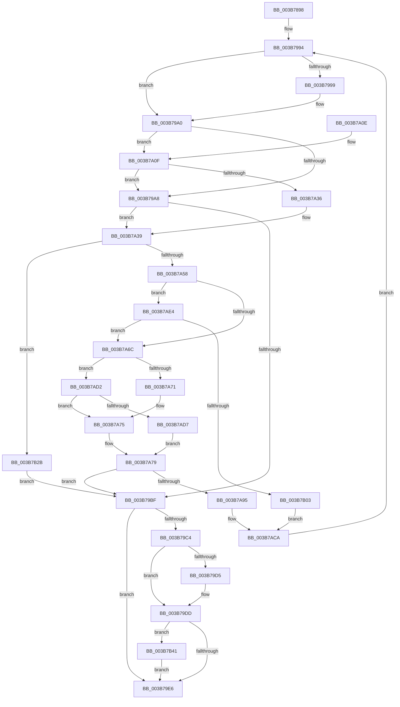

# MiAllocateMdlPagesByLists

- RVA: `0x003B7898`–`0x003B7B4E` (길이 `694` bytes)
- VA: `0x00000001403B7898`
- 실행 섹션: `.text`
- PDB 이름 있음: `예`; PDB Function 태그: `아니요`
- unwind 정보 RVA: `0x0008C844`
- 디코드: `197`개 명령, `694/694` bytes 표시
- 미해석 바이트: `0` (있으면 어셈블리에 `.byte`로 보존)

> 이 문서는 커널 이미지의 기계어와 PDB 기호를 분석해 생성했습니다. 4번과 5번은 함수 원형과 자료형을 바이너리 사용 방식에서 추정한 C 해석이며 원본 소스 복구 결과는 아닙니다.

## 1. Dependencies

- 직접 호출 지점: **6**; 고유 호출 대상: **5**
- 직접 호출자로 확인된 함수: **1**
- RIP 상대 이미지 참조: **1**

### Outgoing calls
- `0x003B78E2` → [MiInitializePageColorBase](../32/MiInitializePageColorBase_function_00320410.md) (function, `0x00320410`)
- `0x003B79B1` → [MiGetPage](../28/MiGetPage_function_002884C0.md) (function, `0x002884C0`)
- `0x003B7A24` → [MiAllocateSlabPageForMdl](../37/MiAllocateSlabPageForMdl_function_00376EC8.md) (function, `0x00376EC8`)
- `0x003B7A5B` → [MiPageToNode](../33/MiPageToNode_function_00338CD0.md) (function, `0x00338CD0`)
- `0x003B7B20` → [MiReleaseFreshPage](../33/MiReleaseFreshPage_function_00334AE0.md) (function, `0x00334AE0`)
- `0x003B7B2E` → [MiReleaseFreshPage](../33/MiReleaseFreshPage_function_00334AE0.md) (function, `0x00334AE0`)

### Direct callers
- [MiFindPagesForMdl](MiFindPagesForMdl_function_003B770C.md) at `0x003B77B8`

### Static image references
- `0x003B7916` → RVA `0x00E2CB40` (`.data`; read)

## 2. Other-region calls and transfers

- 다른 실행 섹션으로 향하는 call: **0**
- 별도 외부 분기/꼬리 이동을 확인하지 못했습니다.

## 3. Assembly (complete function range)

```asm
003B7898  48 89 5C 24 08                  mov qword ptr [rsp + 8], rbx
003B789D  44 89 44 24 18                  mov dword ptr [rsp + 0x18], r8d
003B78A2  48 89 54 24 10                  mov qword ptr [rsp + 0x10], rdx
003B78A7  55                              push rbp
003B78A8  56                              push rsi
003B78A9  57                              push rdi
003B78AA  41 54                           push r12
003B78AC  41 55                           push r13
003B78AE  41 56                           push r14
003B78B0  41 57                           push r15
003B78B2  48 8B EC                        mov rbp, rsp
003B78B5  48 83 EC 70                     sub rsp, 0x70
003B78B9  83 65 58 00                     and dword ptr [rbp + 0x58], 0
003B78BD  45 8B E0                        mov r12d, r8d
003B78C0  44 8B 45 70                     mov r8d, dword ptr [rbp + 0x70]
003B78C4  33 F6                           xor esi, esi
003B78C6  4C 8B FA                        mov r15, rdx
003B78C9  4C 8B F1                        mov r14, rcx
003B78CC  49 8B D9                        mov rbx, r9
003B78CF  0F 57 C0                        xorps xmm0, xmm0
003B78D2  41 FF C0                        inc r8d
003B78D5  4C 8D 4D E8                     lea r9, [rbp - 0x18]
003B78D9  8D 56 03                        lea edx, [rsi + 3]
003B78DC  33 C9                           xor ecx, ecx
003B78DE  0F 11 45 E8                     movups xmmword ptr [rbp - 0x18], xmm0
003B78E2  E8 29 8B F6 FF                  call 0x140320410
003B78E7  8B 45 F0                        mov eax, dword ptr [rbp - 0x10]
003B78EA  44 8B 8B 90 00 00 00            mov r9d, dword ptr [rbx + 0x90]
003B78F1  25 FF FF F3 FF                  and eax, 0xfff3ffff
003B78F6  48 8B 4D E8                     mov rcx, qword ptr [rbp - 0x18]
003B78FA  41 83 E1 03                     and r9d, 3
003B78FE  41 C1 E1 12                     shl r9d, 0x12
003B7902  44 0B C8                        or r9d, eax
003B7905  8D 46 01                        lea eax, [rsi + 1]
003B7908  44 89 4D F0                     mov dword ptr [rbp - 0x10], r9d
003B790C  F0 0F C1 01                     lock xadd dword ptr [rcx], eax
003B7910  8B 9B 94 00 00 00               mov ebx, dword ptr [rbx + 0x94]
003B7916  4C 8D 05 23 52 A7 00            lea r8, [rip + 0xa75223]
003B791D  44 8B 6D F0                     mov r13d, dword ptr [rbp - 0x10]
003B7921  33 D2                           xor edx, edx
003B7923  41 8B C9                        mov ecx, r9d
003B7926  48 C1 E9 10                     shr rcx, 0x10
003B792A  83 E1 03                        and ecx, 3
003B792D  41 F7 B4 88 80 11 00 00         div dword ptr [r8 + rcx*4 + 0x1180]
003B7935  41 8B C4                        mov eax, r12d
003B7938  F7 D0                           not eax
003B793A  41 33 D1                        xor edx, r9d
003B793D  83 E0 01                        and eax, 1
003B7940  0F B6 FA                        movzx edi, dl
003B7943  83 C0 08                        add eax, 8
003B7946  8B D3                           mov edx, ebx
003B7948  C1 E0 04                        shl eax, 4
003B794B  41 33 F9                        xor edi, r9d
003B794E  8B C8                           mov ecx, eax
003B7950  C1 EA 02                        shr edx, 2
003B7953  83 C9 01                        or ecx, 1
003B7956  83 E2 01                        and edx, 1
003B7959  85 D2                           test edx, edx
003B795B  89 55 70                        mov dword ptr [rbp + 0x70], edx
003B795E  0F 44 C8                        cmove ecx, eax
003B7961  41 8B 47 28                     mov eax, dword ptr [r15 + 0x28]
003B7965  48 21 75 D8                     and qword ptr [rbp - 0x28], rsi
003B7969  45 33 E4                        xor r12d, r12d
003B796C  48 C1 E8 0C                     shr rax, 0xc
003B7970  48 83 C0 06                     add rax, 6
003B7974  C1 E3 02                        shl ebx, 2
003B7977  F7 D3                           not ebx
003B7979  89 4D C0                        mov dword ptr [rbp - 0x40], ecx
003B797C  83 E3 08                        and ebx, 8
003B797F  4C 89 65 C8                     mov qword ptr [rbp - 0x38], r12
003B7983  49 8D 0C C7                     lea rcx, [r15 + rax*8]
003B7987  33 C0                           xor eax, eax
003B7989  48 89 45 D0                     mov qword ptr [rbp - 0x30], rax
003B798D  83 CB 03                        or ebx, 3
003B7990  48 89 4D E0                     mov qword ptr [rbp - 0x20], rcx
003B7994  F6 C3 02                        test bl, 2
003B7997  74 07                           je 0x1403b79a0
003B7999  83 E3 FD                        and ebx, 0xfffffffd
003B799C  83 65 58 00                     and dword ptr [rbp + 0x58], 0
003B79A0  83 E3 FB                        and ebx, 0xfffffffb
003B79A3  F6 C3 08                        test bl, 8
003B79A6  75 67                           jne 0x1403b7a0f
003B79A8  44 8B 45 C0                     mov r8d, dword ptr [rbp - 0x40]
003B79AC  8B D7                           mov edx, edi
003B79AE  49 8B CE                        mov rcx, r14
003B79B1  E8 0A 0B ED FF                  call 0x1402884c0
003B79B6  4C 8B F8                        mov r15, rax
003B79B9  48 83 F8 FF                     cmp rax, -1
003B79BD  75 7A                           jne 0x1403b7a39
003B79BF  48 85 F6                        test rsi, rsi
003B79C2  74 22                           je 0x1403b79e6
003B79C4  F0 49 01 B6 40 41 00 00         lock add qword ptr [r14 + 0x4140], rsi
003B79CC  48 8B 45 D0                     mov rax, qword ptr [rbp - 0x30]
003B79D0  48 85 C0                        test rax, rax
003B79D3  74 08                           je 0x1403b79dd
003B79D5  F0 49 01 86 48 41 00 00         lock add qword ptr [r14 + 0x4148], rax
003B79DD  4D 85 E4                        test r12, r12
003B79E0  0F 85 5B 01 00 00               jne 0x1403b7b41
003B79E6  48 8B 45 48                     mov rax, qword ptr [rbp + 0x48]
003B79EA  48 C1 E6 0C                     shl rsi, 0xc
003B79EE  01 70 28                        add dword ptr [rax + 0x28], esi
003B79F1  83 E3 01                        and ebx, 1
003B79F4  8B C3                           mov eax, ebx
003B79F6  48 8B 9C 24 B0 00 00 00         mov rbx, qword ptr [rsp + 0xb0]
003B79FE  48 83 C4 70                     add rsp, 0x70
003B7A02  41 5F                           pop r15
003B7A04  41 5E                           pop r14
003B7A06  41 5D                           pop r13
003B7A08  41 5C                           pop r12
003B7A0A  5F                              pop rdi
003B7A0B  5E                              pop rsi
003B7A0C  5D                              pop rbp
003B7A0D  C3                              ret
003B7A0E  CC                              int3
003B7A0F  44 8B 45 50                     mov r8d, dword ptr [rbp + 0x50]
003B7A13  48 8D 45 58                     lea rax, [rbp + 0x58]
003B7A17  44 8B CA                        mov r9d, edx
003B7A1A  48 89 44 24 20                  mov qword ptr [rsp + 0x20], rax
003B7A1F  8B D7                           mov edx, edi
003B7A21  49 8B CE                        mov rcx, r14
003B7A24  E8 9F F4 FB FF                  call 0x140376ec8
003B7A29  4C 8B F8                        mov r15, rax
003B7A2C  48 83 F8 FF                     cmp rax, -1
003B7A30  0F 84 72 FF FF FF               je 0x1403b79a8
003B7A36  83 CB 04                        or ebx, 4
003B7A39  4F 8D 24 7F                     lea r12, [r15 + r15*2]
003B7A3D  49 C1 E4 04                     shl r12, 4
003B7A41  48 B8 00 00 00 00 00 DE FF FF   movabs rax, 0xffffde0000000000
003B7A4B  4C 03 E0                        add r12, rax
003B7A4E  4C 3B 7D 60                     cmp r15, qword ptr [rbp + 0x60]
003B7A52  0F 87 D3 00 00 00               ja 0x1403b7b2b
003B7A58  49 8B CF                        mov rcx, r15
003B7A5B  E8 70 12 F8 FF                  call 0x140338cd0
003B7A60  8B CF                           mov ecx, edi
003B7A62  C1 E9 09                        shr ecx, 9
003B7A65  83 E1 3F                        and ecx, 0x3f
003B7A68  3B C1                           cmp eax, ecx
003B7A6A  75 78                           jne 0x1403b7ae4
003B7A6C  F6 C3 04                        test bl, 4
003B7A6F  74 61                           je 0x1403b7ad2
003B7A71  48 FF 45 D0                     inc qword ptr [rbp - 0x30]
003B7A75  4C 8B 65 C8                     mov r12, qword ptr [rbp - 0x38]
003B7A79  4C 8B 45 E0                     mov r8, qword ptr [rbp - 0x20]
003B7A7D  48 FF C6                        inc rsi
003B7A80  4D 89 38                        mov qword ptr [r8], r15
003B7A83  49 83 C0 08                     add r8, 8
003B7A87  4C 89 45 E0                     mov qword ptr [rbp - 0x20], r8
003B7A8B  48 3B 75 68                     cmp rsi, qword ptr [rbp + 0x68]
003B7A8F  0F 84 2A FF FF FF               je 0x1403b79bf
003B7A95  48 8B 4D E8                     mov rcx, qword ptr [rbp - 0x18]
003B7A99  B8 01 00 00 00                  mov eax, 1
003B7A9E  F0 0F C1 01                     lock xadd dword ptr [rcx], eax
003B7AA2  4C 8B 6D F0                     mov r13, qword ptr [rbp - 0x10]
003B7AA6  4C 8D 05 93 50 A7 00            lea r8, [rip + 0xa75093]
003B7AAD  33 D2                           xor edx, edx
003B7AAF  49 8B CD                        mov rcx, r13
003B7AB2  48 C1 E9 10                     shr rcx, 0x10
003B7AB6  83 E1 03                        and ecx, 3
003B7AB9  41 F7 B4 88 80 11 00 00         div dword ptr [r8 + rcx*4 + 0x1180]
003B7AC1  41 33 D5                        xor edx, r13d
003B7AC4  0F B6 FA                        movzx edi, dl
003B7AC7  41 33 FD                        xor edi, r13d
003B7ACA  8B 55 70                        mov edx, dword ptr [rbp + 0x70]
003B7ACD  E9 C2 FE FF FF                  jmp 0x1403b7994
003B7AD2  F6 C3 08                        test bl, 8
003B7AD5  75 9E                           jne 0x1403b7a75
003B7AD7  4C 8B 65 C8                     mov r12, qword ptr [rbp - 0x38]
003B7ADB  49 FF C4                        inc r12
003B7ADE  4C 89 65 C8                     mov qword ptr [rbp - 0x38], r12
003B7AE2  EB 95                           jmp 0x1403b7a79
003B7AE4  4C 8B 45 D8                     mov r8, qword ptr [rbp - 0x28]
003B7AE8  83 CB 02                        or ebx, 2
003B7AEB  44 8B C8                        mov r9d, eax
003B7AEE  4D 0F A3 C8                     bt r8, r9
003B7AF2  0F 93 C2                        setae dl
003B7AF5  F6 C3 08                        test bl, 8
003B7AF8  0F 95 C1                        setne cl
003B7AFB  84 D1                           test cl, dl
003B7AFD  0F 84 69 FF FF FF               je 0x1403b7a6c
003B7B03  C1 E0 09                        shl eax, 9
003B7B06  4D 0F AB C8                     bts r8, r9
003B7B0A  41 33 C5                        xor eax, r13d
003B7B0D  4C 89 45 D8                     mov qword ptr [rbp - 0x28], r8
003B7B11  25 00 7E 00 00                  and eax, 0x7e00
003B7B16  49 8B CC                        mov rcx, r12
003B7B19  44 33 E8                        xor r13d, eax
003B7B1C  44 89 6D F0                     mov dword ptr [rbp - 0x10], r13d
003B7B20  E8 BB CF F7 FF                  call 0x140334ae0
003B7B25  4C 8B 65 C8                     mov r12, qword ptr [rbp - 0x38]
003B7B29  EB 9F                           jmp 0x1403b7aca
003B7B2B  49 8B CC                        mov rcx, r12
003B7B2E  E8 AD CF F7 FF                  call 0x140334ae0
003B7B33  4C 8B 65 C8                     mov r12, qword ptr [rbp - 0x38]
003B7B37  BB FE FF FF FF                  mov ebx, 0xfffffffe
003B7B3C  E9 7E FE FF FF                  jmp 0x1403b79bf
003B7B41  F0 4D 01 A6 50 41 00 00         lock add qword ptr [r14 + 0x4150], r12
003B7B49  E9 98 FE FF FF                  jmp 0x1403b79e6
```

## 4. C-style interpretation (structured pseudocode)

```c
__int64 __fastcall MiAllocateMdlPagesByLists(__int64 a1, __int64 a2, int a3, __int64 a4, __int64 a5, __int64 a6, unsigned int a7)
{
    __int64 result;
    __int64 v_r12;
    __int64 v_r13;
    __int64 v_rbx;
    __int64 v_rdi;
    __int64 v_rsi;
    __int64 v_rsp;
    unsigned int v_stack_m48;
    unsigned __int64 v_stack_m50;
    unsigned __int64 v_stack_m58;
    unsigned __int64 v_stack_m60;
    unsigned __int64 v_stack_m68;
    unsigned __int64 v_stack_m70;
    unsigned int v_stack_m78;
    unsigned __int64 v_stack_p10;
    unsigned int v_stack_p18;
    unsigned int v_stack_p20;
    unsigned int v_stack_p38;
    unsigned __int64 v_stack_p8;

    v_stack_p8 = v_rbx;
    v_stack_p18 = a3;
    v_stack_p10 = a2;
    v_rsp = (v_rsp) - (112);
    v_rsi = 0;
    a3 = (unsigned int)(((unsigned int)(a7)) + 1);
    a1 = 0;
    v_stack_m50 = v_xmm0;
    result = MiInitializePageColorBase(a1, v_rsi + 3, a3, v_stack_m50);
    result = (unsigned int)(((unsigned int)(v_stack_m48)) & (0xFFF3FFFFULL));
    a4 = (unsigned int)(((unsigned int)(*(unsigned int *)(a4 + 144))) & (3));
    a4 = (unsigned int)((a4) << (18));
    a4 = (unsigned int)((a4) | ((unsigned int)(result)));
    v_stack_m48 = (unsigned int)(a4);
    a2 = 0;
    a1 = ((unsigned int)((unsigned int)(a4))) >> (16);
    a1 = (unsigned int)((a1) & (3));
    result = (unsigned int)(~((unsigned int)((unsigned int)((unsigned int)(a3)))));
    a2 = (unsigned int)((a2) ^ ((unsigned int)(a4)));
    result = (unsigned int)((result) & (1));
    result = (unsigned int)((result) + (8));
    result = (unsigned int)((result) << (4));
    v_rdi = (unsigned int)(((unsigned __int8)(a2)) ^ ((unsigned int)(a4)));
    a2 = (unsigned int)(((unsigned int)((unsigned int)((unsigned int)(*(unsigned int *)(a4 + 148))))) >> (2));
    a1 = (unsigned int)(((unsigned int)((unsigned int)(result))) | (1));
    a2 = (unsigned int)((a2) & (1));
    v_stack_p38 = (unsigned int)(a2);
    if ((unsigned int)(a2) == 0) { a1 = (unsigned int)(result); }
    v_r12 = 0;
    result = ((unsigned int)(*(unsigned int *)(a2 + 40))) >> (12);
    result = (result) + (6);
    v_rbx = (unsigned int)(((unsigned int)(*(unsigned int *)(a4 + 148))) << (2));
    v_rbx = (unsigned int)(~(v_rbx));
    v_stack_m78 = (unsigned int)(a1);
    v_rbx = (unsigned int)((v_rbx) & (8));
    v_stack_m70 = 0;
    result = 0;
    v_stack_m68 = 0;
    v_rbx = (unsigned int)((v_rbx) | (3));
    v_stack_m58 = a2 + result * 8;
loc_003B7994:
    if ((((unsigned __int8)(v_rbx)) & (2)) != 0) {
        v_rbx = (unsigned int)((v_rbx) & (0xFFFFFFFDULL));
    }
    v_rbx = (unsigned int)((v_rbx) & (0xFFFFFFFBULL));
    if ((((unsigned __int8)(v_rbx)) & (8)) != 0) goto loc_003B7A0F;
loc_003B79A8:
    result = MiGetPage(a1, (unsigned int)((unsigned int)(v_rdi)), (unsigned int)(v_stack_m78), a4);
    if (result != -1) goto loc_003B7A39;
loc_003B79BF:
    if (0 == 0) goto loc_003B79E6;
    if (v_stack_m68 != 0) {
    }
    if (0 != 0) goto loc_003B7B41;
loc_003B79E6:
    v_rsi = (v_rsi) << (12);
    v_rbx = (unsigned int)((v_rbx) & (1));
    v_rsp = (v_rsp) + (112);
    return (unsigned int)((unsigned int)(v_rbx));
loc_003B7A0F:
    v_stack_p20 = v_stack_p20;
    result = MiAllocateSlabPageForMdl(a1, (unsigned int)((unsigned int)(v_rdi)), (unsigned int)(v_stack_p18), (unsigned int)((unsigned int)((unsigned int)((unsigned int)(v_rdi)))));
    if (result == -1) goto loc_003B79A8;
    v_rbx = (unsigned int)((v_stack_p8) | (4));
loc_003B7A39:
    v_r12 = (result + result * 2) << (4);
    v_r12 = (v_r12) + (result);
    if (result > a5) goto loc_003B7B2B;
    result = MiPageToNode(result, (unsigned int)((unsigned int)(v_rdi)), (unsigned int)(v_stack_p18), (unsigned int)((unsigned int)((unsigned int)((unsigned int)(v_rdi)))));
    a1 = (unsigned int)(((unsigned int)((unsigned int)(v_rdi))) >> (9));
    a1 = (unsigned int)((a1) & (63));
    if (((unsigned int)(result)) != ((unsigned int)(a1))) goto loc_003B7AE4;
loc_003B7A6C:
    if ((((unsigned __int8)(v_rbx)) & (4)) == 0) goto loc_003B7AD2;
loc_003B7A75:
loc_003B7A79:
    v_rsi = (v_rsi) + 1;
    *(unsigned __int64 *)(v_stack_m58) = result;
    a3 = (v_stack_m58) + (8);
    v_stack_m58 = a3;
    if (v_rsi == a6) goto loc_003B79BF;
    a2 = 0;
    a1 = (v_stack_m48) >> (16);
    a1 = (unsigned int)((a1) & (3));
    a2 = (unsigned int)((a2) ^ ((unsigned int)(v_stack_m48)));
    v_rdi = (unsigned int)(((unsigned __int8)(a2)) ^ ((unsigned int)(v_stack_m48)));
loc_003B7ACA:
    goto loc_003B7994;
loc_003B7AD2:
    if ((((unsigned __int8)(v_rbx)) & (8)) != 0) goto loc_003B7A75;
    v_r12 = (v_stack_m70) + 1;
    v_stack_m70 = v_r12;
    goto loc_003B7A79;
loc_003B7AE4:
    v_rbx = (unsigned int)((v_rbx) | (2));
    a2 = (condition_is_above_or_equal) ? 1 : 0;
    a1 = ((((unsigned __int8)(v_rbx)) & (8)) != 0) ? 1 : 0;
    if ((((unsigned __int8)(a1)) & ((unsigned __int8)(a2))) == 0) goto loc_003B7A6C;
    result = (unsigned int)((1) << (9));
    result = (unsigned int)((result) ^ ((unsigned int)(v_stack_m48)));
    v_stack_m60 = v_stack_m60;
    result = (unsigned int)((result) & (0x7E00ULL));
    v_r13 = (unsigned int)((v_stack_m48) ^ ((unsigned int)(result)));
    v_stack_m48 = (unsigned int)(v_r13);
    result = MiReleaseFreshPage(v_r12, a2, v_stack_m60, 1);
    goto loc_003B7ACA;
loc_003B7B2B:
    result = MiReleaseFreshPage(v_stack_m70, a2, v_stack_m60, 1);
    goto loc_003B79BF;
loc_003B7B41:
    goto loc_003B79E6;
}
```

## 5. (Beta) C Style

```c
int64_t MiAllocateMdlPagesByLists(void *Arg1, void *Arg2, int32_t Arg3, void *Arg4, int64_t Arg5, int64_t Arg6, uint32_t Arg7)
{
    uint8_t *arg1 = (uint8_t *)Arg1;
    uint8_t *arg2 = (uint8_t *)Arg2;
    uint8_t *arg4 = (uint8_t *)Arg4;

    int64_t result;
    int64_t local_r12;
    int64_t local_r13;
    int64_t local_rbx;
    int64_t local_rdi;
    int64_t local_rsi;
    int64_t local_rsp;
    uint32_t v_stack_m48;
    uint64_t v_stack_m50;
    uint64_t v_stack_m58;
    uint64_t v_stack_m60;
    uint64_t v_stack_m68;
    uint64_t v_stack_m70;
    uint32_t v_stack_m78;
    uint64_t v_stack_p10;
    uint32_t v_stack_p18;
    uint32_t v_stack_p20;
    uint32_t v_stack_p38;
    uint64_t v_stack_p8;

    v_stack_p8 = local_rbx;
    v_stack_p18 = Arg3;
    v_stack_p10 = Arg2;
    local_rsp = (local_rsp) - (112);
    local_rsi = 0;
    Arg3 = (uint32_t)(((uint32_t)(Arg7)) + 1);
    Arg1 = 0;
    v_stack_m50 = v_xmm0;
    result = MiInitializePageColorBase(Arg1, local_rsi + 3, Arg3, v_stack_m50);
    result = (uint32_t)(((uint32_t)(v_stack_m48)) & (0xFFF3FFFFULL));
    Arg4 = (uint32_t)(((uint32_t)(*(uint32_t *)(arg4 + 0x90))) & (3));
    Arg4 = (uint32_t)((Arg4) << (18));
    Arg4 = (uint32_t)((Arg4) | ((uint32_t)(result)));
    v_stack_m48 = (uint32_t)(Arg4);
    Arg2 = 0;
    Arg1 = ((uint32_t)((uint32_t)(Arg4))) >> (16);
    Arg1 = (uint32_t)((Arg1) & (3));
    result = (uint32_t)(~((uint32_t)((uint32_t)((uint32_t)(Arg3)))));
    Arg2 = (uint32_t)((Arg2) ^ ((uint32_t)(Arg4)));
    result = (uint32_t)((result) & (1));
    result = (uint32_t)((result) + (8));
    result = (uint32_t)((result) << (4));
    local_rdi = (uint32_t)(((uint8_t)(Arg2)) ^ ((uint32_t)(Arg4)));
    Arg2 = (uint32_t)(((uint32_t)((uint32_t)((uint32_t)(*(uint32_t *)(arg4 + 0x94))))) >> (2));
    Arg1 = (uint32_t)(((uint32_t)((uint32_t)(result))) | (1));
    Arg2 = (uint32_t)((Arg2) & (1));
    v_stack_p38 = (uint32_t)(Arg2);
    if ((uint32_t)(Arg2) == 0) { Arg1 = (uint32_t)(result); }
    local_r12 = 0;
    result = ((uint32_t)(*(uint32_t *)(arg2 + 0x28))) >> (12);
    result = (result) + (6);
    local_rbx = (uint32_t)(((uint32_t)(*(uint32_t *)(arg4 + 0x94))) << (2));
    local_rbx = (uint32_t)(~(local_rbx));
    v_stack_m78 = (uint32_t)(Arg1);
    local_rbx = (uint32_t)((local_rbx) & (8));
    v_stack_m70 = 0;
    result = 0;
    v_stack_m68 = 0;
    local_rbx = (uint32_t)((local_rbx) | (3));
    v_stack_m58 = Arg2 + result * 8;
loc_003B7994:
    if ((((uint8_t)(local_rbx)) & (2)) != 0) {
        local_rbx = (uint32_t)((local_rbx) & (0xFFFFFFFDULL));
    }
    local_rbx = (uint32_t)((local_rbx) & (0xFFFFFFFBULL));
    if ((((uint8_t)(local_rbx)) & (8)) != 0) goto loc_003B7A0F;
loc_003B79A8:
    result = MiGetPage(Arg1, (uint32_t)((uint32_t)(local_rdi)), (uint32_t)(v_stack_m78), Arg4);
    if (result != -1) goto loc_003B7A39;
loc_003B79BF:
    if (0 == 0) goto loc_003B79E6;
    if (v_stack_m68 != 0) {
    }
    if (0 != 0) goto loc_003B7B41;
loc_003B79E6:
    local_rsi = (local_rsi) << (12);
    local_rbx = (uint32_t)((local_rbx) & (1));
    local_rsp = (local_rsp) + (112);
    return (uint32_t)((uint32_t)(local_rbx));
loc_003B7A0F:
    v_stack_p20 = v_stack_p20;
    result = MiAllocateSlabPageForMdl(Arg1, (uint32_t)((uint32_t)(local_rdi)), (uint32_t)(v_stack_p18), (uint32_t)((uint32_t)((uint32_t)((uint32_t)(local_rdi)))));
    if (result == -1) goto loc_003B79A8;
    local_rbx = (uint32_t)((v_stack_p8) | (4));
loc_003B7A39:
    local_r12 = (result + result * 2) << (4);
    local_r12 = (local_r12) + (result);
    if (result > Arg5) goto loc_003B7B2B;
    result = MiPageToNode(result, (uint32_t)((uint32_t)(local_rdi)), (uint32_t)(v_stack_p18), (uint32_t)((uint32_t)((uint32_t)((uint32_t)(local_rdi)))));
    Arg1 = (uint32_t)(((uint32_t)((uint32_t)(local_rdi))) >> (9));
    Arg1 = (uint32_t)((Arg1) & (63));
    if (((uint32_t)(result)) != ((uint32_t)(Arg1))) goto loc_003B7AE4;
loc_003B7A6C:
    if ((((uint8_t)(local_rbx)) & (4)) == 0) goto loc_003B7AD2;
loc_003B7A75:
loc_003B7A79:
    local_rsi = (local_rsi) + 1;
    *(uint64_t *)(v_stack_m58) = result;
    Arg3 = (v_stack_m58) + (8);
    v_stack_m58 = Arg3;
    if (local_rsi == Arg6) goto loc_003B79BF;
    Arg2 = 0;
    Arg1 = (v_stack_m48) >> (16);
    Arg1 = (uint32_t)((Arg1) & (3));
    Arg2 = (uint32_t)((Arg2) ^ ((uint32_t)(v_stack_m48)));
    local_rdi = (uint32_t)(((uint8_t)(Arg2)) ^ ((uint32_t)(v_stack_m48)));
loc_003B7ACA:
    goto loc_003B7994;
loc_003B7AD2:
    if ((((uint8_t)(local_rbx)) & (8)) != 0) goto loc_003B7A75;
    local_r12 = (v_stack_m70) + 1;
    v_stack_m70 = local_r12;
    goto loc_003B7A79;
loc_003B7AE4:
    local_rbx = (uint32_t)((local_rbx) | (2));
    Arg2 = (condition_is_above_or_equal) ? 1 : 0;
    Arg1 = ((((uint8_t)(local_rbx)) & (8)) != 0) ? 1 : 0;
    if ((((uint8_t)(Arg1)) & ((uint8_t)(Arg2))) == 0) goto loc_003B7A6C;
    result = (uint32_t)((1) << (9));
    result = (uint32_t)((result) ^ ((uint32_t)(v_stack_m48)));
    v_stack_m60 = v_stack_m60;
    result = (uint32_t)((result) & (0x7E00ULL));
    local_r13 = (uint32_t)((v_stack_m48) ^ ((uint32_t)(result)));
    v_stack_m48 = (uint32_t)(local_r13);
    result = MiReleaseFreshPage(local_r12, Arg2, v_stack_m60, 1);
    goto loc_003B7ACA;
loc_003B7B2B:
    result = MiReleaseFreshPage(v_stack_m70, Arg2, v_stack_m60, 1);
    goto loc_003B79BF;
loc_003B7B41:
    goto loc_003B79E6;
}
```

### 관측된 메모리 오프셋

구조체 형식이 확인되지 않은 접근은 인자 기준의 오프셋으로만 기록했습니다.

| 기준 인자 | 오프셋 표현 | 폭 (bit) | 접근 |
|---|---:|---:|---|
| `Arg1` | `+ 0x4140` | `64` | `R/W` |
| `Arg1` | `+ 0x4148` | `64` | `R/W` |
| `Arg1` | `+ 0x4150` | `64` | `R/W` |
| `Arg2` | `+ 0x0 + rax*8` | `64` | `R` |
| `Arg2` | `+ 0x28` | `32` | `R` |
| `Arg4` | `+ 0x90` | `32` | `R` |
| `Arg4` | `+ 0x94` | `32` | `R` |

## 6. Execution-region graph

[열기: 2D/3D 그래프와 함수 탐색 컨트롤 패널](../../../control-panel.html?section=text&rva=0x003B7898&view=graph)

- 2D 그래프는 위에서 아래로 흐르고, 3D 그래프는 빈 공간을 드래그해 회전합니다. Shift+드래그는 이동, 휠은 확대·축소, 함수 노드 선택은 대상 보고서 이동입니다.

### Static fallback


