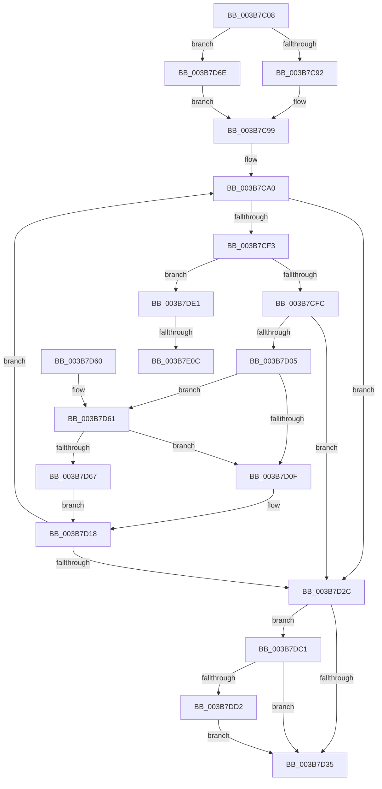

# MiAllocateSkipPagesForMdl

- RVA: `0x003B7C08`–`0x003B7E11` (길이 `521` bytes)
- VA: `0x00000001403B7C08`
- 실행 섹션: `.text`
- PDB 이름 있음: `예`; PDB Function 태그: `예`
- unwind 정보 RVA: `0x0008C860`
- 디코드: `128`개 명령, `521/521` bytes 표시
- 미해석 바이트: `0` (있으면 어셈블리에 `.byte`로 보존)

> 이 문서는 커널 이미지의 기계어와 PDB 기호를 분석해 생성했습니다. 4번과 5번은 함수 원형과 자료형을 바이너리 사용 방식에서 추정한 C 해석이며 원본 소스 복구 결과는 아닙니다.

## 1. Dependencies

- 직접 호출 지점: **5**; 고유 호출 대상: **5**
- 직접 호출자로 확인된 함수: **1**
- RIP 상대 이미지 참조: **1**

### Outgoing calls
- `0x003B7C47` → [memset](../6C/memset_function_006C6C40.md) (function, `0x006C6C40`)
- `0x003B7CEA` → [MiFindContiguousPagesEx](../28/MiFindContiguousPagesEx_function_0028BDE0.md) (function, `0x0028BDE0`)
- `0x003B7D40` → [_security_check_cookie](../6A/_security_check_cookie_function_006AC640.md) (function, `0x006AC640`)
- `0x003B7D95` → [MiInitializeBestCandidatesContext](MiInitializeBestCandidatesContext_function_003B7E18.md) (function, `0x003B7E18`)
- `0x003B7DD7` → [ExFreePoolWithTag](../../poolcode/B8/ExFreePoolWithTag_function_00B82870.md) (function, `0x00B82870`)

### Direct callers
- [MiFindPagesForMdl](MiFindPagesForMdl_function_003B770C.md) at `0x003B7861`

### Static image references
- `0x003B7C1F` → RVA `0x00E0A740` (`.data`; read)

## 2. Other-region calls and transfers

- 다른 실행 섹션으로 향하는 call: **1**
  - `0x003B7DD7` → [ExFreePoolWithTag](../../poolcode/B8/ExFreePoolWithTag_function_00B82870.md) (`.text` → `POOLCODE`)
- call이 아닌 외부 분기/꼬리 이동: **2**
  - `0x003B7E06` → [sub_006E76F4](../6E/Unknown_function_006E76F4.md) (`tail-transfer`)
  - `0x003B7E0C` → [sub_006E76F4 + 0x24](../6E/Unknown_function_006E76F4.md) (`tail-transfer`)

## 3. Assembly (complete function range)

```asm
003B7C08  48 89 5C 24 20                  mov qword ptr [rsp + 0x20], rbx
003B7C0D  55                              push rbp
003B7C0E  56                              push rsi
003B7C0F  57                              push rdi
003B7C10  41 54                           push r12
003B7C12  41 55                           push r13
003B7C14  41 56                           push r14
003B7C16  41 57                           push r15
003B7C18  48 81 EC 00 01 00 00            sub rsp, 0x100
003B7C1F  48 8B 05 1A 2B A5 00            mov rax, qword ptr [rip + 0xa52b1a]
003B7C26  48 33 C4                        xor rax, rsp
003B7C29  48 89 84 24 F0 00 00 00         mov qword ptr [rsp + 0xf0], rax
003B7C31  8B DA                           mov ebx, edx
003B7C33  45 8B E8                        mov r13d, r8d
003B7C36  33 D2                           xor edx, edx
003B7C38  4C 8B F1                        mov r14, rcx
003B7C3B  48 8D 8C 24 90 00 00 00         lea rcx, [rsp + 0x90]
003B7C43  44 8D 42 58                     lea r8d, [rdx + 0x58]
003B7C47  E8 F4 EF 30 00                  call 0x1406c6c40
003B7C4C  48 83 4C 24 70 FF               or qword ptr [rsp + 0x70], 0xffffffffffffffff
003B7C52  33 F6                           xor esi, esi
003B7C54  4D 8B 7E 40                     mov r15, qword ptr [r14 + 0x40]
003B7C58  4D 8B 66 30                     mov r12, qword ptr [r14 + 0x30]
003B7C5C  49 8B 7E 18                     mov rdi, qword ptr [r14 + 0x18]
003B7C60  4D 8B 56 08                     mov r10, qword ptr [r14 + 8]
003B7C64  41 8B 6F 28                     mov ebp, dword ptr [r15 + 0x28]
003B7C68  49 8B 56 10                     mov rdx, qword ptr [r14 + 0x10]
003B7C6C  48 C1 ED 0C                     shr rbp, 0xc
003B7C70  49 0F AF EC                     imul rbp, r12
003B7C74  4C 89 94 24 88 00 00 00         mov qword ptr [rsp + 0x88], r10
003B7C7C  48 89 54 24 78                  mov qword ptr [rsp + 0x78], rdx
003B7C81  48 89 B4 24 80 00 00 00         mov qword ptr [rsp + 0x80], rsi
003B7C89  48 85 FF                        test rdi, rdi
003B7C8C  0F 85 DC 00 00 00               jne 0x1403b7d6e
003B7C92  49 8B 7E 20                     mov rdi, qword ptr [r14 + 0x20]
003B7C96  48 2B FD                        sub rdi, rbp
003B7C99  41 81 CD 00 00 00 60            or r13d, 0x60000000
003B7CA0  41 8B 86 90 00 00 00            mov eax, dword ptr [r14 + 0x90]
003B7CA7  4C 8D 44 24 70                  lea r8, [rsp + 0x70]
003B7CAC  4D 8B 4E 18                     mov r9, qword ptr [r14 + 0x18]
003B7CB0  49 8B 0E                        mov rcx, qword ptr [r14]
003B7CB3  4C 89 44 24 68                  mov qword ptr [rsp + 0x68], r8
003B7CB8  4C 8B C2                        mov r8, rdx
003B7CBB  48 89 74 24 60                  mov qword ptr [rsp + 0x60], rsi
003B7CC0  49 8B D2                        mov rdx, r10
003B7CC3  4C 89 7C 24 58                  mov qword ptr [rsp + 0x58], r15
003B7CC8  83 64 24 50 00                  and dword ptr [rsp + 0x50], 0
003B7CCD  44 89 6C 24 48                  mov dword ptr [rsp + 0x48], r13d
003B7CD2  C6 44 24 40 FF                  mov byte ptr [rsp + 0x40], 0xff
003B7CD7  89 5C 24 38                     mov dword ptr [rsp + 0x38], ebx
003B7CDB  89 44 24 30                     mov dword ptr [rsp + 0x30], eax
003B7CDF  48 89 7C 24 28                  mov qword ptr [rsp + 0x28], rdi
003B7CE4  48 83 64 24 20 00               and qword ptr [rsp + 0x20], 0
003B7CEA  E8 F1 40 ED FF                  call 0x14028bde0
003B7CEF  85 C0                           test eax, eax
003B7CF1  78 39                           js 0x1403b7d2c
003B7CF3  4D 85 FF                        test r15, r15
003B7CF6  0F 84 E5 00 00 00               je 0x1403b7de1
003B7CFC  48 03 EF                        add rbp, rdi
003B7CFF  49 3B 6E 20                     cmp rbp, qword ptr [r14 + 0x20]
003B7D03  74 27                           je 0x1403b7d2c
003B7D05  48 8B 44 24 70                  mov rax, qword ptr [rsp + 0x70]
003B7D0A  48 85 F6                        test rsi, rsi
003B7D0D  75 52                           jne 0x1403b7d61
003B7D0F  48 8D 50 FF                     lea rdx, [rax - 1]
003B7D13  48 89 54 24 78                  mov qword ptr [rsp + 0x78], rdx
003B7D18  4C 8B 94 24 88 00 00 00         mov r10, qword ptr [rsp + 0x88]
003B7D20  49 2B C2                        sub rax, r10
003B7D23  48 3B C7                        cmp rax, rdi
003B7D26  0F 83 74 FF FF FF               jae 0x1403b7ca0
003B7D2C  48 85 F6                        test rsi, rsi
003B7D2F  0F 85 8C 00 00 00               jne 0x1403b7dc1
003B7D35  48 8B 8C 24 F0 00 00 00         mov rcx, qword ptr [rsp + 0xf0]
003B7D3D  48 33 CC                        xor rcx, rsp
003B7D40  E8 FB 48 2F 00                  call 0x1406ac640
003B7D45  48 8B 9C 24 58 01 00 00         mov rbx, qword ptr [rsp + 0x158]
003B7D4D  48 81 C4 00 01 00 00            add rsp, 0x100
003B7D54  41 5F                           pop r15
003B7D56  41 5E                           pop r14
003B7D58  41 5D                           pop r13
003B7D5A  41 5C                           pop r12
003B7D5C  5F                              pop rdi
003B7D5D  5E                              pop rsi
003B7D5E  5D                              pop rbp
003B7D5F  C3                              ret
003B7D60  CC                              int3
003B7D61  83 7E 0C 00                     cmp dword ptr [rsi + 0xc], 0
003B7D65  74 A8                           je 0x1403b7d0f
003B7D67  48 8B 54 24 78                  mov rdx, qword ptr [rsp + 0x78]
003B7D6C  EB AA                           jmp 0x1403b7d18
003B7D6E  49 8B 46 20                     mov rax, qword ptr [r14 + 0x20]
003B7D72  48 8D 8C 24 80 00 00 00         lea rcx, [rsp + 0x80]
003B7D7A  33 D2                           xor edx, edx
003B7D7C  48 89 7C 24 20                  mov qword ptr [rsp + 0x20], rdi
003B7D81  48 2B C5                        sub rax, rbp
003B7D84  4C 8B C7                        mov r8, rdi
003B7D87  48 F7 F7                        div rdi
003B7D8A  48 8D 94 24 90 00 00 00         lea rdx, [rsp + 0x90]
003B7D92  4C 8B C8                        mov r9, rax
003B7D95  E8 7E 00 00 00                  call 0x1403b7e18
003B7D9A  48 8B B4 24 80 00 00 00         mov rsi, qword ptr [rsp + 0x80]
003B7DA2  33 C0                           xor eax, eax
003B7DA4  48 8B 54 24 78                  mov rdx, qword ptr [rsp + 0x78]
003B7DA9  49 83 FC 01                     cmp r12, 1
003B7DAD  4C 8B 94 24 88 00 00 00         mov r10, qword ptr [rsp + 0x88]
003B7DB5  49 0F 44 C7                     cmove rax, r15
003B7DB9  4C 8B F8                        mov r15, rax
003B7DBC  E9 D8 FE FF FF                  jmp 0x1403b7c99
003B7DC1  48 8D 84 24 90 00 00 00         lea rax, [rsp + 0x90]
003B7DC9  48 3B F0                        cmp rsi, rax
003B7DCC  0F 84 63 FF FF FF               je 0x1403b7d35
003B7DD2  33 D2                           xor edx, edx
003B7DD4  48 8B CE                        mov rcx, rsi
003B7DD7  E8 94 AA 7C 00                  call 0x140b82870
003B7DDC  E9 54 FF FF FF                  jmp 0x1403b7d35
003B7DE1  4D 8B 4E 40                     mov r9, qword ptr [r14 + 0x40]
003B7DE5  33 D2                           xor edx, edx
003B7DE7  4D 8B 46 30                     mov r8, qword ptr [r14 + 0x30]
003B7DEB  33 C9                           xor ecx, ecx
003B7DED  41 8B 41 28                     mov eax, dword ptr [r9 + 0x28]
003B7DF1  48 C1 E8 0C                     shr rax, 0xc
003B7DF5  48 83 C0 06                     add rax, 6
003B7DF9  4D 8D 14 C1                     lea r10, [r9 + rax*8]
003B7DFD  48 8B C7                        mov rax, rdi
003B7E00  49 F7 F0                        div r8
003B7E03  48 85 C0                        test rax, rax
003B7E06  0F 85 E8 F8 32 00               jne 0x1406e76f4
003B7E0C  E9 07 F9 32 00                  jmp 0x1406e7718
```

## 4. C-style interpretation (structured pseudocode)

```c
__int64 __fastcall MiAllocateSkipPagesForMdl(__int64 a1, int a2, int a3)
{
    __int64 result;
    __int64 v_r13;
    __int64 v_rbp;
    __int64 v_rdi;
    __int64 v_rsi;
    __int64 v_rsp;
    unsigned int v_stack_m100;
    unsigned int v_stack_m108;
    unsigned __int64 v_stack_m110;
    unsigned __int64 v_stack_m118;
    unsigned __int64 v_stack_m48;
    unsigned __int64 v_stack_mA8;
    unsigned __int64 v_stack_mB0;
    unsigned __int64 v_stack_mB8;
    unsigned __int64 v_stack_mC0;
    unsigned __int64 v_stack_mC8;
    unsigned __int64 v_stack_mD0;
    unsigned __int64 v_stack_mD8;
    unsigned __int64 v_stack_mE0;
    unsigned int v_stack_mE8;
    unsigned int v_stack_mF0;
    unsigned __int8 v_stack_mF8;
    unsigned __int64 v_stack_p20;
    unsigned __int64 v_stack_p78;
    unsigned __int64 v_stack_p80;
    unsigned __int64 v_stack_p88;
    unsigned __int64 v_stack_p90;

    v_stack_p20 = v_rbx;
    v_rsp = (v_rsp) - (256);
    result = (*(unsigned __int64 *)(v_rip + 10824474)) ^ (v_rsp);
    v_stack_m48 = result;
    a2 = 0;
    result = memset(v_stack_mA8, a2, a2 + 88, a4);
    v_rsi = 0;
    v_rbp = ((unsigned int)(*(unsigned int *)(*(unsigned __int64 *)(a1 + 64) + 40))) >> (12);
    v_rbp = (v_rbp) * (*(unsigned __int64 *)(a1 + 48));
    v_stack_mB0 = *(unsigned __int64 *)(a1 + 8);
    v_stack_mC0 = *(unsigned __int64 *)(a1 + 16);
    v_stack_mB8 = 0;
    if (*(unsigned __int64 *)(a1 + 24) != 0) goto loc_003B7D6E;
    v_rdi = (*(unsigned __int64 *)(a1 + 32)) - (v_rbp);
loc_003B7C99:
    v_r13 = (unsigned int)(((unsigned int)(a3)) | (0x60000000ULL));
loc_003B7CA0:
    v_stack_mD0 = v_stack_mC8;
    v_stack_mD8 = 0;
    v_stack_mE0 = *(unsigned __int64 *)(a1 + 64);
    v_stack_mF0 = (unsigned int)(v_r13);
    v_stack_mF8 = 255;
    v_stack_m100 = (unsigned int)((unsigned int)(a2));
    v_stack_m108 = (unsigned int)((unsigned int)(*(unsigned int *)(a1 + 144)));
    v_stack_m110 = v_rdi;
    result = MiFindContiguousPagesEx(*(unsigned __int64 *)(a1), *(unsigned __int64 *)(a1 + 8), *(unsigned __int64 *)(a1 + 16), *(unsigned __int64 *)(a1 + 24));
    if (sign_flag) goto loc_003B7D2C;
    if (*(unsigned __int64 *)(a1 + 64) == 0) goto loc_003B7DE1;
    v_rbp = (v_rbp) + (v_rdi);
    if (v_rbp == (*(unsigned __int64 *)(a1 + 32))) goto loc_003B7D2C;
    if (0 != 0) goto loc_003B7D61;
loc_003B7D0F:
    v_stack_mC0 = v_stack_mC8 - 1;
loc_003B7D18:
    result = (v_stack_mC8) - (v_stack_mB0);
    if (result >= v_rdi) goto loc_003B7CA0;
loc_003B7D2C:
    if (0 != 0) goto loc_003B7DC1;
loc_003B7D35:
    a1 = (v_stack_m48) ^ (v_rsp);
    result = _security_check_cookie(a1, v_stack_mC8 - 1, *(unsigned __int64 *)(a1 + 16), *(unsigned __int64 *)(a1 + 24));
    v_rsp = (v_rsp) + (256);
    return result;
loc_003B7D61:
    if ((*(unsigned int *)(v_rsi + 12)) == 0) goto loc_003B7D0F;
    goto loc_003B7D18;
loc_003B7D6E:
    a2 = 0;
    v_stack_p20 = v_rdi;
    result = (*(unsigned __int64 *)(a1 + 32)) - (v_rbp);
    result = MiInitializeBestCandidatesContext(v_stack_p80, v_stack_p90, v_rdi, result);
    result = 0;
    if ((*(unsigned __int64 *)(a1 + 48)) == 1) { result = *(unsigned __int64 *)(a1 + 64); }
    goto loc_003B7C99;
loc_003B7DC1:
    if (v_stack_p80 == v_stack_p90) goto loc_003B7D35;
    a2 = 0;
    result = ExFreePoolWithTag(v_stack_p80, a2, v_rdi, result);
    goto loc_003B7D35;
loc_003B7DE1:
    a2 = 0;
    a1 = 0;
    result = ((unsigned int)(*(unsigned int *)(*(unsigned __int64 *)(a1 + 64) + 40))) >> (12);
    result = (result) + (6);
}
```

## 5. (Beta) C Style

```c
int64_t MiAllocateSkipPagesForMdl(void *Arg1, int32_t Arg2, int32_t Arg3)
{
    uint8_t *arg1 = (uint8_t *)Arg1;

    int64_t result;
    int64_t local_r13;
    int64_t local_rbp;
    int64_t local_rdi;
    int64_t local_rsi;
    int64_t local_rsp;
    uint32_t v_stack_m100;
    uint32_t v_stack_m108;
    uint64_t v_stack_m110;
    uint64_t v_stack_m118;
    uint64_t v_stack_m48;
    uint64_t v_stack_mA8;
    uint64_t v_stack_mB0;
    uint64_t v_stack_mB8;
    uint64_t v_stack_mC0;
    uint64_t v_stack_mC8;
    uint64_t v_stack_mD0;
    uint64_t v_stack_mD8;
    uint64_t v_stack_mE0;
    uint32_t v_stack_mE8;
    uint32_t v_stack_mF0;
    uint8_t v_stack_mF8;
    uint64_t v_stack_p20;
    uint64_t v_stack_p78;
    uint64_t v_stack_p80;
    uint64_t v_stack_p88;
    uint64_t v_stack_p90;

    v_stack_p20 = local_rbx;
    local_rsp = (local_rsp) - (256);
    result = (*(uint64_t *)(v_rip + 0xA52B1A)) ^ (local_rsp);
    v_stack_m48 = result;
    Arg2 = 0;
    result = memset(v_stack_mA8, Arg2, Arg2 + 88, a4);
    local_rsi = 0;
    local_rbp = ((uint32_t)(*(uint32_t *)(*(uint64_t *)(arg1 + 0x40) + 0x28))) >> (12);
    local_rbp = (local_rbp) * (*(uint64_t *)(arg1 + 0x30));
    v_stack_mB0 = *(uint64_t *)(arg1 + 0x8);
    v_stack_mC0 = *(uint64_t *)(arg1 + 0x10);
    v_stack_mB8 = 0;
    if (*(uint64_t *)(arg1 + 0x18) != 0) goto loc_003B7D6E;
    local_rdi = (*(uint64_t *)(arg1 + 0x20)) - (local_rbp);
loc_003B7C99:
    local_r13 = (uint32_t)(((uint32_t)(Arg3)) | (0x60000000ULL));
loc_003B7CA0:
    v_stack_mD0 = v_stack_mC8;
    v_stack_mD8 = 0;
    v_stack_mE0 = *(uint64_t *)(arg1 + 0x40);
    v_stack_mF0 = (uint32_t)(local_r13);
    v_stack_mF8 = 255;
    v_stack_m100 = (uint32_t)((uint32_t)(Arg2));
    v_stack_m108 = (uint32_t)((uint32_t)(*(uint32_t *)(arg1 + 0x90)));
    v_stack_m110 = local_rdi;
    result = MiFindContiguousPagesEx(*(uint64_t *)(arg1), *(uint64_t *)(arg1 + 0x8), *(uint64_t *)(arg1 + 0x10), *(uint64_t *)(arg1 + 0x18));
    if (sign_flag) goto loc_003B7D2C;
    if (*(uint64_t *)(arg1 + 0x40) == 0) goto loc_003B7DE1;
    local_rbp = (local_rbp) + (local_rdi);
    if (local_rbp == (*(uint64_t *)(arg1 + 0x20))) goto loc_003B7D2C;
    if (0 != 0) goto loc_003B7D61;
loc_003B7D0F:
    v_stack_mC0 = v_stack_mC8 - 1;
loc_003B7D18:
    result = (v_stack_mC8) - (v_stack_mB0);
    if (result >= local_rdi) goto loc_003B7CA0;
loc_003B7D2C:
    if (0 != 0) goto loc_003B7DC1;
loc_003B7D35:
    Arg1 = (v_stack_m48) ^ (local_rsp);
    result = _security_check_cookie(Arg1, v_stack_mC8 - 1, *(uint64_t *)(arg1 + 0x10), *(uint64_t *)(arg1 + 0x18));
    local_rsp = (local_rsp) + (256);
    return result;
loc_003B7D61:
    if ((*(uint32_t *)(local_rsi + 0xC)) == 0) goto loc_003B7D0F;
    goto loc_003B7D18;
loc_003B7D6E:
    Arg2 = 0;
    v_stack_p20 = local_rdi;
    result = (*(uint64_t *)(arg1 + 0x20)) - (local_rbp);
    result = MiInitializeBestCandidatesContext(v_stack_p80, v_stack_p90, local_rdi, result);
    result = 0;
    if ((*(uint64_t *)(arg1 + 0x30)) == 1) { result = *(uint64_t *)(arg1 + 0x40); }
    goto loc_003B7C99;
loc_003B7DC1:
    if (v_stack_p80 == v_stack_p90) goto loc_003B7D35;
    Arg2 = 0;
    result = ExFreePoolWithTag(v_stack_p80, Arg2, local_rdi, result);
    goto loc_003B7D35;
loc_003B7DE1:
    Arg2 = 0;
    Arg1 = 0;
    result = ((uint32_t)(*(uint32_t *)(*(uint64_t *)(arg1 + 0x40) + 0x28))) >> (12);
    result = (result) + (6);
}
```

### 관측된 메모리 오프셋

구조체 형식이 확인되지 않은 접근은 인자 기준의 오프셋으로만 기록했습니다.

| 기준 인자 | 오프셋 표현 | 폭 (bit) | 접근 |
|---|---:|---:|---|
| `Arg1` | `+ 0x0` | `64` | `R` |
| `Arg1` | `+ 0x8` | `64` | `R` |
| `Arg1` | `+ 0x10` | `64` | `R` |
| `Arg1` | `+ 0x18` | `64` | `R` |
| `Arg1` | `+ 0x20` | `64` | `R` |
| `Arg1` | `+ 0x30` | `64` | `R` |
| `Arg1` | `+ 0x40` | `64` | `R` |
| `Arg1` | `+ 0x90` | `32` | `R` |

## 6. Execution-region graph

[열기: 2D/3D 그래프와 함수 탐색 컨트롤 패널](../../../control-panel.html?section=text&rva=0x003B7C08&view=graph)

- 2D 그래프는 위에서 아래로 흐르고, 3D 그래프는 빈 공간을 드래그해 회전합니다. Shift+드래그는 이동, 휠은 확대·축소, 함수 노드 선택은 대상 보고서 이동입니다.

### Static fallback


