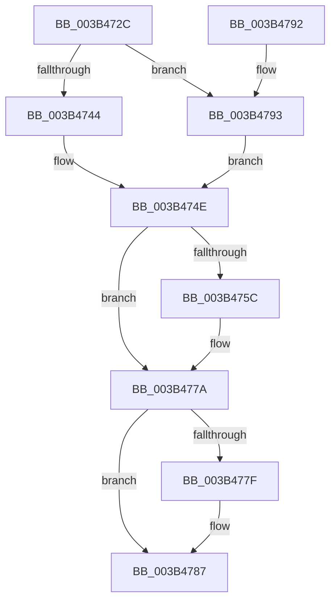

# MiAssignInitialPageAttribute

- RVA: `0x003B472C`–`0x003B4797` (길이 `107` bytes)
- VA: `0x00000001403B472C`
- 실행 섹션: `.text`
- PDB 이름 있음: `예`; PDB Function 태그: `아니요`
- unwind 정보 RVA: `0x0008C5A0`
- 디코드: `36`개 명령, `107/107` bytes 표시
- 미해석 바이트: `0` (있으면 어셈블리에 `.byte`로 보존)

> 이 문서는 커널 이미지의 기계어와 PDB 기호를 분석해 생성했습니다. 4번과 5번은 함수 원형과 자료형을 바이너리 사용 방식에서 추정한 C 해석이며 원본 소스 복구 결과는 아닙니다.

## 1. Dependencies

- 직접 호출 지점: **3**; 고유 호출 대상: **3**
- 직접 호출자로 확인된 함수: **3**
- RIP 상대 이미지 참조: **0**

### Outgoing calls
- `0x003B473B` → [MiMirrorInSingleProcessorMode](MiMirrorInSingleProcessorMode_function_003B47A0.md) (function, `0x003B47A0`)
- `0x003B4747` → [MiLockPageInline](../31/MiLockPageInline_function_0031A340.md) (function, `0x0031A340`)
- `0x003B4782` → [MiUnlockPage](../31/MiUnlockPage_function_0031A3E0.md) (function, `0x0031A3E0`)

### Direct callers
- [MiInsertPhysicalPteMapping](../2A/MiInsertPhysicalPteMapping_function_002AE26C.md) at `0x002AE507`
- [MiMapContiguousMemoryLarge](MiMapContiguousMemoryLarge_function_003B44CC.md) at `0x003B45DD`
- [MiMapMdlCommon](../67/MiMapMdlCommon_function_00674524.md) at `0x0067468B`

### Static image references
- 디코드된 RIP-relative 메모리 참조가 없습니다.

## 2. Other-region calls and transfers

- 다른 실행 섹션으로 향하는 call: **0**
- 별도 외부 분기/꼬리 이동을 확인하지 못했습니다.

## 3. Assembly (complete function range)

```asm
003B472C  48 89 5C 24 10                  mov qword ptr [rsp + 0x10], rbx
003B4731  57                              push rdi
003B4732  48 83 EC 20                     sub rsp, 0x20
003B4736  8B FA                           mov edi, edx
003B4738  48 8B D9                        mov rbx, rcx
003B473B  E8 60 00 00 00                  call 0x1403b47a0
003B4740  85 C0                           test eax, eax
003B4742  75 4F                           jne 0x1403b4793
003B4744  48 8B CB                        mov rcx, rbx
003B4747  E8 F4 5B F6 FF                  call 0x14031a340
003B474C  8A D0                           mov dl, al
003B474E  8B 4B 20                        mov ecx, dword ptr [rbx + 0x20]
003B4751  C1 E9 10                        shr ecx, 0x10
003B4754  80 E1 C0                        and cl, 0xc0
003B4757  80 F9 C0                        cmp cl, 0xc0
003B475A  75 1E                           jne 0x1403b477a
003B475C  8B 43 20                        mov eax, dword ptr [rbx + 0x20]
003B475F  89 44 24 30                     mov dword ptr [rsp + 0x30], eax
003B4763  C1 E8 10                        shr eax, 0x10
003B4766  24 3F                           and al, 0x3f
003B4768  40 C0 E7 06                     shl dil, 6
003B476C  40 0A C7                        or al, dil
003B476F  88 44 24 32                     mov byte ptr [rsp + 0x32], al
003B4773  8B 44 24 30                     mov eax, dword ptr [rsp + 0x30]
003B4777  89 43 20                        mov dword ptr [rbx + 0x20], eax
003B477A  80 FA 11                        cmp dl, 0x11
003B477D  74 08                           je 0x1403b4787
003B477F  48 8B CB                        mov rcx, rbx
003B4782  E8 59 5C F6 FF                  call 0x14031a3e0
003B4787  48 8B 5C 24 38                  mov rbx, qword ptr [rsp + 0x38]
003B478C  48 83 C4 20                     add rsp, 0x20
003B4790  5F                              pop rdi
003B4791  C3                              ret
003B4792  CC                              int3
003B4793  B2 11                           mov dl, 0x11
003B4795  EB B7                           jmp 0x1403b474e
```

## 4. C-style interpretation (structured pseudocode)

```c
__int64 __fastcall MiAssignInitialPageAttribute(__int64 a1, int a2)
{
    __int64 result;
    __int64 v_rdi;
    __int64 v_rsp;
    unsigned __int64 v_stack_p10;
    unsigned int v_stack_p8;
    unsigned __int8 v_stack_pA;

    v_stack_p10 = v_rbx;
    v_rsp = (v_rsp) - (32);
    result = MiMirrorInSingleProcessorMode(a1, a2, a3, a4);
    if ((unsigned int)(result) != 0) goto loc_003B4793;
    result = MiLockPageInline(a1, a2, a3, a4);
loc_003B474E:
    a1 = (unsigned int)(((unsigned int)(*(unsigned int *)(a1 + 32))) >> (16));
    a1 = (unsigned __int8)((a1) & (192));
    v_rdi = (unsigned int)(a2);
    if (((unsigned __int8)(a1)) == 192) {
        result = *(unsigned int *)(a1 + 32);
        v_stack_p8 = (unsigned int)(result);
        result = (unsigned int)((result) >> (16));
        result = (unsigned __int8)((result) & (63));
        v_rdi = (unsigned __int8)(((unsigned int)(a2)) << (6));
        result = (unsigned __int8)((result) | ((unsigned __int8)(v_rdi)));
        v_stack_pA = (unsigned __int8)(result);
        result = v_stack_p8;
        *(unsigned int *)(a1 + 32) = (unsigned int)(result);
    }
    if (((unsigned __int8)((unsigned __int8)(result))) != 17) {
        a1 = a1;
        result = MiUnlockPage(a1, (unsigned __int8)(result), a3, a4);
    }
    v_rsp = (v_rsp) + (32);
    return result;
loc_003B4793:
    goto loc_003B474E;
}
```

## 5. (Beta) C Style

```c
int64_t MiAssignInitialPageAttribute(void *Arg1, int32_t Arg2)
{
    uint8_t *arg1 = (uint8_t *)Arg1;

    int64_t result;
    int64_t local_rdi;
    int64_t local_rsp;
    uint64_t v_stack_p10;
    uint32_t v_stack_p8;
    uint8_t v_stack_pA;

    v_stack_p10 = local_rbx;
    local_rsp = (local_rsp) - (32);
    result = MiMirrorInSingleProcessorMode(Arg1, Arg2, a3, a4);
    if ((uint32_t)(result) != 0) goto loc_003B4793;
    result = MiLockPageInline(Arg1, Arg2, a3, a4);
loc_003B474E:
    Arg1 = (uint32_t)(((uint32_t)(*(uint32_t *)(arg1 + 0x20))) >> (16));
    Arg1 = (uint8_t)((Arg1) & (192));
    local_rdi = (uint32_t)(Arg2);
    if (((uint8_t)(Arg1)) == 192) {
        result = *(uint32_t *)(arg1 + 0x20);
        v_stack_p8 = (uint32_t)(result);
        result = (uint32_t)((result) >> (16));
        result = (uint8_t)((result) & (63));
        local_rdi = (uint8_t)(((uint32_t)(Arg2)) << (6));
        result = (uint8_t)((result) | ((uint8_t)(local_rdi)));
        v_stack_pA = (uint8_t)(result);
        result = v_stack_p8;
        *(uint32_t *)(arg1 + 0x20) = (uint32_t)(result);
    }
    if (((uint8_t)((uint8_t)(result))) != 17) {
        Arg1 = Arg1;
        result = MiUnlockPage(Arg1, (uint8_t)(result), a3, a4);
    }
    local_rsp = (local_rsp) + (32);
    return result;
loc_003B4793:
    goto loc_003B474E;
}
```

### 관측된 메모리 오프셋

구조체 형식이 확인되지 않은 접근은 인자 기준의 오프셋으로만 기록했습니다.

| 기준 인자 | 오프셋 표현 | 폭 (bit) | 접근 |
|---|---:|---:|---|
| `Arg1` | `+ 0x20` | `32` | `R` |
| `Arg1` | `+ 0x20` | `32` | `W` |

## 6. Execution-region graph

[열기: 2D/3D 그래프와 함수 탐색 컨트롤 패널](../../../control-panel.html?section=text&rva=0x003B472C&view=graph)

- 2D 그래프는 위에서 아래로 흐르고, 3D 그래프는 빈 공간을 드래그해 회전합니다. Shift+드래그는 이동, 휠은 확대·축소, 함수 노드 선택은 대상 보고서 이동입니다.

### Static fallback


