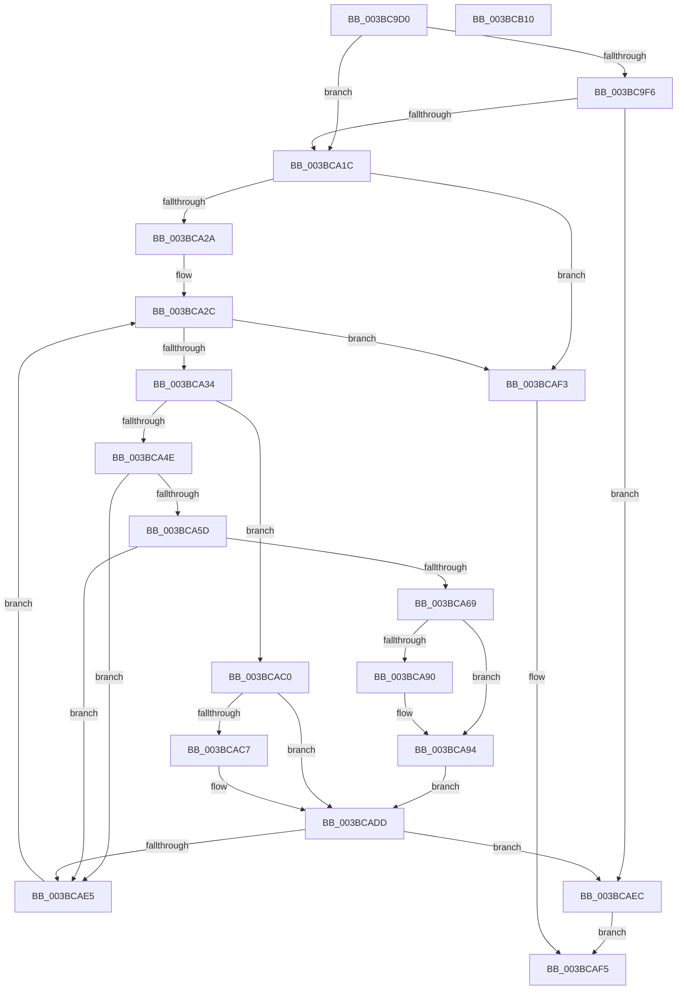

# MiCanFlushMakeProgress

- RVA: `0x003BC9D0`–`0x003BCB11` (길이 `321` bytes)
- VA: `0x00000001403BC9D0`
- 실행 섹션: `.text`
- PDB 이름 있음: `예`; PDB Function 태그: `아니요`
- unwind 정보 RVA: `0x0005E6B4`
- 디코드: `87`개 명령, `321/321` bytes 표시
- 미해석 바이트: `0` (있으면 어셈블리에 `.byte`로 보존)

> 이 문서는 커널 이미지의 기계어와 PDB 기호를 분석해 생성했습니다. 4번과 5번은 함수 원형과 자료형을 바이너리 사용 방식에서 추정한 C 해석이며 원본 소스 복구 결과는 아닙니다.

## 1. Dependencies

- 직접 호출 지점: **1**; 고유 호출 대상: **1**
- 직접 호출자로 확인된 함수: **5**
- RIP 상대 이미지 참조: **0**

### Outgoing calls
- `0x003BCA60` → [MiIsStoreVirtualPagefileFull](../4A/MiIsStoreVirtualPagefileFull_function_004ACB9C.md) (function, `0x004ACB9C`)

### Direct callers
- [MiWaitForFreePage](../2A/MiWaitForFreePage_function_002A3324.md) at `0x002A345B`
- [MiUserFault](../32/MiUserFault_function_00329840.md) at `0x0032994D`
- [MiCheckSystemTrimEndCriteria](../34/MiCheckSystemTrimEndCriteria_function_0034EDC8.md) at `0x0034EE8B`
- [MiFlushAllStoreSwapPages](MiFlushAllStoreSwapPages_function_003BC890.md) at `0x003BC919`
- [MiFlushAllPagesWorker](MiFlushAllPagesWorker_function_003BCED4.md) at `0x003BCF34`

### Static image references
- 디코드된 RIP-relative 메모리 참조가 없습니다.

## 2. Other-region calls and transfers

- 다른 실행 섹션으로 향하는 call: **0**
- 별도 외부 분기/꼬리 이동을 확인하지 못했습니다.

## 3. Assembly (complete function range)

```asm
003BC9D0  48 8B C4                        mov rax, rsp
003BC9D3  48 89 58 08                     mov qword ptr [rax + 8], rbx
003BC9D7  48 89 68 10                     mov qword ptr [rax + 0x10], rbp
003BC9DB  48 89 70 18                     mov qword ptr [rax + 0x18], rsi
003BC9DF  48 89 78 20                     mov qword ptr [rax + 0x20], rdi
003BC9E3  41 56                           push r14
003BC9E5  48 83 EC 20                     sub rsp, 0x20
003BC9E9  45 33 D2                        xor r10d, r10d
003BC9EC  49 8B F0                        mov rsi, r8
003BC9EF  4C 8B D9                        mov r11, rcx
003BC9F2  85 D2                           test edx, edx
003BC9F4  75 26                           jne 0x1403bca1c
003BC9F6  4C 8B 89 C0 4B 00 00            mov r9, qword ptr [rcx + 0x4bc0]
003BC9FD  48 8B 91 A0 4C 00 00            mov rdx, qword ptr [rcx + 0x4ca0]
003BCA04  49 8B C1                        mov rax, r9
003BCA07  48 2B C2                        sub rax, rdx
003BCA0A  49 3B D1                        cmp rdx, r9
003BCA0D  4D 1B D2                        sbb r10, r10
003BCA10  4C 23 D0                        and r10, rax
003BCA13  4D 3B D0                        cmp r10, r8
003BCA16  0F 83 D0 00 00 00               jae 0x1403bcaec
003BCA1C  8B A9 58 48 00 00               mov ebp, dword ptr [rcx + 0x4858]
003BCA22  85 ED                           test ebp, ebp
003BCA24  0F 84 C9 00 00 00               je 0x1403bcaf3
003BCA2A  33 DB                           xor ebx, ebx
003BCA2C  3B DD                           cmp ebx, ebp
003BCA2E  0F 83 BF 00 00 00               jae 0x1403bcaf3
003BCA34  4D 8B B4 DB 60 48 00 00         mov r14, qword ptr [r11 + rbx*8 + 0x4860]
003BCA3C  8B C3                           mov eax, ebx
003BCA3E  41 8B 7E 0C                     mov edi, dword ptr [r14 + 0xc]
003BCA42  41 0F B7 86 AC 00 00 00         movzx eax, word ptr [r14 + 0xac]
003BCA4A  A8 40                           test al, 0x40
003BCA4C  74 72                           je 0x1403bcac0
003BCA4E  41 8B 83 C4 04 00 00            mov eax, dword ptr [r11 + 0x4c4]
003BCA55  85 C0                           test eax, eax
003BCA57  0F 85 88 00 00 00               jne 0x1403bcae5
003BCA5D  49 8B CB                        mov rcx, r11
003BCA60  E8 37 01 0F 00                  call 0x1404acb9c
003BCA65  85 C0                           test eax, eax
003BCA67  75 7C                           jne 0x1403bcae5
003BCA69  49 8B 83 C8 41 00 00            mov rax, qword ptr [r11 + 0x41c8]
003BCA70  41 8B 8B BC 04 00 00            mov ecx, dword ptr [r11 + 0x4bc]
003BCA77  48 05 FF FF 03 00               add rax, 0x3ffff
003BCA7D  48 25 00 00 FC FF               and rax, 0xfffffffffffc0000
003BCA83  48 3B C1                        cmp rax, rcx
003BCA86  0F 46 C8                        cmovbe ecx, eax
003BCA89  41 8B 06                        mov eax, dword ptr [r14]
003BCA8C  3B C8                           cmp ecx, eax
003BCA8E  76 04                           jbe 0x1403bca94
003BCA90  2B C8                           sub ecx, eax
003BCA92  03 F9                           add edi, ecx
003BCA94  41 0F B7 86 AC 00 00 00         movzx eax, word ptr [r14 + 0xac]
003BCA9C  83 E0 0F                        and eax, 0xf
003BCA9F  48 83 C0 30                     add rax, 0x30
003BCAA3  48 6B C0 58                     imul rax, rax, 0x58
003BCAA7  4A 8B 0C 18                     mov rcx, qword ptr [rax + r11]
003BCAAB  49 8B 93 00 10 00 00            mov rdx, qword ptr [r11 + 0x1000]
003BCAB2  48 03 D1                        add rdx, rcx
003BCAB5  8B C7                           mov eax, edi
003BCAB7  48 3B D0                        cmp rdx, rax
003BCABA  48 0F 43 D0                     cmovae rdx, rax
003BCABE  EB 1D                           jmp 0x1403bcadd
003BCAC0  48 8B D7                        mov rdx, rdi
003BCAC3  A8 10                           test al, 0x10
003BCAC5  74 16                           je 0x1403bcadd
003BCAC7  83 E0 0F                        and eax, 0xf
003BCACA  48 83 C0 30                     add rax, 0x30
003BCACE  48 6B C0 58                     imul rax, rax, 0x58
003BCAD2  4A 8B 0C 18                     mov rcx, qword ptr [rax + r11]
003BCAD6  48 3B CA                        cmp rcx, rdx
003BCAD9  48 0F 42 D1                     cmovb rdx, rcx
003BCADD  4C 03 D2                        add r10, rdx
003BCAE0  4C 3B D6                        cmp r10, rsi
003BCAE3  73 07                           jae 0x1403bcaec
003BCAE5  FF C3                           inc ebx
003BCAE7  E9 40 FF FF FF                  jmp 0x1403bca2c
003BCAEC  B8 01 00 00 00                  mov eax, 1
003BCAF1  EB 02                           jmp 0x1403bcaf5
003BCAF3  33 C0                           xor eax, eax
003BCAF5  48 8B 5C 24 30                  mov rbx, qword ptr [rsp + 0x30]
003BCAFA  48 8B 6C 24 38                  mov rbp, qword ptr [rsp + 0x38]
003BCAFF  48 8B 74 24 40                  mov rsi, qword ptr [rsp + 0x40]
003BCB04  48 8B 7C 24 48                  mov rdi, qword ptr [rsp + 0x48]
003BCB09  48 83 C4 20                     add rsp, 0x20
003BCB0D  41 5E                           pop r14
003BCB0F  C3                              ret
003BCB10  CC                              int3
```

## 4. C-style interpretation (structured pseudocode)

```c
__int64 __fastcall MiCanFlushMakeProgress(__int64 a1, int a2, __int64 a3)
{
    __int64 result;
    __int64 v_r10;
    __int64 v_rbx;
    __int64 v_rdi;
    __int64 v_rsp;
    unsigned __int64 v_stack_p10;
    unsigned __int64 v_stack_p18;
    unsigned __int64 v_stack_p20;
    unsigned __int64 v_stack_p8;

    *(unsigned __int64 *)(v_rsp + 8) = v_rbx;
    *(unsigned __int64 *)(v_rsp + 16) = v_rbp;
    *(unsigned __int64 *)(v_rsp + 24) = v_rsi;
    *(unsigned __int64 *)(v_rsp + 32) = v_rdi;
    v_rsp = (v_rsp) - (32);
    v_r10 = 0;
    if (a2 != 0) goto loc_003BCA1C;
    result = (*(unsigned __int64 *)(a1 + 19392)) - (*(unsigned __int64 *)(a1 + 19616));
    v_r10 = (v_r10) & (result);
    if (v_r10 >= a3) goto loc_003BCAEC;
loc_003BCA1C:
    if ((unsigned int)((unsigned int)(*(unsigned int *)(a1 + 18520))) == 0) goto loc_003BCAF3;
    v_rbx = 0;
loc_003BCA2C:
    if (0 >= ((unsigned int)((unsigned int)(*(unsigned int *)(a1 + 18520))))) goto loc_003BCAF3;
    if ((((unsigned __int8)(*(unsigned __int16 *)(*(unsigned __int64 *)(a1 + v_rbx * 8 + 18528) + 172))) & (64)) == 0) goto loc_003BCAC0;
    if ((unsigned int)((unsigned int)(*(unsigned int *)(a1 + 1220))) != 0) goto loc_003BCAE5;
    result = MiIsStoreVirtualPagefileFull(a1, *(unsigned __int64 *)(a1 + 19616), a3, *(unsigned __int64 *)(a1 + 19392));
    if ((unsigned int)(result) != 0) goto loc_003BCAE5;
    result = (*(unsigned __int64 *)(a1 + 16840)) + (0x3FFFFULL);
    result = (result) & (0xFFFFFFFFFFFC0000ULL);
    a1 = (unsigned int)(*(unsigned int *)(a1 + 1212));
    if (result <= ((unsigned int)(*(unsigned int *)(a1 + 1212)))) { a1 = (unsigned int)(result); }
    v_rdi = (unsigned int)(*(unsigned int *)(*(unsigned __int64 *)(a1 + v_rbx * 8 + 18528) + 12));
    if (((unsigned int)(a1)) >= = ((unsigned int)((unsigned int)(*(unsigned int *)(*(unsigned __int64 *)(a1 + v_rbx * 8 + 18528)))))) {
        a1 = (unsigned int)((a1) - ((unsigned int)((unsigned int)(*(unsigned int *)(*(unsigned __int64 *)(a1 + v_rbx * 8 + 18528))))));
        v_rdi = (unsigned int)(((unsigned int)(*(unsigned int *)(*(unsigned __int64 *)(a1 + v_rbx * 8 + 18528) + 12))) + ((unsigned int)(a1)));
    }
    result = (unsigned int)((*(unsigned __int16 *)(*(unsigned __int64 *)(a1 + v_rbx * 8 + 18528) + 172)) & (15));
    result = (result) + (48);
    result = (result) * (result);
    a2 = (*(unsigned __int64 *)(a1 + 4096)) + (*(unsigned __int64 *)(result + a1 * 1));
    if (a2 >= ((unsigned int)((unsigned int)(v_rdi)))) { a2 = (unsigned int)((unsigned int)(v_rdi)); }
    goto loc_003BCADD;
loc_003BCAC0:
    result = (unsigned int)((unsigned int)(v_rdi));
    if ((((unsigned __int8)((unsigned int)((unsigned int)(v_rdi)))) & (16)) != 0) {
        result = (unsigned int)(((unsigned int)((unsigned int)(v_rdi))) & (15));
        result = (result) + (48);
        result = (result) * (result);
        a1 = *(unsigned __int64 *)(result + a1 * 1);
        a2 = v_rdi;
        if (a1 < v_rdi) { a2 = a1; }
    }
    v_r10 = (v_r10) + (a2);
    if (v_r10 >= a3) goto loc_003BCAEC;
loc_003BCAE5:
    v_rbx = (unsigned int)((v_rbx) + 1);
    goto loc_003BCA2C;
loc_003BCAEC:
    goto loc_003BCAF5;
loc_003BCAF3:
    result = 0;
loc_003BCAF5:
    v_rsp = (v_rsp) + (32);
    return result;
}
```

## 5. (Beta) C Style

```c
int64_t MiCanFlushMakeProgress(void *Arg1, int32_t Arg2, int64_t Arg3)
{
    uint8_t *arg1 = (uint8_t *)Arg1;

    int64_t result;
    int64_t local_r10;
    int64_t local_rbx;
    int64_t local_rdi;
    int64_t local_rsp;
    uint64_t v_stack_p10;
    uint64_t v_stack_p18;
    uint64_t v_stack_p20;
    uint64_t v_stack_p8;

    *(uint64_t *)(local_rsp + 0x8) = local_rbx;
    *(uint64_t *)(local_rsp + 0x10) = local_rbp;
    *(uint64_t *)(local_rsp + 0x18) = local_rsi;
    *(uint64_t *)(local_rsp + 0x20) = local_rdi;
    local_rsp = (local_rsp) - (32);
    local_r10 = 0;
    if (Arg2 != 0) goto loc_003BCA1C;
    result = (*(uint64_t *)(arg1 + 0x4BC0)) - (*(uint64_t *)(arg1 + 0x4CA0));
    local_r10 = (local_r10) & (result);
    if (local_r10 >= Arg3) goto loc_003BCAEC;
loc_003BCA1C:
    if ((uint32_t)((uint32_t)(*(uint32_t *)(arg1 + 0x4858))) == 0) goto loc_003BCAF3;
    local_rbx = 0;
loc_003BCA2C:
    if (0 >= ((uint32_t)((uint32_t)(*(uint32_t *)(arg1 + 0x4858))))) goto loc_003BCAF3;
    if ((((uint8_t)(*(uint16_t *)(*(uint64_t *)(arg1 + local_rbx * 8 + 0x4860) + 0xAC))) & (64)) == 0) goto loc_003BCAC0;
    if ((uint32_t)((uint32_t)(*(uint32_t *)(arg1 + 0x4C4))) != 0) goto loc_003BCAE5;
    result = MiIsStoreVirtualPagefileFull(Arg1, *(uint64_t *)(arg1 + 0x4CA0), Arg3, *(uint64_t *)(arg1 + 0x4BC0));
    if ((uint32_t)(result) != 0) goto loc_003BCAE5;
    result = (*(uint64_t *)(arg1 + 0x41C8)) + (0x3FFFFULL);
    result = (result) & (0xFFFFFFFFFFFC0000ULL);
    Arg1 = (uint32_t)(*(uint32_t *)(arg1 + 0x4BC));
    if (result <= ((uint32_t)(*(uint32_t *)(arg1 + 0x4BC)))) { Arg1 = (uint32_t)(result); }
    local_rdi = (uint32_t)(*(uint32_t *)(*(uint64_t *)(arg1 + local_rbx * 8 + 0x4860) + 0xC));
    if (((uint32_t)(Arg1)) >= = ((uint32_t)((uint32_t)(*(uint32_t *)(*(uint64_t *)(arg1 + local_rbx * 8 + 0x4860)))))) {
        Arg1 = (uint32_t)((Arg1) - ((uint32_t)((uint32_t)(*(uint32_t *)(*(uint64_t *)(arg1 + local_rbx * 8 + 0x4860))))));
        local_rdi = (uint32_t)(((uint32_t)(*(uint32_t *)(*(uint64_t *)(arg1 + local_rbx * 8 + 0x4860) + 0xC))) + ((uint32_t)(Arg1)));
    }
    result = (uint32_t)((*(uint16_t *)(*(uint64_t *)(arg1 + local_rbx * 8 + 0x4860) + 0xAC)) & (15));
    result = (result) + (48);
    result = (result) * (result);
    Arg2 = (*(uint64_t *)(arg1 + 0x1000)) + (*(uint64_t *)(result + arg1 * 1));
    if (Arg2 >= ((uint32_t)((uint32_t)(local_rdi)))) { Arg2 = (uint32_t)((uint32_t)(local_rdi)); }
    goto loc_003BCADD;
loc_003BCAC0:
    result = (uint32_t)((uint32_t)(local_rdi));
    if ((((uint8_t)((uint32_t)((uint32_t)(local_rdi)))) & (16)) != 0) {
        result = (uint32_t)(((uint32_t)((uint32_t)(local_rdi))) & (15));
        result = (result) + (48);
        result = (result) * (result);
        Arg1 = *(uint64_t *)(result + arg1 * 1);
        Arg2 = local_rdi;
        if (Arg1 < local_rdi) { Arg2 = Arg1; }
    }
    local_r10 = (local_r10) + (Arg2);
    if (local_r10 >= Arg3) goto loc_003BCAEC;
loc_003BCAE5:
    local_rbx = (uint32_t)((local_rbx) + 1);
    goto loc_003BCA2C;
loc_003BCAEC:
    goto loc_003BCAF5;
loc_003BCAF3:
    result = 0;
loc_003BCAF5:
    local_rsp = (local_rsp) + (32);
    return result;
}
```

### 관측된 메모리 오프셋

구조체 형식이 확인되지 않은 접근은 인자 기준의 오프셋으로만 기록했습니다.

| 기준 인자 | 오프셋 표현 | 폭 (bit) | 접근 |
|---|---:|---:|---|
| `Arg1` | `+ 0x4858` | `32` | `R` |
| `Arg1` | `+ 0x4BC0` | `64` | `R` |
| `Arg1` | `+ 0x4CA0` | `64` | `R` |

## 6. Execution-region graph

[열기: 2D/3D 그래프와 함수 탐색 컨트롤 패널](../../../control-panel.html?section=text&rva=0x003BC9D0&view=graph)

- 2D 그래프는 위에서 아래로 흐르고, 3D 그래프는 빈 공간을 드래그해 회전합니다. Shift+드래그는 이동, 휠은 확대·축소, 함수 노드 선택은 대상 보고서 이동입니다.

### Static fallback


