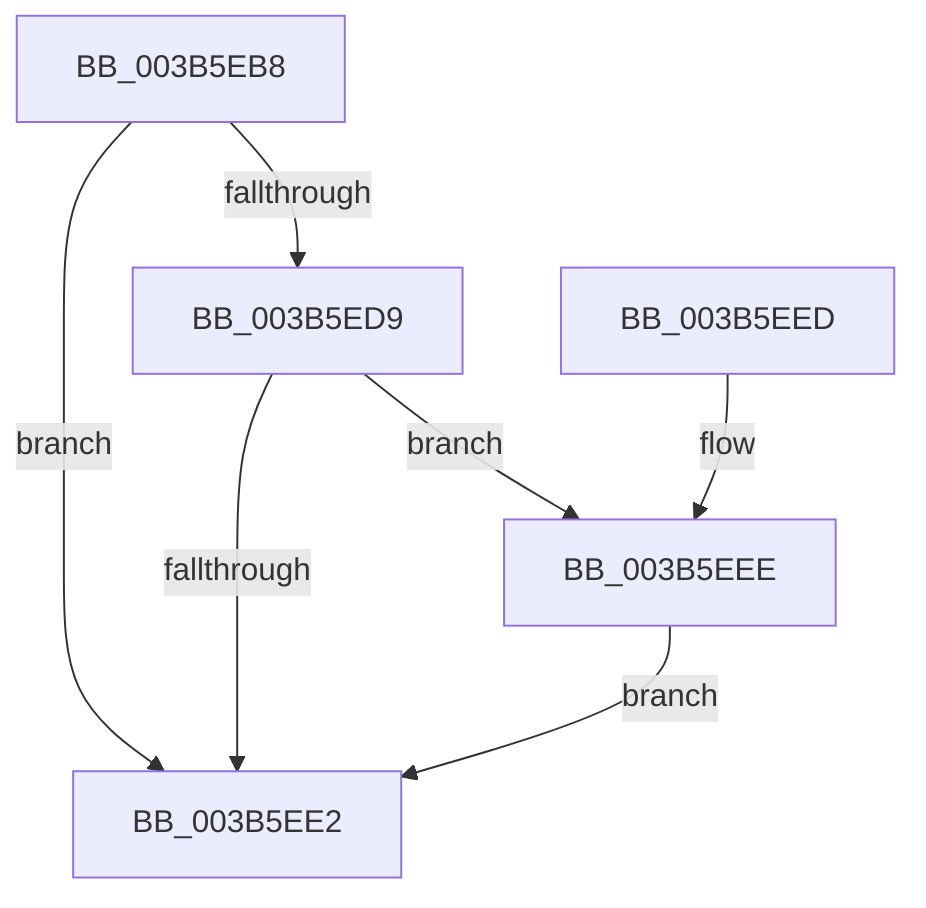

# MiCleanupPageTablePages

- RVA: `0x003B5EB8`–`0x003B5F03` (길이 `75` bytes)
- VA: `0x00000001403B5EB8`
- 실행 섹션: `.text`
- PDB 이름 있음: `예`; PDB Function 태그: `아니요`
- unwind 정보 RVA: `0x0008C670`
- 디코드: `24`개 명령, `75/75` bytes 표시
- 미해석 바이트: `0` (있으면 어셈블리에 `.byte`로 보존)

> 이 문서는 커널 이미지의 기계어와 PDB 기호를 분석해 생성했습니다. 4번과 5번은 함수 원형과 자료형을 바이너리 사용 방식에서 추정한 C 해석이며 원본 소스 복구 결과는 아닙니다.

## 1. Dependencies

- 직접 호출 지점: **2**; 고유 호출 대상: **2**
- 직접 호출자로 확인된 함수: **2**
- RIP 상대 이미지 참조: **0**

### Outgoing calls
- `0x003B5ECB` → [MiFreeLargeZeroPages](MiFreeLargeZeroPages_function_003B5F0C.md) (function, `0x003B5F0C`)
- `0x003B5EFC` → [MiReturnSystemCharges](../36/MiReturnSystemCharges_function_00367A48.md) (function, `0x00367A48`)

### Direct callers
- [MiMakeZeroedPageTablesEx](MiMakeZeroedPageTablesEx_function_003B59FC.md) at `0x003B5C7A`
- [MiMakeZeroedPageTablesEx](MiMakeZeroedPageTablesEx_function_003B59FC.md) at `0x003B5DB5`
- [MmCreateShadowMapping](../../page/80/MmCreateShadowMapping_function_00807AB0.md) at `0x00807CBF`

### Static image references
- 디코드된 RIP-relative 메모리 참조가 없습니다.

## 2. Other-region calls and transfers

- 다른 실행 섹션으로 향하는 call: **0**
- 별도 외부 분기/꼬리 이동을 확인하지 못했습니다.

## 3. Assembly (complete function range)

```asm
003B5EB8  40 53                           push rbx
003B5EBA  48 83 EC 20                     sub rsp, 0x20
003B5EBE  48 8B D9                        mov rbx, rcx
003B5EC1  48 8B D1                        mov rdx, rcx
003B5EC4  48 8B 49 60                     mov rcx, qword ptr [rcx + 0x60]
003B5EC8  45 33 C0                        xor r8d, r8d
003B5ECB  E8 3C 00 00 00                  call 0x1403b5f0c
003B5ED0  48 8B 53 68                     mov rdx, qword ptr [rbx + 0x68]
003B5ED4  48 85 D2                        test rdx, rdx
003B5ED7  74 09                           je 0x1403b5ee2
003B5ED9  48 8B 43 70                     mov rax, qword ptr [rbx + 0x70]
003B5EDD  48 3B C2                        cmp rax, rdx
003B5EE0  75 0C                           jne 0x1403b5eee
003B5EE2  48 83 63 68 00                  and qword ptr [rbx + 0x68], 0
003B5EE7  48 83 C4 20                     add rsp, 0x20
003B5EEB  5B                              pop rbx
003B5EEC  C3                              ret
003B5EED  CC                              int3
003B5EEE  44 8B 4B 78                     mov r9d, dword ptr [rbx + 0x78]
003B5EF2  48 2B D0                        sub rdx, rax
003B5EF5  48 8B 4B 60                     mov rcx, qword ptr [rbx + 0x60]
003B5EF9  4C 8B C2                        mov r8, rdx
003B5EFC  E8 47 1B FB FF                  call 0x140367a48
003B5F01  EB DF                           jmp 0x1403b5ee2
```

## 4. C-style interpretation (structured pseudocode)

```c
__int64 __fastcall MiCleanupPageTablePages(__int64 a1, __int64 a2, int a3)
{
    __int64 result;
    __int64 v_rsp;

    v_rsp = (v_rsp) - (32);
    a3 = 0;
    result = MiFreeLargeZeroPages(*(unsigned __int64 *)(a1 + 96), a1, a3, a4);
    if (*(unsigned __int64 *)(a1 + 104) == 0) goto loc_003B5EE2;
    if ((*(unsigned __int64 *)(a1 + 112)) != (*(unsigned __int64 *)(a1 + 104))) goto loc_003B5EEE;
loc_003B5EE2:
    v_rsp = (v_rsp) + (32);
    return *(unsigned __int64 *)(a1 + 112);
loc_003B5EEE:
    a2 = (*(unsigned __int64 *)(a1 + 104)) - (*(unsigned __int64 *)(a1 + 112));
    result = MiReturnSystemCharges(*(unsigned __int64 *)(a1 + 96), a2, a2, (unsigned int)(*(unsigned int *)(a1 + 120)));
    goto loc_003B5EE2;
}
```

## 5. (Beta) C Style

```c
int64_t MiCleanupPageTablePages(void *Arg1, int64_t Arg2, int32_t Arg3)
{
    uint8_t *arg1 = (uint8_t *)Arg1;

    int64_t result;
    int64_t local_rsp;

    local_rsp = (local_rsp) - (32);
    Arg3 = 0;
    result = MiFreeLargeZeroPages(*(uint64_t *)(arg1 + 0x60), Arg1, Arg3, a4);
    if (*(uint64_t *)(arg1 + 0x68) == 0) goto loc_003B5EE2;
    if ((*(uint64_t *)(arg1 + 0x70)) != (*(uint64_t *)(arg1 + 0x68))) goto loc_003B5EEE;
loc_003B5EE2:
    local_rsp = (local_rsp) + (32);
    return *(uint64_t *)(arg1 + 0x70);
loc_003B5EEE:
    Arg2 = (*(uint64_t *)(arg1 + 0x68)) - (*(uint64_t *)(arg1 + 0x70));
    result = MiReturnSystemCharges(*(uint64_t *)(arg1 + 0x60), Arg2, Arg2, (uint32_t)(*(uint32_t *)(arg1 + 0x78)));
    goto loc_003B5EE2;
}
```

### 관측된 메모리 오프셋

구조체 형식이 확인되지 않은 접근은 인자 기준의 오프셋으로만 기록했습니다.

| 기준 인자 | 오프셋 표현 | 폭 (bit) | 접근 |
|---|---:|---:|---|
| `Arg1` | `+ 0x60` | `64` | `R` |
| `Arg1` | `+ 0x68` | `64` | `R` |
| `Arg1` | `+ 0x68` | `64` | `R/W` |
| `Arg1` | `+ 0x70` | `64` | `R` |
| `Arg1` | `+ 0x78` | `32` | `R` |

## 6. Execution-region graph

[열기: 2D/3D 그래프와 함수 탐색 컨트롤 패널](../../../control-panel.html?section=text&rva=0x003B5EB8&view=graph)

- 2D 그래프는 위에서 아래로 흐르고, 3D 그래프는 빈 공간을 드래그해 회전합니다. Shift+드래그는 이동, 휠은 확대·축소, 함수 노드 선택은 대상 보고서 이동입니다.

### Static fallback


