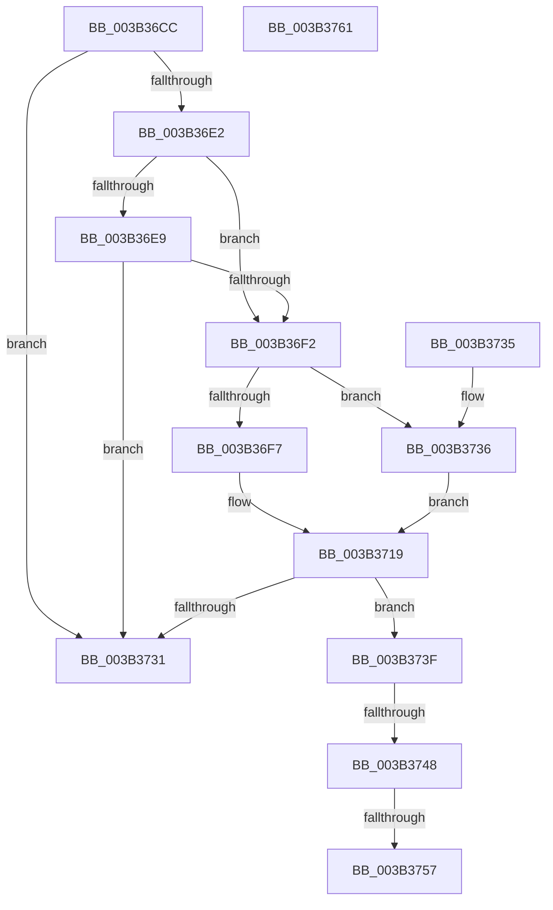

# MiControlAreaRequiresCharge

- RVA: `0x003B36CC`–`0x003B3762` (길이 `150` bytes)
- VA: `0x00000001403B36CC`
- 실행 섹션: `.text`
- PDB 이름 있음: `예`; PDB Function 태그: `예`
- unwind 정보 RVA: `0x000DB714`
- 디코드: `36`개 명령, `150/150` bytes 표시
- 미해석 바이트: `0` (있으면 어셈블리에 `.byte`로 보존)

> 이 문서는 커널 이미지의 기계어와 PDB 기호를 분석해 생성했습니다. 4번과 5번은 함수 원형과 자료형을 바이너리 사용 방식에서 추정한 C 해석이며 원본 소스 복구 결과는 아닙니다.

## 1. Dependencies

- 직접 호출 지점: **0**; 고유 호출 대상: **0**
- 직접 호출자로 확인된 함수: **8**
- RIP 상대 이미지 참조: **3**

### Outgoing calls
- 직접 디코드된 call 명령이 없습니다.

### Direct callers
- [MiCreatePrototypePtes](../29/MiCreatePrototypePtes_function_002950FC.md) at `0x00295371`
- [MiReferenceControlArea](../2B/MiReferenceControlArea_function_002BC198.md) at `0x002BC36C`
- [MiUpControlAreaRefs](MiUpControlAreaRefs_function_003B2BF0.md) at `0x003B2C20`
- [MiInsertInSystemSpace](MiInsertInSystemSpace_function_003B2F5C.md) at `0x003B310B`
- [MiDeleteVad](../../page/88/MiDeleteVad_function_00888C80.md) at `0x008890D1`
- [MiMapImageInSystemSpace](../../page/94/MiMapImageInSystemSpace_function_00941DD8.md) at `0x00941E2D`
- [MiMapViewOfImageSection](../../page/97/MiMapViewOfImageSection_function_0097E92C.md) at `0x0097EE3D`
- [MmLoadSystemImageEx](../../page/99/MmLoadSystemImageEx_function_00999B8C.md) at `0x00999DDA`

### Static image references
- `0x003B3707` → RVA `0x00E30088` (`.data`; read)
- `0x003B3736` → RVA `0x00E38D00` (`.data`; read)
- `0x003B3757` → RVA `0x00E30090` (`.data`; read/write)

## 2. Other-region calls and transfers

- 다른 실행 섹션으로 향하는 call: **0**
- call이 아닌 외부 분기/꼬리 이동: **2**
  - `0x003B3742` → `0x006E7202` (`tail-transfer`)
  - `0x003B3751` → `0x006E7202` (`tail-transfer`)

## 3. Assembly (complete function range)

```asm
003B36CC  44 8A 51 3E                     mov r10b, byte ptr [rcx + 0x3e]
003B36D0  44 8B CA                        mov r9d, edx
003B36D3  4C 8B C1                        mov r8, rcx
003B36D6  41 BB 01 00 00 00               mov r11d, 1
003B36DC  41 F6 C2 0C                     test r10b, 0xc
003B36E0  75 4F                           jne 0x1403b3731
003B36E2  48 83 79 40 00                  cmp qword ptr [rcx + 0x40], 0
003B36E7  75 09                           jne 0x1403b36f2
003B36E9  F7 41 5C 00 00 01 00            test dword ptr [rcx + 0x5c], 0x10000
003B36F0  75 3F                           jne 0x1403b3731
003B36F2  45 3B CB                        cmp r9d, r11d
003B36F5  77 3F                           ja 0x1403b3736
003B36F7  65 48 8B 04 25 88 01 00 00      mov rax, qword ptr gs:[0x188]
003B3700  48 8B 88 B8 00 00 00            mov rcx, qword ptr [rax + 0xb8]
003B3707  48 8B 05 7A C9 A7 00            mov rax, qword ptr [rip + 0xa7c97a]
003B370E  0F B7 91 AE 04 00 00            movzx edx, word ptr [rcx + 0x4ae]
003B3715  48 8B 14 D0                     mov rdx, qword ptr [rax + rdx*8]
003B3719  41 0F B7 48 3C                  movzx ecx, word ptr [r8 + 0x3c]
003B371E  48 8B 05 63 C9 A7 00            mov rax, qword ptr [rip + 0xa7c963]
003B3725  81 E1 FF 03 00 00               and ecx, 0x3ff
003B372B  48 3B 14 C8                     cmp rdx, qword ptr [rax + rcx*8]
003B372F  75 0E                           jne 0x1403b373f
003B3731  41 8B C3                        mov eax, r11d
003B3734  C3                              ret
003B3735  CC                              int3
003B3736  48 8D 15 C3 55 A8 00            lea rdx, [rip + 0xa855c3]
003B373D  EB DA                           jmp 0x1403b3719
003B373F  45 84 D3                        test r11b, r10b
003B3742  0F 84 BA 3A 33 00               je 0x1406e7202
003B3748  41 8D 41 FF                     lea eax, [r9 - 1]
003B374C  A9 FD FF FF FF                  test eax, 0xfffffffd
003B3751  0F 84 AB 3A 33 00               je 0x1406e7202
003B3757  44 01 1D 32 C9 A7 00            add dword ptr [rip + 0xa7c932], r11d
003B375E  33 C0                           xor eax, eax
003B3760  C3                              ret
003B3761  CC                              int3
```

## 4. C-style interpretation (structured pseudocode)

```c
__int64 __fastcall MiControlAreaRequiresCharge(__int64 a1, int a2)
{
    __int64 result;

    if ((((unsigned __int8)(*(unsigned __int8 *)(a1 + 62))) & (12)) != 0) goto loc_003B3731;
    if ((*(unsigned __int64 *)(a1 + 64)) != 0) goto loc_003B36F2;
    if (((*(unsigned int *)(a1 + 92)) & (0x10000ULL)) != 0) goto loc_003B3731;
loc_003B36F2:
    if (((unsigned int)((unsigned int)(a2))) > 1) goto loc_003B3736;
loc_003B3719:
    a1 = (unsigned int)((*(unsigned __int16 *)(a1 + 60)) & (0x3FFULL));
    if ((*(unsigned __int64 *)(*(unsigned __int64 *)(v_rip + 10996090) + *(unsigned __int16 *)(*(unsigned __int64 *)(*(unsigned __int64 *)(gs_base + (0 + 392)) + 184) + 1198) * 8)) != (*(unsigned __int64 *)(*(unsigned __int64 *)(v_rip + 10996067) + a1 * 8))) goto loc_003B373F;
loc_003B3731:
    return 1;
loc_003B3736:
    goto loc_003B3719;
loc_003B373F:
    result = 0;
    return result;
}
```

## 5. (Beta) C Style

```c
int64_t MiControlAreaRequiresCharge(void *Arg1, int32_t Arg2)
{
    uint8_t *arg1 = (uint8_t *)Arg1;

    int64_t result;

    if ((((uint8_t)(*(uint8_t *)(arg1 + 0x3E))) & (12)) != 0) goto loc_003B3731;
    if ((*(uint64_t *)(arg1 + 0x40)) != 0) goto loc_003B36F2;
    if (((*(uint32_t *)(arg1 + 0x5C)) & (0x10000ULL)) != 0) goto loc_003B3731;
loc_003B36F2:
    if (((uint32_t)((uint32_t)(Arg2))) > 1) goto loc_003B3736;
loc_003B3719:
    Arg1 = (uint32_t)((*(uint16_t *)(arg1 + 0x3C)) & (0x3FFULL));
    if ((*(uint64_t *)(*(uint64_t *)(v_rip + 0xA7C97A) + *(uint16_t *)(*(uint64_t *)(*(uint64_t *)(gs_base + (0 + 0x188)) + 0xB8) + 0x4AE) * 8)) != (*(uint64_t *)(*(uint64_t *)(v_rip + 0xA7C963) + arg1 * 8))) goto loc_003B373F;
loc_003B3731:
    return 1;
loc_003B3736:
    goto loc_003B3719;
loc_003B373F:
    result = 0;
    return result;
}
```

### 관측된 메모리 오프셋

구조체 형식이 확인되지 않은 접근은 인자 기준의 오프셋으로만 기록했습니다.

| 기준 인자 | 오프셋 표현 | 폭 (bit) | 접근 |
|---|---:|---:|---|
| `Arg1` | `+ 0x3C` | `16` | `R` |
| `Arg1` | `+ 0x3E` | `8` | `R` |
| `Arg1` | `+ 0x40` | `64` | `R` |
| `Arg1` | `+ 0x5C` | `32` | `R` |

## 6. Execution-region graph

[열기: 2D/3D 그래프와 함수 탐색 컨트롤 패널](../../../control-panel.html?section=text&rva=0x003B36CC&view=graph)

- 2D 그래프는 위에서 아래로 흐르고, 3D 그래프는 빈 공간을 드래그해 회전합니다. Shift+드래그는 이동, 휠은 확대·축소, 함수 노드 선택은 대상 보고서 이동입니다.

### Static fallback


