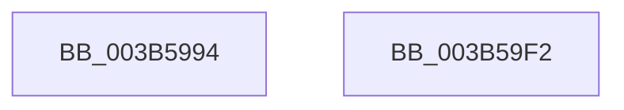

# MiCreatePoolPageTables

- RVA: `0x003B5994`–`0x003B59F3` (길이 `95` bytes)
- VA: `0x00000001403B5994`
- 실행 섹션: `.text`
- PDB 이름 있음: `예`; PDB Function 태그: `아니요`
- unwind 정보 RVA: `0x0005D2F4`
- 디코드: `25`개 명령, `95/95` bytes 표시
- 미해석 바이트: `0` (있으면 어셈블리에 `.byte`로 보존)

> 이 문서는 커널 이미지의 기계어와 PDB 기호를 분석해 생성했습니다. 4번과 5번은 함수 원형과 자료형을 바이너리 사용 방식에서 추정한 C 해석이며 원본 소스 복구 결과는 아닙니다.

## 1. Dependencies

- 직접 호출 지점: **1**; 고유 호출 대상: **1**
- 직접 호출자로 확인된 함수: **1**
- RIP 상대 이미지 참조: **0**

### Outgoing calls
- `0x003B59E8` → [MiMakeZeroedPageTablesEx](MiMakeZeroedPageTablesEx_function_003B59FC.md) (function, `0x003B59FC`)

### Direct callers
- [MiCommitPoolMemory](../32/MiCommitPoolMemory_function_00329520.md) at `0x003296FA`

### Static image references
- 디코드된 RIP-relative 메모리 참조가 없습니다.

## 2. Other-region calls and transfers

- 다른 실행 섹션으로 향하는 call: **0**
- 별도 외부 분기/꼬리 이동을 확인하지 못했습니다.

## 3. Assembly (complete function range)

```asm
003B5994  48 83 EC 38                     sub rsp, 0x38
003B5998  48 8B 41 50                     mov rax, qword ptr [rcx + 0x50]
003B599C  4C 8B DA                        mov r11, rdx
003B599F  44 0F B7 41 64                  movzx r8d, word ptr [rcx + 0x64]
003B59A4  44 8B 49 40                     mov r9d, dword ptr [rcx + 0x40]
003B59A8  41 83 E0 04                     and r8d, 4
003B59AC  41 0F BA E8 0A                  bts r8d, 0xa
003B59B1  41 D1 E8                        shr r8d, 1
003B59B4  45 8B D0                        mov r10d, r8d
003B59B7  41 0F BA EA 0C                  bts r10d, 0xc
003B59BC  80 79 66 02                     cmp byte ptr [rcx + 0x66], 2
003B59C0  45 0F 45 D0                     cmovne r10d, r8d
003B59C4  48 81 E2 00 F0 FF FF            and rdx, 0xfffffffffffff000
003B59CB  48 81 C2 F8 0F 00 00            add rdx, 0xff8
003B59D2  45 8B C2                        mov r8d, r10d
003B59D5  48 3B D0                        cmp rdx, rax
003B59D8  48 0F 47 D0                     cmova rdx, rax
003B59DC  8B 41 60                        mov eax, dword ptr [rcx + 0x60]
003B59DF  FF C0                           inc eax
003B59E1  49 8B CB                        mov rcx, r11
003B59E4  89 44 24 20                     mov dword ptr [rsp + 0x20], eax
003B59E8  E8 0F 00 00 00                  call 0x1403b59fc
003B59ED  48 83 C4 38                     add rsp, 0x38
003B59F1  C3                              ret
003B59F2  CC                              int3
```

## 4. C-style interpretation (structured pseudocode)

```c
__int64 __fastcall MiCreatePoolPageTables(__int64 a1, __int64 a2)
{
    __int64 result;
    __int64 v_r10;
    __int64 v_rsp;
    unsigned int v_stack_m18;

    v_rsp = (v_rsp) - (56);
    a3 = (unsigned int)((*(unsigned __int16 *)(a1 + 100)) & (4));
    a3 = (unsigned int)((a3) >> (1));
    v_r10 = (unsigned int)((unsigned int)(a3));
    if ((*(unsigned __int8 *)(a1 + 102)) != 2) { v_r10 = (unsigned int)(a3); }
    a2 = (a2) & (0xFFFFFFFFFFFFF000ULL);
    a2 = (a2) + (0xFF8ULL);
    if (a2 > (*(unsigned __int64 *)(a1 + 80))) { a2 = *(unsigned __int64 *)(a1 + 80); }
    result = (unsigned int)(((unsigned int)(*(unsigned int *)(a1 + 96))) + 1);
    v_stack_m18 = (unsigned int)(result);
    result = MiMakeZeroedPageTablesEx(a2, a2, (unsigned int)((unsigned int)(v_r10)), (unsigned int)(*(unsigned int *)(a1 + 64)));
    v_rsp = (v_rsp) + (56);
    return result;
}
```

## 5. (Beta) C Style

```c
int64_t MiCreatePoolPageTables(void *Arg1, int64_t Arg2)
{
    uint8_t *arg1 = (uint8_t *)Arg1;

    int64_t result;
    int64_t local_r10;
    int64_t local_rsp;
    uint32_t v_stack_m18;

    local_rsp = (local_rsp) - (56);
    a3 = (uint32_t)((*(uint16_t *)(arg1 + 0x64)) & (4));
    a3 = (uint32_t)((a3) >> (1));
    local_r10 = (uint32_t)((uint32_t)(a3));
    if ((*(uint8_t *)(arg1 + 0x66)) != 2) { local_r10 = (uint32_t)(a3); }
    Arg2 = (Arg2) & (0xFFFFFFFFFFFFF000ULL);
    Arg2 = (Arg2) + (0xFF8ULL);
    if (Arg2 > (*(uint64_t *)(arg1 + 0x50))) { Arg2 = *(uint64_t *)(arg1 + 0x50); }
    result = (uint32_t)(((uint32_t)(*(uint32_t *)(arg1 + 0x60))) + 1);
    v_stack_m18 = (uint32_t)(result);
    result = MiMakeZeroedPageTablesEx(Arg2, Arg2, (uint32_t)((uint32_t)(local_r10)), (uint32_t)(*(uint32_t *)(arg1 + 0x40)));
    local_rsp = (local_rsp) + (56);
    return result;
}
```

### 관측된 메모리 오프셋

구조체 형식이 확인되지 않은 접근은 인자 기준의 오프셋으로만 기록했습니다.

| 기준 인자 | 오프셋 표현 | 폭 (bit) | 접근 |
|---|---:|---:|---|
| `Arg1` | `+ 0x40` | `32` | `R` |
| `Arg1` | `+ 0x50` | `64` | `R` |
| `Arg1` | `+ 0x60` | `32` | `R` |
| `Arg1` | `+ 0x64` | `16` | `R` |
| `Arg1` | `+ 0x66` | `8` | `R` |

## 6. Execution-region graph

[열기: 2D/3D 그래프와 함수 탐색 컨트롤 패널](../../../control-panel.html?section=text&rva=0x003B5994&view=graph)

- 2D 그래프는 위에서 아래로 흐르고, 3D 그래프는 빈 공간을 드래그해 회전합니다. Shift+드래그는 이동, 휠은 확대·축소, 함수 노드 선택은 대상 보고서 이동입니다.

### Static fallback


