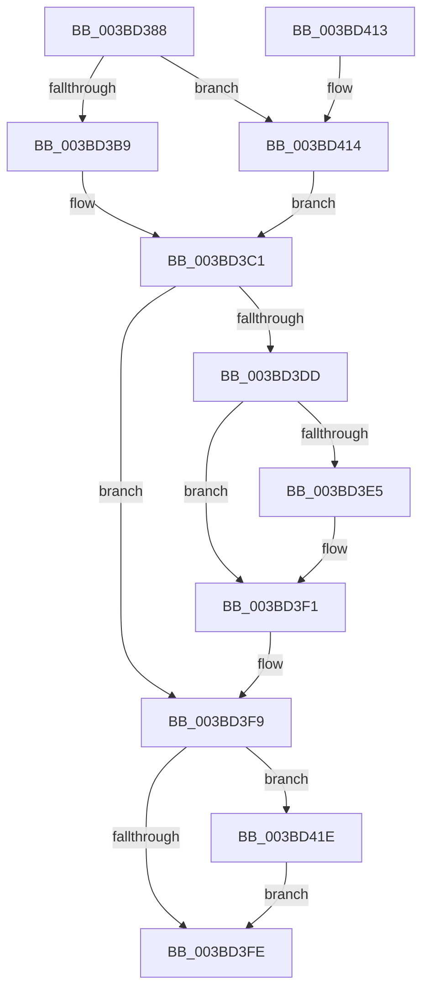

# MiDereferencePageRuns

- RVA: `0x003BD388`–`0x003BD42A` (길이 `162` bytes)
- VA: `0x00000001403BD388`
- 실행 섹션: `.text`
- PDB 이름 있음: `예`; PDB Function 태그: `아니요`
- unwind 정보 RVA: `0x0008CEBC`
- 디코드: `45`개 명령, `162/162` bytes 표시
- 미해석 바이트: `0` (있으면 어셈블리에 `.byte`로 보존)

> 이 문서는 커널 이미지의 기계어와 PDB 기호를 분석해 생성했습니다. 4번과 5번은 함수 원형과 자료형을 바이너리 사용 방식에서 추정한 C 해석이며 원본 소스 복구 결과는 아닙니다.

## 1. Dependencies

- 직접 호출 지점: **5**; 고유 호출 대상: **5**
- 직접 호출자로 확인된 함수: **13**
- RIP 상대 이미지 참조: **1**

### Outgoing calls
- `0x003BD3B9` → [ExAcquireSpinLockExclusive](../24/ExAcquireSpinLockExclusive_function_00248690.md) (function, `0x00248690`)
- `0x003BD3D2` → [ExReleaseSpinLockExclusiveFromDpcLevel](../24/ExReleaseSpinLockExclusiveFromDpcLevel_function_002497E0.md) (function, `0x002497E0`)
- `0x003BD3EC` → [KiLowerIrqlProcessIrqlFlags](../4F/KiLowerIrqlProcessIrqlFlags_function_004F5698.md) (function, `0x004F5698`)
- `0x003BD417` → [ExAcquireSpinLockExclusiveAtDpcLevel](../24/ExAcquireSpinLockExclusiveAtDpcLevel_function_00248E80.md) (function, `0x00248E80`)
- `0x003BD423` → [ExFreePoolWithTag](../../poolcode/B8/ExFreePoolWithTag_function_00B82870.md) (function, `0x00B82870`)

### Direct callers
- [MiFindContiguousPagesEx](../28/MiFindContiguousPagesEx_function_0028BDE0.md) at `0x0028C456`
- [MiFindContiguousPagesEx](../28/MiFindContiguousPagesEx_function_0028BDE0.md) at `0x0028C4D5`
- [MiProcessLargeCoalesceCandidates](../37/MiProcessLargeCoalesceCandidates_function_00379DF4.md) at `0x0037A3D3`
- [MiRebuildLargePage](MiRebuildLargePage_function_003BBAEC.md) at `0x003BBE95`
- [MiComputeNodeMemory](../67/MiComputeNodeMemory_function_00671AA4.md) at `0x00671DB2`
- [MiGetListOfPendingBadPages](../67/MiGetListOfPendingBadPages_function_006799D0.md) at `0x00679C05`
- [MiGetListOfPendingBadPages](../67/MiGetListOfPendingBadPages_function_006799D0.md) at `0x00679D23`
- [MiUpdatePartitionMemory](../69/MiUpdatePartitionMemory_function_00692294.md) at `0x006922F8`
- [MiUpdatePartitionMemory](../69/MiUpdatePartitionMemory_function_00692294.md) at `0x00692305`
- [MiScanPagefileSpace](../../page/80/MiScanPagefileSpace_function_00800440.md) at `0x00800643`
- [MiMakePartitionMemoryBlock](../../page/80/MiMakePartitionMemoryBlock_function_0080D94C.md) at `0x0080DB10`
- [MmScrubMemory](../../page/80/MmScrubMemory_function_0080EFA0.md) at `0x0080F14D`
- [MiCombineAllPhysicalMemory](../../page/9F/MiCombineAllPhysicalMemory_function_009F6B6C.md) at `0x009F6D96`
- [MmGetNodeChannelRanges](../../page/A8/MmGetNodeChannelRanges_function_00A82784.md) at `0x00A827EC`
- [MmIdentifyPhysicalMemory](../../page/AA/MmIdentifyPhysicalMemory_function_00AAD05C.md) at `0x00AAD2C5`
- [MiGetPhysicalMemoryRanges](../../page/AC/MiGetPhysicalMemoryRanges_function_00ACAE08.md) at `0x00ACAF66`

### Static image references
- `0x003BD3DD` → RVA `0x00FC6D20` (`ALMOSTRO`; read)

## 2. Other-region calls and transfers

- 다른 실행 섹션으로 향하는 call: **1**
  - `0x003BD423` → [ExFreePoolWithTag](../../poolcode/B8/ExFreePoolWithTag_function_00B82870.md) (`.text` → `POOLCODE`)
- 별도 외부 분기/꼬리 이동을 확인하지 못했습니다.

## 3. Assembly (complete function range)

```asm
003BD388  48 89 5C 24 08                  mov qword ptr [rsp + 8], rbx
003BD38D  48 89 6C 24 10                  mov qword ptr [rsp + 0x10], rbp
003BD392  48 89 74 24 18                  mov qword ptr [rsp + 0x18], rsi
003BD397  57                              push rdi
003BD398  48 83 EC 20                     sub rsp, 0x20
003BD39C  48 8B E9                        mov rbp, rcx
003BD39F  48 8D 59 F0                     lea rbx, [rcx - 0x10]
003BD3A3  44 0F 20 C2                     mov rdx, cr8
003BD3A7  48 8B 3B                        mov rdi, qword ptr [rbx]
003BD3AA  48 81 C7 C8 00 00 00            add rdi, 0xc8
003BD3B1  48 8B CF                        mov rcx, rdi
003BD3B4  80 FA 02                        cmp dl, 2
003BD3B7  74 5B                           je 0x1403bd414
003BD3B9  E8 D2 B2 E8 FF                  call 0x140248690
003BD3BE  40 8A F0                        mov sil, al
003BD3C1  48 83 45 F8 FF                  add qword ptr [rbp - 8], -1
003BD3C6  48 8B CF                        mov rcx, rdi
003BD3C9  BD 00 00 00 00                  mov ebp, 0
003BD3CE  48 0F 45 DD                     cmovne rbx, rbp
003BD3D2  E8 09 C4 E8 FF                  call 0x1402497e0
003BD3D7  40 80 FE 11                     cmp sil, 0x11
003BD3DB  74 1C                           je 0x1403bd3f9
003BD3DD  39 2D 3D 99 C0 00               cmp dword ptr [rip + 0xc0993d], ebp
003BD3E3  74 0C                           je 0x1403bd3f1
003BD3E5  44 0F 20 C1                     mov rcx, cr8
003BD3E9  40 8A D6                        mov dl, sil
003BD3EC  E8 A7 82 13 00                  call 0x1404f5698
003BD3F1  40 0F B6 C6                     movzx eax, sil
003BD3F5  44 0F 22 C0                     mov cr8, rax
003BD3F9  48 85 DB                        test rbx, rbx
003BD3FC  75 20                           jne 0x1403bd41e
003BD3FE  48 8B 5C 24 30                  mov rbx, qword ptr [rsp + 0x30]
003BD403  48 8B 6C 24 38                  mov rbp, qword ptr [rsp + 0x38]
003BD408  48 8B 74 24 40                  mov rsi, qword ptr [rsp + 0x40]
003BD40D  48 83 C4 20                     add rsp, 0x20
003BD411  5F                              pop rdi
003BD412  C3                              ret
003BD413  CC                              int3
003BD414  40 B6 11                        mov sil, 0x11
003BD417  E8 64 BA E8 FF                  call 0x140248e80
003BD41C  EB A3                           jmp 0x1403bd3c1
003BD41E  33 D2                           xor edx, edx
003BD420  48 8B CB                        mov rcx, rbx
003BD423  E8 48 54 7C 00                  call 0x140b82870
003BD428  EB D4                           jmp 0x1403bd3fe
```

## 4. C-style interpretation (structured pseudocode)

```c
__int64 __fastcall MiDereferencePageRuns(__int64 a1)
{
    __int64 result;
    __int64 v_rbx;
    __int64 v_rdi;
    __int64 v_rsp;
    unsigned __int64 v_stack_p10;
    unsigned __int64 v_stack_p18;
    unsigned __int64 v_stack_p8;

    v_stack_p8 = v_rbx;
    v_stack_p10 = v_rbp;
    v_stack_p18 = v_rsi;
    v_rsp = (v_rsp) - (32);
    v_rdi = (*(unsigned __int64 *)(a1 - 16)) + (200);
    if (((unsigned __int8)(v_cr8)) == 2) goto loc_003BD414;
    result = ExAcquireSpinLockExclusive(v_rdi, v_cr8, a3, a4);
loc_003BD3C1:
    v_rbx = a1 - 16;
    if (((unsigned __int8)(v_cr8)) != 2) { v_rbx = 0; }
    result = ExReleaseSpinLockExclusiveFromDpcLevel(v_rdi, v_cr8, a3, a4);
    if (((unsigned __int8)((unsigned __int8)(result))) == 17) goto loc_003BD3F9;
    if ((*(unsigned int *)(v_rip + 12622141)) != 0) {
        a1 = v_cr8;
        a2 = (unsigned __int8)((unsigned __int8)(result));
        result = KiLowerIrqlProcessIrqlFlags(a1, a2, a3, a4);
    }
loc_003BD3F9:
    if (v_rbx != 0) goto loc_003BD41E;
loc_003BD3FE:
    v_rsp = (v_rsp) + (32);
    return (unsigned __int8)((unsigned __int8)(result));
loc_003BD414:
    result = ExAcquireSpinLockExclusiveAtDpcLevel(a1, a2, a3, a4);
    goto loc_003BD3C1;
loc_003BD41E:
    a2 = 0;
    result = ExFreePoolWithTag(v_stack_p8, a2, a3, a4);
    goto loc_003BD3FE;
}
```

## 5. (Beta) C Style

```c
int64_t MiDereferencePageRuns(void *Arg1)
{
    uint8_t *arg1 = (uint8_t *)Arg1;

    int64_t result;
    int64_t local_rbx;
    int64_t local_rdi;
    int64_t local_rsp;
    uint64_t v_stack_p10;
    uint64_t v_stack_p18;
    uint64_t v_stack_p8;

    v_stack_p8 = local_rbx;
    v_stack_p10 = local_rbp;
    v_stack_p18 = local_rsi;
    local_rsp = (local_rsp) - (32);
    local_rdi = (*(uint64_t *)(arg1 - 0x10)) + (200);
    if (((uint8_t)(v_cr8)) == 2) goto loc_003BD414;
    result = ExAcquireSpinLockExclusive(local_rdi, v_cr8, a3, a4);
loc_003BD3C1:
    local_rbx = Arg1 - 16;
    if (((uint8_t)(v_cr8)) != 2) { local_rbx = 0; }
    result = ExReleaseSpinLockExclusiveFromDpcLevel(local_rdi, v_cr8, a3, a4);
    if (((uint8_t)((uint8_t)(result))) == 17) goto loc_003BD3F9;
    if ((*(uint32_t *)(v_rip + 0xC0993D)) != 0) {
        Arg1 = v_cr8;
        a2 = (uint8_t)((uint8_t)(result));
        result = KiLowerIrqlProcessIrqlFlags(Arg1, a2, a3, a4);
    }
loc_003BD3F9:
    if (local_rbx != 0) goto loc_003BD41E;
loc_003BD3FE:
    local_rsp = (local_rsp) + (32);
    return (uint8_t)((uint8_t)(result));
loc_003BD414:
    result = ExAcquireSpinLockExclusiveAtDpcLevel(Arg1, a2, a3, a4);
    goto loc_003BD3C1;
loc_003BD41E:
    a2 = 0;
    result = ExFreePoolWithTag(v_stack_p8, a2, a3, a4);
    goto loc_003BD3FE;
}
```

### 관측된 메모리 오프셋

구조체 형식이 확인되지 않은 접근은 인자 기준의 오프셋으로만 기록했습니다.

| 기준 인자 | 오프셋 표현 | 폭 (bit) | 접근 |
|---|---:|---:|---|
| `Arg1` | `- 0x10` | `64` | `R` |
| `Arg1` | `- 0x8` | `64` | `R/W` |
| `Arg1` | `+ 0x0` | `64` | `R` |

## 6. Execution-region graph

[열기: 2D/3D 그래프와 함수 탐색 컨트롤 패널](../../../control-panel.html?section=text&rva=0x003BD388&view=graph)

- 2D 그래프는 위에서 아래로 흐르고, 3D 그래프는 빈 공간을 드래그해 회전합니다. Shift+드래그는 이동, 휠은 확대·축소, 함수 노드 선택은 대상 보고서 이동입니다.

### Static fallback


