# MiExpandPtes

- RVA: `0x003B4B78`–`0x003B4F3D` (길이 `965` bytes)
- VA: `0x00000001403B4B78`
- 실행 섹션: `.text`
- PDB 이름 있음: `예`; PDB Function 태그: `예`
- unwind 정보 RVA: `0x0008C5E4`
- 디코드: `252`개 명령, `965/965` bytes 표시
- 미해석 바이트: `0` (있으면 어셈블리에 `.byte`로 보존)

> 이 문서는 커널 이미지의 기계어와 PDB 기호를 분석해 생성했습니다. 4번과 5번은 함수 원형과 자료형을 바이너리 사용 방식에서 추정한 C 해석이며 원본 소스 복구 결과는 아닙니다.

## 1. Dependencies

- 직접 호출 지점: **8**; 고유 호출 대상: **7**
- 직접 호출자로 확인된 함수: **1**
- RIP 상대 이미지 참조: **1**

### Outgoing calls
- `0x003B4C0C` → [MiObtainSystemVa](MiObtainSystemVa_function_003B4F44.md) (function, `0x003B4F44`)
- `0x003B4C74` → [MiMakeZeroedPageTables](MiMakeZeroedPageTables_function_003B4F6C.md) (function, `0x003B4F6C`)
- `0x003B4D01` → [ExAcquireSpinLockExclusive](../24/ExAcquireSpinLockExclusive_function_00248690.md) (function, `0x00248690`)
- `0x003B4D26` → [MiSplitBitmapPages](MiSplitBitmapPages_function_003B4A34.md) (function, `0x003B4A34`)
- `0x003B4D83` → [MiReleaseSpinLockExclusive](../24/MiReleaseSpinLockExclusive_function_002482C0.md) (function, `0x002482C0`)
- `0x003B4E5F` → [MiReturnSystemVa](../23/MiReturnSystemVa_function_002394C4.md) (function, `0x002394C4`)
- `0x003B4E76` → [ExAcquireSpinLockExclusiveAtDpcLevel](../24/ExAcquireSpinLockExclusiveAtDpcLevel_function_00248E80.md) (function, `0x00248E80`)
- `0x003B4F32` → [ExAcquireSpinLockExclusiveAtDpcLevel](../24/ExAcquireSpinLockExclusiveAtDpcLevel_function_00248E80.md) (function, `0x00248E80`)

### Direct callers
- [MiReservePtes](../31/MiReservePtes_function_00318D20.md) at `0x00319148`
- [MiReservePtes](../31/MiReservePtes_function_00318D20.md) at `0x00319405`

### Static image references
- `0x003B4CBB` → RVA `0x00E37668` (`.data`; read)

## 2. Other-region calls and transfers

- 다른 실행 섹션으로 향하는 call: **0**
- call이 아닌 외부 분기/꼬리 이동: **2**
  - `0x003B4F2C` → [sub_006E7378](../6E/Unknown_function_006E7378.md) (`tail-transfer`)
  - `0x003B4F38` → [sub_006E7378 + 0xC](../6E/Unknown_function_006E7378.md) (`tail-transfer`)

## 3. Assembly (complete function range)

```asm
003B4B78  48 89 5C 24 08                  mov qword ptr [rsp + 8], rbx
003B4B7D  55                              push rbp
003B4B7E  56                              push rsi
003B4B7F  57                              push rdi
003B4B80  41 54                           push r12
003B4B82  41 55                           push r13
003B4B84  41 56                           push r14
003B4B86  41 57                           push r15
003B4B88  48 83 EC 50                     sub rsp, 0x50
003B4B8C  48 8D B2 FF 01 00 00            lea rsi, [rdx + 0x1ff]
003B4B93  4C 8B FA                        mov r15, rdx
003B4B96  48 8B F9                        mov rdi, rcx
003B4B99  48 3B F2                        cmp rsi, rdx
003B4B9C  0F 86 C2 02 00 00               jbe 0x1403b4e64
003B4BA2  8B 41 28                        mov eax, dword ptr [rcx + 0x28]
003B4BA5  8B 69 2C                        mov ebp, dword ptr [rcx + 0x2c]
003B4BA8  24 01                           and al, 1
003B4BAA  F6 D8                           neg al
003B4BAC  44 8B ED                        mov r13d, ebp
003B4BAF  4D 1B F6                        sbb r14, r14
003B4BB2  45 33 E4                        xor r12d, r12d
003B4BB5  41 83 E6 0F                     and r14d, 0xf
003B4BB9  44 89 A4 24 A8 00 00 00         mov dword ptr [rsp + 0xa8], r12d
003B4BC1  49 FF C6                        inc r14
003B4BC4  48 81 FA 00 02 00 00            cmp rdx, 0x200
003B4BCB  0F 83 EA 00 00 00               jae 0x1403b4cbb
003B4BD1  48 81 E6 00 FE FF FF            and rsi, 0xfffffffffffffe00
003B4BD8  33 D2                           xor edx, edx
003B4BDA  48 8B C6                        mov rax, rsi
003B4BDD  49 F7 F6                        div r14
003B4BE0  48 89 44 24 48                  mov qword ptr [rsp + 0x48], rax
003B4BE5  44 0F 20 C1                     mov rcx, cr8
003B4BE9  80 F9 02                        cmp cl, 2
003B4BEC  48 89 4C 24 40                  mov qword ptr [rsp + 0x40], rcx
003B4BF1  BA 10 00 00 00                  mov edx, 0x10
003B4BF6  B8 10 10 00 00                  mov eax, 0x1010
003B4BFB  0F 45 C2                        cmovne eax, edx
003B4BFE  48 8B CE                        mov rcx, rsi
003B4C01  48 C1 E9 09                     shr rcx, 9
003B4C05  41 8B D5                        mov edx, r13d
003B4C08  89 44 24 28                     mov dword ptr [rsp + 0x28], eax
003B4C0C  E8 33 03 00 00                  call 0x1403b4f44
003B4C11  48 89 44 24 38                  mov qword ptr [rsp + 0x38], rax
003B4C16  48 85 C0                        test rax, rax
003B4C19  0F 84 45 02 00 00               je 0x1403b4e64
003B4C1F  48 8B D8                        mov rbx, rax
003B4C22  48 B8 F8 FF FF FF 7F 00 00 00   movabs rax, 0x7ffffffff8
003B4C2C  48 C1 EB 09                     shr rbx, 9
003B4C30  48 23 D8                        and rbx, rax
003B4C33  48 B8 00 00 00 00 80 F6 FF FF   movabs rax, 0xfffff68000000000
003B4C3D  48 8B C0                        mov rax, rax
003B4C40  48 03 D8                        add rbx, rax
003B4C43  B1 11                           mov cl, 0x11
003B4C45  48 8B C3                        mov rax, rbx
003B4C48  88 8C 24 A0 00 00 00            mov byte ptr [rsp + 0xa0], cl
003B4C4F  48 2B 47 20                     sub rax, qword ptr [rdi + 0x20]
003B4C53  48 C1 F8 03                     sar rax, 3
003B4C57  48 89 44 24 30                  mov qword ptr [rsp + 0x30], rax
003B4C5C  45 85 E4                        test r12d, r12d
003B4C5F  74 7C                           je 0x1403b4cdd
003B4C61  44 8B 44 24 28                  mov r8d, dword ptr [rsp + 0x28]
003B4C66  48 8D 56 FF                     lea rdx, [rsi - 1]
003B4C6A  48 8D 14 D3                     lea rdx, [rbx + rdx*8]
003B4C6E  44 8B CD                        mov r9d, ebp
003B4C71  48 8B CB                        mov rcx, rbx
003B4C74  E8 F3 02 00 00                  call 0x1403b4f6c
003B4C79  85 C0                           test eax, eax
003B4C7B  0F 84 AB 01 00 00               je 0x1403b4e2c
003B4C81  F0 48 01 77 38                  lock add qword ptr [rdi + 0x38], rsi
003B4C86  8B 47 28                        mov eax, dword ptr [rdi + 0x28]
003B4C89  A8 04                           test al, 4
003B4C8B  0F 85 6C 02 00 00               jne 0x1403b4efd
003B4C91  83 BC 24 A8 00 00 00 00         cmp dword ptr [rsp + 0xa8], 0
003B4C99  0F 84 01 01 00 00               je 0x1403b4da0
003B4C9F  48 8B C3                        mov rax, rbx
003B4CA2  48 8B 9C 24 90 00 00 00         mov rbx, qword ptr [rsp + 0x90]
003B4CAA  48 83 C4 50                     add rsp, 0x50
003B4CAE  41 5F                           pop r15
003B4CB0  41 5E                           pop r14
003B4CB2  41 5D                           pop r13
003B4CB4  41 5C                           pop r12
003B4CB6  5F                              pop rdi
003B4CB7  5E                              pop rsi
003B4CB8  5D                              pop rbp
003B4CB9  C3                              ret
003B4CBA  CC                              int3
003B4CBB  48 8D 05 A6 29 A8 00            lea rax, [rip + 0xa829a6]
003B4CC2  48 3B F8                        cmp rdi, rax
003B4CC5  0F 84 48 01 00 00               je 0x1403b4e13
003B4CCB  83 FD 06                        cmp ebp, 6
003B4CCE  0F 85 FD FE FF FF               jne 0x1403b4bd1
003B4CD4  44 8D 6D 04                     lea r13d, [rbp + 4]
003B4CD8  E9 3C 01 00 00                  jmp 0x1403b4e19
003B4CDD  33 D2                           xor edx, edx
003B4CDF  49 F7 F6                        div r14
003B4CE2  4C 8B E0                        mov r12, rax
003B4CE5  48 C1 E8 03                     shr rax, 3
003B4CE9  48 03 47 08                     add rax, qword ptr [rdi + 8]
003B4CED  80 7C 24 40 02                  cmp byte ptr [rsp + 0x40], 2
003B4CF2  48 89 44 24 20                  mov qword ptr [rsp + 0x20], rax
003B4CF7  0F 84 6E 01 00 00               je 0x1403b4e6b
003B4CFD  48 8D 4F 34                     lea rcx, [rdi + 0x34]
003B4D01  E8 8A 39 E9 FF                  call 0x140248690
003B4D06  88 84 24 98 00 00 00            mov byte ptr [rsp + 0x98], al
003B4D0D  48 8B 54 24 20                  mov rdx, qword ptr [rsp + 0x20]
003B4D12  4D 8B C4                        mov r8, r12
003B4D15  41 83 E0 07                     and r8d, 7
003B4D19  41 B9 01 00 00 00               mov r9d, 1
003B4D1F  4C 03 44 24 48                  add r8, qword ptr [rsp + 0x48]
003B4D24  8B CD                           mov ecx, ebp
003B4D26  E8 09 FD FF FF                  call 0x1403b4a34
003B4D2B  89 44 24 20                     mov dword ptr [rsp + 0x20], eax
003B4D2F  85 C0                           test eax, eax
003B4D31  74 45                           je 0x1403b4d78
003B4D33  4C 8B 44 24 30                  mov r8, qword ptr [rsp + 0x30]
003B4D38  33 D2                           xor edx, edx
003B4D3A  48 8B 0F                        mov rcx, qword ptr [rdi]
003B4D3D  4C 03 C6                        add r8, rsi
003B4D40  49 8B C0                        mov rax, r8
003B4D43  49 F7 F6                        div r14
003B4D46  48 3B C1                        cmp rax, rcx
003B4D49  76 0B                           jbe 0x1403b4d56
003B4D4B  33 D2                           xor edx, edx
003B4D4D  49 8B C0                        mov rax, r8
003B4D50  49 F7 F6                        div r14
003B4D53  48 89 07                        mov qword ptr [rdi], rax
003B4D56  41 F6 C4 3F                     test r12b, 0x3f
003B4D5A  74 04                           je 0x1403b4d60
003B4D5C  49 83 E4 C0                     and r12, 0xffffffffffffffc0
003B4D60  48 8B 47 48                     mov rax, qword ptr [rdi + 0x48]
003B4D64  4C 3B E0                        cmp r12, rax
003B4D67  72 07                           jb 0x1403b4d70
003B4D69  8B 47 28                        mov eax, dword ptr [rdi + 0x28]
003B4D6C  A8 02                           test al, 2
003B4D6E  75 08                           jne 0x1403b4d78
003B4D70  4C 89 67 48                     mov qword ptr [rdi + 0x48], r12
003B4D74  83 4F 28 02                     or dword ptr [rdi + 0x28], 2
003B4D78  8A 94 24 98 00 00 00            mov dl, byte ptr [rsp + 0x98]
003B4D7F  48 8D 4F 34                     lea rcx, [rdi + 0x34]
003B4D83  E8 38 35 E9 FF                  call 0x1402482c0
003B4D88  83 7C 24 20 00                  cmp dword ptr [rsp + 0x20], 0
003B4D8D  0F 84 A0 00 00 00               je 0x1403b4e33
003B4D93  44 8B A4 24 A8 00 00 00         mov r12d, dword ptr [rsp + 0xa8]
003B4D9B  E9 C1 FE FF FF                  jmp 0x1403b4c61
003B4DA0  4C 3B FE                        cmp r15, rsi
003B4DA3  0F 84 F6 FE FF FF               je 0x1403b4c9f
003B4DA9  49 2B F7                        sub rsi, r15
003B4DAC  F0 48 01 77 58                  lock add qword ptr [rdi + 0x58], rsi
003B4DB1  48 8B 4F 08                     mov rcx, qword ptr [rdi + 8]
003B4DB5  33 D2                           xor edx, edx
003B4DB7  48 8B C6                        mov rax, rsi
003B4DBA  49 F7 F6                        div r14
003B4DBD  33 D2                           xor edx, edx
003B4DBF  4C 8B C8                        mov r9, rax
003B4DC2  48 8B 44 24 30                  mov rax, qword ptr [rsp + 0x30]
003B4DC7  49 03 C7                        add rax, r15
003B4DCA  49 F7 F6                        div r14
003B4DCD  4C 8B D0                        mov r10, rax
003B4DD0  48 8B D0                        mov rdx, rax
003B4DD3  48 C1 EA 05                     shr rdx, 5
003B4DD7  41 83 E2 1F                     and r10d, 0x1f
003B4DDB  4C 8D 04 91                     lea r8, [rcx + rdx*4]
003B4DDF  4B 8D 0C 0A                     lea rcx, [r10 + r9]
003B4DE3  48 83 F9 20                     cmp rcx, 0x20
003B4DE7  0F 87 93 00 00 00               ja 0x1403b4e80
003B4DED  49 83 F9 20                     cmp r9, 0x20
003B4DF1  0F 84 FA 00 00 00               je 0x1403b4ef1
003B4DF7  49 8B C9                        mov rcx, r9
003B4DFA  B8 01 00 00 00                  mov eax, 1
003B4DFF  D3 E0                           shl eax, cl
003B4E01  41 8B CA                        mov ecx, r10d
003B4E04  FF C8                           dec eax
003B4E06  D3 E0                           shl eax, cl
003B4E08  F7 D0                           not eax
003B4E0A  F0 41 21 00                     lock and dword ptr [r8], eax
003B4E0E  E9 8C FE FF FF                  jmp 0x1403b4c9f
003B4E13  41 BD 0C 00 00 00               mov r13d, 0xc
003B4E19  41 BC 01 00 00 00               mov r12d, 1
003B4E1F  44 89 A4 24 A8 00 00 00         mov dword ptr [rsp + 0xa8], r12d
003B4E27  E9 A5 FD FF FF                  jmp 0x1403b4bd1
003B4E2C  45 85 E4                        test r12d, r12d
003B4E2F  41 0F 45 ED                     cmovne ebp, r13d
003B4E33  48 C1 E3 19                     shl rbx, 0x19
003B4E37  48 B8 00 00 00 00 80 F6 FF FF   movabs rax, 0xfffff68000000000
003B4E41  48 8B C0                        mov rax, rax
003B4E44  48 8B 4C 24 38                  mov rcx, qword ptr [rsp + 0x38]
003B4E49  44 8B C5                        mov r8d, ebp
003B4E4C  48 C1 E0 19                     shl rax, 0x19
003B4E50  48 2B D8                        sub rbx, rax
003B4E53  48 C1 E6 1C                     shl rsi, 0x1c
003B4E57  48 8D 14 1E                     lea rdx, [rsi + rbx]
003B4E5B  48 C1 FA 10                     sar rdx, 0x10
003B4E5F  E8 60 46 E8 FF                  call 0x1402394c4
003B4E64  33 C0                           xor eax, eax
003B4E66  E9 37 FE FF FF                  jmp 0x1403b4ca2
003B4E6B  88 8C 24 98 00 00 00            mov byte ptr [rsp + 0x98], cl
003B4E72  48 8D 4F 34                     lea rcx, [rdi + 0x34]
003B4E76  E8 05 40 E9 FF                  call 0x140248e80
003B4E7B  E9 8D FE FF FF                  jmp 0x1403b4d0d
003B4E80  4D 85 D2                        test r10, r10
003B4E83  75 41                           jne 0x1403b4ec6
003B4E85  49 83 F9 20                     cmp r9, 0x20
003B4E89  73 1A                           jae 0x1403b4ea5
003B4E8B  4D 85 C9                        test r9, r9
003B4E8E  0F 84 0B FE FF FF               je 0x1403b4c9f
003B4E94  49 8B C9                        mov rcx, r9
003B4E97  83 CA FF                        or edx, 0xffffffff
003B4E9A  D3 E2                           shl edx, cl
003B4E9C  F0 41 21 10                     lock and dword ptr [r8], edx
003B4EA0  E9 FA FD FF FF                  jmp 0x1403b4c9f
003B4EA5  49 8B C9                        mov rcx, r9
003B4EA8  48 C1 E9 05                     shr rcx, 5
003B4EAC  48 6B C1 E0                     imul rax, rcx, -0x20
003B4EB0  4C 03 C8                        add r9, rax
003B4EB3  41 C7 00 00 00 00 00            mov dword ptr [r8], 0
003B4EBA  49 83 C0 04                     add r8, 4
003B4EBE  48 83 E9 01                     sub rcx, 1
003B4EC2  74 C7                           je 0x1403b4e8b
003B4EC4  EB ED                           jmp 0x1403b4eb3
003B4EC6  83 E0 1F                        and eax, 0x1f
003B4EC9  BA 20 00 00 00                  mov edx, 0x20
003B4ECE  2B D0                           sub edx, eax
003B4ED0  B8 01 00 00 00                  mov eax, 1
003B4ED5  8B CA                           mov ecx, edx
003B4ED7  D3 E0                           shl eax, cl
003B4ED9  49 8B CA                        mov rcx, r10
003B4EDC  FF C8                           dec eax
003B4EDE  D3 E0                           shl eax, cl
003B4EE0  F7 D0                           not eax
003B4EE2  F0 41 21 00                     lock and dword ptr [r8], eax
003B4EE6  8B C2                           mov eax, edx
003B4EE8  4C 2B C8                        sub r9, rax
003B4EEB  49 83 C0 04                     add r8, 4
003B4EEF  EB 94                           jmp 0x1403b4e85
003B4EF1  41 C7 00 00 00 00 00            mov dword ptr [r8], 0
003B4EF8  E9 A2 FD FF FF                  jmp 0x1403b4c9f
003B4EFD  48 8B 44 24 30                  mov rax, qword ptr [rsp + 0x30]
003B4F02  4C 8D 6F 34                     lea r13, [rdi + 0x34]
003B4F06  33 D2                           xor edx, edx
003B4F08  49 8B CD                        mov rcx, r13
003B4F0B  49 F7 F6                        div r14
003B4F0E  4C 8B E0                        mov r12, rax
003B4F11  4D 03 E4                        add r12, r12
003B4F14  49 8B C4                        mov rax, r12
003B4F17  48 C1 E8 03                     shr rax, 3
003B4F1B  48 03 47 18                     add rax, qword ptr [rdi + 0x18]
003B4F1F  80 7C 24 40 02                  cmp byte ptr [rsp + 0x40], 2
003B4F24  48 89 84 24 98 00 00 00         mov qword ptr [rsp + 0x98], rax
003B4F2C  0F 85 46 24 33 00               jne 0x1406e7378
003B4F32  E8 49 3F E9 FF                  call 0x140248e80
003B4F37  90                              nop
003B4F38  E9 47 24 33 00                  jmp 0x1406e7384
```

## 4. C-style interpretation (structured pseudocode)

```c
__int64 __fastcall MiExpandPtes(__int64 a1, __int64 a2)
{
    __int64 result;
    __int64 v_r10;
    __int64 v_r12;
    __int64 v_r14;
    __int64 v_rbp;
    __int64 v_rbx;
    __int64 v_rsi;
    __int64 v_rsp;
    unsigned __int64 v_stack_m40;
    unsigned __int64 v_stack_m48;
    unsigned __int64 v_stack_m50;
    unsigned __int64 v_stack_m58;
    unsigned int v_stack_m60;
    unsigned __int8 v_stack_p18;
    unsigned int v_stack_p20;
    unsigned __int64 v_stack_p30;
    unsigned __int64 v_stack_p38;
    unsigned __int8 v_stack_p40;
    unsigned __int64 v_stack_p48;
    unsigned __int64 v_stack_p8;
    unsigned __int8 v_stack_p98;
    unsigned int v_stack_pA8;

    v_stack_p8 = v_rbx;
    v_rsp = (v_rsp) - (80);
    if ((a2 + 511) <= a2) goto loc_003B4E64;
    result = (unsigned __int8)(((unsigned int)(*(unsigned int *)(a1 + 40))) & (1));
    result = (unsigned __int8)(-(result));
    v_r12 = 0;
    v_r14 = (unsigned int)((v_r14) & (15));
    v_stack_p20 = 0;
    v_r14 = (v_r14) + 1;
    if (a2 >= 512) goto loc_003B4CBB;
loc_003B4BD1:
    v_rsi = (a2 + 511) & (-512);
    a2 = 0;
    v_stack_m40 = v_rsi;
    v_stack_m48 = v_cr8;
    result = (unsigned int)(0x1010ULL);
    if (((unsigned __int8)(v_cr8)) != 2) { result = 16; }
    a1 = (v_rsi) >> (9);
    v_stack_m60 = (unsigned int)(result);
    result = MiObtainSystemVa(a1, (unsigned int)((unsigned int)((unsigned int)((unsigned int)((unsigned int)(*(unsigned int *)(a1 + 44)))))), a3, a4);
    v_stack_m50 = result;
    if (result == 0) goto loc_003B4E64;
    v_rbx = (result) >> (9);
    v_rbx = (v_rbx) & (result);
    v_rbx = (v_rbx) + (result);
    v_stack_p18 = 17;
    result = (v_rbx) - (*(unsigned __int64 *)(a1 + 32));
    result = (result) >> (3);
    v_stack_m58 = result;
    if (0 == 0) goto loc_003B4CDD;
loc_003B4C61:
    result = MiMakeZeroedPageTables(v_rbx, v_rbx + v_rsi - 1 * 8, (unsigned int)(v_stack_m60), (unsigned int)((unsigned int)((unsigned int)(*(unsigned int *)(a1 + 44)))));
    if ((unsigned int)(result) == 0) goto loc_003B4E2C;
    if ((((unsigned __int8)((unsigned int)(*(unsigned int *)(a1 + 40)))) & (4)) != 0) goto loc_003B4EFD;
    if (v_stack_p20 == 0) goto loc_003B4DA0;
loc_003B4C9F:
loc_003B4CA2:
    v_rsp = (v_rsp) + (80);
    return v_rbx;
loc_003B4CBB:
    if (a1 == (v_rip + 11020710)) goto loc_003B4E13;
    if (((unsigned int)((unsigned int)(*(unsigned int *)(a1 + 44)))) != 6) goto loc_003B4BD1;
    goto loc_003B4E19;
loc_003B4CDD:
    a2 = 0;
    result = (v_rip + 11020710) >> (3);
    result = (result) + (*(unsigned __int64 *)(a1 + 8));
    v_stack_p20 = result;
    if (v_stack_p40 == 2) goto loc_003B4E6B;
    result = ExAcquireSpinLockExclusive(a1 + 52, a2, (unsigned int)(v_stack_m60), (unsigned int)((unsigned int)((unsigned int)(*(unsigned int *)(a1 + 44)))));
    v_stack_p98 = (unsigned __int8)(result);
loc_003B4D0D:
    a3 = (unsigned int)((v_rip + 11020710) & (7));
    a3 = (a3) + (v_stack_p48);
    result = MiSplitBitmapPages((unsigned int)((unsigned int)((unsigned int)(*(unsigned int *)(a1 + 44)))), v_stack_p20, a3, 1);
    v_stack_p20 = (unsigned int)(result);
    if ((unsigned int)(result) == 0) goto loc_003B4D78;
    a2 = 0;
    a3 = (v_stack_p30) + (v_rsi);
    result = a3;
    if (a3 >= = (*(unsigned __int64 *)(a1))) {
        a2 = 0;
        result = a3;
        *(unsigned __int64 *)(a1) = result;
    }
    v_r12 = v_rip + 11020710;
    if ((((unsigned __int8)(v_rip + 11020710)) & (63)) != 0) {
        v_r12 = (v_rip + 11020710) & (-64);
    }
    if (v_r12 < (*(unsigned __int64 *)(a1 + 72))) goto loc_003B4D70;
    if ((((unsigned __int8)((unsigned int)(*(unsigned int *)(a1 + 40)))) & (2)) == 0) {
        *(unsigned __int64 *)(a1 + 72) = v_r12;
    }
    result = MiReleaseSpinLockExclusive(a1 + 52, v_stack_p98, a3, 1);
    if (v_stack_p20 == 0) goto loc_003B4E33;
    goto loc_003B4C61;
loc_003B4DA0:
    if (0 == v_rsi) goto loc_003B4C9F;
    v_rsi = (v_rsi) - (0);
    a2 = 0;
    a2 = 0;
    result = (v_stack_p30) + (0);
    a2 = (result) >> (5);
    v_r10 = (unsigned int)((result) & (31));
    if ((v_r10 + v_rsi * 1) > 32) goto loc_003B4E80;
    if (v_rsi == 32) goto loc_003B4EF1;
    result = (unsigned int)((1) << ((unsigned __int8)(v_rsi)));
    result = (unsigned int)((result) - 1);
    result = (unsigned int)((result) << ((unsigned __int8)((unsigned int)((unsigned int)(v_r10)))));
    result = (unsigned int)(~(result));
    goto loc_003B4C9F;
loc_003B4E13:
loc_003B4E19:
    v_stack_pA8 = 1;
    goto loc_003B4BD1;
loc_003B4E2C:
    v_rbp = (unsigned int)(*(unsigned int *)(a1 + 44));
    if (1 != 0) { v_rbp = 12; }
loc_003B4E33:
    v_rbx = (v_stack_p8) << (25);
    result = (result) << (25);
    v_rbx = (v_rbx) - (result);
    v_rsi = (v_rsi) << (28);
    a2 = (v_rsi + v_rbx * 1) >> (16);
    result = MiReturnSystemVa(v_stack_p38, a2, (unsigned int)((unsigned int)(v_rbp)), v_rsi);
loc_003B4E64:
    result = 0;
    goto loc_003B4CA2;
loc_003B4E6B:
    v_stack_p98 = (unsigned __int8)(v_stack_p38);
    result = ExAcquireSpinLockExclusiveAtDpcLevel(a1 + 52, a2, (unsigned int)((unsigned int)(v_rbp)), v_rsi);
    goto loc_003B4D0D;
loc_003B4E80:
    if (v_r10 != 0) goto loc_003B4EC6;
loc_003B4E85:
    if (v_rsi >= 32) goto loc_003B4EA5;
loc_003B4E8B:
    if (v_rsi == 0) goto loc_003B4C9F;
    a2 = (unsigned int)((a2) | (0xFFFFFFFFULL));
    a2 = (unsigned int)((a2) << ((unsigned __int8)(v_rsi)));
    goto loc_003B4C9F;
loc_003B4EA5:
    a1 = (v_rsi) >> (5);
    result = (result) * (a1);
    a4 = (v_rsi) + (result);
loc_003B4EB3:
    *(unsigned int *)((unsigned int)((unsigned int)(v_rbp))) = 0;
    a3 = ((unsigned int)((unsigned int)(v_rbp))) + (4);
    a1 = (a1) - (1);
    if (condition_is_equal) goto loc_003B4E8B;
    goto loc_003B4EB3;
loc_003B4EC6:
    result = (unsigned int)((result) & (31));
    a2 = (unsigned int)((32) - ((unsigned int)(result)));
    result = (unsigned int)((1) << ((unsigned __int8)((unsigned int)((unsigned int)(a2)))));
    result = (unsigned int)((result) - 1);
    result = (unsigned int)((result) << ((unsigned __int8)(v_r10)));
    result = (unsigned int)(~(result));
    a4 = (a4) - ((unsigned int)((unsigned int)(a2)));
    a3 = (a3) + (4);
    goto loc_003B4E85;
loc_003B4EF1:
    *(unsigned int *)(a3) = 0;
    goto loc_003B4C9F;
loc_003B4EFD:
    a2 = 0;
    v_r12 = (v_stack_p30) + (v_stack_p30);
    result = (v_r12) >> (3);
    result = (result) + (*(unsigned __int64 *)(a1 + 24));
    v_stack_p98 = result;
    result = ExAcquireSpinLockExclusiveAtDpcLevel(a1 + 52, a2, a3, a4);
}
```

## 5. (Beta) C Style

```c
int64_t MiExpandPtes(void *Arg1, void *Arg2)
{
    uint8_t *arg1 = (uint8_t *)Arg1;
    uint8_t *arg2 = (uint8_t *)Arg2;

    int64_t result;
    int64_t local_r10;
    int64_t local_r12;
    int64_t local_r14;
    int64_t local_rbp;
    int64_t local_rbx;
    int64_t local_rsi;
    int64_t local_rsp;
    uint64_t v_stack_m40;
    uint64_t v_stack_m48;
    uint64_t v_stack_m50;
    uint64_t v_stack_m58;
    uint32_t v_stack_m60;
    uint8_t v_stack_p18;
    uint32_t v_stack_p20;
    uint64_t v_stack_p30;
    uint64_t v_stack_p38;
    uint8_t v_stack_p40;
    uint64_t v_stack_p48;
    uint64_t v_stack_p8;
    uint8_t v_stack_p98;
    uint32_t v_stack_pA8;

    v_stack_p8 = local_rbx;
    local_rsp = (local_rsp) - (80);
    if ((Arg2 + 511) <= Arg2) goto loc_003B4E64;
    result = (uint8_t)(((uint32_t)(*(uint32_t *)(arg1 + 0x28))) & (1));
    result = (uint8_t)(-(result));
    local_r12 = 0;
    local_r14 = (uint32_t)((local_r14) & (15));
    v_stack_p20 = 0;
    local_r14 = (local_r14) + 1;
    if (Arg2 >= 512) goto loc_003B4CBB;
loc_003B4BD1:
    local_rsi = (Arg2 + 511) & (-512);
    Arg2 = 0;
    v_stack_m40 = local_rsi;
    v_stack_m48 = v_cr8;
    result = (uint32_t)(0x1010ULL);
    if (((uint8_t)(v_cr8)) != 2) { result = 16; }
    Arg1 = (local_rsi) >> (9);
    v_stack_m60 = (uint32_t)(result);
    result = MiObtainSystemVa(Arg1, (uint32_t)((uint32_t)((uint32_t)((uint32_t)((uint32_t)(*(uint32_t *)(arg1 + 0x2C)))))), a3, a4);
    v_stack_m50 = result;
    if (result == 0) goto loc_003B4E64;
    local_rbx = (result) >> (9);
    local_rbx = (local_rbx) & (result);
    local_rbx = (local_rbx) + (result);
    v_stack_p18 = 17;
    result = (local_rbx) - (*(uint64_t *)(arg1 + 0x20));
    result = (result) >> (3);
    v_stack_m58 = result;
    if (0 == 0) goto loc_003B4CDD;
loc_003B4C61:
    result = MiMakeZeroedPageTables(local_rbx, local_rbx + local_rsi - 1 * 8, (uint32_t)(v_stack_m60), (uint32_t)((uint32_t)((uint32_t)(*(uint32_t *)(arg1 + 0x2C)))));
    if ((uint32_t)(result) == 0) goto loc_003B4E2C;
    if ((((uint8_t)((uint32_t)(*(uint32_t *)(arg1 + 0x28)))) & (4)) != 0) goto loc_003B4EFD;
    if (v_stack_p20 == 0) goto loc_003B4DA0;
loc_003B4C9F:
loc_003B4CA2:
    local_rsp = (local_rsp) + (80);
    return local_rbx;
loc_003B4CBB:
    if (Arg1 == (v_rip + 11020710)) goto loc_003B4E13;
    if (((uint32_t)((uint32_t)(*(uint32_t *)(arg1 + 0x2C)))) != 6) goto loc_003B4BD1;
    goto loc_003B4E19;
loc_003B4CDD:
    Arg2 = 0;
    result = (v_rip + 11020710) >> (3);
    result = (result) + (*(uint64_t *)(arg1 + 0x8));
    v_stack_p20 = result;
    if (v_stack_p40 == 2) goto loc_003B4E6B;
    result = ExAcquireSpinLockExclusive(Arg1 + 52, Arg2, (uint32_t)(v_stack_m60), (uint32_t)((uint32_t)((uint32_t)(*(uint32_t *)(arg1 + 0x2C)))));
    v_stack_p98 = (uint8_t)(result);
loc_003B4D0D:
    a3 = (uint32_t)((v_rip + 11020710) & (7));
    a3 = (a3) + (v_stack_p48);
    result = MiSplitBitmapPages((uint32_t)((uint32_t)((uint32_t)(*(uint32_t *)(arg1 + 0x2C)))), v_stack_p20, a3, 1);
    v_stack_p20 = (uint32_t)(result);
    if ((uint32_t)(result) == 0) goto loc_003B4D78;
    Arg2 = 0;
    a3 = (v_stack_p30) + (local_rsi);
    result = a3;
    if (a3 >= = (*(uint64_t *)(arg1))) {
        Arg2 = 0;
        result = a3;
        *(uint64_t *)(arg1) = result;
    }
    local_r12 = v_rip + 11020710;
    if ((((uint8_t)(v_rip + 11020710)) & (63)) != 0) {
        local_r12 = (v_rip + 11020710) & (-64);
    }
    if (local_r12 < (*(uint64_t *)(arg1 + 0x48))) goto loc_003B4D70;
    if ((((uint8_t)((uint32_t)(*(uint32_t *)(arg1 + 0x28)))) & (2)) == 0) {
        *(uint64_t *)(arg1 + 0x48) = local_r12;
    }
    result = MiReleaseSpinLockExclusive(Arg1 + 52, v_stack_p98, a3, 1);
    if (v_stack_p20 == 0) goto loc_003B4E33;
    goto loc_003B4C61;
loc_003B4DA0:
    if (0 == local_rsi) goto loc_003B4C9F;
    local_rsi = (local_rsi) - (0);
    Arg2 = 0;
    Arg2 = 0;
    result = (v_stack_p30) + (0);
    Arg2 = (result) >> (5);
    local_r10 = (uint32_t)((result) & (31));
    if ((local_r10 + local_rsi * 1) > 32) goto loc_003B4E80;
    if (local_rsi == 32) goto loc_003B4EF1;
    result = (uint32_t)((1) << ((uint8_t)(local_rsi)));
    result = (uint32_t)((result) - 1);
    result = (uint32_t)((result) << ((uint8_t)((uint32_t)((uint32_t)(local_r10)))));
    result = (uint32_t)(~(result));
    goto loc_003B4C9F;
loc_003B4E13:
loc_003B4E19:
    v_stack_pA8 = 1;
    goto loc_003B4BD1;
loc_003B4E2C:
    local_rbp = (uint32_t)(*(uint32_t *)(arg1 + 0x2C));
    if (1 != 0) { local_rbp = 12; }
loc_003B4E33:
    local_rbx = (v_stack_p8) << (25);
    result = (result) << (25);
    local_rbx = (local_rbx) - (result);
    local_rsi = (local_rsi) << (28);
    Arg2 = (local_rsi + local_rbx * 1) >> (16);
    result = MiReturnSystemVa(v_stack_p38, Arg2, (uint32_t)((uint32_t)(local_rbp)), local_rsi);
loc_003B4E64:
    result = 0;
    goto loc_003B4CA2;
loc_003B4E6B:
    v_stack_p98 = (uint8_t)(v_stack_p38);
    result = ExAcquireSpinLockExclusiveAtDpcLevel(Arg1 + 52, Arg2, (uint32_t)((uint32_t)(local_rbp)), local_rsi);
    goto loc_003B4D0D;
loc_003B4E80:
    if (local_r10 != 0) goto loc_003B4EC6;
loc_003B4E85:
    if (local_rsi >= 32) goto loc_003B4EA5;
loc_003B4E8B:
    if (local_rsi == 0) goto loc_003B4C9F;
    Arg2 = (uint32_t)((Arg2) | (0xFFFFFFFFULL));
    Arg2 = (uint32_t)((Arg2) << ((uint8_t)(local_rsi)));
    goto loc_003B4C9F;
loc_003B4EA5:
    Arg1 = (local_rsi) >> (5);
    result = (result) * (Arg1);
    a4 = (local_rsi) + (result);
loc_003B4EB3:
    *(uint32_t *)((uint32_t)((uint32_t)(local_rbp))) = 0;
    a3 = ((uint32_t)((uint32_t)(local_rbp))) + (4);
    Arg1 = (Arg1) - (1);
    if (condition_is_equal) goto loc_003B4E8B;
    goto loc_003B4EB3;
loc_003B4EC6:
    result = (uint32_t)((result) & (31));
    Arg2 = (uint32_t)((32) - ((uint32_t)(result)));
    result = (uint32_t)((1) << ((uint8_t)((uint32_t)((uint32_t)(Arg2)))));
    result = (uint32_t)((result) - 1);
    result = (uint32_t)((result) << ((uint8_t)(local_r10)));
    result = (uint32_t)(~(result));
    a4 = (a4) - ((uint32_t)((uint32_t)(Arg2)));
    a3 = (a3) + (4);
    goto loc_003B4E85;
loc_003B4EF1:
    *(uint32_t *)(a3) = 0;
    goto loc_003B4C9F;
loc_003B4EFD:
    Arg2 = 0;
    local_r12 = (v_stack_p30) + (v_stack_p30);
    result = (local_r12) >> (3);
    result = (result) + (*(uint64_t *)(arg1 + 0x18));
    v_stack_p98 = result;
    result = ExAcquireSpinLockExclusiveAtDpcLevel(Arg1 + 52, Arg2, a3, a4);
}
```

### 관측된 메모리 오프셋

구조체 형식이 확인되지 않은 접근은 인자 기준의 오프셋으로만 기록했습니다.

| 기준 인자 | 오프셋 표현 | 폭 (bit) | 접근 |
|---|---:|---:|---|
| `Arg1` | `+ 0x28` | `32` | `R` |
| `Arg1` | `+ 0x2C` | `32` | `R` |
| `Arg2` | `+ 0x1FF` | `64` | `R` |

## 6. Execution-region graph

[열기: 2D/3D 그래프와 함수 탐색 컨트롤 패널](../../../control-panel.html?section=text&rva=0x003B4B78&view=graph)

- 2D 그래프는 위에서 아래로 흐르고, 3D 그래프는 빈 공간을 드래그해 회전합니다. Shift+드래그는 이동, 휠은 확대·축소, 함수 노드 선택은 대상 보고서 이동입니다.

### Static fallback

```mermaid
flowchart TD
  bb_003B4B78[BB_003B4B78]
  bb_003B4BA2[BB_003B4BA2]
  bb_003B4BD1[BB_003B4BD1]
  bb_003B4C1F[BB_003B4C1F]
  bb_003B4C61[BB_003B4C61]
  bb_003B4C81[BB_003B4C81]
  bb_003B4C91[BB_003B4C91]
  bb_003B4C9F[BB_003B4C9F]
  bb_003B4CA2[BB_003B4CA2]
  bb_003B4CBA[BB_003B4CBA]
  bb_003B4CBB[BB_003B4CBB]
  bb_003B4CCB[BB_003B4CCB]
  bb_003B4CD4[BB_003B4CD4]
  bb_003B4CDD[BB_003B4CDD]
  bb_003B4CFD[BB_003B4CFD]
  bb_003B4D0D[BB_003B4D0D]
  bb_003B4D33[BB_003B4D33]
  bb_003B4D4B[BB_003B4D4B]
  bb_003B4D56[BB_003B4D56]
  bb_003B4D5C[BB_003B4D5C]
  bb_003B4D60[BB_003B4D60]
  bb_003B4D69[BB_003B4D69]
  bb_003B4D70[BB_003B4D70]
  bb_003B4D78[BB_003B4D78]
  bb_003B4D93[BB_003B4D93]
  bb_003B4DA0[BB_003B4DA0]
  bb_003B4DA9[BB_003B4DA9]
  bb_003B4DED[BB_003B4DED]
  bb_003B4DF7[BB_003B4DF7]
  bb_003B4E13[BB_003B4E13]
  bb_003B4E19[BB_003B4E19]
  bb_003B4E2C[BB_003B4E2C]
  bb_003B4E33[BB_003B4E33]
  bb_003B4E64[BB_003B4E64]
  bb_003B4E6B[BB_003B4E6B]
  bb_003B4E80[BB_003B4E80]
  bb_003B4E85[BB_003B4E85]
  bb_003B4E8B[BB_003B4E8B]
  bb_003B4E94[BB_003B4E94]
  bb_003B4EA5[BB_003B4EA5]
  bb_003B4EB3[BB_003B4EB3]
  bb_003B4EC4[BB_003B4EC4]
  bb_003B4EC6[BB_003B4EC6]
  bb_003B4EF1[BB_003B4EF1]
  bb_003B4EFD[BB_003B4EFD]
  bb_003B4F32[BB_003B4F32]
  bb_003B4B78 -->|branch| bb_003B4E64
  bb_003B4B78 -->|fallthrough| bb_003B4BA2
  bb_003B4BA2 -->|branch| bb_003B4CBB
  bb_003B4BA2 -->|fallthrough| bb_003B4BD1
  bb_003B4BD1 -->|branch| bb_003B4E64
  bb_003B4BD1 -->|fallthrough| bb_003B4C1F
  bb_003B4C1F -->|branch| bb_003B4CDD
  bb_003B4C1F -->|fallthrough| bb_003B4C61
  bb_003B4C61 -->|branch| bb_003B4E2C
  bb_003B4C61 -->|fallthrough| bb_003B4C81
  bb_003B4C81 -->|branch| bb_003B4EFD
  bb_003B4C81 -->|fallthrough| bb_003B4C91
  bb_003B4C91 -->|branch| bb_003B4DA0
  bb_003B4C91 -->|fallthrough| bb_003B4C9F
  bb_003B4C9F -->|flow| bb_003B4CA2
  bb_003B4CBA -->|flow| bb_003B4CBB
  bb_003B4CBB -->|branch| bb_003B4E13
  bb_003B4CBB -->|fallthrough| bb_003B4CCB
  bb_003B4CCB -->|branch| bb_003B4BD1
  bb_003B4CCB -->|fallthrough| bb_003B4CD4
  bb_003B4CD4 -->|branch| bb_003B4E19
  bb_003B4CDD -->|branch| bb_003B4E6B
  bb_003B4CDD -->|fallthrough| bb_003B4CFD
  bb_003B4CFD -->|flow| bb_003B4D0D
  bb_003B4D0D -->|branch| bb_003B4D78
  bb_003B4D0D -->|fallthrough| bb_003B4D33
  bb_003B4D33 -->|branch| bb_003B4D56
  bb_003B4D33 -->|fallthrough| bb_003B4D4B
  bb_003B4D4B -->|flow| bb_003B4D56
  bb_003B4D56 -->|branch| bb_003B4D60
  bb_003B4D56 -->|fallthrough| bb_003B4D5C
  bb_003B4D5C -->|flow| bb_003B4D60
  bb_003B4D60 -->|branch| bb_003B4D70
  bb_003B4D60 -->|fallthrough| bb_003B4D69
  bb_003B4D69 -->|branch| bb_003B4D78
  bb_003B4D69 -->|fallthrough| bb_003B4D70
  bb_003B4D70 -->|flow| bb_003B4D78
  bb_003B4D78 -->|branch| bb_003B4E33
  bb_003B4D78 -->|fallthrough| bb_003B4D93
  bb_003B4D93 -->|branch| bb_003B4C61
  bb_003B4DA0 -->|branch| bb_003B4C9F
  bb_003B4DA0 -->|fallthrough| bb_003B4DA9
  bb_003B4DA9 -->|branch| bb_003B4E80
  bb_003B4DA9 -->|fallthrough| bb_003B4DED
  bb_003B4DED -->|branch| bb_003B4EF1
  bb_003B4DED -->|fallthrough| bb_003B4DF7
  bb_003B4DF7 -->|branch| bb_003B4C9F
  bb_003B4E13 -->|flow| bb_003B4E19
  bb_003B4E19 -->|branch| bb_003B4BD1
  bb_003B4E2C -->|flow| bb_003B4E33
  bb_003B4E33 -->|flow| bb_003B4E64
  bb_003B4E64 -->|branch| bb_003B4CA2
  bb_003B4E6B -->|branch| bb_003B4D0D
  bb_003B4E80 -->|branch| bb_003B4EC6
  bb_003B4E80 -->|fallthrough| bb_003B4E85
  bb_003B4E85 -->|branch| bb_003B4EA5
  bb_003B4E85 -->|fallthrough| bb_003B4E8B
  bb_003B4E8B -->|branch| bb_003B4C9F
  bb_003B4E8B -->|fallthrough| bb_003B4E94
  bb_003B4E94 -->|branch| bb_003B4C9F
  bb_003B4EA5 -->|flow| bb_003B4EB3
  bb_003B4EB3 -->|branch| bb_003B4E8B
  bb_003B4EB3 -->|fallthrough| bb_003B4EC4
  bb_003B4EC4 -->|branch| bb_003B4EB3
  bb_003B4EC6 -->|branch| bb_003B4E85
  bb_003B4EF1 -->|branch| bb_003B4C9F
  bb_003B4EFD -->|fallthrough| bb_003B4F32
```


