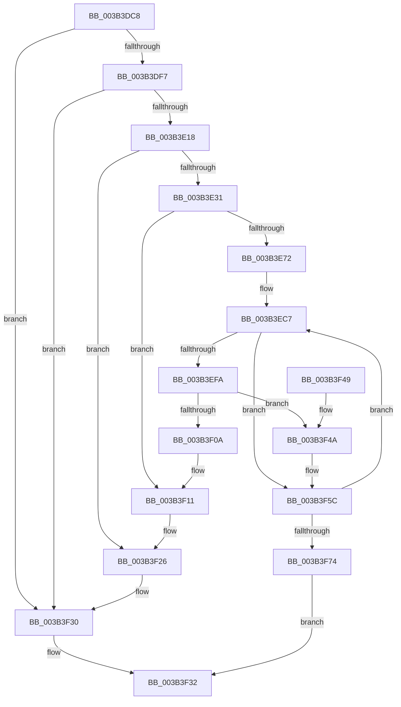

# MiExpandSystemCache

- RVA: `0x003B3DC8`–`0x003B3FA8` (길이 `480` bytes)
- VA: `0x00000001403B3DC8`
- 실행 섹션: `.text`
- PDB 이름 있음: `예`; PDB Function 태그: `아니요`
- unwind 정보 RVA: `0x0008C4F4`
- 디코드: `115`개 명령, `480/480` bytes 표시
- 미해석 바이트: `0` (있으면 어셈블리에 `.byte`로 보존)

> 이 문서는 커널 이미지의 기계어와 PDB 기호를 분석해 생성했습니다. 4번과 5번은 함수 원형과 자료형을 바이너리 사용 방식에서 추정한 C 해석이며 원본 소스 복구 결과는 아닙니다.

## 1. Dependencies

- 직접 호출 지점: **11**; 고유 호출 대상: **10**
- 직접 호출자로 확인된 함수: **1**
- RIP 상대 이미지 참조: **2**

### Outgoing calls
- `0x003B3E07` → [MiAllocatePool](../35/MiAllocatePool_function_0035B540.md) (function, `0x0035B540`)
- `0x003B3E20` → [MiObtainSystemVa](MiObtainSystemVa_function_003B4F44.md) (function, `0x003B4F44`)
- `0x003B3E65` → [MiMakeZeroedPageTables](MiMakeZeroedPageTables_function_003B4F6C.md) (function, `0x003B4F6C`)
- `0x003B3E93` → [MiLockWorkingSetOptimal](../23/MiLockWorkingSetOptimal_function_00238FC0.md) (function, `0x00238FC0`)
- `0x003B3EA1` → [MiSetSystemCacheReverseMap](../23/MiSetSystemCacheReverseMap_function_00238F58.md) (function, `0x00238F58`)
- `0x003B3EAD` → [ExAcquireSpinLockExclusiveAtDpcLevel](../24/ExAcquireSpinLockExclusiveAtDpcLevel_function_00248E80.md) (function, `0x00248E80`)
- `0x003B3F21` → [MiReturnSystemVa](../23/MiReturnSystemVa_function_002394C4.md) (function, `0x002394C4`)
- `0x003B3F2B` → [ExFreePoolWithTag](../../poolcode/B8/ExFreePoolWithTag_function_00B82870.md) (function, `0x00B82870`)
- `0x003B3F82` → [MiSetSystemCacheReverseMap](../23/MiSetSystemCacheReverseMap_function_00238F58.md) (function, `0x00238F58`)
- `0x003B3F8E` → [ExReleaseSpinLockExclusiveFromDpcLevel](../24/ExReleaseSpinLockExclusiveFromDpcLevel_function_002497E0.md) (function, `0x002497E0`)
- `0x003B3F9E` → [MiUnlockWorkingSetOptimal](../23/MiUnlockWorkingSetOptimal_function_00238DFC.md) (function, `0x00238DFC`)

### Direct callers
- [sub_00238CD1](../23/Unknown_function_00238CD1.md) at `0x00238D11`

### Static image references
- `0x003B3DDE` → RVA `0x00E2EEC8` (`.data`; read)
- `0x003B3EA6` → RVA `0x00E2F3B8` (`.data`; read)

## 2. Other-region calls and transfers

- 다른 실행 섹션으로 향하는 call: **1**
  - `0x003B3F2B` → [ExFreePoolWithTag](../../poolcode/B8/ExFreePoolWithTag_function_00B82870.md) (`.text` → `POOLCODE`)
- 별도 외부 분기/꼬리 이동을 확인하지 못했습니다.

## 3. Assembly (complete function range)

```asm
003B3DC8  48 89 5C 24 08                  mov qword ptr [rsp + 8], rbx
003B3DCD  48 89 6C 24 18                  mov qword ptr [rsp + 0x18], rbp
003B3DD2  56                              push rsi
003B3DD3  57                              push rdi
003B3DD4  41 54                           push r12
003B3DD6  41 56                           push r14
003B3DD8  41 57                           push r15
003B3DDA  48 83 EC 20                     sub rsp, 0x20
003B3DDE  48 81 3D DF B0 A7 00 00 00 00 04  cmp qword ptr [rip + 0xa7b0df], 0x4000000
003B3DE9  4C 8B F1                        mov r14, rcx
003B3DEC  C6 44 24 58 00                  mov byte ptr [rsp + 0x58], 0
003B3DF1  0F 86 39 01 00 00               jbe 0x1403b3f30
003B3DF7  BA 40 01 00 00                  mov edx, 0x140
003B3DFC  B9 40 00 00 00                  mov ecx, 0x40
003B3E01  41 B8 4D 69 53 63               mov r8d, 0x6353694d
003B3E07  E8 34 77 FA FF                  call 0x14035b540
003B3E0C  48 8B F8                        mov rdi, rax
003B3E0F  48 85 C0                        test rax, rax
003B3E12  0F 84 18 01 00 00               je 0x1403b3f30
003B3E18  BA 07 00 00 00                  mov edx, 7
003B3E1D  8D 4A FA                        lea ecx, [rdx - 6]
003B3E20  E8 1F 11 00 00                  call 0x1403b4f44
003B3E25  48 8B F0                        mov rsi, rax
003B3E28  48 85 C0                        test rax, rax
003B3E2B  0F 84 F5 00 00 00               je 0x1403b3f26
003B3E31  48 8B E8                        mov rbp, rax
003B3E34  48 B8 F8 FF FF FF 7F 00 00 00   movabs rax, 0x7ffffffff8
003B3E3E  48 C1 ED 09                     shr rbp, 9
003B3E42  48 23 E8                        and rbp, rax
003B3E45  48 B8 00 00 00 00 80 F6 FF FF   movabs rax, 0xfffff68000000000
003B3E4F  48 03 E8                        add rbp, rax
003B3E52  41 B9 07 00 00 00               mov r9d, 7
003B3E58  45 33 C0                        xor r8d, r8d
003B3E5B  48 8B CD                        mov rcx, rbp
003B3E5E  48 8D 95 F8 0F 00 00            lea rdx, [rbp + 0xff8]
003B3E65  E8 02 11 00 00                  call 0x1403b4f6c
003B3E6A  85 C0                           test eax, eax
003B3E6C  0F 84 9F 00 00 00               je 0x1403b3f11
003B3E72  F0 41 FF 86 78 09 00 00         lock inc dword ptr [r14 + 0x978]
003B3E7A  41 0F B7 1E                     movzx ebx, word ptr [r14]
003B3E7E  4D 8D A6 80 49 00 00            lea r12, [r14 + 0x4980]
003B3E85  49 8B CC                        mov rcx, r12
003B3E88  4C 8D 44 24 58                  lea r8, [rsp + 0x58]
003B3E8D  48 8B D5                        mov rdx, rbp
003B3E90  4C 8B FE                        mov r15, rsi
003B3E93  E8 28 51 E8 FF                  call 0x140238fc0
003B3E98  45 33 C0                        xor r8d, r8d
003B3E9B  48 8B D6                        mov rdx, rsi
003B3E9E  48 8B E8                        mov rbp, rax
003B3EA1  E8 B2 50 E8 FF                  call 0x140238f58
003B3EA6  48 8D 0D 0B B5 A7 00            lea rcx, [rip + 0xa7b50b]
003B3EAD  E8 CE 4F E9 FF                  call 0x140248e80
003B3EB2  44 8B D3                        mov r10d, ebx
003B3EB5  48 8D 57 20                     lea rdx, [rdi + 0x20]
003B3EB9  41 81 E2 FF 03 00 00            and r10d, 0x3ff
003B3EC0  45 33 C0                        xor r8d, r8d
003B3EC3  49 C1 E2 06                     shl r10, 6
003B3EC7  4C 89 7A F0                     mov qword ptr [rdx - 0x10], r15
003B3ECB  48 B9 3F 00 FF FF FF FF FF 3F   movabs rcx, 0x3fffffffffff003f
003B3ED5  48 8B 02                        mov rax, qword ptr [rdx]
003B3ED8  49 B9 00 00 00 00 00 00 00 80   movabs r9, 0x8000000000000000
003B3EE2  48 23 C1                        and rax, rcx
003B3EE5  49 33 C2                        xor rax, r10
003B3EE8  48 8B C8                        mov rcx, rax
003B3EEB  49 0B C9                        or rcx, r9
003B3EEE  45 85 C0                        test r8d, r8d
003B3EF1  48 0F 45 C8                     cmovne rcx, rax
003B3EF5  48 89 0A                        mov qword ptr [rdx], rcx
003B3EF8  74 62                           je 0x1403b3f5c
003B3EFA  49 8D 8E 00 09 00 00            lea rcx, [r14 + 0x900]
003B3F01  4C 8B 49 08                     mov r9, qword ptr [rcx + 8]
003B3F05  49 39 09                        cmp qword ptr [r9], rcx
003B3F08  74 40                           je 0x1403b3f4a
003B3F0A  B9 03 00 00 00                  mov ecx, 3
003B3F0F  CD 29                           int 0x29
003B3F11  48 8D 96 00 00 20 00            lea rdx, [rsi + 0x200000]
003B3F18  41 B8 07 00 00 00               mov r8d, 7
003B3F1E  48 8B CE                        mov rcx, rsi
003B3F21  E8 9E 55 E8 FF                  call 0x1402394c4
003B3F26  33 D2                           xor edx, edx
003B3F28  48 8B CF                        mov rcx, rdi
003B3F2B  E8 40 E9 7C 00                  call 0x140b82870
003B3F30  33 C0                           xor eax, eax
003B3F32  48 8B 5C 24 50                  mov rbx, qword ptr [rsp + 0x50]
003B3F37  48 8B 6C 24 60                  mov rbp, qword ptr [rsp + 0x60]
003B3F3C  48 83 C4 20                     add rsp, 0x20
003B3F40  41 5F                           pop r15
003B3F42  41 5E                           pop r14
003B3F44  41 5C                           pop r12
003B3F46  5F                              pop rdi
003B3F47  5E                              pop rsi
003B3F48  C3                              ret
003B3F49  CC                              int3
003B3F4A  48 8D 42 E0                     lea rax, [rdx - 0x20]
003B3F4E  4C 89 4A E8                     mov qword ptr [rdx - 0x18], r9
003B3F52  48 89 08                        mov qword ptr [rax], rcx
003B3F55  49 89 01                        mov qword ptr [r9], rax
003B3F58  48 89 41 08                     mov qword ptr [rcx + 8], rax
003B3F5C  48 83 C2 28                     add rdx, 0x28
003B3F60  49 81 C7 00 00 04 00            add r15, 0x40000
003B3F67  41 FF C0                        inc r8d
003B3F6A  41 83 F8 08                     cmp r8d, 8
003B3F6E  0F 82 53 FF FF FF               jb 0x1403b3ec7
003B3F74  49 83 86 10 09 00 00 07         add qword ptr [r14 + 0x910], 7
003B3F7C  4C 8B C7                        mov r8, rdi
003B3F7F  48 8B D6                        mov rdx, rsi
003B3F82  E8 D1 4F E8 FF                  call 0x140238f58
003B3F87  48 8D 0D 2A B4 A7 00            lea rcx, [rip + 0xa7b42a]
003B3F8E  E8 4D 58 E9 FF                  call 0x1402497e0
003B3F93  44 8A 44 24 58                  mov r8b, byte ptr [rsp + 0x58]
003B3F98  48 8B D5                        mov rdx, rbp
003B3F9B  49 8B CC                        mov rcx, r12
003B3F9E  E8 59 4E E8 FF                  call 0x140238dfc
003B3FA3  48 8B C7                        mov rax, rdi
003B3FA6  EB 8A                           jmp 0x1403b3f32
```

## 4. C-style interpretation (structured pseudocode)

```c
__int64 __fastcall MiExpandSystemCache(__int64 a1)
{
    __int64 result;
    __int64 v_r10;
    __int64 v_r15;
    __int64 v_rbp;
    __int64 v_rsp;
    unsigned __int8 v_stack_p10;
    unsigned __int64 v_stack_p18;
    unsigned __int8 v_stack_p58;
    unsigned __int64 v_stack_p8;

    v_stack_p8 = v_rbx;
    v_stack_p18 = v_rbp;
    v_rsp = (v_rsp) - (32);
    v_stack_p10 = 0;
    if ((*(unsigned __int64 *)(v_rip + 10989791)) <= 0x4000000ULL) goto loc_003B3F30;
    result = MiAllocatePool(64, 320, (unsigned int)(0x6353694DULL), a4);
    if (result == 0) goto loc_003B3F30;
    result = MiObtainSystemVa(7 - 6, 7, (unsigned int)(0x6353694DULL), a4);
    if (result == 0) goto loc_003B3F26;
    v_rbp = (result) >> (9);
    v_rbp = (v_rbp) & (result);
    v_rbp = (v_rbp) + (result);
    a3 = 0;
    result = MiMakeZeroedPageTables(v_rbp, v_rbp + 4088, a3, 7);
    if ((unsigned int)(result) == 0) goto loc_003B3F11;
    result = MiLockWorkingSetOptimal(a1 + 18816, v_rbp, v_stack_p10, 7);
    a3 = 0;
    result = MiSetSystemCacheReverseMap(a1 + 18816, result, a3, 7);
    result = ExAcquireSpinLockExclusiveAtDpcLevel(v_rip + 10990859, result, a3, 7);
    v_r10 = (unsigned int)(((unsigned int)((unsigned int)(*(unsigned __int16 *)(a1)))) & (0x3FFULL));
    a3 = 0;
    v_r10 = (v_r10) << (6);
loc_003B3EC7:
    *(unsigned __int64 *)(result + 32 - 16) = result;
    result = (*(unsigned __int64 *)(result + 32)) & (v_rip + 10990859);
    result = (result) ^ (v_r10);
    a1 = (result) | (7);
    if (0 != 0) { a1 = result; }
    *(unsigned __int64 *)(result + 32) = a1;
    if (0 == 0) goto loc_003B3F5C;
    if ((*(unsigned __int64 *)(*(unsigned __int64 *)(a1 + 2304 + 8))) == (a1 + 2304)) goto loc_003B3F4A;
loc_003B3F11:
    result = MiReturnSystemVa(result, result + 2097152, 7, *(unsigned __int64 *)(a1 + 2304 + 8));
loc_003B3F26:
    a2 = 0;
    result = ExFreePoolWithTag(result, a2, 7, *(unsigned __int64 *)(a1 + 2304 + 8));
loc_003B3F30:
    result = 0;
loc_003B3F32:
    v_rsp = (v_rsp) + (32);
    return result;
loc_003B3F4A:
    *(unsigned __int64 *)(a2 - 24) = *(unsigned __int64 *)(a1 + 2304 + 8);
    *(unsigned __int64 *)(a2 - 32) = 0;
    *(unsigned __int64 *)(*(unsigned __int64 *)(a1 + 2304 + 8)) = a2 - 32;
    *(unsigned __int64 *)(result + 8) = a2 - 32;
loc_003B3F5C:
    a2 = (a2) + (40);
    v_r15 = (result) + (0x40000ULL);
    a3 = (unsigned int)((7) + 1);
    if (((unsigned int)(a3)) < 8) goto loc_003B3EC7;
    result = MiSetSystemCacheReverseMap(result, 0, 0, *(unsigned __int64 *)(a1 + 2304 + 8));
    result = ExReleaseSpinLockExclusiveFromDpcLevel(v_rip + 10990634, 0, 0, *(unsigned __int64 *)(a1 + 2304 + 8));
    result = MiUnlockWorkingSetOptimal(a1 + 18816, v_stack_p18, v_stack_p58, *(unsigned __int64 *)(a1 + 2304 + 8));
    goto loc_003B3F32;
}
```

## 5. (Beta) C Style

```c
int64_t MiExpandSystemCache(void *Arg1)
{
    uint8_t *arg1 = (uint8_t *)Arg1;

    int64_t result;
    int64_t local_r10;
    int64_t local_r15;
    int64_t local_rbp;
    int64_t local_rsp;
    uint8_t v_stack_p10;
    uint64_t v_stack_p18;
    uint8_t v_stack_p58;
    uint64_t v_stack_p8;

    v_stack_p8 = local_rbx;
    v_stack_p18 = local_rbp;
    local_rsp = (local_rsp) - (32);
    v_stack_p10 = 0;
    if ((*(uint64_t *)(v_rip + 0xA7B0DF)) <= 0x4000000ULL) goto loc_003B3F30;
    result = MiAllocatePool(64, 320, (uint32_t)(0x6353694DULL), a4);
    if (result == 0) goto loc_003B3F30;
    result = MiObtainSystemVa(7 - 6, 7, (uint32_t)(0x6353694DULL), a4);
    if (result == 0) goto loc_003B3F26;
    local_rbp = (result) >> (9);
    local_rbp = (local_rbp) & (result);
    local_rbp = (local_rbp) + (result);
    a3 = 0;
    result = MiMakeZeroedPageTables(local_rbp, local_rbp + 4088, a3, 7);
    if ((uint32_t)(result) == 0) goto loc_003B3F11;
    result = MiLockWorkingSetOptimal(Arg1 + 18816, local_rbp, v_stack_p10, 7);
    a3 = 0;
    result = MiSetSystemCacheReverseMap(Arg1 + 18816, result, a3, 7);
    result = ExAcquireSpinLockExclusiveAtDpcLevel(v_rip + 10990859, result, a3, 7);
    local_r10 = (uint32_t)(((uint32_t)((uint32_t)(*(uint16_t *)(arg1)))) & (0x3FFULL));
    a3 = 0;
    local_r10 = (local_r10) << (6);
loc_003B3EC7:
    *(uint64_t *)(result + 0x20 - 0x10) = result;
    result = (*(uint64_t *)(result + 0x20)) & (v_rip + 10990859);
    result = (result) ^ (local_r10);
    Arg1 = (result) | (7);
    if (0 != 0) { Arg1 = result; }
    *(void **)(result + 0x20) = Arg1;
    if (0 == 0) goto loc_003B3F5C;
    if ((*(uint64_t *)(*(uint64_t *)(arg1 + 0x900 + 0x8))) == (Arg1 + 2304)) goto loc_003B3F4A;
loc_003B3F11:
    result = MiReturnSystemVa(result, result + 2097152, 7, *(uint64_t *)(arg1 + 0x900 + 0x8));
loc_003B3F26:
    a2 = 0;
    result = ExFreePoolWithTag(result, a2, 7, *(uint64_t *)(arg1 + 0x900 + 0x8));
loc_003B3F30:
    result = 0;
loc_003B3F32:
    local_rsp = (local_rsp) + (32);
    return result;
loc_003B3F4A:
    *(uint64_t *)(a2 - 0x18) = *(uint64_t *)(arg1 + 0x900 + 0x8);
    *(uint64_t *)(a2 - 0x20) = 0;
    *(uint64_t *)(*(uint64_t *)(arg1 + 0x900 + 0x8)) = a2 - 32;
    *(uint64_t *)(result + 0x8) = a2 - 32;
loc_003B3F5C:
    a2 = (a2) + (40);
    local_r15 = (result) + (0x40000ULL);
    a3 = (uint32_t)((7) + 1);
    if (((uint32_t)(a3)) < 8) goto loc_003B3EC7;
    result = MiSetSystemCacheReverseMap(result, 0, 0, *(uint64_t *)(arg1 + 0x900 + 0x8));
    result = ExReleaseSpinLockExclusiveFromDpcLevel(v_rip + 10990634, 0, 0, *(uint64_t *)(arg1 + 0x900 + 0x8));
    result = MiUnlockWorkingSetOptimal(Arg1 + 18816, v_stack_p18, v_stack_p58, *(uint64_t *)(arg1 + 0x900 + 0x8));
    goto loc_003B3F32;
}
```

### 관측된 메모리 오프셋

구조체 형식이 확인되지 않은 접근은 인자 기준의 오프셋으로만 기록했습니다.

| 기준 인자 | 오프셋 표현 | 폭 (bit) | 접근 |
|---|---:|---:|---|
| `Arg1` | `+ 0x0` | `16` | `R` |
| `Arg1` | `+ 0x8` | `64` | `R` |
| `Arg1` | `+ 0x8` | `64` | `W` |
| `Arg1` | `+ 0x900` | `64` | `R` |
| `Arg1` | `+ 0x910` | `64` | `R/W` |
| `Arg1` | `+ 0x978` | `32` | `R/W` |
| `Arg1` | `+ 0x4980` | `64` | `R` |

## 6. Execution-region graph

[열기: 2D/3D 그래프와 함수 탐색 컨트롤 패널](../../../control-panel.html?section=text&rva=0x003B3DC8&view=graph)

- 2D 그래프는 위에서 아래로 흐르고, 3D 그래프는 빈 공간을 드래그해 회전합니다. Shift+드래그는 이동, 휠은 확대·축소, 함수 노드 선택은 대상 보고서 이동입니다.

### Static fallback


