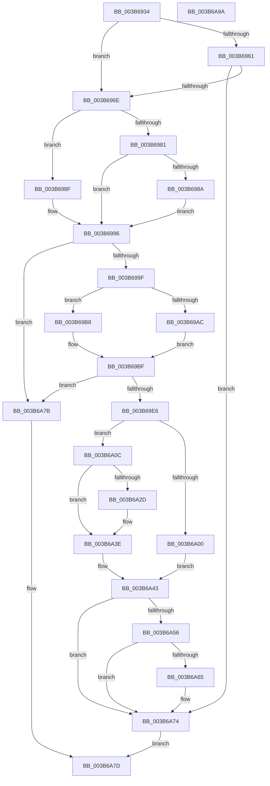

# MiExtendDynamicBitMap

- RVA: `0x003B6934`–`0x003B6A9B` (길이 `359` bytes)
- VA: `0x00000001403B6934`
- 실행 섹션: `.text`
- PDB 이름 있음: `예`; PDB Function 태그: `아니요`
- unwind 정보 RVA: `0x00075C18`
- 디코드: `106`개 명령, `359/359` bytes 표시
- 미해석 바이트: `0` (있으면 어셈블리에 `.byte`로 보존)

> 이 문서는 커널 이미지의 기계어와 PDB 기호를 분석해 생성했습니다. 4번과 5번은 함수 원형과 자료형을 바이너리 사용 방식에서 추정한 C 해석이며 원본 소스 복구 결과는 아닙니다.

## 1. Dependencies

- 직접 호출 지점: **3**; 고유 호출 대상: **3**
- 직접 호출자로 확인된 함수: **2**
- RIP 상대 이미지 참조: **0**

### Outgoing calls
- `0x003B69D9` → [MiSplitBitmapPages](MiSplitBitmapPages_function_003B4A34.md) (function, `0x003B4A34`)
- `0x003B6A4C` → [RtlClearBitsEx](../29/RtlClearBitsEx_function_00297740.md) (function, `0x00297740`)
- `0x003B6A5C` → [MiSystemVaPreserveGuardPage](../67/MiSystemVaPreserveGuardPage_function_0067FCA8.md) (function, `0x0067FCA8`)

### Direct callers
- [MiMarkSystemVaAllocated](MiMarkSystemVaAllocated_function_003B3878.md) at `0x003B3951`
- [MiObtainDynamicVa](MiObtainDynamicVa_function_003B501C.md) at `0x003B50C9`

### Static image references
- 디코드된 RIP-relative 메모리 참조가 없습니다.

## 2. Other-region calls and transfers

- 다른 실행 섹션으로 향하는 call: **0**
- 별도 외부 분기/꼬리 이동을 확인하지 못했습니다.

## 3. Assembly (complete function range)

```asm
003B6934  48 89 5C 24 08                  mov qword ptr [rsp + 8], rbx
003B6939  48 89 6C 24 10                  mov qword ptr [rsp + 0x10], rbp
003B693E  48 89 74 24 18                  mov qword ptr [rsp + 0x18], rsi
003B6943  57                              push rdi
003B6944  41 54                           push r12
003B6946  41 55                           push r13
003B6948  41 56                           push r14
003B694A  41 57                           push r15
003B694C  48 83 EC 20                     sub rsp, 0x20
003B6950  4C 8B 32                        mov r14, qword ptr [rdx]
003B6953  45 8B F9                        mov r15d, r9d
003B6956  48 8B DA                        mov rbx, rdx
003B6959  48 8B F9                        mov rdi, rcx
003B695C  48 3B D1                        cmp rdx, rcx
003B695F  74 0D                           je 0x1403b696e
003B6961  48 8B 41 28                     mov rax, qword ptr [rcx + 0x28]
003B6965  4C 3B F0                        cmp r14, rax
003B6968  0F 85 06 01 00 00               jne 0x1403b6a74
003B696E  48 8B 69 10                     mov rbp, qword ptr [rcx + 0x10]
003B6972  41 8D 41 FA                     lea eax, [r9 - 6]
003B6976  41 BD FD FF FF FF               mov r13d, 0xfffffffd
003B697C  41 85 C5                        test r13d, eax
003B697F  74 0E                           je 0x1403b698f
003B6981  41 8D 41 F6                     lea eax, [r9 - 0xa]
003B6985  41 85 C5                        test r13d, eax
003B6988  75 0C                           jne 0x1403b6996
003B698A  48 2B 29                        sub rbp, qword ptr [rcx]
003B698D  EB 07                           jmp 0x1403b6996
003B698F  48 8B 41 28                     mov rax, qword ptr [rcx + 0x28]
003B6993  48 2B E8                        sub rbp, rax
003B6996  4C 3B F5                        cmp r14, rbp
003B6999  0F 83 DC 00 00 00               jae 0x1403b6a7b
003B699F  48 8B 52 08                     mov rdx, qword ptr [rdx + 8]
003B69A3  41 8D 41 F6                     lea eax, [r9 - 0xa]
003B69A7  41 85 C5                        test r13d, eax
003B69AA  74 0C                           je 0x1403b69b8
003B69AC  49 8B C6                        mov rax, r14
003B69AF  48 C1 E8 03                     shr rax, 3
003B69B3  48 03 D0                        add rdx, rax
003B69B6  EB 07                           jmp 0x1403b69bf
003B69B8  48 81 EA 00 10 00 00            sub rdx, 0x1000
003B69BF  4D 85 C0                        test r8, r8
003B69C2  41 B9 01 00 00 00               mov r9d, 1
003B69C8  41 BC 00 80 00 00               mov r12d, 0x8000
003B69CE  4D 0F 45 E0                     cmovne r12, r8
003B69D2  4D 8B C4                        mov r8, r12
003B69D5  41 8D 49 07                     lea ecx, [r9 + 7]
003B69D9  E8 56 E0 FF FF                  call 0x1403b4a34
003B69DE  85 C0                           test eax, eax
003B69E0  0F 84 95 00 00 00               je 0x1403b6a7b
003B69E6  4B 8D 04 34                     lea rax, [r12 + r14]
003B69EA  48 8B F5                        mov rsi, rbp
003B69ED  49 2B F6                        sub rsi, r14
003B69F0  48 3B C5                        cmp rax, rbp
003B69F3  41 8D 47 F6                     lea eax, [r15 - 0xa]
003B69F7  49 0F 46 F4                     cmovbe rsi, r12
003B69FB  41 85 C5                        test r13d, eax
003B69FE  74 0C                           je 0x1403b6a0c
003B6A00  4C 8B 33                        mov r14, qword ptr [rbx]
003B6A03  49 8D 04 36                     lea rax, [r14 + rsi]
003B6A07  48 89 03                        mov qword ptr [rbx], rax
003B6A0A  EB 37                           jmp 0x1403b6a43
003B6A0C  48 01 33                        add qword ptr [rbx], rsi
003B6A0F  48 8B C6                        mov rax, rsi
003B6A12  48 C1 E8 06                     shr rax, 6
003B6A16  45 33 F6                        xor r14d, r14d
003B6A19  48 F7 D8                        neg rax
003B6A1C  48 C1 E0 03                     shl rax, 3
003B6A20  48 01 43 08                     add qword ptr [rbx + 8], rax
003B6A24  48 8B 47 28                     mov rax, qword ptr [rdi + 0x28]
003B6A28  48 85 C0                        test rax, rax
003B6A2B  75 11                           jne 0x1403b6a3e
003B6A2D  48 8B 47 08                     mov rax, qword ptr [rdi + 8]
003B6A31  48 C1 E8 15                     shr rax, 0x15
003B6A35  25 FF 7F 00 00                  and eax, 0x7fff
003B6A3A  48 89 47 30                     mov qword ptr [rdi + 0x30], rax
003B6A3E  F0 48 01 77 28                  lock add qword ptr [rdi + 0x28], rsi
003B6A43  4C 8B C6                        mov r8, rsi
003B6A46  49 8B D6                        mov rdx, r14
003B6A49  48 8B CB                        mov rcx, rbx
003B6A4C  E8 EF 0C EE FF                  call 0x140297740
003B6A51  48 39 2B                        cmp qword ptr [rbx], rbp
003B6A54  75 1E                           jne 0x1403b6a74
003B6A56  41 8B D7                        mov edx, r15d
003B6A59  48 8B CF                        mov rcx, rdi
003B6A5C  E8 47 92 2C 00                  call 0x14067fca8
003B6A61  85 C0                           test eax, eax
003B6A63  74 0F                           je 0x1403b6a74
003B6A65  48 8B 4B 08                     mov rcx, qword ptr [rbx + 8]
003B6A69  49 8D 56 FF                     lea rdx, [r14 - 1]
003B6A6D  48 03 D6                        add rdx, rsi
003B6A70  48 0F AB 11                     bts qword ptr [rcx], rdx
003B6A74  B8 01 00 00 00                  mov eax, 1
003B6A79  EB 02                           jmp 0x1403b6a7d
003B6A7B  33 C0                           xor eax, eax
003B6A7D  48 8B 5C 24 50                  mov rbx, qword ptr [rsp + 0x50]
003B6A82  48 8B 6C 24 58                  mov rbp, qword ptr [rsp + 0x58]
003B6A87  48 8B 74 24 60                  mov rsi, qword ptr [rsp + 0x60]
003B6A8C  48 83 C4 20                     add rsp, 0x20
003B6A90  41 5F                           pop r15
003B6A92  41 5E                           pop r14
003B6A94  41 5D                           pop r13
003B6A96  41 5C                           pop r12
003B6A98  5F                              pop rdi
003B6A99  C3                              ret
003B6A9A  CC                              int3
```

## 4. C-style interpretation (structured pseudocode)

```c
__int64 __fastcall MiExtendDynamicBitMap(__int64 a1, __int64 a2, __int64 a3, __int64 a4)
{
    __int64 result;
    __int64 v_r12;
    __int64 v_r14;
    __int64 v_rbp;
    __int64 v_rsi;
    __int64 v_rsp;
    unsigned __int64 v_stack_p10;
    unsigned __int64 v_stack_p18;
    unsigned __int64 v_stack_p8;

    v_stack_p8 = v_rbx;
    v_stack_p10 = v_rbp;
    v_stack_p18 = v_rsi;
    v_rsp = (v_rsp) - (32);
    if (a2 == a1) goto loc_003B696E;
    if ((*(unsigned __int64 *)(a2)) != (*(unsigned __int64 *)(a1 + 40))) goto loc_003B6A74;
loc_003B696E:
    if ((((unsigned int)((unsigned int)(0xFFFFFFFDULL))) & ((unsigned int)(a4 - 6))) == 0) goto loc_003B698F;
    if ((((unsigned int)((unsigned int)(0xFFFFFFFDULL))) & ((unsigned int)(a4 - 10))) != 0) goto loc_003B6996;
    v_rbp = (*(unsigned __int64 *)(a1 + 16)) - (*(unsigned __int64 *)(a1));
    goto loc_003B6996;
loc_003B698F:
    v_rbp = (v_rbp) - (*(unsigned __int64 *)(a1 + 40));
loc_003B6996:
    if ((*(unsigned __int64 *)(a2)) >= v_rbp) goto loc_003B6A7B;
    if ((((unsigned int)((unsigned int)(0xFFFFFFFDULL))) & ((unsigned int)(a4 - 10))) == 0) goto loc_003B69B8;
    result = (*(unsigned __int64 *)(a2)) >> (3);
    a2 = (*(unsigned __int64 *)(a2 + 8)) + (result);
    goto loc_003B69BF;
loc_003B69B8:
    a2 = (a2) - (0x1000ULL);
loc_003B69BF:
    v_r12 = (unsigned int)(0x8000ULL);
    if (a3 != 0) { v_r12 = a3; }
    result = MiSplitBitmapPages(1 + 7, a2, v_r12, 1);
    if ((unsigned int)(result) == 0) goto loc_003B6A7B;
    v_rsi = (v_rbp) - (*(unsigned __int64 *)(a2));
    if ((v_r12 + *(unsigned __int64 *)(a2) * 1) <= v_rbp) { v_rsi = v_r12; }
    if ((((unsigned int)((unsigned int)(0xFFFFFFFDULL))) & ((unsigned int)((unsigned int)((unsigned int)(a4)) - 10))) == 0) goto loc_003B6A0C;
    *(unsigned __int64 *)(a2) = *(unsigned __int64 *)(a2) + v_rsi * 1;
    goto loc_003B6A43;
loc_003B6A0C:
    result = (v_rsi) >> (6);
    v_r14 = 0;
    result = -(result);
    result = (result) << (3);
    result = *(unsigned __int64 *)(a1 + 40);
    if (*(unsigned __int64 *)(a1 + 40) == 0) {
        result = *(unsigned __int64 *)(a1 + 8);
        result = (result) >> (21);
        result = (unsigned int)((result) & (0x7FFFULL));
        *(unsigned __int64 *)(a1 + 48) = result;
    }
loc_003B6A43:
    result = RtlClearBitsEx(a2, 0, v_rsi, 1);
    if ((*(unsigned __int64 *)(a2)) != v_rbp) goto loc_003B6A74;
    result = MiSystemVaPreserveGuardPage(a1, (unsigned int)((unsigned int)((unsigned int)((unsigned int)(a4)))), v_rsi, 1);
    if ((unsigned int)(result) != 0) {
        a1 = *(unsigned __int64 *)(a2 + 8);
        a2 = v_r14 - 1;
        a2 = (a2) + (v_rsi);
    }
    goto loc_003B6A7D;
loc_003B6A7B:
    result = 0;
loc_003B6A7D:
    v_rsp = (v_rsp) + (32);
    return result;
}
```

## 5. (Beta) C Style

```c
int64_t MiExtendDynamicBitMap(void *Arg1, void *Arg2, int64_t Arg3, void *Arg4)
{
    uint8_t *arg1 = (uint8_t *)Arg1;
    uint8_t *arg2 = (uint8_t *)Arg2;
    uint8_t *arg4 = (uint8_t *)Arg4;

    int64_t result;
    int64_t local_r12;
    int64_t local_r14;
    int64_t local_rbp;
    int64_t local_rsi;
    int64_t local_rsp;
    uint64_t v_stack_p10;
    uint64_t v_stack_p18;
    uint64_t v_stack_p8;

    v_stack_p8 = local_rbx;
    v_stack_p10 = local_rbp;
    v_stack_p18 = local_rsi;
    local_rsp = (local_rsp) - (32);
    if (Arg2 == Arg1) goto loc_003B696E;
    if ((*(uint64_t *)(arg2)) != (*(uint64_t *)(arg1 + 0x28))) goto loc_003B6A74;
loc_003B696E:
    if ((((uint32_t)((uint32_t)(0xFFFFFFFDULL))) & ((uint32_t)(Arg4 - 6))) == 0) goto loc_003B698F;
    if ((((uint32_t)((uint32_t)(0xFFFFFFFDULL))) & ((uint32_t)(Arg4 - 10))) != 0) goto loc_003B6996;
    local_rbp = (*(uint64_t *)(arg1 + 0x10)) - (*(uint64_t *)(arg1));
    goto loc_003B6996;
loc_003B698F:
    local_rbp = (local_rbp) - (*(uint64_t *)(arg1 + 0x28));
loc_003B6996:
    if ((*(uint64_t *)(arg2)) >= local_rbp) goto loc_003B6A7B;
    if ((((uint32_t)((uint32_t)(0xFFFFFFFDULL))) & ((uint32_t)(Arg4 - 10))) == 0) goto loc_003B69B8;
    result = (*(uint64_t *)(arg2)) >> (3);
    Arg2 = (*(uint64_t *)(arg2 + 0x8)) + (result);
    goto loc_003B69BF;
loc_003B69B8:
    Arg2 = (Arg2) - (0x1000ULL);
loc_003B69BF:
    local_r12 = (uint32_t)(0x8000ULL);
    if (Arg3 != 0) { local_r12 = Arg3; }
    result = MiSplitBitmapPages(1 + 7, Arg2, local_r12, 1);
    if ((uint32_t)(result) == 0) goto loc_003B6A7B;
    local_rsi = (local_rbp) - (*(uint64_t *)(arg2));
    if ((local_r12 + *(uint64_t *)(arg2) * 1) <= local_rbp) { local_rsi = local_r12; }
    if ((((uint32_t)((uint32_t)(0xFFFFFFFDULL))) & ((uint32_t)((uint32_t)((uint32_t)(Arg4)) - 10))) == 0) goto loc_003B6A0C;
    *(uint64_t *)(arg2) = *(uint64_t *)(arg2) + local_rsi * 1;
    goto loc_003B6A43;
loc_003B6A0C:
    result = (local_rsi) >> (6);
    local_r14 = 0;
    result = -(result);
    result = (result) << (3);
    result = *(uint64_t *)(arg1 + 0x28);
    if (*(uint64_t *)(arg1 + 0x28) == 0) {
        result = *(uint64_t *)(arg1 + 0x8);
        result = (result) >> (21);
        result = (uint32_t)((result) & (0x7FFFULL));
        *(uint64_t *)(arg1 + 0x30) = result;
    }
loc_003B6A43:
    result = RtlClearBitsEx(Arg2, 0, local_rsi, 1);
    if ((*(uint64_t *)(arg2)) != local_rbp) goto loc_003B6A74;
    result = MiSystemVaPreserveGuardPage(Arg1, (uint32_t)((uint32_t)((uint32_t)((uint32_t)(Arg4)))), local_rsi, 1);
    if ((uint32_t)(result) != 0) {
        Arg1 = *(uint64_t *)(arg2 + 0x8);
        Arg2 = local_r14 - 1;
        Arg2 = (Arg2) + (local_rsi);
    }
    goto loc_003B6A7D;
loc_003B6A7B:
    result = 0;
loc_003B6A7D:
    local_rsp = (local_rsp) + (32);
    return result;
}
```

### 관측된 메모리 오프셋

구조체 형식이 확인되지 않은 접근은 인자 기준의 오프셋으로만 기록했습니다.

| 기준 인자 | 오프셋 표현 | 폭 (bit) | 접근 |
|---|---:|---:|---|
| `Arg1` | `+ 0x0` | `64` | `R` |
| `Arg1` | `+ 0x8` | `64` | `R` |
| `Arg1` | `+ 0x10` | `64` | `R` |
| `Arg1` | `+ 0x28` | `64` | `R` |
| `Arg1` | `+ 0x28` | `64` | `R/W` |
| `Arg1` | `+ 0x30` | `64` | `W` |
| `Arg2` | `+ 0x0` | `64` | `R` |
| `Arg2` | `+ 0x0` | `64` | `R/W` |
| `Arg2` | `+ 0x0` | `64` | `W` |
| `Arg2` | `+ 0x8` | `64` | `R` |
| `Arg2` | `+ 0x8` | `64` | `R/W` |
| `Arg4` | `- 0xA` | `32` | `R` |
| `Arg4` | `- 0x6` | `32` | `R` |

## 6. Execution-region graph

[열기: 2D/3D 그래프와 함수 탐색 컨트롤 패널](../../../control-panel.html?section=text&rva=0x003B6934&view=graph)

- 2D 그래프는 위에서 아래로 흐르고, 3D 그래프는 빈 공간을 드래그해 회전합니다. Shift+드래그는 이동, 휠은 확대·축소, 함수 노드 선택은 대상 보고서 이동입니다.

### Static fallback


