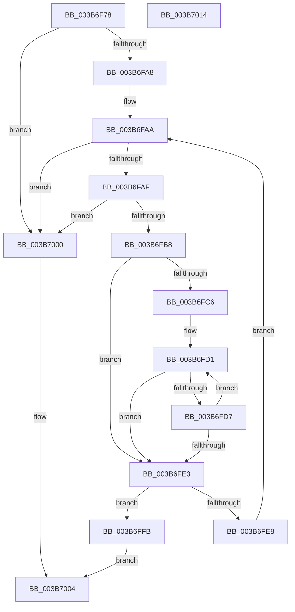

# MiFindNextAlignedForwardRunClearEx

- RVA: `0x003B6F78`–`0x003B7015` (길이 `157` bytes)
- VA: `0x00000001403B6F78`
- 실행 섹션: `.text`
- PDB 이름 있음: `예`; PDB Function 태그: `아니요`
- unwind 정보 RVA: `0x00069588`
- 디코드: `49`개 명령, `157/157` bytes 표시
- 미해석 바이트: `0` (있으면 어셈블리에 `.byte`로 보존)

> 이 문서는 커널 이미지의 기계어와 PDB 기호를 분석해 생성했습니다. 4번과 5번은 함수 원형과 자료형을 바이너리 사용 방식에서 추정한 C 해석이며 원본 소스 복구 결과는 아닙니다.

## 1. Dependencies

- 직접 호출 지점: **0**; 고유 호출 대상: **0**
- 직접 호출자로 확인된 함수: **1**
- RIP 상대 이미지 참조: **0**

### Outgoing calls
- 직접 디코드된 call 명령이 없습니다.

### Direct callers
- [MiObtainDynamicVa](MiObtainDynamicVa_function_003B501C.md) at `0x003B53EF`
- [MiObtainDynamicVa](MiObtainDynamicVa_function_003B501C.md) at `0x003B5968`

### Static image references
- 디코드된 RIP-relative 메모리 참조가 없습니다.

## 2. Other-region calls and transfers

- 다른 실행 섹션으로 향하는 call: **0**
- 별도 외부 분기/꼬리 이동을 확인하지 못했습니다.

## 3. Assembly (complete function range)

```asm
003B6F78  48 89 5C 24 08                  mov qword ptr [rsp + 8], rbx
003B6F7D  48 89 74 24 10                  mov qword ptr [rsp + 0x10], rsi
003B6F82  48 89 7C 24 18                  mov qword ptr [rsp + 0x18], rdi
003B6F87  4C 8B 09                        mov r9, qword ptr [rcx]
003B6F8A  49 8D 58 FF                     lea rbx, [r8 - 1]
003B6F8E  48 8B 71 08                     mov rsi, qword ptr [rcx + 8]
003B6F92  4C 8D 5A 3F                     lea r11, [rdx + 0x3f]
003B6F96  48 F7 D3                        not rbx
003B6F99  49 83 E3 C0                     and r11, 0xffffffffffffffc0
003B6F9D  4C 23 CB                        and r9, rbx
003B6FA0  49 8B F8                        mov rdi, r8
003B6FA3  4D 3B D9                        cmp r11, r9
003B6FA6  77 58                           ja 0x1403b7000
003B6FA8  33 C9                           xor ecx, ecx
003B6FAA  49 3B C9                        cmp rcx, r9
003B6FAD  73 51                           jae 0x1403b7000
003B6FAF  49 8D 04 0B                     lea rax, [r11 + rcx]
003B6FB3  49 3B C1                        cmp rax, r9
003B6FB6  77 48                           ja 0x1403b7000
003B6FB8  4D 8B C3                        mov r8, r11
003B6FBB  33 D2                           xor edx, edx
003B6FBD  49 C1 E8 06                     shr r8, 6
003B6FC1  4D 85 C0                        test r8, r8
003B6FC4  74 1D                           je 0x1403b6fe3
003B6FC6  48 8B C1                        mov rax, rcx
003B6FC9  48 C1 E8 06                     shr rax, 6
003B6FCD  4C 8D 14 C6                     lea r10, [rsi + rax*8]
003B6FD1  49 83 3A 00                     cmp qword ptr [r10], 0
003B6FD5  75 0C                           jne 0x1403b6fe3
003B6FD7  48 FF C2                        inc rdx
003B6FDA  49 83 C2 08                     add r10, 8
003B6FDE  49 3B D0                        cmp rdx, r8
003B6FE1  72 EE                           jb 0x1403b6fd1
003B6FE3  49 3B D0                        cmp rdx, r8
003B6FE6  74 13                           je 0x1403b6ffb
003B6FE8  48 C1 E2 06                     shl rdx, 6
003B6FEC  48 8D 47 3F                     lea rax, [rdi + 0x3f]
003B6FF0  48 03 C2                        add rax, rdx
003B6FF3  48 23 C3                        and rax, rbx
003B6FF6  48 03 C8                        add rcx, rax
003B6FF9  EB AF                           jmp 0x1403b6faa
003B6FFB  48 8B C1                        mov rax, rcx
003B6FFE  EB 04                           jmp 0x1403b7004
003B7000  48 83 C8 FF                     or rax, 0xffffffffffffffff
003B7004  48 8B 5C 24 08                  mov rbx, qword ptr [rsp + 8]
003B7009  48 8B 74 24 10                  mov rsi, qword ptr [rsp + 0x10]
003B700E  48 8B 7C 24 18                  mov rdi, qword ptr [rsp + 0x18]
003B7013  C3                              ret
003B7014  CC                              int3
```

## 4. C-style interpretation (structured pseudocode)

```c
__int64 __fastcall MiFindNextAlignedForwardRunClearEx(__int64 a1, __int64 a2, __int64 a3)
{
    __int64 result;
    __int64 v_r10;
    __int64 v_r11;
    __int64 v_rbx;
    unsigned __int64 v_stack_p10;
    unsigned __int64 v_stack_p18;
    unsigned __int64 v_stack_p8;

    v_stack_p8 = v_rbx;
    v_stack_p10 = v_rsi;
    v_stack_p18 = v_rdi;
    v_rbx = ~(a3 - 1);
    v_r11 = (a2 + 63) & (-64);
    a4 = (*(unsigned __int64 *)(a1)) & (v_rbx);
    if (v_r11 > a4) goto loc_003B7000;
    a1 = 0;
loc_003B6FAA:
    if (0 >= a4) goto loc_003B7000;
    if ((v_r11 + a1 * 1) > a4) goto loc_003B7000;
    a2 = 0;
    a3 = (v_r11) >> (6);
    if (a3 == 0) goto loc_003B6FE3;
    result = (0) >> (6);
loc_003B6FD1:
    if ((*(unsigned __int64 *)(*(unsigned __int64 *)(a1 + 8) + result * 8)) != 0) goto loc_003B6FE3;
    a2 = (a2) + 1;
    v_r10 = (*(unsigned __int64 *)(a1 + 8) + result * 8) + (8);
    if (a2 < a3) goto loc_003B6FD1;
loc_003B6FE3:
    if (a2 == a3) goto loc_003B6FFB;
    a2 = (a2) << (6);
    result = (a3 + 63) + (a2);
    result = (result) & (v_rbx);
    a1 = (a1) + (result);
    goto loc_003B6FAA;
loc_003B6FFB:
    goto loc_003B7004;
loc_003B7000:
    result = (a1) | (-1);
loc_003B7004:
    return result;
}
```

## 5. (Beta) C Style

```c
int64_t MiFindNextAlignedForwardRunClearEx(void *Arg1, void *Arg2, void *Arg3)
{
    uint8_t *arg1 = (uint8_t *)Arg1;
    uint8_t *arg2 = (uint8_t *)Arg2;
    uint8_t *arg3 = (uint8_t *)Arg3;

    int64_t result;
    int64_t local_r10;
    int64_t local_r11;
    int64_t local_rbx;
    uint64_t v_stack_p10;
    uint64_t v_stack_p18;
    uint64_t v_stack_p8;

    v_stack_p8 = local_rbx;
    v_stack_p10 = local_rsi;
    v_stack_p18 = local_rdi;
    local_rbx = ~(Arg3 - 1);
    local_r11 = (Arg2 + 63) & (-64);
    a4 = (*(uint64_t *)(arg1)) & (local_rbx);
    if (local_r11 > a4) goto loc_003B7000;
    Arg1 = 0;
loc_003B6FAA:
    if (0 >= a4) goto loc_003B7000;
    if ((local_r11 + Arg1 * 1) > a4) goto loc_003B7000;
    Arg2 = 0;
    Arg3 = (local_r11) >> (6);
    if (Arg3 == NULL) goto loc_003B6FE3;
    result = (0) >> (6);
loc_003B6FD1:
    if ((*(uint64_t *)(*(uint64_t *)(arg1 + 0x8) + result * 8)) != 0) goto loc_003B6FE3;
    Arg2 = (Arg2) + 1;
    local_r10 = (*(uint64_t *)(arg1 + 0x8) + result * 8) + (8);
    if (Arg2 < Arg3) goto loc_003B6FD1;
loc_003B6FE3:
    if (Arg2 == Arg3) goto loc_003B6FFB;
    Arg2 = (Arg2) << (6);
    result = (Arg3 + 63) + (Arg2);
    result = (result) & (local_rbx);
    Arg1 = (Arg1) + (result);
    goto loc_003B6FAA;
loc_003B6FFB:
    goto loc_003B7004;
loc_003B7000:
    result = (Arg1) | (-1);
loc_003B7004:
    return result;
}
```

### 관측된 메모리 오프셋

구조체 형식이 확인되지 않은 접근은 인자 기준의 오프셋으로만 기록했습니다.

| 기준 인자 | 오프셋 표현 | 폭 (bit) | 접근 |
|---|---:|---:|---|
| `Arg1` | `+ 0x0` | `64` | `R` |
| `Arg1` | `+ 0x8` | `64` | `R` |
| `Arg2` | `+ 0x3F` | `64` | `R` |
| `Arg3` | `- 0x1` | `64` | `R` |
| `Arg3` | `+ 0x3F` | `64` | `R` |

## 6. Execution-region graph

[열기: 2D/3D 그래프와 함수 탐색 컨트롤 패널](../../../control-panel.html?section=text&rva=0x003B6F78&view=graph)

- 2D 그래프는 위에서 아래로 흐르고, 3D 그래프는 빈 공간을 드래그해 회전합니다. Shift+드래그는 이동, 휠은 확대·축소, 함수 노드 선택은 대상 보고서 이동입니다.

### Static fallback


