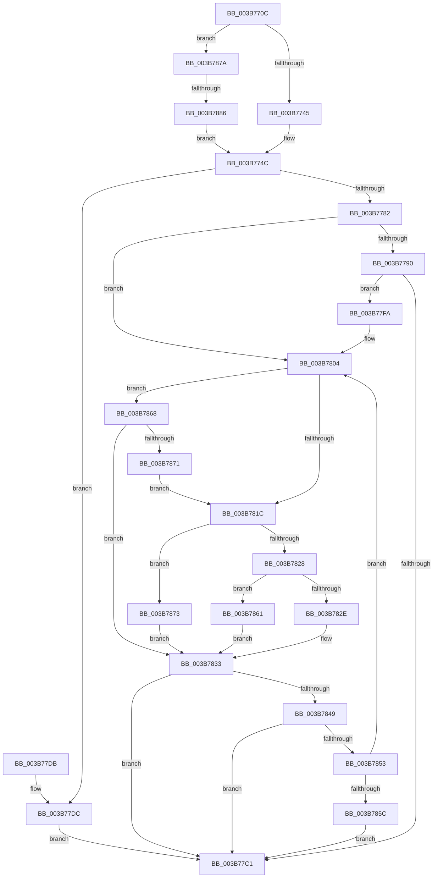

# MiFindPagesForMdl

- RVA: `0x003B770C`–`0x003B788F` (길이 `387` bytes)
- VA: `0x00000001403B770C`
- 실행 섹션: `.text`
- PDB 이름 있음: `예`; PDB Function 태그: `예`
- unwind 정보 RVA: `0x0008C818`
- 디코드: `106`개 명령, `387/387` bytes 표시
- 미해석 바이트: `0` (있으면 어셈블리에 `.byte`로 보존)

> 이 문서는 커널 이미지의 기계어와 PDB 기호를 분석해 생성했습니다. 4번과 5번은 함수 원형과 자료형을 바이너리 사용 방식에서 추정한 C 해석이며 원본 소스 복구 결과는 아닙니다.

## 1. Dependencies

- 직접 호출 지점: **5**; 고유 호출 대상: **5**
- 직접 호출자로 확인된 함수: **1**
- RIP 상대 이미지 참조: **2**

### Outgoing calls
- `0x003B77B8` → [MiAllocateMdlPagesByLists](MiAllocateMdlPagesByLists_function_003B7898.md) (function, `0x003B7898`)
- `0x003B77F3` → [MiAllocateEnclavePagesForMdl](MiAllocateEnclavePagesForMdl_function_003B7B54.md) (function, `0x003B7B54`)
- `0x003B782E` → [MiAllocateMostlyContiguousPagesForMdl](../37/MiAllocateMostlyContiguousPagesForMdl_function_003769B0.md) (function, `0x003769B0`)
- `0x003B7861` → [MiAllocateSkipPagesForMdl](MiAllocateSkipPagesForMdl_function_003B7C08.md) (function, `0x003B7C08`)
- `0x003B7873` → [MiAllocateFastLargePagesForMdl](MiAllocateFastLargePagesForMdl_function_003B701C.md) (function, `0x003B701C`)

### Direct callers
- [MiAllocatePagesForMdl](../3E/MiAllocatePagesForMdl_function_003EABEC.md) at `0x003EACF6`
- [MiAllocatePagesForMdl](../3E/MiAllocatePagesForMdl_function_003EABEC.md) at `0x003EAD66`

### Static image references
- `0x003B7724` → RVA `0x00FC5000` (`ALMOSTRO`; read)
- `0x003B7868` → RVA `0x00FC6A88` (`ALMOSTRO`; read)

## 2. Other-region calls and transfers

- 다른 실행 섹션으로 향하는 call: **0**
- call이 아닌 외부 분기/꼬리 이동: **1**
  - `0x003B7880` → [sub_006E76DC](../6E/Unknown_function_006E76DC.md) (`tail-transfer`)

## 3. Assembly (complete function range)

```asm
003B770C  48 89 5C 24 08                  mov qword ptr [rsp + 8], rbx
003B7711  48 89 6C 24 10                  mov qword ptr [rsp + 0x10], rbp
003B7716  48 89 74 24 18                  mov qword ptr [rsp + 0x18], rsi
003B771B  57                              push rdi
003B771C  41 56                           push r14
003B771E  41 57                           push r15
003B7720  48 83 EC 50                     sub rsp, 0x50
003B7724  44 0F B7 05 D4 D8 C0 00         movzx r8d, word ptr [rip + 0xc0d8d4]
003B772C  33 C0                           xor eax, eax
003B772E  8B 51 38                        mov edx, dword ptr [rcx + 0x38]
003B7731  48 8B D9                        mov rbx, rcx
003B7734  4C 8B 31                        mov r14, qword ptr [rcx]
003B7737  48 8B 69 40                     mov rbp, qword ptr [rcx + 0x40]
003B773B  41 83 F8 01                     cmp r8d, 1
003B773F  0F 87 35 01 00 00               ja 0x1403b787a
003B7745  83 E2 FD                        and edx, 0xfffffffd
003B7748  21 44 24 40                     and dword ptr [rsp + 0x40], eax
003B774C  48 8D 74 24 40                  lea rsi, [rsp + 0x40]
003B7751  8B FA                           mov edi, edx
003B7753  48 8D 4C 24 40                  lea rcx, [rsp + 0x40]
003B7758  48 3B F1                        cmp rsi, rcx
003B775B  4C 8D 7E 04                     lea r15, [rsi + 4]
003B775F  4C 0F 45 F8                     cmovne r15, rax
003B7763  81 CF 00 00 00 0C               or edi, 0xc000000
003B7769  0F BA E2 08                     bt edx, 8
003B776D  0F 43 FA                        cmovae edi, edx
003B7770  8B 55 28                        mov edx, dword ptr [rbp + 0x28]
003B7773  48 C1 EA 0C                     shr rdx, 0xc
003B7777  48 0F AF 53 30                  imul rdx, qword ptr [rbx + 0x30]
003B777C  0F BA E7 0A                     bt edi, 0xa
003B7780  72 5A                           jb 0x1403b77dc
003B7782  8B C7                           mov eax, edi
003B7784  25 52 00 01 00                  and eax, 0x10052
003B7789  3D 00 00 01 00                  cmp eax, 0x10000
003B778E  75 74                           jne 0x1403b7804
003B7790  8B 43 3C                        mov eax, dword ptr [rbx + 0x3c]
003B7793  4C 8B CB                        mov r9, rbx
003B7796  48 8B 4B 20                     mov rcx, qword ptr [rbx + 0x20]
003B779A  44 8B C7                        mov r8d, edi
003B779D  48 2B CA                        sub rcx, rdx
003B77A0  89 44 24 30                     mov dword ptr [rsp + 0x30], eax
003B77A4  48 8B 43 10                     mov rax, qword ptr [rbx + 0x10]
003B77A8  48 8B D5                        mov rdx, rbp
003B77AB  48 89 4C 24 28                  mov qword ptr [rsp + 0x28], rcx
003B77B0  49 8B CE                        mov rcx, r14
003B77B3  48 89 44 24 20                  mov qword ptr [rsp + 0x20], rax
003B77B8  E8 DB 00 00 00                  call 0x1403b7898
003B77BD  85 C0                           test eax, eax
003B77BF  74 39                           je 0x1403b77fa
003B77C1  4C 8D 5C 24 50                  lea r11, [rsp + 0x50]
003B77C6  49 8B 5B 20                     mov rbx, qword ptr [r11 + 0x20]
003B77CA  49 8B 6B 28                     mov rbp, qword ptr [r11 + 0x28]
003B77CE  49 8B 73 30                     mov rsi, qword ptr [r11 + 0x30]
003B77D2  49 8B E3                        mov rsp, r11
003B77D5  41 5F                           pop r15
003B77D7  41 5E                           pop r14
003B77D9  5F                              pop rdi
003B77DA  C3                              ret
003B77DB  CC                              int3
003B77DC  4C 8B 4B 20                     mov r9, qword ptr [rbx + 0x20]
003B77E0  44 8B C7                        mov r8d, edi
003B77E3  8B 43 3C                        mov eax, dword ptr [rbx + 0x3c]
003B77E6  4C 2B CA                        sub r9, rdx
003B77E9  48 8B D5                        mov rdx, rbp
003B77EC  89 44 24 20                     mov dword ptr [rsp + 0x20], eax
003B77F0  49 8B CE                        mov rcx, r14
003B77F3  E8 5C 03 00 00                  call 0x1403b7b54
003B77F8  EB C7                           jmp 0x1403b77c1
003B77FA  B8 FF FF FE FF                  mov eax, 0xfffeffff
003B77FF  23 F8                           and edi, eax
003B7801  21 43 38                        and dword ptr [rbx + 0x38], eax
003B7804  8B 16                           mov edx, dword ptr [rsi]
003B7806  49 8B 46 10                     mov rax, qword ptr [r14 + 0x10]
003B780A  48 69 CA 80 DF 00 00            imul rcx, rdx, 0xdf80
003B7811  48 83 BC 01 80 3A 00 00 00      cmp qword ptr [rcx + rax + 0x3a80], 0
003B781A  74 4C                           je 0x1403b7868
003B781C  44 8B C7                        mov r8d, edi
003B781F  48 8B CB                        mov rcx, rbx
003B7822  40 F6 C7 40                     test dil, 0x40
003B7826  75 4B                           jne 0x1403b7873
003B7828  40 F6 C7 20                     test dil, 0x20
003B782C  75 33                           jne 0x1403b7861
003B782E  E8 7D F1 FB FF                  call 0x1403769b0
003B7833  8B 45 28                        mov eax, dword ptr [rbp + 0x28]
003B7836  48 C1 E8 0C                     shr rax, 0xc
003B783A  48 0F AF 43 30                  imul rax, qword ptr [rbx + 0x30]
003B783F  48 3B 43 20                     cmp rax, qword ptr [rbx + 0x20]
003B7843  0F 84 78 FF FF FF               je 0x1403b77c1
003B7849  40 F6 C7 02                     test dil, 2
003B784D  0F 85 6E FF FF FF               jne 0x1403b77c1
003B7853  48 83 C6 04                     add rsi, 4
003B7857  49 3B F7                        cmp rsi, r15
003B785A  72 A8                           jb 0x1403b7804
003B785C  E9 60 FF FF FF                  jmp 0x1403b77c1
003B7861  E8 A2 03 00 00                  call 0x1403b7c08
003B7866  EB CB                           jmp 0x1403b7833
003B7868  F6 05 19 F2 C0 00 30            test byte ptr [rip + 0xc0f219], 0x30
003B786F  75 C2                           jne 0x1403b7833
003B7871  EB A9                           jmp 0x1403b781c
003B7873  E8 A4 F7 FF FF                  call 0x1403b701c
003B7878  EB B9                           jmp 0x1403b7833
003B787A  8B 49 3C                        mov ecx, dword ptr [rcx + 0x3c]
003B787D  F6 C2 02                        test dl, 2
003B7880  0F 84 56 FE 32 00               je 0x1406e76dc
003B7886  89 4C 24 40                     mov dword ptr [rsp + 0x40], ecx
003B788A  E9 BD FE FF FF                  jmp 0x1403b774c
```

## 4. C-style interpretation (structured pseudocode)

```c
__int64 __fastcall MiFindPagesForMdl(__int64 a1)
{
    __int64 result;
    __int64 v_r15;
    __int64 v_rdi;
    __int64 v_rsi;
    __int64 v_rsp;
    unsigned int v_stack_m10;
    unsigned __int64 v_stack_m18;
    unsigned int v_stack_m28;
    unsigned int v_stack_m30;
    unsigned int v_stack_m38;
    unsigned __int64 v_stack_m40;
    unsigned __int64 v_stack_m48;
    unsigned __int64 v_stack_p10;
    unsigned __int64 v_stack_p18;
    unsigned __int64 v_stack_p8;

    v_stack_p8 = v_rbx;
    v_stack_p10 = v_rbp;
    v_stack_p18 = v_rsi;
    v_rsp = (v_rsp) - (80);
    result = 0;
    if (((unsigned int)(*(unsigned __int16 *)(v_rip + 12638420))) > 1) goto loc_003B787A;
    a2 = (unsigned int)(((unsigned int)(*(unsigned int *)(a1 + 56))) & (0xFFFFFFFDULL));
loc_003B774C:
    v_r15 = v_stack_m28 + 4;
    if (v_stack_m28 != v_stack_m28) { v_r15 = 0; }
    v_rdi = (unsigned int)(((unsigned int)((unsigned int)(a2))) | (0xC000000ULL));
    if (condition_is_above_or_equal) { v_rdi = (unsigned int)(a2); }
    a2 = ((unsigned int)(*(unsigned int *)(*(unsigned __int64 *)(a1 + 64) + 40))) >> (12);
    a2 = (a2) * (*(unsigned __int64 *)(a1 + 48));
    if (condition_is_below) goto loc_003B77DC;
    result = (unsigned int)(((unsigned int)((unsigned int)(v_rdi))) & (0x10052ULL));
    if (((unsigned int)(result)) != 0x10000ULL) goto loc_003B7804;
    a1 = (*(unsigned __int64 *)(a1 + 32)) - (a2);
    v_stack_m38 = (unsigned int)((unsigned int)(*(unsigned int *)(a1 + 60)));
    v_stack_m40 = a1;
    v_stack_m48 = *(unsigned __int64 *)(a1 + 16);
    result = MiAllocateMdlPagesByLists(*(unsigned __int64 *)(a1), *(unsigned __int64 *)(a1 + 64), (unsigned int)((unsigned int)(v_rdi)), a1);
    if ((unsigned int)(result) == 0) goto loc_003B77FA;
loc_003B77C1:
    return result;
loc_003B77DC:
    a4 = (*(unsigned __int64 *)(*(unsigned __int64 *)(v_stack_m18 + 32) + 32)) - (*(unsigned __int64 *)(a1 + 64));
    v_stack_m30 = (unsigned int)((unsigned int)(*(unsigned int *)(*(unsigned __int64 *)(v_stack_m18 + 32) + 60)));
    result = MiAllocateEnclavePagesForMdl(*(unsigned __int64 *)(a1), *(unsigned __int64 *)(v_stack_m18 + 40), (unsigned int)((unsigned int)(v_rdi)), a4);
    goto loc_003B77C1;
loc_003B77FA:
    v_rdi = (unsigned int)((v_rdi) & ((unsigned int)((unsigned int)(0xFFFEFFFFULL))));
loc_003B7804:
    a1 = (*(unsigned __int64 *)(a1)) * ((unsigned int)(*(unsigned int *)(*(unsigned __int64 *)(v_stack_m18 + 48))));
    if ((*(unsigned __int64 *)(a1 + *(unsigned __int64 *)(*(unsigned __int64 *)(a1) + 16) * 1 + 14976)) == 0) goto loc_003B7868;
loc_003B781C:
    if ((((unsigned __int8)(v_rdi)) & (64)) != 0) goto loc_003B7873;
    if ((((unsigned __int8)(v_rdi)) & (32)) != 0) goto loc_003B7861;
    result = MiAllocateMostlyContiguousPagesForMdl(*(unsigned __int64 *)(v_stack_m18 + 32), (unsigned int)(*(unsigned int *)(*(unsigned __int64 *)(v_stack_m18 + 48))), (unsigned int)((unsigned int)(v_rdi)), a4);
loc_003B7833:
    result = ((unsigned int)(*(unsigned int *)(*(unsigned __int64 *)(v_stack_m18 + 40) + 40))) >> (12);
    result = (result) * (*(unsigned __int64 *)(*(unsigned __int64 *)(v_stack_m18 + 32) + 48));
    if (result == (*(unsigned __int64 *)(*(unsigned __int64 *)(v_stack_m18 + 32) + 32))) goto loc_003B77C1;
    if ((((unsigned __int8)(v_rdi)) & (2)) != 0) goto loc_003B77C1;
    v_rsi = (*(unsigned __int64 *)(v_stack_m18 + 48)) + (4);
    if (v_rsi < v_r15) goto loc_003B7804;
    goto loc_003B77C1;
loc_003B7861:
    result = MiAllocateSkipPagesForMdl(*(unsigned __int64 *)(v_stack_m18 + 32), (unsigned int)(*(unsigned int *)(*(unsigned __int64 *)(v_stack_m18 + 48))), (unsigned int)((unsigned int)(v_rdi)), a4);
    goto loc_003B7833;
loc_003B7868:
    if (((*(unsigned __int8 *)(v_rip + 12644889)) & (48)) != 0) goto loc_003B7833;
    goto loc_003B781C;
loc_003B7873:
    result = MiAllocateFastLargePagesForMdl(*(unsigned __int64 *)(v_stack_m18 + 32), (unsigned int)(*(unsigned int *)(*(unsigned __int64 *)(v_stack_m18 + 48))), (unsigned int)((unsigned int)(v_rdi)), a4);
    goto loc_003B7833;
loc_003B787A:
    v_stack_m10 = (unsigned int)((unsigned int)(*(unsigned int *)(*(unsigned __int64 *)(v_stack_m18 + 32) + 60)));
    goto loc_003B774C;
}
```

## 5. (Beta) C Style

```c
int64_t MiFindPagesForMdl(void *Arg1)
{
    uint8_t *arg1 = (uint8_t *)Arg1;

    int64_t result;
    int64_t local_r15;
    int64_t local_rdi;
    int64_t local_rsi;
    int64_t local_rsp;
    uint32_t v_stack_m10;
    uint64_t v_stack_m18;
    uint32_t v_stack_m28;
    uint32_t v_stack_m30;
    uint32_t v_stack_m38;
    uint64_t v_stack_m40;
    uint64_t v_stack_m48;
    uint64_t v_stack_p10;
    uint64_t v_stack_p18;
    uint64_t v_stack_p8;

    v_stack_p8 = local_rbx;
    v_stack_p10 = local_rbp;
    v_stack_p18 = local_rsi;
    local_rsp = (local_rsp) - (80);
    result = 0;
    if (((uint32_t)(*(uint16_t *)(v_rip + 0xC0D8D4))) > 1) goto loc_003B787A;
    a2 = (uint32_t)(((uint32_t)(*(uint32_t *)(arg1 + 0x38))) & (0xFFFFFFFDULL));
loc_003B774C:
    local_r15 = v_stack_m28 + 4;
    if (v_stack_m28 != v_stack_m28) { local_r15 = 0; }
    local_rdi = (uint32_t)(((uint32_t)((uint32_t)(a2))) | (0xC000000ULL));
    if (condition_is_above_or_equal) { local_rdi = (uint32_t)(a2); }
    a2 = ((uint32_t)(*(uint32_t *)(*(uint64_t *)(arg1 + 0x40) + 0x28))) >> (12);
    a2 = (a2) * (*(uint64_t *)(arg1 + 0x30));
    if (condition_is_below) goto loc_003B77DC;
    result = (uint32_t)(((uint32_t)((uint32_t)(local_rdi))) & (0x10052ULL));
    if (((uint32_t)(result)) != 0x10000ULL) goto loc_003B7804;
    Arg1 = (*(uint64_t *)(arg1 + 0x20)) - (a2);
    v_stack_m38 = (uint32_t)((uint32_t)(*(uint32_t *)(arg1 + 0x3C)));
    v_stack_m40 = Arg1;
    v_stack_m48 = *(uint64_t *)(arg1 + 0x10);
    result = MiAllocateMdlPagesByLists(*(uint64_t *)(arg1), *(uint64_t *)(arg1 + 0x40), (uint32_t)((uint32_t)(local_rdi)), Arg1);
    if ((uint32_t)(result) == 0) goto loc_003B77FA;
loc_003B77C1:
    return result;
loc_003B77DC:
    a4 = (*(uint64_t *)(*(uint64_t *)(v_stack_m18 + 0x20) + 0x20)) - (*(uint64_t *)(arg1 + 0x40));
    v_stack_m30 = (uint32_t)((uint32_t)(*(uint32_t *)(*(uint64_t *)(v_stack_m18 + 0x20) + 0x3C)));
    result = MiAllocateEnclavePagesForMdl(*(uint64_t *)(arg1), *(uint64_t *)(v_stack_m18 + 0x28), (uint32_t)((uint32_t)(local_rdi)), a4);
    goto loc_003B77C1;
loc_003B77FA:
    local_rdi = (uint32_t)((local_rdi) & ((uint32_t)((uint32_t)(0xFFFEFFFFULL))));
loc_003B7804:
    Arg1 = (*(uint64_t *)(arg1)) * ((uint32_t)(*(uint32_t *)(*(uint64_t *)(v_stack_m18 + 0x30))));
    if ((*(uint64_t *)(arg1 + *(uint64_t *)(*(uint64_t *)(arg1) + 0x10) * 1 + 0x3A80)) == 0) goto loc_003B7868;
loc_003B781C:
    if ((((uint8_t)(local_rdi)) & (64)) != 0) goto loc_003B7873;
    if ((((uint8_t)(local_rdi)) & (32)) != 0) goto loc_003B7861;
    result = MiAllocateMostlyContiguousPagesForMdl(*(uint64_t *)(v_stack_m18 + 0x20), (uint32_t)(*(uint32_t *)(*(uint64_t *)(v_stack_m18 + 0x30))), (uint32_t)((uint32_t)(local_rdi)), a4);
loc_003B7833:
    result = ((uint32_t)(*(uint32_t *)(*(uint64_t *)(v_stack_m18 + 0x28) + 0x28))) >> (12);
    result = (result) * (*(uint64_t *)(*(uint64_t *)(v_stack_m18 + 0x20) + 0x30));
    if (result == (*(uint64_t *)(*(uint64_t *)(v_stack_m18 + 0x20) + 0x20))) goto loc_003B77C1;
    if ((((uint8_t)(local_rdi)) & (2)) != 0) goto loc_003B77C1;
    local_rsi = (*(uint64_t *)(v_stack_m18 + 0x30)) + (4);
    if (local_rsi < local_r15) goto loc_003B7804;
    goto loc_003B77C1;
loc_003B7861:
    result = MiAllocateSkipPagesForMdl(*(uint64_t *)(v_stack_m18 + 0x20), (uint32_t)(*(uint32_t *)(*(uint64_t *)(v_stack_m18 + 0x30))), (uint32_t)((uint32_t)(local_rdi)), a4);
    goto loc_003B7833;
loc_003B7868:
    if (((*(uint8_t *)(v_rip + 0xC0F219)) & (48)) != 0) goto loc_003B7833;
    goto loc_003B781C;
loc_003B7873:
    result = MiAllocateFastLargePagesForMdl(*(uint64_t *)(v_stack_m18 + 0x20), (uint32_t)(*(uint32_t *)(*(uint64_t *)(v_stack_m18 + 0x30))), (uint32_t)((uint32_t)(local_rdi)), a4);
    goto loc_003B7833;
loc_003B787A:
    v_stack_m10 = (uint32_t)((uint32_t)(*(uint32_t *)(*(uint64_t *)(v_stack_m18 + 0x20) + 0x3C)));
    goto loc_003B774C;
}
```

### 관측된 메모리 오프셋

구조체 형식이 확인되지 않은 접근은 인자 기준의 오프셋으로만 기록했습니다.

| 기준 인자 | 오프셋 표현 | 폭 (bit) | 접근 |
|---|---:|---:|---|
| `Arg1` | `+ 0x0` | `64` | `R` |
| `Arg1` | `+ 0x10` | `64` | `R` |
| `Arg1` | `+ 0x20` | `64` | `R` |
| `Arg1` | `+ 0x30` | `64` | `R` |
| `Arg1` | `+ 0x38` | `32` | `R` |
| `Arg1` | `+ 0x38` | `32` | `R/W` |
| `Arg1` | `+ 0x3C` | `32` | `R` |
| `Arg1` | `+ 0x40` | `64` | `R` |

## 6. Execution-region graph

[열기: 2D/3D 그래프와 함수 탐색 컨트롤 패널](../../../control-panel.html?section=text&rva=0x003B770C&view=graph)

- 2D 그래프는 위에서 아래로 흐르고, 3D 그래프는 빈 공간을 드래그해 회전합니다. Shift+드래그는 이동, 휠은 확대·축소, 함수 노드 선택은 대상 보고서 이동입니다.

### Static fallback


