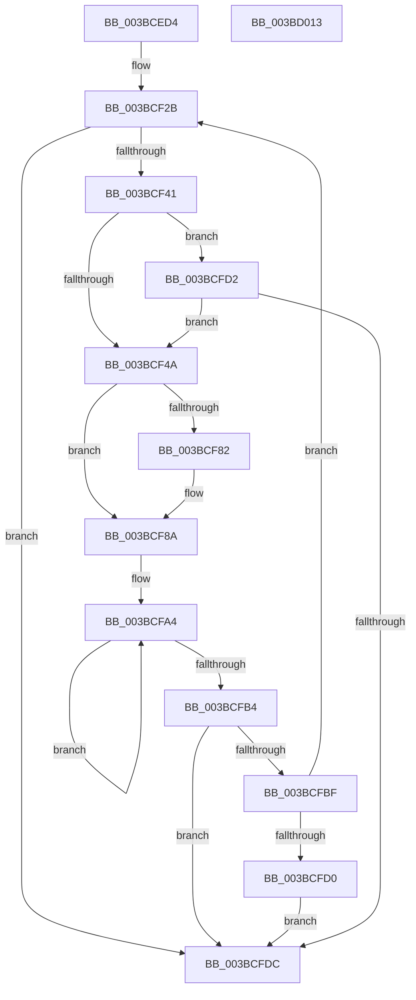

# MiFlushAllPagesWorker

- RVA: `0x003BCED4`–`0x003BD014` (길이 `320` bytes)
- VA: `0x00000001403BCED4`
- 실행 섹션: `.text`
- PDB 이름 있음: `예`; PDB Function 태그: `아니요`
- unwind 정보 RVA: `0x0005FEF8`
- 디코드: `77`개 명령, `320/320` bytes 표시
- 미해석 바이트: `0` (있으면 어셈블리에 `.byte`로 보존)

> 이 문서는 커널 이미지의 기계어와 PDB 기호를 분석해 생성했습니다. 4번과 5번은 함수 원형과 자료형을 바이너리 사용 방식에서 추정한 C 해석이며 원본 소스 복구 결과는 아닙니다.

## 1. Dependencies

- 직접 호출 지점: **7**; 고유 호출 대상: **7**
- 직접 호출자로 확인된 함수: **1**
- RIP 상대 이미지 참조: **1**

### Outgoing calls
- `0x003BCF34` → [MiCanFlushMakeProgress](MiCanFlushMakeProgress_function_003BC9D0.md) (function, `0x003BC9D0`)
- `0x003BCF56` → [KeSetEvent](../33/KeSetEvent_function_0033F310.md) (function, `0x0033F310`)
- `0x003BCF61` → [MiWakeModifiedPageWriter](MiWakeModifiedPageWriter_function_003BCB18.md) (function, `0x003BCB18`)
- `0x003BCF72` → [CcNotifyWriteBehindEx](CcNotifyWriteBehindEx_function_003BCBA8.md) (function, `0x003BCBA8`)
- `0x003BCF85` → [MiStoreUpdateMemoryConditions](../34/MiStoreUpdateMemoryConditions_function_0034CF3C.md) (function, `0x0034CF3C`)
- `0x003BCF95` → [KeDelayExecutionThread](../20/KeDelayExecutionThread_function_00209550.md) (function, `0x00209550`)
- `0x003BCFEF` → [KeLeaveCriticalRegionThread](../25/KeLeaveCriticalRegionThread_function_0025EFF0.md) (function, `0x0025EFF0`)

### Direct callers
- [MiFlushAllPages](MiFlushAllPages_function_003BD294.md) at `0x003BD309`
- [MiFlushAllPages](MiFlushAllPages_function_003BD294.md) at `0x003BD357`

### Static image references
- `0x003BCF8A` → RVA `0x00011C80` (`.rdata`; read)

## 2. Other-region calls and transfers

- 다른 실행 섹션으로 향하는 call: **0**
- 별도 외부 분기/꼬리 이동을 확인하지 못했습니다.

## 3. Assembly (complete function range)

```asm
003BCED4  48 8B C4                        mov rax, rsp
003BCED7  48 89 58 08                     mov qword ptr [rax + 8], rbx
003BCEDB  48 89 68 10                     mov qword ptr [rax + 0x10], rbp
003BCEDF  48 89 70 18                     mov qword ptr [rax + 0x18], rsi
003BCEE3  48 89 78 20                     mov qword ptr [rax + 0x20], rdi
003BCEE7  41 54                           push r12
003BCEE9  41 56                           push r14
003BCEEB  41 57                           push r15
003BCEED  48 83 EC 20                     sub rsp, 0x20
003BCEF1  65 48 8B 3C 25 88 01 00 00      mov rdi, qword ptr gs:[0x188]
003BCEFA  49 83 CF FF                     or r15, 0xffffffffffffffff
003BCEFE  49 8B F1                        mov rsi, r9
003BCF01  49 8B E8                        mov rbp, r8
003BCF04  4C 8B F2                        mov r14, rdx
003BCF07  48 8B D9                        mov rbx, rcx
003BCF0A  66 44 01 BF E4 01 00 00         add word ptr [rdi + 0x1e4], r15w
003BCF12  90                              nop
003BCF13  F0 FF 81 40 03 00 00            lock inc dword ptr [rcx + 0x340]
003BCF1A  F0 FF 81 44 03 00 00            lock inc dword ptr [rcx + 0x344]
003BCF21  49 BC B0 03 00 00 80 F7 FF FF   movabs r12, 0xfffff780000003b0
003BCF2B  33 D2                           xor edx, edx
003BCF2D  48 8B CB                        mov rcx, rbx
003BCF30  44 8D 42 01                     lea r8d, [rdx + 1]
003BCF34  E8 97 FA FF FF                  call 0x1403bc9d0
003BCF39  85 C0                           test eax, eax
003BCF3B  0F 84 9B 00 00 00               je 0x1403bcfdc
003BCF41  48 85 F6                        test rsi, rsi
003BCF44  0F 85 88 00 00 00               jne 0x1403bcfd2
003BCF4A  48 8D 8B 48 03 00 00            lea rcx, [rbx + 0x348]
003BCF51  45 33 C0                        xor r8d, r8d
003BCF54  33 D2                           xor edx, edx
003BCF56  E8 B5 23 F8 FF                  call 0x14033f310
003BCF5B  49 8B D7                        mov rdx, r15
003BCF5E  48 8B CB                        mov rcx, rbx
003BCF61  E8 B2 FB FF FF                  call 0x1403bcb18
003BCF66  48 8B 93 B8 00 00 00            mov rdx, qword ptr [rbx + 0xb8]
003BCF6D  B9 02 00 00 00                  mov ecx, 2
003BCF72  E8 31 FC FF FF                  call 0x1403bcba8
003BCF77  8B 83 B4 04 00 00               mov eax, dword ptr [rbx + 0x4b4]
003BCF7D  83 F8 FF                        cmp eax, -1
003BCF80  74 08                           je 0x1403bcf8a
003BCF82  48 8B CB                        mov rcx, rbx
003BCF85  E8 B2 FF F8 FF                  call 0x14034cf3c
003BCF8A  4C 8D 05 EF 4C C5 FF            lea r8, [rip - 0x3ab311]
003BCF91  33 D2                           xor edx, edx
003BCF93  33 C9                           xor ecx, ecx
003BCF95  E8 B6 C5 E4 FF                  call 0x140209550
003BCF9A  49 B8 08 00 00 00 80 F7 FF FF   movabs r8, 0xfffff78000000008
003BCFA4  49 8B 0C 24                     mov rcx, qword ptr [r12]
003BCFA8  49 8B 10                        mov rdx, qword ptr [r8]
003BCFAB  49 8B 04 24                     mov rax, qword ptr [r12]
003BCFAF  48 3B C8                        cmp rcx, rax
003BCFB2  75 F0                           jne 0x1403bcfa4
003BCFB4  48 2B D1                        sub rdx, rcx
003BCFB7  49 2B D6                        sub rdx, r14
003BCFBA  48 3B D5                        cmp rdx, rbp
003BCFBD  77 1D                           ja 0x1403bcfdc
003BCFBF  48 8B 83 C0 4B 00 00            mov rax, qword ptr [rbx + 0x4bc0]
003BCFC6  48 83 F8 32                     cmp rax, 0x32
003BCFCA  0F 87 5B FF FF FF               ja 0x1403bcf2b
003BCFD0  EB 0A                           jmp 0x1403bcfdc
003BCFD2  83 7E 04 00                     cmp dword ptr [rsi + 4], 0
003BCFD6  0F 84 6E FF FF FF               je 0x1403bcf4a
003BCFDC  F0 44 01 BB 40 03 00 00         lock add dword ptr [rbx + 0x340], r15d
003BCFE4  F0 44 01 BB 44 03 00 00         lock add dword ptr [rbx + 0x344], r15d
003BCFEC  48 8B CF                        mov rcx, rdi
003BCFEF  E8 FC 1F EA FF                  call 0x14025eff0
003BCFF4  48 8B 5C 24 40                  mov rbx, qword ptr [rsp + 0x40]
003BCFF9  48 8B 6C 24 48                  mov rbp, qword ptr [rsp + 0x48]
003BCFFE  48 8B 74 24 50                  mov rsi, qword ptr [rsp + 0x50]
003BD003  48 8B 7C 24 58                  mov rdi, qword ptr [rsp + 0x58]
003BD008  48 83 C4 20                     add rsp, 0x20
003BD00C  41 5F                           pop r15
003BD00E  41 5E                           pop r14
003BD010  41 5C                           pop r12
003BD012  C3                              ret
003BD013  CC                              int3
```

## 4. C-style interpretation (structured pseudocode)

```c
__int64 __fastcall MiFlushAllPagesWorker(__int64 a1, __int64 a2, __int64 a3, __int64 a4)
{
    __int64 result;
    __int64 v_r15;
    __int64 v_rsp;
    unsigned __int64 v_stack_p10;
    unsigned __int64 v_stack_p18;
    unsigned __int64 v_stack_p20;
    unsigned __int64 v_stack_p8;

    *(unsigned __int64 *)(v_rsp + 8) = v_rbx;
    *(unsigned __int64 *)(v_rsp + 16) = v_rbp;
    *(unsigned __int64 *)(v_rsp + 24) = v_rsi;
    *(unsigned __int64 *)(v_rsp + 32) = v_rdi;
    v_rsp = (v_rsp) - (32);
    v_r15 = (v_r15) | (-1);
loc_003BCF2B:
    a2 = 0;
    result = MiCanFlushMakeProgress(a1, a2, a2 + 1, a4);
    if ((unsigned int)(result) == 0) goto loc_003BCFDC;
    if (a4 != 0) goto loc_003BCFD2;
loc_003BCF4A:
    a3 = 0;
    a2 = 0;
    result = KeSetEvent(a1 + 840, a2, a3, a4);
    result = MiWakeModifiedPageWriter(a1, v_r15, a3, a4);
    result = CcNotifyWriteBehindEx(2, *(unsigned __int64 *)(a1 + 184), a3, a4);
    result = (unsigned int)(*(unsigned int *)(a1 + 1204));
    if (((unsigned int)((unsigned int)(*(unsigned int *)(a1 + 1204)))) != -1) {
        a1 = a1;
        result = MiStoreUpdateMemoryConditions(a1, *(unsigned __int64 *)(a1 + 184), a3, a4);
    }
    a2 = 0;
    a1 = 0;
    result = KeDelayExecutionThread(a1, a2, v_rip - 3846929, a4);
loc_003BCFA4:
    if ((*(unsigned __int64 *)(v_r12)) != (*(unsigned __int64 *)(v_r12))) goto loc_003BCFA4;
    a2 = (*(unsigned __int64 *)(v_rip - 3846929)) - (*(unsigned __int64 *)(v_r12));
    a2 = (a2) - (a2);
    if (a2 > 0) goto loc_003BCFDC;
    if ((*(unsigned __int64 *)(a1 + 19392)) > 50) goto loc_003BCF2B;
    goto loc_003BCFDC;
loc_003BCFD2:
    if ((*(unsigned int *)(a4 + 4)) == 0) goto loc_003BCF4A;
loc_003BCFDC:
    result = KeLeaveCriticalRegionThread(*(unsigned __int64 *)(gs_base + (0 + 392)), a2, v_rip - 3846929, a4);
    v_rsp = (v_rsp) + (32);
    return result;
}
```

## 5. (Beta) C Style

```c
int64_t MiFlushAllPagesWorker(void *Arg1, int64_t Arg2, int64_t Arg3, int64_t Arg4)
{
    uint8_t *arg1 = (uint8_t *)Arg1;

    int64_t result;
    int64_t local_r15;
    int64_t local_rsp;
    uint64_t v_stack_p10;
    uint64_t v_stack_p18;
    uint64_t v_stack_p20;
    uint64_t v_stack_p8;

    *(uint64_t *)(local_rsp + 0x8) = local_rbx;
    *(uint64_t *)(local_rsp + 0x10) = local_rbp;
    *(uint64_t *)(local_rsp + 0x18) = local_rsi;
    *(uint64_t *)(local_rsp + 0x20) = local_rdi;
    local_rsp = (local_rsp) - (32);
    local_r15 = (local_r15) | (-1);
loc_003BCF2B:
    Arg2 = 0;
    result = MiCanFlushMakeProgress(Arg1, Arg2, Arg2 + 1, Arg4);
    if ((uint32_t)(result) == 0) goto loc_003BCFDC;
    if (Arg4 != 0) goto loc_003BCFD2;
loc_003BCF4A:
    Arg3 = 0;
    Arg2 = 0;
    result = KeSetEvent(Arg1 + 840, Arg2, Arg3, Arg4);
    result = MiWakeModifiedPageWriter(Arg1, local_r15, Arg3, Arg4);
    result = CcNotifyWriteBehindEx(2, *(uint64_t *)(arg1 + 0xB8), Arg3, Arg4);
    result = (uint32_t)(*(uint32_t *)(arg1 + 0x4B4));
    if (((uint32_t)((uint32_t)(*(uint32_t *)(arg1 + 0x4B4)))) != -1) {
        Arg1 = Arg1;
        result = MiStoreUpdateMemoryConditions(Arg1, *(uint64_t *)(arg1 + 0xB8), Arg3, Arg4);
    }
    Arg2 = 0;
    Arg1 = 0;
    result = KeDelayExecutionThread(Arg1, Arg2, v_rip - 3846929, Arg4);
loc_003BCFA4:
    if ((*(uint64_t *)(local_r12)) != (*(uint64_t *)(local_r12))) goto loc_003BCFA4;
    Arg2 = (*(uint64_t *)(v_rip - 0x3AB311)) - (*(uint64_t *)(local_r12));
    Arg2 = (Arg2) - (Arg2);
    if (Arg2 > 0) goto loc_003BCFDC;
    if ((*(uint64_t *)(arg1 + 0x4BC0)) > 50) goto loc_003BCF2B;
    goto loc_003BCFDC;
loc_003BCFD2:
    if ((*(uint32_t *)(Arg4 + 0x4)) == 0) goto loc_003BCF4A;
loc_003BCFDC:
    result = KeLeaveCriticalRegionThread(*(uint64_t *)(gs_base + (0 + 0x188)), Arg2, v_rip - 3846929, Arg4);
    local_rsp = (local_rsp) + (32);
    return result;
}
```

### 관측된 메모리 오프셋

구조체 형식이 확인되지 않은 접근은 인자 기준의 오프셋으로만 기록했습니다.

| 기준 인자 | 오프셋 표현 | 폭 (bit) | 접근 |
|---|---:|---:|---|
| `Arg1` | `+ 0xB8` | `64` | `R` |
| `Arg1` | `+ 0x340` | `32` | `R/W` |
| `Arg1` | `+ 0x344` | `32` | `R/W` |
| `Arg1` | `+ 0x348` | `64` | `R` |
| `Arg1` | `+ 0x4B4` | `32` | `R` |
| `Arg1` | `+ 0x4BC0` | `64` | `R` |

## 6. Execution-region graph

[열기: 2D/3D 그래프와 함수 탐색 컨트롤 패널](../../../control-panel.html?section=text&rva=0x003BCED4&view=graph)

- 2D 그래프는 위에서 아래로 흐르고, 3D 그래프는 빈 공간을 드래그해 회전합니다. Shift+드래그는 이동, 휠은 확대·축소, 함수 노드 선택은 대상 보고서 이동입니다.

### Static fallback


