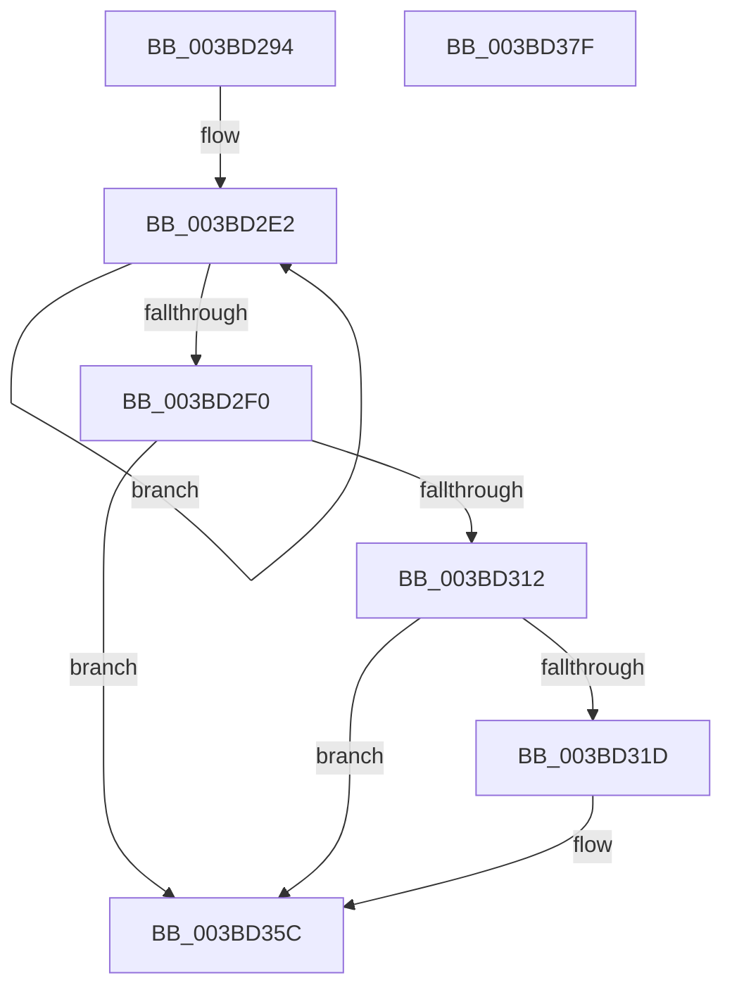

# MiFlushAllPages

- RVA: `0x003BD294`–`0x003BD380` (길이 `236` bytes)
- VA: `0x00000001403BD294`
- 실행 섹션: `.text`
- PDB 이름 있음: `예`; PDB Function 태그: `아니요`
- unwind 정보 RVA: `0x0008CE9C`
- 디코드: `60`개 명령, `236/236` bytes 표시
- 미해석 바이트: `0` (있으면 어셈블리에 `.byte`로 보존)

> 이 문서는 커널 이미지의 기계어와 PDB 기호를 분석해 생성했습니다. 4번과 5번은 함수 원형과 자료형을 바이너리 사용 방식에서 추정한 C 해석이며 원본 소스 복구 결과는 아닙니다.

## 1. Dependencies

- 직접 호출 지점: **6**; 고유 호출 대상: **5**
- 직접 호출자로 확인된 함수: **2**
- RIP 상대 이미지 참조: **1**

### Outgoing calls
- `0x003BD309` → [MiFlushAllPagesWorker](MiFlushAllPagesWorker_function_003BCED4.md) (function, `0x003BCED4`)
- `0x003BD32C` → [KeStackAttachProcess](../21/KeStackAttachProcess_function_00216800.md) (function, `0x00216800`)
- `0x003BD33A` → [MiEmptyWorkingSetPrivatePagesByVa](../2A/MiEmptyWorkingSetPrivatePagesByVa_function_002A6AC0.md) (function, `0x002A6AC0`)
- `0x003BD346` → [KiUnstackDetachProcess](../21/KiUnstackDetachProcess_function_00217D30.md) (function, `0x00217D30`)
- `0x003BD357` → [MiFlushAllPagesWorker](MiFlushAllPagesWorker_function_003BCED4.md) (function, `0x003BCED4`)
- `0x003BD364` → [_security_check_cookie](../6A/_security_check_cookie_function_006AC640.md) (function, `0x006AC640`)

### Direct callers
- [MmFlushAllPagesEx](../68/MmFlushAllPagesEx_function_006804E4.md) at `0x00680505`
- [MmPerformMemoryListCommand](../../pagelk/B7/MmPerformMemoryListCommand_function_00B7D730.md) at `0x00B7D799`

### Static image references
- `0x003BD2A8` → RVA `0x00E0A740` (`.data`; read)

## 2. Other-region calls and transfers

- 다른 실행 섹션으로 향하는 call: **0**
- 별도 외부 분기/꼬리 이동을 확인하지 못했습니다.

## 3. Assembly (complete function range)

```asm
003BD294  48 89 5C 24 10                  mov qword ptr [rsp + 0x10], rbx
003BD299  48 89 6C 24 18                  mov qword ptr [rsp + 0x18], rbp
003BD29E  48 89 74 24 20                  mov qword ptr [rsp + 0x20], rsi
003BD2A3  57                              push rdi
003BD2A4  48 83 EC 60                     sub rsp, 0x60
003BD2A8  48 8B 05 91 D4 A4 00            mov rax, qword ptr [rip + 0xa4d491]
003BD2AF  48 33 C4                        xor rax, rsp
003BD2B2  48 89 44 24 50                  mov qword ptr [rsp + 0x50], rax
003BD2B7  0F 57 C0                        xorps xmm0, xmm0
003BD2BA  8A DA                           mov bl, dl
003BD2BC  0F 11 44 24 20                  movups xmmword ptr [rsp + 0x20], xmm0
003BD2C1  48 8B F9                        mov rdi, rcx
003BD2C4  48 BA B0 03 00 00 80 F7 FF FF   movabs rdx, 0xfffff780000003b0
003BD2CE  0F 11 44 24 30                  movups xmmword ptr [rsp + 0x30], xmm0
003BD2D3  49 B9 08 00 00 00 80 F7 FF FF   movabs r9, 0xfffff78000000008
003BD2DD  0F 11 44 24 40                  movups xmmword ptr [rsp + 0x40], xmm0
003BD2E2  48 8B 0A                        mov rcx, qword ptr [rdx]
003BD2E5  49 8B 31                        mov rsi, qword ptr [r9]
003BD2E8  48 8B 02                        mov rax, qword ptr [rdx]
003BD2EB  48 3B C8                        cmp rcx, rax
003BD2EE  75 F2                           jne 0x1403bd2e2
003BD2F0  41 8B C0                        mov eax, r8d
003BD2F3  48 2B F1                        sub rsi, rcx
003BD2F6  48 69 E8 80 96 98 00            imul rbp, rax, 0x989680
003BD2FD  45 33 C9                        xor r9d, r9d
003BD300  48 8B D6                        mov rdx, rsi
003BD303  4C 8B C5                        mov r8, rbp
003BD306  48 8B CF                        mov rcx, rdi
003BD309  E8 C6 FB FF FF                  call 0x1403bced4
003BD30E  84 DB                           test bl, bl
003BD310  74 4A                           je 0x1403bd35c
003BD312  8B 87 B4 04 00 00               mov eax, dword ptr [rdi + 0x4b4]
003BD318  83 F8 FF                        cmp eax, -1
003BD31B  74 3F                           je 0x1403bd35c
003BD31D  48 8B 9F A0 06 00 00            mov rbx, qword ptr [rdi + 0x6a0]
003BD324  48 8D 54 24 20                  lea rdx, [rsp + 0x20]
003BD329  48 8B CB                        mov rcx, rbx
003BD32C  E8 CF 94 E5 FF                  call 0x140216800
003BD331  48 8D 8B 00 04 00 00            lea rcx, [rbx + 0x400]
003BD338  33 D2                           xor edx, edx
003BD33A  E8 81 97 EE FF                  call 0x1402a6ac0
003BD33F  33 D2                           xor edx, edx
003BD341  48 8D 4C 24 20                  lea rcx, [rsp + 0x20]
003BD346  E8 E5 A9 E5 FF                  call 0x140217d30
003BD34B  45 33 C9                        xor r9d, r9d
003BD34E  4C 8B C5                        mov r8, rbp
003BD351  48 8B D6                        mov rdx, rsi
003BD354  48 8B CF                        mov rcx, rdi
003BD357  E8 78 FB FF FF                  call 0x1403bced4
003BD35C  48 8B 4C 24 50                  mov rcx, qword ptr [rsp + 0x50]
003BD361  48 33 CC                        xor rcx, rsp
003BD364  E8 D7 F2 2E 00                  call 0x1406ac640
003BD369  4C 8D 5C 24 60                  lea r11, [rsp + 0x60]
003BD36E  49 8B 5B 18                     mov rbx, qword ptr [r11 + 0x18]
003BD372  49 8B 6B 20                     mov rbp, qword ptr [r11 + 0x20]
003BD376  49 8B 73 28                     mov rsi, qword ptr [r11 + 0x28]
003BD37A  49 8B E3                        mov rsp, r11
003BD37D  5F                              pop rdi
003BD37E  C3                              ret
003BD37F  CC                              int3
```

## 4. C-style interpretation (structured pseudocode)

```c
__int64 __fastcall MiFlushAllPages(__int64 a1, unsigned __int8 a2, int a3)
{
    __int64 result;
    __int64 v_rbp;
    __int64 v_rbx;
    __int64 v_rsi;
    __int64 v_rsp;
    unsigned __int64 v_stack_m18;
    unsigned __int64 v_stack_m28;
    unsigned __int64 v_stack_m38;
    unsigned __int64 v_stack_m48;
    unsigned __int64 v_stack_m8;
    unsigned __int64 v_stack_p10;
    unsigned __int64 v_stack_p18;
    unsigned __int64 v_stack_p20;

    v_stack_p10 = v_rbx;
    v_stack_p18 = v_rbp;
    v_stack_p20 = v_rsi;
    v_rsp = (v_rsp) - (96);
    result = (*(unsigned __int64 *)(v_rip + 10802321)) ^ (v_rsp);
    v_stack_m18 = result;
    v_stack_m48 = v_xmm0;
    v_stack_m38 = v_xmm0;
    v_stack_m28 = v_xmm0;
loc_003BD2E2:
    if ((*(unsigned __int64 *)(a2)) != (*(unsigned __int64 *)(a2))) goto loc_003BD2E2;
    v_rsi = (*(unsigned __int64 *)(a4)) - (*(unsigned __int64 *)(a2));
    v_rbp = (v_rbp) * ((unsigned int)(a3));
    a4 = 0;
    result = MiFlushAllPagesWorker(a1, v_rsi, v_rbp, a4);
    if (a2 == 0) goto loc_003BD35C;
    result = (unsigned int)(*(unsigned int *)(a1 + 1204));
    v_rbx = a2;
    if (((unsigned int)((unsigned int)(*(unsigned int *)(a1 + 1204)))) != -1) {
        v_rbx = *(unsigned __int64 *)(a1 + 1696);
        a2 = v_stack_m48;
        a1 = v_rbx;
        result = KeStackAttachProcess(a1, a2, v_rbp, a4);
        a1 = v_rbx + 1024;
        a2 = 0;
        result = MiEmptyWorkingSetPrivatePagesByVa(a1, a2, v_rbp, a4);
        a2 = 0;
        a1 = v_stack_m48;
        result = KiUnstackDetachProcess(a1, a2, v_rbp, a4);
        a4 = 0;
        a3 = v_rbp;
        a2 = v_rsi;
        a1 = a1;
        result = MiFlushAllPagesWorker(a1, a2, a3, a4);
    }
    a1 = (v_stack_m18) ^ (v_rsp);
    result = _security_check_cookie(a1, a2, a3, a4);
    return result;
}
```

## 5. (Beta) C Style

```c
int64_t MiFlushAllPages(void *Arg1, uint8_t Arg2, int32_t Arg3)
{
    uint8_t *arg1 = (uint8_t *)Arg1;

    int64_t result;
    int64_t local_rbp;
    int64_t local_rbx;
    int64_t local_rsi;
    int64_t local_rsp;
    uint64_t v_stack_m18;
    uint64_t v_stack_m28;
    uint64_t v_stack_m38;
    uint64_t v_stack_m48;
    uint64_t v_stack_m8;
    uint64_t v_stack_p10;
    uint64_t v_stack_p18;
    uint64_t v_stack_p20;

    v_stack_p10 = local_rbx;
    v_stack_p18 = local_rbp;
    v_stack_p20 = local_rsi;
    local_rsp = (local_rsp) - (96);
    result = (*(uint64_t *)(v_rip + 0xA4D491)) ^ (local_rsp);
    v_stack_m18 = result;
    v_stack_m48 = v_xmm0;
    v_stack_m38 = v_xmm0;
    v_stack_m28 = v_xmm0;
loc_003BD2E2:
    if ((*(uint64_t *)(Arg2)) != (*(uint64_t *)(Arg2))) goto loc_003BD2E2;
    local_rsi = (*(uint64_t *)(a4)) - (*(uint64_t *)(Arg2));
    local_rbp = (local_rbp) * ((uint32_t)(Arg3));
    a4 = 0;
    result = MiFlushAllPagesWorker(Arg1, local_rsi, local_rbp, a4);
    if (Arg2 == 0) goto loc_003BD35C;
    result = (uint32_t)(*(uint32_t *)(arg1 + 0x4B4));
    local_rbx = Arg2;
    if (((uint32_t)((uint32_t)(*(uint32_t *)(arg1 + 0x4B4)))) != -1) {
        local_rbx = *(uint64_t *)(arg1 + 0x6A0);
        Arg2 = v_stack_m48;
        Arg1 = local_rbx;
        result = KeStackAttachProcess(Arg1, Arg2, local_rbp, a4);
        Arg1 = local_rbx + 1024;
        Arg2 = 0;
        result = MiEmptyWorkingSetPrivatePagesByVa(Arg1, Arg2, local_rbp, a4);
        Arg2 = 0;
        Arg1 = v_stack_m48;
        result = KiUnstackDetachProcess(Arg1, Arg2, local_rbp, a4);
        a4 = 0;
        Arg3 = local_rbp;
        Arg2 = local_rsi;
        Arg1 = Arg1;
        result = MiFlushAllPagesWorker(Arg1, Arg2, Arg3, a4);
    }
    Arg1 = (v_stack_m18) ^ (local_rsp);
    result = _security_check_cookie(Arg1, Arg2, Arg3, a4);
    return result;
}
```

### 관측된 메모리 오프셋

구조체 형식이 확인되지 않은 접근은 인자 기준의 오프셋으로만 기록했습니다.

| 기준 인자 | 오프셋 표현 | 폭 (bit) | 접근 |
|---|---:|---:|---|
| `Arg1` | `+ 0x4B4` | `32` | `R` |
| `Arg1` | `+ 0x6A0` | `64` | `R` |

## 6. Execution-region graph

[열기: 2D/3D 그래프와 함수 탐색 컨트롤 패널](../../../control-panel.html?section=text&rva=0x003BD294&view=graph)

- 2D 그래프는 위에서 아래로 흐르고, 3D 그래프는 빈 공간을 드래그해 회전합니다. Shift+드래그는 이동, 휠은 확대·축소, 함수 노드 선택은 대상 보고서 이동입니다.

### Static fallback


