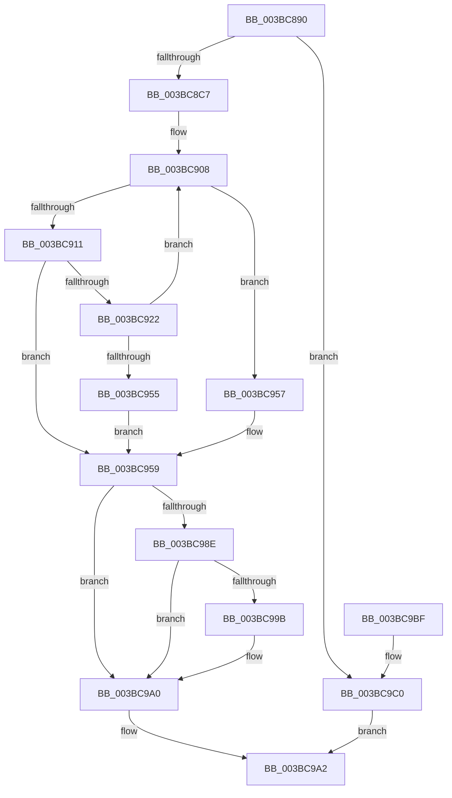

# MiFlushAllStoreSwapPages

- RVA: `0x003BC890`–`0x003BC9C7` (길이 `311` bytes)
- VA: `0x00000001403BC890`
- 실행 섹션: `.text`
- PDB 이름 있음: `예`; PDB Function 태그: `아니요`
- unwind 정보 RVA: `0x0008CDD0`
- 디코드: `83`개 명령, `311/311` bytes 표시
- 미해석 바이트: `0` (있으면 어셈블리에 `.byte`로 보존)

> 이 문서는 커널 이미지의 기계어와 PDB 기호를 분석해 생성했습니다. 4번과 5번은 함수 원형과 자료형을 바이너리 사용 방식에서 추정한 C 해석이며 원본 소스 복구 결과는 아닙니다.

## 1. Dependencies

- 직접 호출 지점: **8**; 고유 호출 대상: **7**
- 직접 호출자로 확인된 함수: **1**
- RIP 상대 이미지 참조: **1**

### Outgoing calls
- `0x003BC8DA` → [KeSetActualBasePriorityThread](../3C/KeSetActualBasePriorityThread_function_003C4370.md) (function, `0x003C4370`)
- `0x003BC919` → [MiCanFlushMakeProgress](MiCanFlushMakeProgress_function_003BC9D0.md) (function, `0x003BC9D0`)
- `0x003BC929` → [MiWakeModifiedPageWriter](MiWakeModifiedPageWriter_function_003BCB18.md) (function, `0x003BCB18`)
- `0x003BC931` → [MiStoreUpdateMemoryConditions](../34/MiStoreUpdateMemoryConditions_function_0034CF3C.md) (function, `0x0034CF3C`)
- `0x003BC941` → [KeDelayExecutionThread](../20/KeDelayExecutionThread_function_00209550.md) (function, `0x00209550`)
- `0x003BC974` → [KeSetEvent](../33/KeSetEvent_function_0033F310.md) (function, `0x0033F310`)
- `0x003BC97F` → [KeSetActualBasePriorityThread](../3C/KeSetActualBasePriorityThread_function_003C4370.md) (function, `0x003C4370`)
- `0x003BC99B` → [KiCheckForKernelApcDelivery](../2E/KiCheckForKernelApcDelivery_function_002E2C80.md) (function, `0x002E2C80`)

### Direct callers
- [SmpFlushStorePages](../../page/A9/SmpFlushStorePages_function_00A9DC00.md) at `0x00A9DC16`

### Static image references
- `0x003BC936` → RVA `0x00011C80` (`.rdata`; read)

## 2. Other-region calls and transfers

- 다른 실행 섹션으로 향하는 call: **0**
- 별도 외부 분기/꼬리 이동을 확인하지 못했습니다.

## 3. Assembly (complete function range)

```asm
003BC890  48 89 5C 24 08                  mov qword ptr [rsp + 8], rbx
003BC895  48 89 6C 24 10                  mov qword ptr [rsp + 0x10], rbp
003BC89A  48 89 74 24 18                  mov qword ptr [rsp + 0x18], rsi
003BC89F  57                              push rdi
003BC8A0  41 54                           push r12
003BC8A2  41 55                           push r13
003BC8A4  41 56                           push r14
003BC8A6  41 57                           push r15
003BC8A8  48 83 EC 20                     sub rsp, 0x20
003BC8AC  65 48 8B 34 25 88 01 00 00      mov rsi, qword ptr gs:[0x188]
003BC8B5  48 8B D9                        mov rbx, rcx
003BC8B8  8B 81 B4 04 00 00               mov eax, dword ptr [rcx + 0x4b4]
003BC8BE  83 F8 FF                        cmp eax, -1
003BC8C1  0F 84 F9 00 00 00               je 0x1403bc9c0
003BC8C7  BF 01 00 00 00                  mov edi, 1
003BC8CC  48 8B CE                        mov rcx, rsi
003BC8CF  66 29 BE E6 01 00 00            sub word ptr [rsi + 0x1e6], di
003BC8D6  90                              nop
003BC8D7  8D 57 11                        lea edx, [rdi + 0x11]
003BC8DA  E8 91 7A 00 00                  call 0x1403c4370
003BC8DF  49 BD 08 00 00 00 80 F7 FF FF   movabs r13, 0xfffff78000000008
003BC8E9  44 8B E0                        mov r12d, eax
003BC8EC  4D 8B 7D 00                     mov r15, qword ptr [r13]
003BC8F0  8B 8B B4 04 00 00               mov ecx, dword ptr [rbx + 0x4b4]
003BC8F6  F0 83 83 B0 04 00 00 02         lock add dword ptr [rbx + 0x4b0], 2
003BC8FE  33 ED                           xor ebp, ebp
003BC900  48 83 C1 30                     add rcx, 0x30
003BC904  4C 6B F1 58                     imul r14, rcx, 0x58
003BC908  49 8B 04 1E                     mov rax, qword ptr [r14 + rbx]
003BC90C  48 85 C0                        test rax, rax
003BC90F  74 46                           je 0x1403bc957
003BC911  4C 8B C7                        mov r8, rdi
003BC914  8B D7                           mov edx, edi
003BC916  48 8B CB                        mov rcx, rbx
003BC919  E8 B2 00 00 00                  call 0x1403bc9d0
003BC91E  85 C0                           test eax, eax
003BC920  74 37                           je 0x1403bc959
003BC922  48 83 CA FF                     or rdx, 0xffffffffffffffff
003BC926  48 8B CB                        mov rcx, rbx
003BC929  E8 EA 01 00 00                  call 0x1403bcb18
003BC92E  48 8B CB                        mov rcx, rbx
003BC931  E8 06 06 F9 FF                  call 0x14034cf3c
003BC936  4C 8D 05 43 53 C5 FF            lea r8, [rip - 0x3aacbd]
003BC93D  33 D2                           xor edx, edx
003BC93F  33 C9                           xor ecx, ecx
003BC941  E8 0A CC E4 FF                  call 0x140209550
003BC946  49 8B 45 00                     mov rax, qword ptr [r13]
003BC94A  49 2B C7                        sub rax, r15
003BC94D  48 3D 80 F0 FA 02               cmp rax, 0x2faf080
003BC953  76 B3                           jbe 0x1403bc908
003BC955  EB 02                           jmp 0x1403bc959
003BC957  8B EF                           mov ebp, edi
003BC959  F0 09 BB B0 04 00 00            lock or dword ptr [rbx + 0x4b0], edi
003BC960  F0 83 83 B0 04 00 00 FE         lock add dword ptr [rbx + 0x4b0], -2
003BC968  48 8D 8B A0 03 00 00            lea rcx, [rbx + 0x3a0]
003BC96F  45 33 C0                        xor r8d, r8d
003BC972  33 D2                           xor edx, edx
003BC974  E8 97 29 F8 FF                  call 0x14033f310
003BC979  41 8B D4                        mov edx, r12d
003BC97C  48 8B CE                        mov rcx, rsi
003BC97F  E8 EC 79 00 00                  call 0x1403c4370
003BC984  90                              nop
003BC985  66 01 BE E6 01 00 00            add word ptr [rsi + 0x1e6], di
003BC98C  75 12                           jne 0x1403bc9a0
003BC98E  48 8D 8E 98 00 00 00            lea rcx, [rsi + 0x98]
003BC995  90                              nop
003BC996  48 39 09                        cmp qword ptr [rcx], rcx
003BC999  74 05                           je 0x1403bc9a0
003BC99B  E8 E0 62 F2 FF                  call 0x1402e2c80
003BC9A0  8B C5                           mov eax, ebp
003BC9A2  48 8B 5C 24 50                  mov rbx, qword ptr [rsp + 0x50]
003BC9A7  48 8B 6C 24 58                  mov rbp, qword ptr [rsp + 0x58]
003BC9AC  48 8B 74 24 60                  mov rsi, qword ptr [rsp + 0x60]
003BC9B1  48 83 C4 20                     add rsp, 0x20
003BC9B5  41 5F                           pop r15
003BC9B7  41 5E                           pop r14
003BC9B9  41 5D                           pop r13
003BC9BB  41 5C                           pop r12
003BC9BD  5F                              pop rdi
003BC9BE  C3                              ret
003BC9BF  CC                              int3
003BC9C0  B8 01 00 00 00                  mov eax, 1
003BC9C5  EB DB                           jmp 0x1403bc9a2
```

## 4. C-style interpretation (structured pseudocode)

```c
__int64 __fastcall MiFlushAllStoreSwapPages(__int64 a1)
{
    __int64 result;
    __int64 v_r14;
    __int64 v_rbp;
    __int64 v_rsp;
    unsigned __int64 v_stack_p10;
    unsigned __int64 v_stack_p18;
    unsigned __int64 v_stack_p8;

    v_stack_p8 = v_rbx;
    v_stack_p10 = v_rbp;
    v_stack_p18 = v_rsi;
    v_rsp = (v_rsp) - (32);
    if (((unsigned int)((unsigned int)(*(unsigned int *)(a1 + 1204)))) == -1) goto loc_003BC9C0;
    result = KeSetActualBasePriorityThread(*(unsigned __int64 *)(gs_base + (0 + 392)), 1 + 17, a3, a4);
    v_rbp = 0;
    a1 = ((unsigned int)(*(unsigned int *)(a1 + 1204))) + (48);
    v_r14 = (v_r14) * (a1);
loc_003BC908:
    if (*(unsigned __int64 *)(v_r14 + a1 * 1) == 0) goto loc_003BC957;
    result = MiCanFlushMakeProgress(a1, 1, 1, a4);
    if ((unsigned int)(result) == 0) goto loc_003BC959;
    a2 = (1) | (-1);
    result = MiWakeModifiedPageWriter(a1, a2, 1, a4);
    result = MiStoreUpdateMemoryConditions(a1, a2, 1, a4);
    a2 = 0;
    a1 = 0;
    result = KeDelayExecutionThread(a1, a2, v_rip - 3845309, a4);
    result = (*(unsigned __int64 *)(v_r13)) - (*(unsigned __int64 *)(v_r13));
    if (result <= 0x2FAF080ULL) goto loc_003BC908;
    goto loc_003BC959;
loc_003BC957:
loc_003BC959:
    a3 = 0;
    a2 = 0;
    result = KeSetEvent(a1 + 928, a2, a3, a4);
    result = KeSetActualBasePriorityThread(*(unsigned __int64 *)(gs_base + (0 + 392)), (unsigned int)((unsigned int)((unsigned int)((unsigned int)(result)))), a3, a4);
    if (condition_is_not_equal) goto loc_003BC9A0;
    if ((*(unsigned __int64 *)(*(unsigned __int64 *)(gs_base + (0 + 392)) + 152)) != (*(unsigned __int64 *)(gs_base + (0 + 392)) + 152)) {
        result = KiCheckForKernelApcDelivery(*(unsigned __int64 *)(gs_base + (0 + 392)) + 152, (unsigned int)((unsigned int)((unsigned int)((unsigned int)(result)))), a3, a4);
    }
loc_003BC9A2:
    v_rsp = (v_rsp) + (32);
    return 1;
loc_003BC9C0:
    goto loc_003BC9A2;
}
```

## 5. (Beta) C Style

```c
int64_t MiFlushAllStoreSwapPages(void *Arg1)
{
    uint8_t *arg1 = (uint8_t *)Arg1;

    int64_t result;
    int64_t local_r14;
    int64_t local_rbp;
    int64_t local_rsp;
    uint64_t v_stack_p10;
    uint64_t v_stack_p18;
    uint64_t v_stack_p8;

    v_stack_p8 = local_rbx;
    v_stack_p10 = local_rbp;
    v_stack_p18 = local_rsi;
    local_rsp = (local_rsp) - (32);
    if (((uint32_t)((uint32_t)(*(uint32_t *)(arg1 + 0x4B4)))) == -1) goto loc_003BC9C0;
    result = KeSetActualBasePriorityThread(*(uint64_t *)(gs_base + (0 + 0x188)), 1 + 17, a3, a4);
    local_rbp = 0;
    Arg1 = ((uint32_t)(*(uint32_t *)(arg1 + 0x4B4))) + (48);
    local_r14 = (local_r14) * (Arg1);
loc_003BC908:
    if (*(uint64_t *)(local_r14 + arg1 * 1) == 0) goto loc_003BC957;
    result = MiCanFlushMakeProgress(Arg1, 1, 1, a4);
    if ((uint32_t)(result) == 0) goto loc_003BC959;
    a2 = (1) | (-1);
    result = MiWakeModifiedPageWriter(Arg1, a2, 1, a4);
    result = MiStoreUpdateMemoryConditions(Arg1, a2, 1, a4);
    a2 = 0;
    Arg1 = 0;
    result = KeDelayExecutionThread(Arg1, a2, v_rip - 3845309, a4);
    result = (*(uint64_t *)(local_r13)) - (*(uint64_t *)(local_r13));
    if (result <= 0x2FAF080ULL) goto loc_003BC908;
    goto loc_003BC959;
loc_003BC957:
loc_003BC959:
    a3 = 0;
    a2 = 0;
    result = KeSetEvent(Arg1 + 928, a2, a3, a4);
    result = KeSetActualBasePriorityThread(*(uint64_t *)(gs_base + (0 + 0x188)), (uint32_t)((uint32_t)((uint32_t)((uint32_t)(result)))), a3, a4);
    if (condition_is_not_equal) goto loc_003BC9A0;
    if ((*(uint64_t *)(*(uint64_t *)(gs_base + (0 + 0x188)) + 0x98)) != (*(uint64_t *)(gs_base + (0 + 0x188)) + 152)) {
        result = KiCheckForKernelApcDelivery(*(uint64_t *)(gs_base + (0 + 0x188)) + 152, (uint32_t)((uint32_t)((uint32_t)((uint32_t)(result)))), a3, a4);
    }
loc_003BC9A2:
    local_rsp = (local_rsp) + (32);
    return 1;
loc_003BC9C0:
    goto loc_003BC9A2;
}
```

### 관측된 메모리 오프셋

구조체 형식이 확인되지 않은 접근은 인자 기준의 오프셋으로만 기록했습니다.

| 기준 인자 | 오프셋 표현 | 폭 (bit) | 접근 |
|---|---:|---:|---|
| `Arg1` | `+ 0x3A0` | `64` | `R` |
| `Arg1` | `+ 0x4B0` | `32` | `R/W` |
| `Arg1` | `+ 0x4B4` | `32` | `R` |

## 6. Execution-region graph

[열기: 2D/3D 그래프와 함수 탐색 컨트롤 패널](../../../control-panel.html?section=text&rva=0x003BC890&view=graph)

- 2D 그래프는 위에서 아래로 흐르고, 3D 그래프는 빈 공간을 드래그해 회전합니다. Shift+드래그는 이동, 휠은 확대·축소, 함수 노드 선택은 대상 보고서 이동입니다.

### Static fallback


