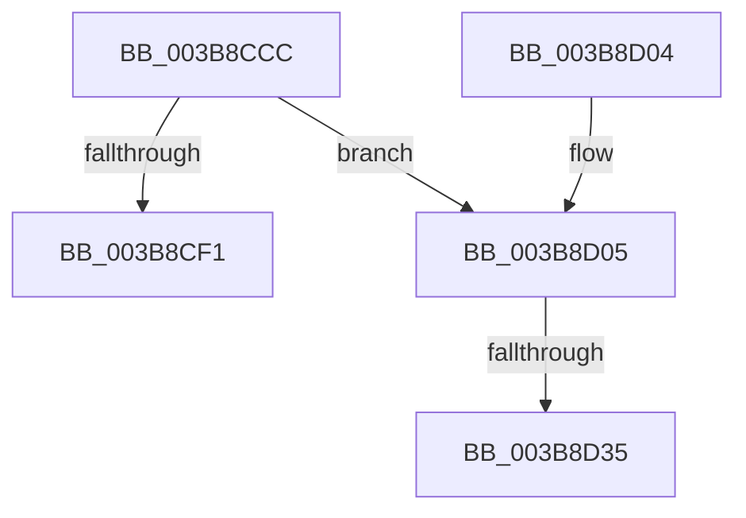

# MiFreeLargePageChain

- RVA: `0x003B8CCC`–`0x003B8D3F` (길이 `115` bytes)
- VA: `0x00000001403B8CCC`
- 실행 섹션: `.text`
- PDB 이름 있음: `예`; PDB Function 태그: `예`
- unwind 정보 RVA: `0x0008C9B0`
- 디코드: `31`개 명령, `115/115` bytes 표시
- 미해석 바이트: `0` (있으면 어셈블리에 `.byte`로 보존)

> 이 문서는 커널 이미지의 기계어와 PDB 기호를 분석해 생성했습니다. 4번과 5번은 함수 원형과 자료형을 바이너리 사용 방식에서 추정한 C 해석이며 원본 소스 복구 결과는 아닙니다.

## 1. Dependencies

- 직접 호출 지점: **1**; 고유 호출 대상: **1**
- 직접 호출자로 확인된 함수: **2**
- RIP 상대 이미지 참조: **0**

### Outgoing calls
- `0x003B8CE4` → [MiUnlinkPageChainHead](../36/MiUnlinkPageChainHead_function_00365C40.md) (function, `0x00365C40`)

### Direct callers
- [MiReturnExcessPoolCommit](../32/MiReturnExcessPoolCommit_function_00328D3C.md) at `0x00328DC2`
- [MiGetLargePageChain](MiGetLargePageChain_function_003B82D0.md) at `0x003B83C8`

### Static image references
- 디코드된 RIP-relative 메모리 참조가 없습니다.

## 2. Other-region calls and transfers

- 다른 실행 섹션으로 향하는 call: **0**
- call이 아닌 외부 분기/꼬리 이동: **2**
  - `0x003B8D2F` → [sub_006E798E + 0x1C](../6E/Unknown_function_006E798E.md) (`tail-transfer`)
  - `0x003B8D3A` → [sub_006E798E](../6E/Unknown_function_006E798E.md) (`tail-transfer`)

## 3. Assembly (complete function range)

```asm
003B8CCC  48 89 5C 24 08                  mov qword ptr [rsp + 8], rbx
003B8CD1  48 89 6C 24 10                  mov qword ptr [rsp + 0x10], rbp
003B8CD6  56                              push rsi
003B8CD7  57                              push rdi
003B8CD8  41 56                           push r14
003B8CDA  48 83 EC 20                     sub rsp, 0x20
003B8CDE  0F B6 EA                        movzx ebp, dl
003B8CE1  4C 8B F1                        mov r14, rcx
003B8CE4  E8 57 CF FA FF                  call 0x140365c40
003B8CE9  48 8B D8                        mov rbx, rax
003B8CEC  48 85 C0                        test rax, rax
003B8CEF  75 14                           jne 0x1403b8d05
003B8CF1  48 8B 5C 24 40                  mov rbx, qword ptr [rsp + 0x40]
003B8CF6  48 8B 6C 24 48                  mov rbp, qword ptr [rsp + 0x48]
003B8CFB  48 83 C4 20                     add rsp, 0x20
003B8CFF  41 5E                           pop r14
003B8D01  5F                              pop rdi
003B8D02  5E                              pop rsi
003B8D03  C3                              ret
003B8D04  CC                              int3
003B8D05  48 B8 00 00 00 00 00 DE FF FF   movabs rax, 0xffffde0000000000
003B8D0F  48 8B F3                        mov rsi, rbx
003B8D12  48 8D 7B 18                     lea rdi, [rbx + 0x18]
003B8D16  48 2B F0                        sub rsi, rax
003B8D19  48 B8 AB AA AA AA AA AA AA AA   movabs rax, 0xaaaaaaaaaaaaaaab
003B8D23  48 C1 FE 04                     sar rsi, 4
003B8D27  48 0F AF F0                     imul rsi, rax
003B8D2B  40 80 FD 02                     cmp bpl, 2
003B8D2F  0F 85 75 EC 32 00               jne 0x1406e79aa
003B8D35  83 64 24 50 00                  and dword ptr [rsp + 0x50], 0
003B8D3A  E9 4F EC 32 00                  jmp 0x1406e798e
```

## 4. C-style interpretation (structured pseudocode)

```c
__int64 __fastcall MiFreeLargePageChain(__int64 a1, unsigned __int8 a2)
{
    __int64 result;
    __int64 v_rsi;
    __int64 v_rsp;
    unsigned __int64 v_stack_p10;
    unsigned int v_stack_p50;
    unsigned __int64 v_stack_p8;

    v_stack_p8 = v_rbx;
    v_stack_p10 = v_rbp;
    v_rsp = (v_rsp) - (32);
    result = MiUnlinkPageChainHead(a1, a2, a3, a4);
    if (result != 0) goto loc_003B8D05;
    v_rsp = (v_rsp) + (32);
    return result;
loc_003B8D05:
    v_rsi = (v_stack_p8) - (result);
    v_rsi = (v_rsi) >> (4);
    v_rsi = (v_rsi) * (result);
}
```

## 5. (Beta) C Style

```c
int64_t MiFreeLargePageChain(int64_t Arg1, uint8_t Arg2)
{
    int64_t result;
    int64_t local_rsi;
    int64_t local_rsp;
    uint64_t v_stack_p10;
    uint32_t v_stack_p50;
    uint64_t v_stack_p8;

    v_stack_p8 = local_rbx;
    v_stack_p10 = local_rbp;
    local_rsp = (local_rsp) - (32);
    result = MiUnlinkPageChainHead(Arg1, Arg2, a3, a4);
    if (result != 0) goto loc_003B8D05;
    local_rsp = (local_rsp) + (32);
    return result;
loc_003B8D05:
    local_rsi = (v_stack_p8) - (result);
    local_rsi = (local_rsi) >> (4);
    local_rsi = (local_rsi) * (result);
}
```

## 6. Execution-region graph

[열기: 2D/3D 그래프와 함수 탐색 컨트롤 패널](../../../control-panel.html?section=text&rva=0x003B8CCC&view=graph)

- 2D 그래프는 위에서 아래로 흐르고, 3D 그래프는 빈 공간을 드래그해 회전합니다. Shift+드래그는 이동, 휠은 확대·축소, 함수 노드 선택은 대상 보고서 이동입니다.

### Static fallback


