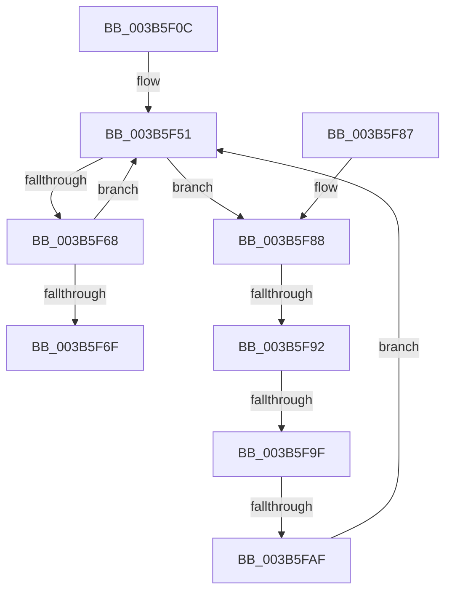

# MiFreeLargeZeroPages

- RVA: `0x003B5F0C`–`0x003B5FC6` (길이 `186` bytes)
- VA: `0x00000001403B5F0C`
- 실행 섹션: `.text`
- PDB 이름 있음: `예`; PDB Function 태그: `예`
- unwind 정보 RVA: `0x0008C67C`
- 디코드: `59`개 명령, `186/186` bytes 표시
- 미해석 바이트: `0` (있으면 어셈블리에 `.byte`로 보존)

> 이 문서는 커널 이미지의 기계어와 PDB 기호를 분석해 생성했습니다. 4번과 5번은 함수 원형과 자료형을 바이너리 사용 방식에서 추정한 C 해석이며 원본 소스 복구 결과는 아닙니다.

## 1. Dependencies

- 직접 호출 지점: **1**; 고유 호출 대상: **1**
- 직접 호출자로 확인된 함수: **9**
- RIP 상대 이미지 참조: **0**

### Outgoing calls
- `0x003B5FB2` → [MiReleaseFreshPage](../33/MiReleaseFreshPage_function_00334AE0.md) (function, `0x00334AE0`)

### Direct callers
- [MiCommitExistingVad](../32/MiCommitExistingVad_function_0032A860.md) at `0x0032B384`
- [MiCleanupPageTablePages](MiCleanupPageTablePages_function_003B5EB8.md) at `0x003B5ECB`
- [MiAllocateFastLargePagesForMdl](MiAllocateFastLargePagesForMdl_function_003B701C.md) at `0x003B71A0`
- [MiCreateLargePfnList](../3D/MiCreateLargePfnList_function_003D2DA8.md) at `0x003D3071`
- [MiPfnRangeIsZero](../67/MiPfnRangeIsZero_function_006735C0.md) at `0x006738FF`
- [MiAllocateLargeProcessPagesFromCache](../69/MiAllocateLargeProcessPagesFromCache_function_0069818C.md) at `0x0069878B`
- [MiFreeCacheSlice](../69/MiFreeCacheSlice_function_00698EB8.md) at `0x00698F0D`
- [MiAllocateFastAwePages](../../page/80/MiAllocateFastAwePages_function_0080969C.md) at `0x008097E6`
- [MiCreatePagingFileMap](../../page/98/MiCreatePagingFileMap_function_009852F8.md) at `0x009858BD`

### Static image references
- 디코드된 RIP-relative 메모리 참조가 없습니다.

## 2. Other-region calls and transfers

- 다른 실행 섹션으로 향하는 call: **0**
- call이 아닌 외부 분기/꼬리 이동: **3**
  - `0x003B5F8C` → [sub_006E7436 + 0xFE](../6E/Unknown_function_006E7436.md) (`tail-transfer`)
  - `0x003B5F99` → [sub_006E7436 + 0xFE](../6E/Unknown_function_006E7436.md) (`tail-transfer`)
  - `0x003B5FA9` → [sub_006E7436](../6E/Unknown_function_006E7436.md) (`tail-transfer`)

## 3. Assembly (complete function range)

```asm
003B5F0C  48 89 5C 24 20                  mov qword ptr [rsp + 0x20], rbx
003B5F11  48 89 54 24 10                  mov qword ptr [rsp + 0x10], rdx
003B5F16  48 89 4C 24 08                  mov qword ptr [rsp + 8], rcx
003B5F1B  55                              push rbp
003B5F1C  56                              push rsi
003B5F1D  57                              push rdi
003B5F1E  41 54                           push r12
003B5F20  41 55                           push r13
003B5F22  41 56                           push r14
003B5F24  41 57                           push r15
003B5F26  48 83 EC 20                     sub rsp, 0x20
003B5F2A  4C 8B CA                        mov r9, rdx
003B5F2D  4C 8B D1                        mov r10, rcx
003B5F30  44 0F 20 C0                     mov rax, cr8
003B5F34  BE 02 00 00 00                  mov esi, 2
003B5F39  40 3A C6                        cmp al, sil
003B5F3C  44 8D 6E 04                     lea r13d, [rsi + 4]
003B5F40  44 0F 45 EE                     cmovne r13d, esi
003B5F44  41 F7 D8                        neg r8d
003B5F47  45 1B FF                        sbb r15d, r15d
003B5F4A  33 FF                           xor edi, edi
003B5F4C  41 F7 DF                        neg r15d
003B5F4F  33 ED                           xor ebp, ebp
003B5F51  48 8D 04 6D 00 00 00 00         lea rax, [rbp*2]
003B5F59  48 03 C5                        add rax, rbp
003B5F5C  49 8D 0C C1                     lea rcx, [r9 + rax*8]
003B5F60  48 8B 19                        mov rbx, qword ptr [rcx]
003B5F63  48 3B D9                        cmp rbx, rcx
003B5F66  75 20                           jne 0x1403b5f88
003B5F68  FF C5                           inc ebp
003B5F6A  83 FD 04                        cmp ebp, 4
003B5F6D  72 E2                           jb 0x1403b5f51
003B5F6F  48 8B 5C 24 78                  mov rbx, qword ptr [rsp + 0x78]
003B5F74  48 8B C7                        mov rax, rdi
003B5F77  48 83 C4 20                     add rsp, 0x20
003B5F7B  41 5F                           pop r15
003B5F7D  41 5E                           pop r14
003B5F7F  41 5D                           pop r13
003B5F81  41 5C                           pop r12
003B5F83  5F                              pop rdi
003B5F84  5E                              pop rsi
003B5F85  5D                              pop rbp
003B5F86  C3                              ret
003B5F87  CC                              int3
003B5F88  48 39 4B 08                     cmp qword ptr [rbx + 8], rcx
003B5F8C  0F 85 A2 15 33 00               jne 0x1406e7534
003B5F92  48 8B 03                        mov rax, qword ptr [rbx]
003B5F95  48 39 58 08                     cmp qword ptr [rax + 8], rbx
003B5F99  0F 85 95 15 33 00               jne 0x1406e7534
003B5F9F  48 89 01                        mov qword ptr [rcx], rax
003B5FA2  48 89 48 08                     mov qword ptr [rax + 8], rcx
003B5FA6  83 FD 03                        cmp ebp, 3
003B5FA9  0F 85 87 14 33 00               jne 0x1406e7436
003B5FAF  48 8B CB                        mov rcx, rbx
003B5FB2  E8 29 EB F7 FF                  call 0x140334ae0
003B5FB7  4C 8B 4C 24 68                  mov r9, qword ptr [rsp + 0x68]
003B5FBC  48 FF C7                        inc rdi
003B5FBF  4C 8B 54 24 60                  mov r10, qword ptr [rsp + 0x60]
003B5FC4  EB 8B                           jmp 0x1403b5f51
```

## 4. C-style interpretation (structured pseudocode)

```c
__int64 __fastcall MiFreeLargeZeroPages(__int64 a1, __int64 a2, int a3)
{
    __int64 result;
    __int64 v_r13;
    __int64 v_r15;
    __int64 v_rbp;
    __int64 v_rdi;
    __int64 v_rsp;
    unsigned __int64 v_stack_p10;
    unsigned __int64 v_stack_p20;
    unsigned __int64 v_stack_p60;
    unsigned __int64 v_stack_p68;
    unsigned __int64 v_stack_p8;

    v_stack_p20 = v_rbx;
    v_stack_p10 = a2;
    v_stack_p8 = a1;
    v_rsp = (v_rsp) - (32);
    v_r13 = 2 + 4;
    if (((unsigned __int8)(v_cr8)) != 2) { v_r13 = 2; }
    a3 = (unsigned int)(-(a3));
    v_rdi = 0;
    v_r15 = (unsigned int)(-(v_r15));
    v_rbp = 0;
loc_003B5F51:
    result = (v_rbp * 2) + (0);
    if ((*(unsigned __int64 *)(a2 + result * 8)) != (a2 + result * 8)) goto loc_003B5F88;
    v_rbp = (unsigned int)((v_rbp) + 1);
    if (((unsigned int)(v_rbp)) < 4) goto loc_003B5F51;
    v_rsp = (v_rsp) + (32);
    return 0;
loc_003B5F88:
    *(unsigned __int64 *)(a2 + result * 8) = *(unsigned __int64 *)(v_stack_p20);
    *(unsigned __int64 *)(*(unsigned __int64 *)(v_stack_p20) + 8) = a2 + result * 8;
    result = MiReleaseFreshPage(v_stack_p20, a2, a3, a2);
    v_rdi = (v_rdi) + 1;
    goto loc_003B5F51;
}
```

## 5. (Beta) C Style

```c
int64_t MiFreeLargeZeroPages(int64_t Arg1, int64_t Arg2, int32_t Arg3)
{
    int64_t result;
    int64_t local_r13;
    int64_t local_r15;
    int64_t local_rbp;
    int64_t local_rdi;
    int64_t local_rsp;
    uint64_t v_stack_p10;
    uint64_t v_stack_p20;
    uint64_t v_stack_p60;
    uint64_t v_stack_p68;
    uint64_t v_stack_p8;

    v_stack_p20 = local_rbx;
    v_stack_p10 = Arg2;
    v_stack_p8 = Arg1;
    local_rsp = (local_rsp) - (32);
    local_r13 = 2 + 4;
    if (((uint8_t)(v_cr8)) != 2) { local_r13 = 2; }
    Arg3 = (uint32_t)(-(Arg3));
    local_rdi = 0;
    local_r15 = (uint32_t)(-(local_r15));
    local_rbp = 0;
loc_003B5F51:
    result = (local_rbp * 2) + (0);
    if ((*(uint64_t *)(Arg2 + result * 8)) != (Arg2 + result * 8)) goto loc_003B5F88;
    local_rbp = (uint32_t)((local_rbp) + 1);
    if (((uint32_t)(local_rbp)) < 4) goto loc_003B5F51;
    local_rsp = (local_rsp) + (32);
    return 0;
loc_003B5F88:
    *(uint64_t *)(Arg2 + result * 8) = *(uint64_t *)(v_stack_p20);
    *(uint64_t *)(*(uint64_t *)(v_stack_p20) + 0x8) = Arg2 + result * 8;
    result = MiReleaseFreshPage(v_stack_p20, Arg2, Arg3, Arg2);
    local_rdi = (local_rdi) + 1;
    goto loc_003B5F51;
}
```

## 6. Execution-region graph

[열기: 2D/3D 그래프와 함수 탐색 컨트롤 패널](../../../control-panel.html?section=text&rva=0x003B5F0C&view=graph)

- 2D 그래프는 위에서 아래로 흐르고, 3D 그래프는 빈 공간을 드래그해 회전합니다. Shift+드래그는 이동, 휠은 확대·축소, 함수 노드 선택은 대상 보고서 이동입니다.

### Static fallback


