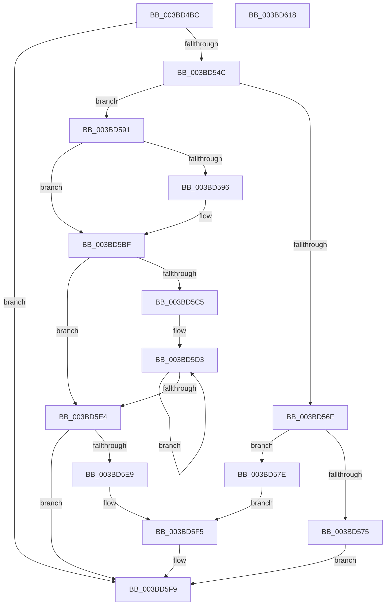

# MiFreeListPageContentsChanged

- RVA: `0x003BD4BC`–`0x003BD619` (길이 `349` bytes)
- VA: `0x00000001403BD4BC`
- 실행 섹션: `.text`
- PDB 이름 있음: `예`; PDB Function 태그: `아니요`
- unwind 정보 RVA: `0x0008CED4`
- 디코드: `95`개 명령, `349/349` bytes 표시
- 미해석 바이트: `0` (있으면 어셈블리에 `.byte`로 보존)

> 이 문서는 커널 이미지의 기계어와 PDB 기호를 분석해 생성했습니다. 4번과 5번은 함수 원형과 자료형을 바이너리 사용 방식에서 추정한 C 해석이며 원본 소스 복구 결과는 아닙니다.

## 1. Dependencies

- 직접 호출 지점: **5**; 고유 호출 대상: **5**
- 직접 호출자로 확인된 함수: **1**
- RIP 상대 이미지 참조: **3**

### Outgoing calls
- `0x003BD4F6` → [MI_PAGE_TO_FULL_COLOR](../33/MI_PAGE_TO_FULL_COLOR_function_00337820.md) (function, `0x00337820`)
- `0x003BD500` → [MiGetPfnPageSizeIndex](../31/MiGetPfnPageSizeIndex_function_0031C710.md) (function, `0x0031C710`)
- `0x003BD527` → [MiGetColorHeadBase](MiGetColorHeadBase_function_003BB8B0.md) (function, `0x003BB8B0`)
- `0x003BD53A` → [ExAcquireSpinLockExclusiveAtDpcLevel](../24/ExAcquireSpinLockExclusiveAtDpcLevel_function_00248E80.md) (function, `0x00248E80`)
- `0x003BD5FD` → [ExReleaseSpinLockExclusiveFromDpcLevel](../24/ExReleaseSpinLockExclusiveFromDpcLevel_function_002497E0.md) (function, `0x002497E0`)

### Direct callers
- [MiPageFreeToZero](../33/MiPageFreeToZero_function_00337A30.md) at `0x00337C1F`

### Static image references
- `0x003BD50B` → RVA `0x00011C60` (`.rdata`; read)
- `0x003BD53F` → RVA `0x00E3014C` (`.data`; read)
- `0x003BD54C` → RVA `0x00E301A8` (`.data`; read)

## 2. Other-region calls and transfers

- 다른 실행 섹션으로 향하는 call: **0**
- 별도 외부 분기/꼬리 이동을 확인하지 못했습니다.

## 3. Assembly (complete function range)

```asm
003BD4BC  48 89 5C 24 08                  mov qword ptr [rsp + 8], rbx
003BD4C1  48 89 74 24 18                  mov qword ptr [rsp + 0x18], rsi
003BD4C6  48 89 7C 24 20                  mov qword ptr [rsp + 0x20], rdi
003BD4CB  41 56                           push r14
003BD4CD  48 83 EC 20                     sub rsp, 0x20
003BD4D1  48 8D 3C 52                     lea rdi, [rdx + rdx*2]
003BD4D5  4C 8B F2                        mov r14, rdx
003BD4D8  48 C1 E7 04                     shl rdi, 4
003BD4DC  48 8B F1                        mov rsi, rcx
003BD4DF  48 B8 00 00 00 00 00 DE FF FF   movabs rax, 0xffffde0000000000
003BD4E9  48 03 F8                        add rdi, rax
003BD4EC  48 8B CA                        mov rcx, rdx
003BD4EF  8B 47 20                        mov eax, dword ptr [rdi + 0x20]
003BD4F2  89 44 24 38                     mov dword ptr [rsp + 0x38], eax
003BD4F6  E8 25 A3 F7 FF                  call 0x140337820
003BD4FB  48 8B CF                        mov rcx, rdi
003BD4FE  8B D8                           mov ebx, eax
003BD500  E8 0B F2 F5 FF                  call 0x14031c710
003BD505  44 0F B6 4C 24 3A               movzx r9d, byte ptr [rsp + 0x3a]
003BD50B  48 8D 3D 4E 47 C5 FF            lea rdi, [rip - 0x3ab8b2]
003BD512  8B C8                           mov ecx, eax
003BD514  41 B8 01 00 00 00               mov r8d, 1
003BD51A  41 C1 E9 06                     shr r9d, 6
003BD51E  8B D3                           mov edx, ebx
003BD520  48 8B 3C CF                     mov rdi, qword ptr [rdi + rcx*8]
003BD524  48 8B CE                        mov rcx, rsi
003BD527  E8 84 E3 FF FF                  call 0x1403bb8b0
003BD52C  0F B6 CB                        movzx ecx, bl
003BD52F  48 6B D9 58                     imul rbx, rcx, 0x58
003BD533  48 03 D8                        add rbx, rax
003BD536  48 8D 4B 20                     lea rcx, [rbx + 0x20]
003BD53A  E8 41 B9 E8 FF                  call 0x140248e80
003BD53F  83 3D 06 2C A7 00 01            cmp dword ptr [rip + 0xa72c06], 1
003BD546  0F 85 AD 00 00 00               jne 0x1403bd5f9
003BD54C  48 8B 05 55 2C A7 00            mov rax, qword ptr [rip + 0xa72c55]
003BD553  4D 8B CE                        mov r9, r14
003BD556  41 83 E1 1F                     and r9d, 0x1f
003BD55A  49 8B CE                        mov rcx, r14
003BD55D  48 C1 E9 05                     shr rcx, 5
003BD561  4C 8D 04 88                     lea r8, [rax + rcx*4]
003BD565  49 8D 04 39                     lea rax, [r9 + rdi]
003BD569  48 83 F8 20                     cmp rax, 0x20
003BD56D  77 22                           ja 0x1403bd591
003BD56F  48 83 FF 20                     cmp rdi, 0x20
003BD573  75 09                           jne 0x1403bd57e
003BD575  41 C7 00 FF FF FF FF            mov dword ptr [r8], 0xffffffff
003BD57C  EB 7B                           jmp 0x1403bd5f9
003BD57E  48 8B CF                        mov rcx, rdi
003BD581  B8 01 00 00 00                  mov eax, 1
003BD586  D3 E0                           shl eax, cl
003BD588  49 8B C9                        mov rcx, r9
003BD58B  FF C8                           dec eax
003BD58D  D3 E0                           shl eax, cl
003BD58F  EB 64                           jmp 0x1403bd5f5
003BD591  4D 85 C9                        test r9, r9
003BD594  74 29                           je 0x1403bd5bf
003BD596  41 83 E6 1F                     and r14d, 0x1f
003BD59A  BA 20 00 00 00                  mov edx, 0x20
003BD59F  41 2B D6                        sub edx, r14d
003BD5A2  B8 01 00 00 00                  mov eax, 1
003BD5A7  8B CA                           mov ecx, edx
003BD5A9  D3 E0                           shl eax, cl
003BD5AB  49 8B C9                        mov rcx, r9
003BD5AE  FF C8                           dec eax
003BD5B0  D3 E0                           shl eax, cl
003BD5B2  F0 41 09 00                     lock or dword ptr [r8], eax
003BD5B6  8B C2                           mov eax, edx
003BD5B8  48 2B F8                        sub rdi, rax
003BD5BB  49 83 C0 04                     add r8, 4
003BD5BF  48 83 FF 20                     cmp rdi, 0x20
003BD5C3  72 1F                           jb 0x1403bd5e4
003BD5C5  48 8B CF                        mov rcx, rdi
003BD5C8  48 C1 E9 05                     shr rcx, 5
003BD5CC  48 6B C1 E0                     imul rax, rcx, -0x20
003BD5D0  48 03 F8                        add rdi, rax
003BD5D3  41 C7 00 FF FF FF FF            mov dword ptr [r8], 0xffffffff
003BD5DA  49 83 C0 04                     add r8, 4
003BD5DE  48 83 E9 01                     sub rcx, 1
003BD5E2  75 EF                           jne 0x1403bd5d3
003BD5E4  48 85 FF                        test rdi, rdi
003BD5E7  74 10                           je 0x1403bd5f9
003BD5E9  48 8B CF                        mov rcx, rdi
003BD5EC  B8 01 00 00 00                  mov eax, 1
003BD5F1  D3 E0                           shl eax, cl
003BD5F3  FF C8                           dec eax
003BD5F5  F0 41 09 00                     lock or dword ptr [r8], eax
003BD5F9  48 8D 4B 20                     lea rcx, [rbx + 0x20]
003BD5FD  E8 DE C1 E8 FF                  call 0x1402497e0
003BD602  48 8B 5C 24 30                  mov rbx, qword ptr [rsp + 0x30]
003BD607  48 8B 74 24 40                  mov rsi, qword ptr [rsp + 0x40]
003BD60C  48 8B 7C 24 48                  mov rdi, qword ptr [rsp + 0x48]
003BD611  48 83 C4 20                     add rsp, 0x20
003BD615  41 5E                           pop r14
003BD617  C3                              ret
003BD618  CC                              int3
```

## 4. C-style interpretation (structured pseudocode)

```c
__int64 __fastcall MiFreeListPageContentsChanged(__int64 a1, __int64 a2)
{
    __int64 result;
    __int64 v_r14;
    __int64 v_rbx;
    __int64 v_rdi;
    __int64 v_rsp;
    unsigned int v_stack_p10;
    unsigned __int8 v_stack_p12;
    unsigned __int64 v_stack_p18;
    unsigned __int64 v_stack_p20;
    unsigned __int64 v_stack_p8;

    v_stack_p8 = v_rbx;
    v_stack_p18 = v_rsi;
    v_stack_p20 = v_rdi;
    v_rsp = (v_rsp) - (32);
    v_rdi = (a2 + a2 * 2) << (4);
    v_rdi = (v_rdi) + (result);
    v_stack_p10 = (unsigned int)((unsigned int)(*(unsigned int *)(v_rdi + 32)));
    result = MI_PAGE_TO_FULL_COLOR(a2, a2, a3, a4);
    result = MiGetPfnPageSizeIndex(v_rdi, a2, a3, a4);
    a4 = (unsigned int)((v_stack_p12) >> (6));
    result = MiGetColorHeadBase(a1, (unsigned int)((unsigned int)((unsigned int)((unsigned int)(result)))), 1, a4);
    v_rbx = ((unsigned int)((unsigned int)(result))) * ((unsigned __int8)((unsigned int)((unsigned int)(result))));
    v_rbx = (v_rbx) + (result);
    result = ExAcquireSpinLockExclusiveAtDpcLevel(v_rbx + 32, (unsigned int)((unsigned int)((unsigned int)((unsigned int)(result)))), 1, a4);
    if ((*(unsigned int *)(v_rip + 10955782)) != 1) goto loc_003BD5F9;
    a4 = (unsigned int)((a2) & (31));
    a1 = (a2) >> (5);
    if ((a4 + *(unsigned __int64 *)(v_rip - 3848370 + (unsigned int)((unsigned int)(result)) * 8) * 1) > 32) goto loc_003BD591;
    if ((*(unsigned __int64 *)(v_rip - 3848370 + (unsigned int)((unsigned int)(result)) * 8)) != 32) goto loc_003BD57E;
    *(unsigned int *)(*(unsigned __int64 *)(v_rip + 10955861) + a1 * 4) = 0xFFFFFFFFULL;
    goto loc_003BD5F9;
loc_003BD57E:
    result = (unsigned int)((1) << ((unsigned __int8)(*(unsigned __int64 *)(v_rip - 3848370 + (unsigned int)((unsigned int)(result)) * 8))));
    result = (unsigned int)((result) - 1);
    result = (unsigned int)((result) << ((unsigned __int8)(a4)));
    goto loc_003BD5F5;
loc_003BD591:
    v_rdi = *(unsigned __int64 *)(v_rip - 3848370 + (unsigned int)((unsigned int)(result)) * 8);
    v_r14 = a2;
    if (a4 != 0) {
        v_r14 = (unsigned int)((a2) & (31));
        a2 = 32;
        a2 = (unsigned int)((a2) - ((unsigned int)(v_r14)));
        result = 1;
        a1 = (unsigned int)(a2);
        result = (unsigned int)((result) << ((unsigned __int8)(a1)));
        a1 = a4;
        result = (unsigned int)((result) - 1);
        result = (unsigned int)((result) << ((unsigned __int8)(a1)));
        result = (unsigned int)(a2);
        v_rdi = (*(unsigned __int64 *)(v_rip - 3848370 + (unsigned int)((unsigned int)(result)) * 8)) - (result);
        a3 = (*(unsigned __int64 *)(v_rip + 10955861) + a1 * 4) + (4);
    }
    if (v_rdi < 32) goto loc_003BD5E4;
    a1 = (v_rdi) >> (5);
    result = (result) * (a1);
    v_rdi = (v_rdi) + (result);
loc_003BD5D3:
    *(unsigned int *)(a3) = 0xFFFFFFFFULL;
    a3 = (a3) + (4);
    a1 = (a1) - (1);
    if (condition_is_not_equal) goto loc_003BD5D3;
loc_003BD5E4:
    if (v_rdi == 0) goto loc_003BD5F9;
    result = (unsigned int)((1) << ((unsigned __int8)(v_rdi)));
    result = (unsigned int)((result) - 1);
loc_003BD5F5:
loc_003BD5F9:
    result = ExReleaseSpinLockExclusiveFromDpcLevel(v_rbx + 32, a2, a3, a4);
    v_rsp = (v_rsp) + (32);
    return result;
}
```

## 5. (Beta) C Style

```c
int64_t MiFreeListPageContentsChanged(int64_t Arg1, void *Arg2)
{
    uint8_t *arg2 = (uint8_t *)Arg2;

    int64_t result;
    int64_t local_r14;
    int64_t local_rbx;
    int64_t local_rdi;
    int64_t local_rsp;
    uint32_t v_stack_p10;
    uint8_t v_stack_p12;
    uint64_t v_stack_p18;
    uint64_t v_stack_p20;
    uint64_t v_stack_p8;

    v_stack_p8 = local_rbx;
    v_stack_p18 = local_rsi;
    v_stack_p20 = local_rdi;
    local_rsp = (local_rsp) - (32);
    local_rdi = (Arg2 + Arg2 * 2) << (4);
    local_rdi = (local_rdi) + (result);
    v_stack_p10 = (uint32_t)((uint32_t)(*(uint32_t *)(local_rdi + 0x20)));
    result = MI_PAGE_TO_FULL_COLOR(Arg2, Arg2, a3, a4);
    result = MiGetPfnPageSizeIndex(local_rdi, Arg2, a3, a4);
    a4 = (uint32_t)((v_stack_p12) >> (6));
    result = MiGetColorHeadBase(Arg1, (uint32_t)((uint32_t)((uint32_t)((uint32_t)(result)))), 1, a4);
    local_rbx = ((uint32_t)((uint32_t)(result))) * ((uint8_t)((uint32_t)((uint32_t)(result))));
    local_rbx = (local_rbx) + (result);
    result = ExAcquireSpinLockExclusiveAtDpcLevel(local_rbx + 32, (uint32_t)((uint32_t)((uint32_t)((uint32_t)(result)))), 1, a4);
    if ((*(uint32_t *)(v_rip + 0xA72C06)) != 1) goto loc_003BD5F9;
    a4 = (uint32_t)((Arg2) & (31));
    Arg1 = (Arg2) >> (5);
    if ((a4 + *(uint64_t *)(v_rip - 0x3AB8B2 + (uint32_t)((uint32_t)(result)) * 8) * 1) > 32) goto loc_003BD591;
    if ((*(uint64_t *)(v_rip - 0x3AB8B2 + (uint32_t)((uint32_t)(result)) * 8)) != 32) goto loc_003BD57E;
    *(uint32_t *)(*(uint64_t *)(v_rip + 0xA72C55) + Arg1 * 4) = 0xFFFFFFFFULL;
    goto loc_003BD5F9;
loc_003BD57E:
    result = (uint32_t)((1) << ((uint8_t)(*(uint64_t *)(v_rip - 0x3AB8B2 + (uint32_t)((uint32_t)(result)) * 8))));
    result = (uint32_t)((result) - 1);
    result = (uint32_t)((result) << ((uint8_t)(a4)));
    goto loc_003BD5F5;
loc_003BD591:
    local_rdi = *(uint64_t *)(v_rip - 0x3AB8B2 + (uint32_t)((uint32_t)(result)) * 8);
    local_r14 = Arg2;
    if (a4 != 0) {
        local_r14 = (uint32_t)((Arg2) & (31));
        Arg2 = 32;
        Arg2 = (uint32_t)((Arg2) - ((uint32_t)(local_r14)));
        result = 1;
        Arg1 = (uint32_t)(Arg2);
        result = (uint32_t)((result) << ((uint8_t)(Arg1)));
        Arg1 = a4;
        result = (uint32_t)((result) - 1);
        result = (uint32_t)((result) << ((uint8_t)(Arg1)));
        result = (uint32_t)(Arg2);
        local_rdi = (*(uint64_t *)(v_rip - 0x3AB8B2 + (uint32_t)((uint32_t)(result)) * 8)) - (result);
        a3 = (*(uint64_t *)(v_rip + 0xA72C55) + Arg1 * 4) + (4);
    }
    if (local_rdi < 32) goto loc_003BD5E4;
    Arg1 = (local_rdi) >> (5);
    result = (result) * (Arg1);
    local_rdi = (local_rdi) + (result);
loc_003BD5D3:
    *(uint32_t *)(a3) = 0xFFFFFFFFULL;
    a3 = (a3) + (4);
    Arg1 = (Arg1) - (1);
    if (condition_is_not_equal) goto loc_003BD5D3;
loc_003BD5E4:
    if (local_rdi == 0) goto loc_003BD5F9;
    result = (uint32_t)((1) << ((uint8_t)(local_rdi)));
    result = (uint32_t)((result) - 1);
loc_003BD5F5:
loc_003BD5F9:
    result = ExReleaseSpinLockExclusiveFromDpcLevel(local_rbx + 32, Arg2, a3, a4);
    local_rsp = (local_rsp) + (32);
    return result;
}
```

### 관측된 메모리 오프셋

구조체 형식이 확인되지 않은 접근은 인자 기준의 오프셋으로만 기록했습니다.

| 기준 인자 | 오프셋 표현 | 폭 (bit) | 접근 |
|---|---:|---:|---|
| `Arg2` | `+ 0x0 + rdi*1` | `64` | `R` |
| `Arg2` | `+ 0x0 + rdx*2` | `64` | `R` |

## 6. Execution-region graph

[열기: 2D/3D 그래프와 함수 탐색 컨트롤 패널](../../../control-panel.html?section=text&rva=0x003BD4BC&view=graph)

- 2D 그래프는 위에서 아래로 흐르고, 3D 그래프는 빈 공간을 드래그해 회전합니다. Shift+드래그는 이동, 휠은 확대·축소, 함수 노드 선택은 대상 보고서 이동입니다.

### Static fallback


