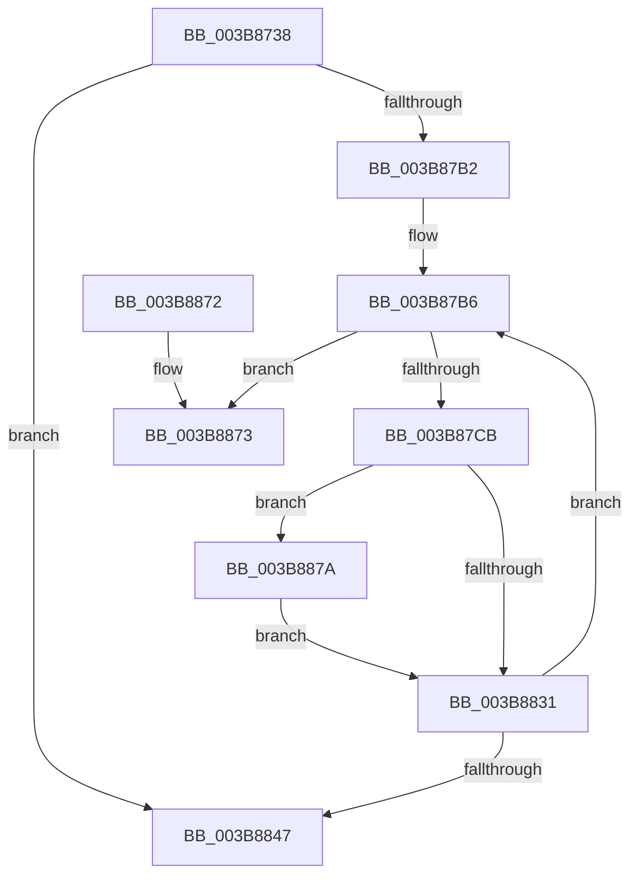

# MiGetChannelInformation

- RVA: `0x003B8738`–`0x003B8881` (길이 `329` bytes)
- VA: `0x00000001403B8738`
- 실행 섹션: `.text`
- PDB 이름 있음: `예`; PDB Function 태그: `예`
- unwind 정보 RVA: `0x0008C930`
- 디코드: `86`개 명령, `329/329` bytes 표시
- 미해석 바이트: `0` (있으면 어셈블리에 `.byte`로 보존)

> 이 문서는 커널 이미지의 기계어와 PDB 기호를 분석해 생성했습니다. 4번과 5번은 함수 원형과 자료형을 바이너리 사용 방식에서 추정한 C 해석이며 원본 소스 복구 결과는 아닙니다.

## 1. Dependencies

- 직접 호출 지점: **5**; 고유 호출 대상: **5**
- 직접 호출자로 확인된 함수: **2**
- RIP 상대 이미지 참조: **1**

### Outgoing calls
- `0x003B878D` → [MiLockDynamicMemoryShared](MiLockDynamicMemoryShared_function_003B8AA8.md) (function, `0x003B8AA8`)
- `0x003B879C` → [ExAcquireSpinLockShared](../24/ExAcquireSpinLockShared_function_0024DCE0.md) (function, `0x0024DCE0`)
- `0x003B8805` → [MiGetNodeChannelPageCounts](MiGetNodeChannelPageCounts_function_003B8888.md) (function, `0x003B8888`)
- `0x003B884D` → [MiReleaseSpinLockShared](../34/MiReleaseSpinLockShared_function_00348BF0.md) (function, `0x00348BF0`)
- `0x003B8858` → [MiUnlockDynamicMemoryShared](MiUnlockDynamicMemoryShared_function_003B8A48.md) (function, `0x003B8A48`)

### Direct callers
- [MmManagePartitionMemoryInformation](../../page/90/MmManagePartitionMemoryInformation_function_0090343C.md) at `0x0090361C`
- [MmGetChannelInformation](../../page/A7/MmGetChannelInformation_function_00A71000.md) at `0x00A7104C`

### Static image references
- `0x003B876D` → RVA `0x00FC5002` (`ALMOSTRO`; read)

## 2. Other-region calls and transfers

- 다른 실행 섹션으로 향하는 call: **0**
- call이 아닌 외부 분기/꼬리 이동: **1**
  - `0x003B8875` → [sub_006E78C4](../6E/Unknown_function_006E78C4.md) (`tail-transfer`)

## 3. Assembly (complete function range)

```asm
003B8738  48 8B C4                        mov rax, rsp
003B873B  48 89 58 10                     mov qword ptr [rax + 0x10], rbx
003B873F  55                              push rbp
003B8740  56                              push rsi
003B8741  57                              push rdi
003B8742  41 54                           push r12
003B8744  41 55                           push r13
003B8746  41 56                           push r14
003B8748  41 57                           push r15
003B874A  48 83 EC 30                     sub rsp, 0x30
003B874E  65 4C 8B 3C 25 88 01 00 00      mov r15, qword ptr gs:[0x188]
003B8757  33 F6                           xor esi, esi
003B8759  8B DA                           mov ebx, edx
003B875B  49 8B F8                        mov rdi, r8
003B875E  48 89 70 08                     mov qword ptr [rax + 8], rsi
003B8762  4C 8B F1                        mov r14, rcx
003B8765  48 89 70 18                     mov qword ptr [rax + 0x18], rsi
003B8769  48 89 70 20                     mov qword ptr [rax + 0x20], rsi
003B876D  0F B6 05 8E C8 C0 00            movzx eax, byte ptr [rip + 0xc0c88e]
003B8774  48 69 EB 80 DF 00 00            imul rbp, rbx, 0xdf80
003B877B  48 8D 14 80                     lea rdx, [rax + rax*4]
003B877F  48 03 69 10                     add rbp, qword ptr [rcx + 0x10]
003B8783  48 C1 E2 03                     shl rdx, 3
003B8787  49 89 11                        mov qword ptr [r9], rdx
003B878A  49 8B D7                        mov rdx, r15
003B878D  E8 16 03 00 00                  call 0x1403b8aa8
003B8792  4C 8D A5 74 3B 00 00            lea r12, [rbp + 0x3b74]
003B8799  49 8B CC                        mov rcx, r12
003B879C  E8 3F 55 E9 FF                  call 0x14024dce0
003B87A1  8A 15 5B C8 C0 00               mov dl, byte ptr [rip + 0xc0c85b]
003B87A7  44 8A E8                        mov r13b, al
003B87AA  84 D2                           test dl, dl
003B87AC  0F 84 95 00 00 00               je 0x1403b8847
003B87B2  48 83 C7 04                     add rdi, 4
003B87B6  40 0F B6 CE                     movzx ecx, sil
003B87BA  89 4F FC                        mov dword ptr [rdi - 4], ecx
003B87BD  8B 85 50 3B 00 00               mov eax, dword ptr [rbp + 0x3b50]
003B87C3  A8 01                           test al, 1
003B87C5  0F 85 A8 00 00 00               jne 0x1403b8873
003B87CB  83 0F FF                        or dword ptr [rdi], 0xffffffff
003B87CE  40 0F B6 C6                     movzx eax, sil
003B87D2  4C 8D 4C 24 70                  lea r9, [rsp + 0x70]
003B87D7  44 8A C6                        mov r8b, sil
003B87DA  8B D3                           mov edx, ebx
003B87DC  48 8B 8C C5 70 3A 00 00         mov rcx, qword ptr [rbp + rax*8 + 0x3a70]
003B87E4  48 8D 84 24 88 00 00 00         lea rax, [rsp + 0x88]
003B87EC  48 89 44 24 28                  mov qword ptr [rsp + 0x28], rax
003B87F1  48 8D 84 24 80 00 00 00         lea rax, [rsp + 0x80]
003B87F9  48 89 4F 04                     mov qword ptr [rdi + 4], rcx
003B87FD  49 8B CE                        mov rcx, r14
003B8800  48 89 44 24 20                  mov qword ptr [rsp + 0x20], rax
003B8805  E8 7E 00 00 00                  call 0x1403b8888
003B880A  48 8B 44 24 70                  mov rax, qword ptr [rsp + 0x70]
003B880F  48 89 47 0C                     mov qword ptr [rdi + 0xc], rax
003B8813  48 8B 84 24 80 00 00 00         mov rax, qword ptr [rsp + 0x80]
003B881B  48 89 47 14                     mov qword ptr [rdi + 0x14], rax
003B881F  48 8B 84 24 88 00 00 00         mov rax, qword ptr [rsp + 0x88]
003B8827  48 89 47 1C                     mov qword ptr [rdi + 0x1c], rax
003B882B  48 83 F8 FF                     cmp rax, -1
003B882F  74 49                           je 0x1403b887a
003B8831  8A 15 CB C7 C0 00               mov dl, byte ptr [rip + 0xc0c7cb]
003B8837  40 FE C6                        inc sil
003B883A  48 83 C7 28                     add rdi, 0x28
003B883E  40 3A F2                        cmp sil, dl
003B8841  0F 82 6F FF FF FF               jb 0x1403b87b6
003B8847  41 8A D5                        mov dl, r13b
003B884A  49 8B CC                        mov rcx, r12
003B884D  E8 9E 03 F9 FF                  call 0x140348bf0
003B8852  49 8B D7                        mov rdx, r15
003B8855  49 8B CE                        mov rcx, r14
003B8858  E8 EB 01 00 00                  call 0x1403b8a48
003B885D  48 8B 5C 24 78                  mov rbx, qword ptr [rsp + 0x78]
003B8862  48 83 C4 30                     add rsp, 0x30
003B8866  41 5F                           pop r15
003B8868  41 5E                           pop r14
003B886A  41 5D                           pop r13
003B886C  41 5C                           pop r12
003B886E  5F                              pop rdi
003B886F  5E                              pop rsi
003B8870  5D                              pop rbp
003B8871  C3                              ret
003B8872  CC                              int3
003B8873  32 C9                           xor cl, cl
003B8875  E9 4A F0 32 00                  jmp 0x1406e78c4
003B887A  48 83 4F 1C FF                  or qword ptr [rdi + 0x1c], 0xffffffffffffffff
003B887F  EB B0                           jmp 0x1403b8831
```

## 4. C-style interpretation (structured pseudocode)

```c
__int64 __fastcall MiGetChannelInformation(__int64 a1, int a2, __int64 a3, __int64 a4)
{
    __int64 result;
    __int64 v_rbp;
    __int64 v_rdi;
    __int64 v_rsi;
    __int64 v_rsp;
    unsigned __int64 v_stack_m40;
    unsigned __int64 v_stack_m48;
    unsigned __int64 v_stack_p10;
    unsigned __int64 v_stack_p18;
    unsigned __int64 v_stack_p20;
    unsigned __int64 v_stack_p8;

    *(unsigned __int64 *)(v_rsp + 16) = v_rbx;
    v_rsp = (v_rsp) - (48);
    v_rsi = 0;
    *(unsigned __int64 *)(v_rsp + 8) = 0;
    *(unsigned __int64 *)(v_rsp + 24) = 0;
    *(unsigned __int64 *)(v_rsp + 32) = 0;
    v_rbp = (v_rbp) * ((unsigned int)(a2));
    v_rbp = (v_rbp) + (*(unsigned __int64 *)(a1 + 16));
    a2 = (*(unsigned __int8 *)(v_rip + 12634254) + *(unsigned __int8 *)(v_rip + 12634254) * 4) << (3);
    *(unsigned __int64 *)(a4) = a2;
    result = MiLockDynamicMemoryShared(a1, *(unsigned __int64 *)(gs_base + (0 + 392)), a3, a4);
    result = ExAcquireSpinLockShared(v_rbp + 15220, *(unsigned __int64 *)(gs_base + (0 + 392)), a3, a4);
    if ((unsigned __int8)(*(unsigned __int8 *)(v_rip + 12634203)) == 0) goto loc_003B8847;
    v_rdi = (a3) + (4);
loc_003B87B6:
    *(unsigned int *)(v_rdi - 4) = 0;
    if ((((unsigned __int8)((unsigned int)(*(unsigned int *)(v_rbp + 15184)))) & (1)) != 0) goto loc_003B8873;
    v_stack_m40 = v_stack_p20;
    *(unsigned __int64 *)(v_rdi + 4) = *(unsigned __int64 *)(v_rbp + 0 * 8 + 14960);
    v_stack_m48 = v_stack_p18;
    result = MiGetNodeChannelPageCounts(a1, (unsigned int)((unsigned int)((unsigned int)(a2))), 0, v_stack_p8);
    *(unsigned __int64 *)(v_rdi + 12) = v_stack_p8;
    *(unsigned __int64 *)(v_rdi + 20) = v_stack_p18;
    *(unsigned __int64 *)(v_rdi + 28) = v_stack_p20;
    if (v_stack_p20 == -1) goto loc_003B887A;
loc_003B8831:
    v_rsi = (unsigned __int8)((v_rsi) + 1);
    v_rdi = (v_rdi) + (40);
    if (((unsigned __int8)(v_rsi)) < ((unsigned __int8)(*(unsigned __int8 *)(v_rip + 12634059)))) goto loc_003B87B6;
loc_003B8847:
    result = MiReleaseSpinLockShared(v_rbp + 15220, (unsigned __int8)((unsigned __int8)(result)), 0, v_stack_p8);
    result = MiUnlockDynamicMemoryShared(a1, *(unsigned __int64 *)(gs_base + (0 + 392)), 0, v_stack_p8);
    v_rsp = (v_rsp) + (48);
    return result;
loc_003B8873:
    a1 = 0;
loc_003B887A:
    goto loc_003B8831;
}
```

## 5. (Beta) C Style

```c
int64_t MiGetChannelInformation(void *Arg1, int32_t Arg2, void *Arg3, void *Arg4)
{
    uint8_t *arg1 = (uint8_t *)Arg1;
    uint8_t *arg3 = (uint8_t *)Arg3;
    uint8_t *arg4 = (uint8_t *)Arg4;

    int64_t result;
    int64_t local_rbp;
    int64_t local_rdi;
    int64_t local_rsi;
    int64_t local_rsp;
    uint64_t v_stack_m40;
    uint64_t v_stack_m48;
    uint64_t v_stack_p10;
    uint64_t v_stack_p18;
    uint64_t v_stack_p20;
    uint64_t v_stack_p8;

    *(uint64_t *)(local_rsp + 0x10) = local_rbx;
    local_rsp = (local_rsp) - (48);
    local_rsi = 0;
    *(uint64_t *)(local_rsp + 0x8) = 0;
    *(uint64_t *)(local_rsp + 0x18) = 0;
    *(uint64_t *)(local_rsp + 0x20) = 0;
    local_rbp = (local_rbp) * ((uint32_t)(Arg2));
    local_rbp = (local_rbp) + (*(uint64_t *)(arg1 + 0x10));
    Arg2 = (*(uint8_t *)(v_rip + 0xC0C88E) + *(uint8_t *)(v_rip + 0xC0C88E) * 4) << (3);
    *(uint64_t *)(arg4) = Arg2;
    result = MiLockDynamicMemoryShared(Arg1, *(uint64_t *)(gs_base + (0 + 0x188)), Arg3, Arg4);
    result = ExAcquireSpinLockShared(local_rbp + 15220, *(uint64_t *)(gs_base + (0 + 0x188)), Arg3, Arg4);
    if ((uint8_t)(*(uint8_t *)(v_rip + 0xC0C85B)) == 0) goto loc_003B8847;
    local_rdi = (Arg3) + (4);
loc_003B87B6:
    *(uint32_t *)(local_rdi - 0x4) = 0;
    if ((((uint8_t)((uint32_t)(*(uint32_t *)(local_rbp + 0x3B50)))) & (1)) != 0) goto loc_003B8873;
    v_stack_m40 = v_stack_p20;
    *(uint64_t *)(local_rdi + 0x4) = *(uint64_t *)(local_rbp + 0x0 * 8 + 0x3A70);
    v_stack_m48 = v_stack_p18;
    result = MiGetNodeChannelPageCounts(Arg1, (uint32_t)((uint32_t)((uint32_t)(Arg2))), 0, v_stack_p8);
    *(uint64_t *)(local_rdi + 0xC) = v_stack_p8;
    *(uint64_t *)(local_rdi + 0x14) = v_stack_p18;
    *(uint64_t *)(local_rdi + 0x1C) = v_stack_p20;
    if (v_stack_p20 == -1) goto loc_003B887A;
loc_003B8831:
    local_rsi = (uint8_t)((local_rsi) + 1);
    local_rdi = (local_rdi) + (40);
    if (((uint8_t)(local_rsi)) < ((uint8_t)(*(uint8_t *)(v_rip + 0xC0C7CB)))) goto loc_003B87B6;
loc_003B8847:
    result = MiReleaseSpinLockShared(local_rbp + 15220, (uint8_t)((uint8_t)(result)), 0, v_stack_p8);
    result = MiUnlockDynamicMemoryShared(Arg1, *(uint64_t *)(gs_base + (0 + 0x188)), 0, v_stack_p8);
    local_rsp = (local_rsp) + (48);
    return result;
loc_003B8873:
    Arg1 = 0;
loc_003B887A:
    goto loc_003B8831;
}
```

### 관측된 메모리 오프셋

구조체 형식이 확인되지 않은 접근은 인자 기준의 오프셋으로만 기록했습니다.

| 기준 인자 | 오프셋 표현 | 폭 (bit) | 접근 |
|---|---:|---:|---|
| `Arg1` | `+ 0x10` | `64` | `R` |
| `Arg3` | `- 0x4` | `32` | `W` |
| `Arg3` | `+ 0x0` | `32` | `R/W` |
| `Arg3` | `+ 0x4` | `64` | `W` |
| `Arg3` | `+ 0xC` | `64` | `W` |
| `Arg3` | `+ 0x14` | `64` | `W` |
| `Arg3` | `+ 0x1C` | `64` | `R/W` |
| `Arg3` | `+ 0x1C` | `64` | `W` |
| `Arg4` | `+ 0x0` | `64` | `W` |

## 6. Execution-region graph

[열기: 2D/3D 그래프와 함수 탐색 컨트롤 패널](../../../control-panel.html?section=text&rva=0x003B8738&view=graph)

- 2D 그래프는 위에서 아래로 흐르고, 3D 그래프는 빈 공간을 드래그해 회전합니다. Shift+드래그는 이동, 휠은 확대·축소, 함수 노드 선택은 대상 보고서 이동입니다.

### Static fallback


