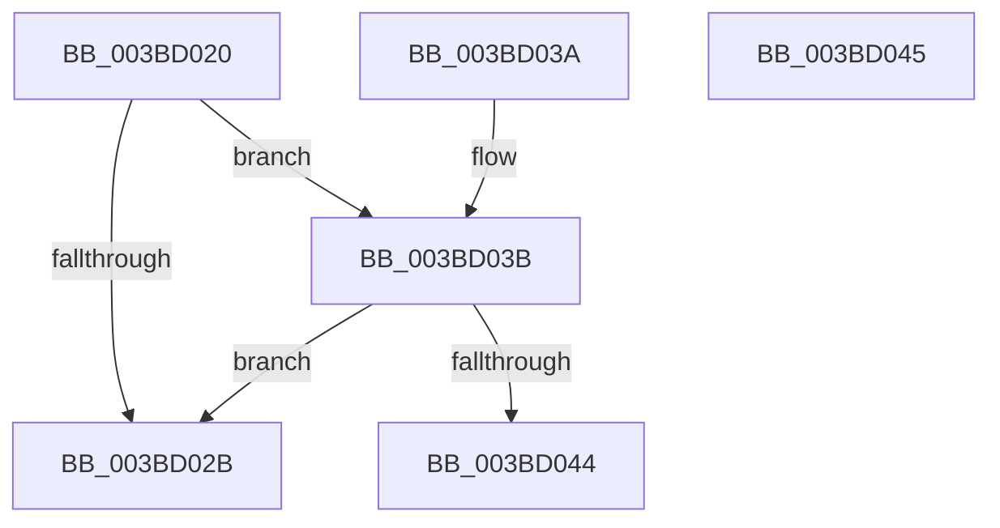

# MiGetCurrentSlabIdentity

- RVA: `0x003BD020`–`0x003BD046` (길이 `38` bytes)
- VA: `0x00000001403BD020`
- 실행 섹션: `.text`
- PDB 이름 있음: `예`; PDB Function 태그: `아니요`
- unwind 정보 RVA: `0x000DB714`
- 디코드: `11`개 명령, `38/38` bytes 표시
- 미해석 바이트: `0` (있으면 어셈블리에 `.byte`로 보존)

> 이 문서는 커널 이미지의 기계어와 PDB 기호를 분석해 생성했습니다. 4번과 5번은 함수 원형과 자료형을 바이너리 사용 방식에서 추정한 C 해석이며 원본 소스 복구 결과는 아닙니다.

## 1. Dependencies

- 직접 호출 지점: **0**; 고유 호출 대상: **0**
- 직접 호출자로 확인된 함수: **10**
- RIP 상대 이미지 참조: **0**

### Outgoing calls
- 직접 디코드된 call 명령이 없습니다.

### Direct callers
- [MiFreePageToSlabAllocator](../2A/MiFreePageToSlabAllocator_function_002A0A60.md) at `0x002A0C60`
- [sub_002A32C4](../2A/Unknown_function_002A32C4.md) at `0x002A32D1`
- [MiUserFault](../32/MiUserFault_function_00329840.md) at `0x00329919`
- [MiCopyOnWrite](../36/MiCopyOnWrite_function_00362A0C.md) at `0x00362CE4`
- [MiResolvePageFileFault](../36/MiResolvePageFileFault_function_0036D968.md) at `0x0036E4CB`
- [MiCreateSlabEntry](../37/MiCreateSlabEntry_function_00374DEC.md) at `0x00375053`
- [MiGetPageFromSlabAllocator](../37/MiGetPageFromSlabAllocator_function_00377294.md) at `0x00377663`
- [MiReplenishSlabAllocatorByIdentity](MiReplenishSlabAllocatorByIdentity_function_003BD8A8.md) at `0x003BD96D`
- [sub_006D7EC6](../6D/Unknown_function_006D7EC6.md) at `0x006D7F25`
- [sub_006DAF7E](../6D/Unknown_function_006DAF7E.md) at `0x006DAF87`

### Static image references
- 디코드된 RIP-relative 메모리 참조가 없습니다.

## 2. Other-region calls and transfers

- 다른 실행 섹션으로 향하는 call: **0**
- 별도 외부 분기/꼬리 이동을 확인하지 못했습니다.

## 3. Assembly (complete function range)

```asm
003BD020  0F B6 81 27 07 00 00            movzx eax, byte ptr [rcx + 0x727]
003BD027  3C FF                           cmp al, 0xff
003BD029  75 10                           jne 0x1403bd03b
003BD02B  48 8B 81 B8 00 00 00            mov rax, qword ptr [rcx + 0xb8]
003BD032  0F B6 80 EE 06 00 00            movzx eax, byte ptr [rax + 0x6ee]
003BD039  C3                              ret
003BD03A  CC                              int3
003BD03B  F6 81 AA 05 00 00 01            test byte ptr [rcx + 0x5aa], 1
003BD042  75 E7                           jne 0x1403bd02b
003BD044  C3                              ret
003BD045  CC                              int3
```

## 4. C-style interpretation (structured pseudocode)

```c
__int64 __fastcall MiGetCurrentSlabIdentity(__int64 a1)
{
    if (((unsigned __int8)(*(unsigned __int8 *)(a1 + 1831))) != 255) goto loc_003BD03B;
loc_003BD02B:
    return *(unsigned __int8 *)(*(unsigned __int64 *)(a1 + 184) + 1774);
loc_003BD03B:
    if (((*(unsigned __int8 *)(a1 + 1450)) & (1)) != 0) goto loc_003BD02B;
    return *(unsigned __int8 *)(*(unsigned __int64 *)(a1 + 184) + 1774);
}
```

## 5. (Beta) C Style

```c
int64_t MiGetCurrentSlabIdentity(void *Arg1)
{
    uint8_t *arg1 = (uint8_t *)Arg1;

    if (((uint8_t)(*(uint8_t *)(arg1 + 0x727))) != 255) goto loc_003BD03B;
loc_003BD02B:
    return *(uint8_t *)(*(uint64_t *)(arg1 + 0xB8) + 0x6EE);
loc_003BD03B:
    if (((*(uint8_t *)(arg1 + 0x5AA)) & (1)) != 0) goto loc_003BD02B;
    return *(uint8_t *)(*(uint64_t *)(arg1 + 0xB8) + 0x6EE);
}
```

### 관측된 메모리 오프셋

구조체 형식이 확인되지 않은 접근은 인자 기준의 오프셋으로만 기록했습니다.

| 기준 인자 | 오프셋 표현 | 폭 (bit) | 접근 |
|---|---:|---:|---|
| `Arg1` | `+ 0xB8` | `64` | `R` |
| `Arg1` | `+ 0x5AA` | `8` | `R` |
| `Arg1` | `+ 0x727` | `8` | `R` |

## 6. Execution-region graph

[열기: 2D/3D 그래프와 함수 탐색 컨트롤 패널](../../../control-panel.html?section=text&rva=0x003BD020&view=graph)

- 2D 그래프는 위에서 아래로 흐르고, 3D 그래프는 빈 공간을 드래그해 회전합니다. Shift+드래그는 이동, 휠은 확대·축소, 함수 노드 선택은 대상 보고서 이동입니다.

### Static fallback


